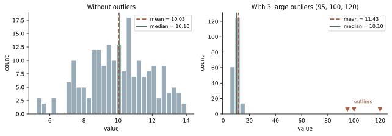
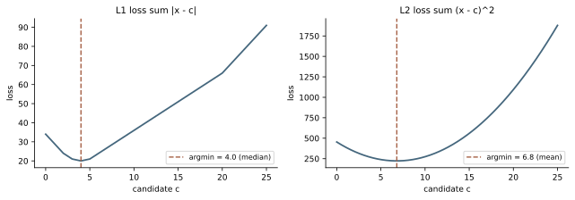
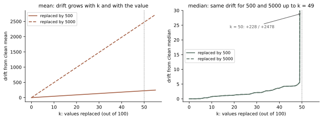
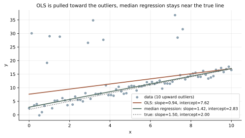

中央値（median）は、データを小さい順に並べた時に真ん中に来る値です。データ数 `n` が奇数なら `(n+1)/2` 番目の値、偶数なら `n/2` 番目と `n/2+1` 番目の平均を使います。[平均](../mean/)が値の重心を見るのに対し、中央値は順位の中心だけを見るので、外れ値に引きずられにくい代表値です。[四分位点](../quantile/)の Q2（50% 点）とも同じ値を指します。

```python
import statistics
import numpy as np

print(np.median([2, 3, 4, 5, 20]))  # 4.0（20 が 200 でも 4.0）
print(np.median([2, 3, 4, 5]))      # 3.5
print(statistics.median_low([2, 3, 4, 5]), statistics.median_high([2, 3, 4, 5]))  # 3 4
```

[`numpy.median`](https://numpy.org/doc/stable/reference/generated/numpy.median.html) や [`pandas.Series.median`](https://pandas.pydata.org/docs/reference/api/pandas.Series.median.html) は偶数個の時に真ん中 2 つの平均を返し、Python 標準の [`statistics`](https://docs.python.org/3/library/statistics.html#statistics.median_low) の `median_low` / `median_high` はどちらか一方を返します。

<br>

本記事では、次の疑問を順に扱います。

- 外れ値が混ざると、平均と中央値はそれぞれどれだけ動くか
- 外れ値に強い理由と、その限界（崩壊点）
- 回帰で中央値を予測すると何が変わるか

---

### 外れ値を足した時の動き

平均 10・標準偏差 2 の正規分布から 200 個の値を作り、95, 100, 120 の 3 個を足します。

```python
rng = np.random.default_rng(0)
base = rng.normal(loc=10.0, scale=2.0, size=200)
outlier = np.concatenate([base, [100.0, 120.0, 95.0]])
print(f"mean:   {base.mean():.2f} -> {outlier.mean():.2f}")
print(f"median: {np.median(base):.2f} -> {np.median(outlier):.2f}")
```

```text
mean:   10.03 -> 11.43
median: 10.10 -> 10.10
```



平均は 1.4 上がります。中央値は 203 個中 102 番目の値に変わるだけなので、外れ値が 95 でも 9500 でも結果は同じです。給与や取引金額のように右に長い裾を持つデータでは、典型的な値として中央値の方が実感に合います。

---

### L1 損失の最小点

中央値は「L1 損失（絶対誤差の和）`Σ|x - c|` を最小にする `c`」と言い換えられます。[平均](../mean/)が L2 損失（二乗誤差の和）`Σ(x - c)²` を最小にする `c` であることと対になる関係です。冒頭の `[2, 3, 4, 5, 20]` で `c` を動かすと、次の図になります。



L1 損失は `c = 4`、L2 損失は `c = 6.8` で最小です。`c` を少し右へ動かすと、L1 損失は `c` より左の点の数だけ増え、右の点の数だけ減ります。左右の点の数が釣り合う順位の真ん中で止まるので、20 がどれだけ遠くても関係ありません。L2 損失では 20 との差が二乗で効き、最小点が 20 の側へ引かれます。

`[2, 3, 4, 5]` のように偶数個だと、L1 損失は `c` が 3〜4 のどこでも 4 で、最小点が区間になります。確率の言葉では、中央値は `P(X ≤ m) ≥ 1/2` かつ `P(X ≥ m) ≥ 1/2` を満たす `m` です。連続分布なら累積分布関数 `F(m) = 0.5` の 1 点ですが、この例では 3〜4 の全てが条件を満たし、冒頭の `numpy` はその中点、`median_low` / `median_high` は両端を返していました。

---

### 崩壊点（breakdown point）

ロバスト統計では、外れ値への強さの限度を [Hampel（1971）](https://doi.org/10.1214/aoms/1177693054) が導入した崩壊点（breakdown point）で測ります。データの一部を任意の値に置き換えた時に、推定値をいくらでも遠くへ動かせるようになる最小の割合です。平均は 1 個の置き換えでいくらでも動くので `n` 個のデータで `1/n`（`n` が大きければ 0 に近い）、中央値は 50% です。

平均 50・標準偏差 5 の 100 個のうち `k` 個を極端な値 `v` に置き換えて確かめます。置き換える位置は `v = 500` と `5000` で共通です。

```python
rng = np.random.default_rng(1)
clean = rng.normal(50, 5, 100)
order = rng.permutation(len(clean))  # 置き換える位置の順番

for v in (500.0, 5000.0):
    for k in (10, 30, 49, 50):
        x = clean.copy()
        x[order[:k]] = v
        print(v, k, round(x.mean() - clean.mean(), 2),
              round(np.median(x) - np.median(clean), 2))
```

出力を表にまとめます（元の平均・中央値からのずれ）。

| `k` | 平均（500） | 中央値（500） | 平均（5000） | 中央値（5000） |
|---:|---:|---:|---:|---:|
| 10 | 45.22 | 0.75 | 495.22 | 0.75 |
| 30 | 135.30 | 2.13 | 1485.30 | 2.13 |
| 49 | 220.82 | 5.55 | 2425.82 | 5.55 |
| 50 | 225.29 | 227.91 | 2475.29 | 2477.91 |



平均のずれは `k ×（v − 置き換えた元の値）/ 100` なので、`v` を大きくすればいくらでも増えます。中央値は `k = 49` まで 500 と 5000 で同じ値です。100 個の中央値は 50 番目と 51 番目の平均で、置き換えが 49 個以下ならこの 2 つは元の値のどれかなので、ずれは元の最大値と中央値の差（10.44）を超えません。`k = 50` で 51 番目が `v` になり、中央値も跳ねます。

ただし、崩壊しないことと動かないことは別です。`k = 49` の中央値は元の標準偏差 5 と同じくらいの 5.55 ずれています。崩壊点が保証するのはずれに上限があることで、汚染が増えれば推定は偏ります。

---

### 中央値を予測する回帰

[線形回帰](/ml/ml/linear-regression/)にも同じ対比があります。[損失関数](/ml/ml/loss-functions/)に L2 を使う OLS（Ordinary Least Squares、最小二乗法）は条件付きの平均を予測し、`quantile=0.5` の[分位点回帰](https://scikit-learn.org/stable/modules/linear_model.html#quantile-regression)（quantile regression）は L1 損失（pinball loss の 0.5 倍）で条件付きの中央値を予測します。真の直線 `y = 1.5x + 2` に、上向きの外れ値を 10 個混ぜて比べます。

```python
from sklearn.linear_model import LinearRegression, QuantileRegressor

rng = np.random.default_rng(42)
x_data = np.linspace(0, 10, 80)
y_data = 1.5 * x_data + 2.0 + rng.normal(0, 1.5, 80)
idx = rng.choice(80, size=10, replace=False)
y_data[idx] += rng.uniform(15, 30, 10)  # 上向きの外れ値

X = x_data.reshape(-1, 1)
ols = LinearRegression().fit(X, y_data)
qr = QuantileRegressor(quantile=0.5, alpha=0.0).fit(X, y_data)
print(f"OLS: slope={ols.coef_[0]:.2f} intercept={ols.intercept_:.2f}")
print(f"QR : slope={qr.coef_[0]:.2f} intercept={qr.intercept_:.2f}")
```

```text
OLS: slope=0.94 intercept=7.62
QR : slope=1.42 intercept=2.83
```



外れ値 10 個のうち 7 個が `x < 4` に入ったため、OLS は左端を持ち上げ、切片 7.62、傾き 0.94 と真の 1.5 より寝ました。上向きの外れ値でも、傾きがどちらへずれるかは外れ値の `x` の位置で決まります。[`QuantileRegressor`](https://scikit-learn.org/stable/modules/generated/sklearn.linear_model.QuantileRegressor.html) は傾き 1.42、切片 2.83 で、真の直線の近くに残りました。

---

### 機械学習での使いどころ

- 欠損値の補完: [`SimpleImputer(strategy="median")`](https://scikit-learn.org/stable/modules/generated/sklearn.impute.SimpleImputer.html) は、平均補完より外れ値に引きずられにくい
- ロバストな[標準化](../../ml/standardization/): [`RobustScaler`](https://scikit-learn.org/stable/modules/generated/sklearn.preprocessing.RobustScaler.html) は中央値を引いて IQR（Interquartile Range、四分位範囲）で割る
- 指標の要約: レイテンシのような右に長い分布は、平均と並べて中央値（p50）を見る

---

### 注意点と適さないケース

- 順序を付けられるデータが前提です（数値・順序尺度）
- 分布の形（裾の重さ・多峰性）や総量は分かりません。形は [KDE](../kde/) やヒストグラム、総量は合計や平均で見ます
- 10 件程度以下では、真ん中の値がたまたまの 1 個に左右されます
- 並べ替えると `O(n log n)` ですが、`numpy.median` は `np.partition` で真ん中の位置だけを確定させ、平均的に `O(n)` です
- L1 損失 `|x - c|` は `x = c` で微分できないので、勾配法では劣勾配を使うか、[`HuberRegressor`](https://scikit-learn.org/stable/modules/generated/sklearn.linear_model.HuberRegressor.html) が使う Huber 損失のように、0 付近だけ二乗にした損失で代用します
