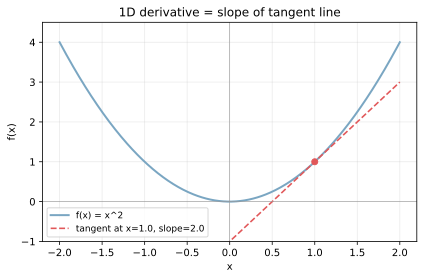
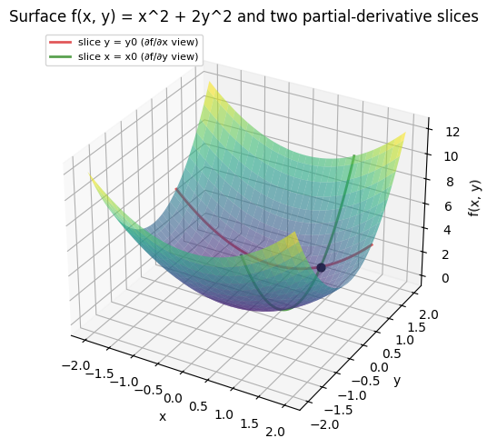
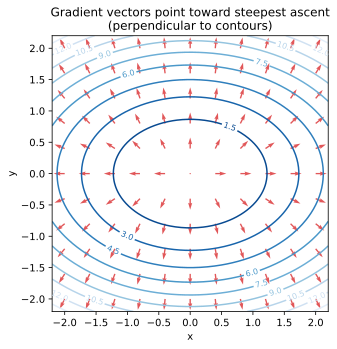
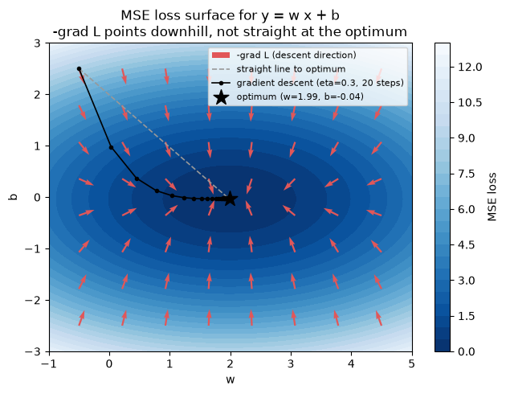

偏微分（partial derivative）は、複数の変数を持つ関数 `f(x, y, ...)` を「ある 1 変数だけ動かして、他は固定する」と決めて、その 1 変数についての変化率を取った量です。勾配（gradient, `∇f`）は、全変数についての偏微分をベクトルに並べたもので、そのベクトルが「f が最も急に増える向き」を指す性質を持ちます。

機械学習では、[損失関数](/ml/ml/loss-functions/) `L(w_1, w_2, ..., w_n)` をパラメータで偏微分し、勾配の逆向きにパラメータを更新して損失を下げます。[線形回帰](/ml/ml/linear-regression/)の正規方程式は勾配を 0 と置いて解いたもので、ロジスティック回帰やニューラルネットは勾配の逆向きに少しずつ進んで解を探します（ニューラルネットの勾配は誤差逆伝播で求めます）。いずれも損失の勾配を求めるところから始まります。

<br>

本記事では、1 変数の接線から偏微分・勾配へ進み、最後に線形モデルの平均二乗誤差（MSE）の勾配を数値で確かめます。負の勾配は損失を下げる向きですが、最適解を真っ直ぐ指すとは限りません。この点も角度を測って示します。

---

### 1 変数の微分から始める

1 変数関数 `f(x)` の微分 `f'(x)` は、`x` を少しだけ動かした時に `f` が動く比率を表します。グラフ上では、点 `(x, f(x))` での接線の傾きと同じものとなります。

以下のコードは、数値計算ライブラリの [NumPy](https://numpy.org/) とグラフ描画ライブラリの [Matplotlib](https://matplotlib.org/) で図を描きます。本記事のコードはタイトルや軸ラベルなどの設定を省いた抜粋で、全体は[生成コード](https://github.com/nao1215/debimate/blob/main/projects/ml/scripts/notes/partial-derivative-gradient_gen.py)にあります。

```python
import numpy as np
import matplotlib.pyplot as plt

x = np.linspace(-2, 2, 400)
y = x ** 2
x0 = 1.0
slope = 2 * x0
tangent = slope * (x - x0) + x0 ** 2

plt.plot(x, y, color="#7aa6c2", lw=2, label="f(x) = x^2")
plt.plot(x, tangent, color="#e15759", ls="--",
         label=f"tangent at x={x0}, slope={slope}")
plt.scatter([x0], [x0 ** 2], color="#e15759")
plt.savefig("tangent_1d.svg", bbox_inches="tight")
```



`f(x) = x^2` の `x=1` における微分は `f'(1) = 2` で、図の赤い破線の傾きと一致します。微分は局所的な傾きであり、グラフが平らな点（`f'(x) = 0`）は極大・極小の候補で、`x^3` の `x=0` のようにどちらでもない点も含みます。最適化はこの「平らな点」を探す作業でもあります。

---

### 偏微分: 1 変数だけ動かす

多変数関数 `f(x, y) = x^2 + 2 y^2` を考えます。`x` についての偏微分 `∂f/∂x` は、`y` を固定したまま `x` だけ動かした時の変化率です。形式的には `y` を定数とみなして 1 変数の微分を取ります。

- `∂f/∂x = 2x`（`y` は定数扱い、`2 y^2` の項は微分で消える）
- `∂f/∂y = 4y`（`x` は定数扱い、`x^2` の項は微分で消える）

幾何的には、`y = y_0` という平面でサーフェスを切った断面の傾きが `∂f/∂x` に、`x = x_0` で切った断面の傾きが `∂f/∂y` に対応します。

```python
from mpl_toolkits.mplot3d import Axes3D  # noqa
import numpy as np
import matplotlib.pyplot as plt

xs = np.linspace(-2, 2, 60)
ys = np.linspace(-2, 2, 60)
XX, YY = np.meshgrid(xs, ys)
ZZ = XX ** 2 + 2 * YY ** 2

fig = plt.figure(figsize=(7, 5))
ax = fig.add_subplot(111, projection="3d")
ax.plot_surface(XX, YY, ZZ, cmap="viridis", alpha=0.6, edgecolor="none")

x0, y0 = 1.0, 0.8
ax.plot(xs, np.full_like(xs, y0), xs ** 2 + 2 * y0 ** 2,
        color="#e15759", lw=2, label="slice y = y0 (∂f/∂x)")
ax.plot(np.full_like(ys, x0), ys, x0 ** 2 + 2 * ys ** 2,
        color="#59a14f", lw=2, label="slice x = x0 (∂f/∂y)")
plt.savefig("surface_slices.png", bbox_inches="tight")
```



赤い曲線が `y = y_0` 平面での断面で、その曲線の傾きが `(x_0, y_0)` における `∂f/∂x` の値となります。緑の曲線は `x = x_0` 平面での断面で、傾きが `∂f/∂y` を表します。1 つの点に対して、見る方向ごとに別々の傾きが定まる、という点が多変数関数の特徴です。

---

### 勾配ベクトル: 偏微分を並べる

偏微分を全変数ぶん集めてベクトルにしたものを勾配と呼びます。記号は `∇f`（ナブラ f）で、`∇f(x, y) = (∂f/∂x, ∂f/∂y)` と書きます。`f(x, y) = x^2 + 2 y^2` の場合は `∇f = (2x, 4y)` となります。

勾配には次の 2 つの幾何的性質があります。

- 向き: 勾配ベクトルは「`f` が最も急に増える方向」を指す
- 大きさ: 勾配ベクトルの長さ `|∇f|` は、その方向への変化率の大きさを表す

そのため、最小化したい関数では `-∇f`（負の勾配、descent direction）の向きに動けば、最も急に値が下がります。これが最急降下法（gradient descent）の出発点となります。詳細は [最急降下法・SGD](../gradient-descent-sgd/) のノートに譲ります。

等高線図上で見ると、勾配ベクトルは等高線に常に垂直に立ちます。等高線は「同じ高さの点をつないだ線」なので、その線に沿って動いても高さは変わりません。最も大きく高さが変わる向きはその直交方向、つまり等高線の法線方向となります。

```python
import numpy as np
import matplotlib.pyplot as plt

xs = np.linspace(-2.2, 2.2, 200)
ys = np.linspace(-2.2, 2.2, 200)
XX, YY = np.meshgrid(xs, ys)
ZZ = XX ** 2 + 2 * YY ** 2

XQ, YQ = np.meshgrid(np.linspace(-2, 2, 11), np.linspace(-2, 2, 11))
UQ, VQ = 2 * XQ, 4 * YQ
mag = np.sqrt(UQ ** 2 + VQ ** 2)
plt.contour(XX, YY, ZZ, levels=12, cmap="Blues_r")
plt.quiver(XQ, YQ, UQ / (mag + 1e-9), VQ / (mag + 1e-9),
           color="#e15759", scale=25, width=0.005)
plt.gca().set_aspect("equal")  # 縦横の縮尺を揃えないと直交して見えない
plt.savefig("gradient_field.svg", bbox_inches="tight")
```



赤い矢印が各点の勾配ベクトルで、向きだけを見せるために長さを 1 に揃えています。矢印は青い等高線に直交し、原点（最小値）から外へ向きます。`y` 方向は係数 4、`x` 方向は係数 2 なので、矢印は `y` 方向に強めに傾きます。この差で、`(2, 2)` のような斜めの点では、矢印は原点の真反対を向きません。この傾きは次の MSE の例で効いてきます。

---

### 機械学習に直結する例: MSE 損失の勾配

線形モデル `y_pred = w * x + b` を MSE（平均二乗誤差, mean squared error）で訓練する状況を考えます。

`L(w, b) = (1/n) Σ_i (y_i - (w x_i + b))^2`

これを `w` と `b` で偏微分すると、

- `∂L/∂w = -(2/n) Σ_i x_i (y_i - (w x_i + b))`
- `∂L/∂b = -(2/n) Σ_i (y_i - (w x_i + b))`

となります。勾配は `(w, b)` 平面上のベクトルで、その逆向きに `(w, b)` を更新していけば損失が下がります。学習率 `η` を掛けて次のように更新するのが最急降下法そのものです。

```text
w ← w - η (∂L/∂w)
b ← b - η (∂L/∂b)
```

以下のコードは、`y = 2x` にノイズを足した 30 点で上の式を `grad()` に実装し、数値微分（`h` だけずらした差分）との一致、点 `(w, b) = (-0.5, 2.5)` での負の勾配と最適解の方向のずれ、20 回の更新でのパラメータの動きを確かめます。[生成コード](https://github.com/nao1215/debimate/blob/main/projects/ml/scripts/notes/partial-derivative-gradient_gen.py)の計算部分の抜粋で、描画処理は省いています。

```python
import numpy as np

rng = np.random.default_rng(0)
x_data = np.linspace(-1, 1, 30)
y_data = 2.0 * x_data + rng.normal(0.0, 0.3, 30)


def loss(w, b):
    return np.mean((y_data - (w * x_data + b)) ** 2)


def grad(w, b):
    r = y_data - (w * x_data + b)
    return np.array([-2 * np.mean(x_data * r), -2 * np.mean(r)])


w_opt, b_opt = np.polyfit(x_data, y_data, 1)  # 最小二乗法の解
print(f"optimum: w={w_opt:.3f}, b={b_opt:.3f}")

w0, b0 = -0.5, 2.5
h = 1e-6
numeric = [(loss(w0 + h, b0) - loss(w0 - h, b0)) / (2 * h),
           (loss(w0, b0 + h) - loss(w0, b0 - h)) / (2 * h)]
print("grad   :", np.round(grad(w0, b0), 4))
print("numeric:", np.round(numeric, 4))

d = -grad(w0, b0)
to_opt = np.array([w_opt - w0, b_opt - b0])
cos = d @ to_opt / (np.linalg.norm(d) * np.linalg.norm(to_opt))
print(f"angle between -grad and optimum: {np.degrees(np.arccos(cos)):.1f} deg")

eta = 0.3
p = np.array([w0, b0])
for t in range(1, 21):
    p = p - eta * grad(*p)
    if t in (1, 5, 20):
        print(f"step {t:2d}: w={p[0]:.3f}, b={p[1]:.3f}, L={loss(*p):.4f}")
```

```text
optimum: w=1.986, b=-0.036
grad   : [-1.7713  5.0729]
numeric: [-1.7713  5.0729]
angle between -grad and optimum: 25.2 deg
step  1: w=0.031, b=0.978, L=2.4490
step  5: w=1.239, b=-0.010, L=0.2582
step 20: w=1.965, b=-0.036, L=0.0590
```

最適解はノイズのため `(2, 0)` から少しずれ、`(1.986, -0.036)` になります。解析的に求めた勾配は数値微分と小数点以下 4 桁まで一致しました。



色の濃淡が損失の高さで、星が最適解、赤い矢印が各点の `-∇L` の向きです。矢印は損失が下がる向きを指しますが、星を真っ直ぐには指していません。`(-0.5, 2.5)` では、星への直線（灰色の破線）から 25.2 度ずれています。

ずれる理由は、損失面が `b` 方向に急で `w` 方向に緩やかだからです（等高線が横長の楕円になっています）。`b` の 2 階微分は 2、`w` の 2 階微分は `2 × mean(x^2) ≈ 0.71` で、約 2.8 倍違います。そのため、黒い軌跡は先に `b` をほぼ 0 まで下げ（5 回目で `b=-0.010`）、その後で緩やかな `w` 方向を進みます。最急降下法は損失面の今いる場所の傾きだけを見て下るアルゴリズムで、遠くの最適解の位置は知りません。

---

### 連鎖律（chain rule）

合成関数 `f(g(x))` の微分は、`f'(g(x)) × g'(x)` という積で書けます。これが連鎖律で、ニューラルネットの[誤差逆伝播法](/ml/ml/backpropagation/)は層ごとに連鎖律を適用して勾配を計算します。

多変数の連鎖律は、損失 `L = f(z(w))`（`z` は層の中間出力、`w` は重み）に対して

`∂L/∂w = (∂L/∂z) × (∂z/∂w)`

のように偏微分の積で書けます。「外側の損失の勾配」と「内側の関数のヤコビ行列」を順に掛け合わせる構造で、深いネットワークでも 1 層ずつ局所的に勾配を計算できる仕組みになります。

---

### 数学での使いどころ

- 多変数関数の極値判定（停留点は `∇f = 0` を満たす）
- ラグランジュ未定乗数法（制約付き最適化、`∇f = λ ∇g`）
- 方向微分（任意の単位ベクトル `u` 方向の変化率は `∇f · u`）
- 物理のポテンシャル（電場は電位の負の勾配 `E = -∇φ`）
- [固有値分解](../eigen-decomposition/) と関連する 2 次形式 `x^T A x` の勾配は、`A` が対称行列なら `2 A x`（一般の `A` では `(A + A^T) x`）

---

### 機械学習での使いどころ

機械学習では、勾配を次のように使います。

- パラメータ学習: [最急降下法・SGD](../gradient-descent-sgd/) でモデルパラメータを更新する基本道具
- 損失関数の最小化: ロジスティック回帰やニューラルネットは勾配を使う反復法で解く。線形回帰は勾配を 0 と置いた正規方程式でも解け、サポートベクターマシンは [scikit-learn](https://scikit-learn.org/stable/modules/svm.html) では libsvm などの 2 次計画問題の解法で解く
- 誤差逆伝播法（backpropagation）: 連鎖律を多層に適用してニューラルネットの全パラメータの勾配を求める
- 特徴量の重要度: 入力に対する勾配 `∂y/∂x` の大きさで特徴量の影響度を測る手法（[Saliency Map](https://arxiv.org/abs/1312.6034) など）

---

### 適さないケース / 限界

勾配を使った最適化には、次の制約があります。

- 微分不可能な関数: ReLU の `x=0` のように尖った点では厳密な勾配が定義されない（実装では劣勾配や任意の値で代用）
- 離散最適化: 整数計画や組合せ最適化は連続変数の勾配の枠外で、別系統のアルゴリズム（branch-and-bound、遺伝的アルゴリズム）が必要
- 非凸関数: 勾配が 0 になる点は最小値とは限らず、鞍点や局所最小に捕まる。深層学習では SGD（確率的勾配降下法）のノイズや momentum によって抜け出せる場合がある
- 勾配消失・勾配爆発: 深いネットワークで連鎖律の積が極端に小さく/大きくなる現象。[活性化関数](/ml/ml/activation-functions/)の選び方（ReLU 等）や初期化、正規化で緩和する
- ノイズの大きい損失面: 観測誤差が支配的な場合、勾配の方向自体が信頼できない。ミニバッチサイズや学習率を慎重に選ぶ必要がある
