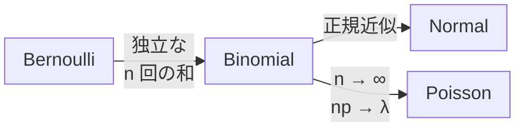

確率分布（probability distribution）は、確率変数 `X` がどの値をどれくらいの確率で取るかを表したものです。離散変数では、確率質量関数（PMF, probability mass function）`P(X = k)` が値 `k` を取る確率そのものを返します。連続変数では 1 点ちょうどの値を取る確率が 0 なので、確率密度関数（PDF, probability density function）`f(x)` を使い、区間 `[a, b]` に入る確率を曲線の下の面積 `∫_a^b f(x) dx` で求めます。

密度 `f(x)` は確率ではないので、1 を超えることもあります。例えば、後で示す指数分布（`λ = 2`）の `f(0)` は 2 ですが、曲線の下の面積は全体で 1 です。

機械学習では「データはこの分布から生成された」とモデル化したり、予測モデルに分布を出力させたりします。その時に選ぶ分布族（式が同じでパラメータだけが違う分布の集まり）で、モデルが表せるデータの形が決まります。

<br>

本記事では、ML でよく使う 6 つの分布（ベルヌーイ・二項・ポアソン・正規・指数・ベータ）について、次の疑問を順に扱います。[期待値](../expectation/) と [同時分布](../joint-marginal-conditional/) は別のノートで説明しています。

- 各分布は何を表し、パラメータと平均・分散はどうなるのか
- 分布族を間違えると、パラメータを正しく求めても何がずれるのか
- 分布同士はどう繋がり、ML のどこで使われるのか

---

### 離散分布: ベルヌーイ・二項・ポアソン

値が 0, 1, 2, … のように数えられる時に使う分布です。下の図の縦軸は確率 `P(X=k)` で、棒の高さを全部足すと 1 になります。本記事の図は [生成元のスクリプト](https://github.com/nao1215/debimate/blob/main/projects/ml/scripts/notes/probability-distributions_gen.py) で描いています。



| 分布 | PMF | パラメータ | E[X] | Var(X) | 何を表す |
|---|---|---|---|---|---|
| ベルヌーイ（Bernoulli） | `P(X=1)=p, P(X=0)=1-p` | `p` | `p` | `p(1-p)` | 1 回の試行の成功/失敗 |
| 二項（Binomial） | `C(n,k) p^k (1-p)^(n-k)` | `n, p` | `np` | `np(1-p)` | `n` 回の独立試行で `k` 回成功 |
| ポアソン（Poisson） | `λ^k e^(-λ) / k!` | `λ` | `λ` | `λ` | 単位時間/領域で起きる稀な事象の回数 |

ベルヌーイは「コイン投げ 1 回」の結果で、二項はそれを `n` 回繰り返した時の成功数です。ポアソンは、二項分布で `n` を大きく、成功率 `p = λ/n` を小さくした極限として導かれ、「単位時間あたりに起きる稀な事象（事故・故障・電話）」のモデルとして頻出します。

ポアソン分布の重要な性質は `E[X] = Var(X) = λ` で平均と分散が等しいことです。実データで「平均より分散が大きい」（over-dispersion）なら、ポアソンでは足りず、負の二項分布や、0 が多すぎるデータ向けのゼロ過剰ポアソン分布への拡張が必要になります。

---

### 連続分布: 正規・指数・ベータ

値が実数の区間を連続的に動く時に使う分布です。下の図の縦軸は確率ではなく密度 `f(x)` です。



| 分布 | PDF | パラメータ | E[X] | Var(X) | 何を表す |
|---|---|---|---|---|---|
| 正規（Normal） | `(1/(σ√(2π))) exp(-(x-μ)²/(2σ²))` | `μ, σ` | `μ` | `σ²` | 多数の独立な要因を足し合わせた量 |
| 指数（Exponential） | `λ exp(-λx)` (x ≥ 0) | `λ` | `1/λ` | `1/λ²` | 次の事象までの待ち時間 |
| ベータ（Beta） | `x^(a-1)(1-x)^(b-1) / B(a,b)` | `a, b` | `a/(a+b)` | `ab/((a+b)²(a+b+1))` | `(0, 1)` 区間の確率の事前分布 |

- 正規分布（ガウス分布）: 統計と ML で最もよく使われる。中心極限定理（CLT, central limit theorem）により、同じ分布に従う独立な確率変数を `n` 個足すと、分散が有限なら元の分布形によらず、和を標準化した値の分布は `n` が大きいほど標準正規分布に近づく。平均も分散も定まらないコーシー分布のように、条件を満たさない分布では成り立たない（[大数の法則と中心極限定理](../lln-clt/) のノート参照）
- 指数分布: ポアソンで起きる事象の「次まで何秒待つか」。既に `t` 秒待ったことが残りの待ち時間の分布を変えない記憶喪失性（memoryless property）を持ち、この性質を持つ連続分布は指数分布だけ
- ベータ分布: 値域が `(0, 1)` に閉じているので、確率そのものの事前分布として自然。形が極めて柔軟で、`a, b` の調整で「U 字」「逆 U 字」「左寄り」「右寄り」を作れる

---

### 分布族の選び方

分布族を間違えると、パラメータを最尤推定（データが得られる確率を最大にする選び方）で求めても、データの形を表せません。例えば、平均 8 のポアソン分布から「1 時間あたりの来店客数」を 500 時間分作り、ポアソン・正規・指数を当てはめます。パラメータはどれも最尤推定値で、標本の平均（正規は標準偏差も）から決まります。

以下は、「客が 2 人以下の時間帯」の割合を実データと 3 つの当てはめで比べるコードです。[NumPy](https://numpy.org/) 2.5.4 と [SciPy](https://scipy.org/) 1.18.1 で実行しています。

```python
import numpy as np
from scipy import stats

rng = np.random.default_rng(0)
counts = rng.poisson(8, 500)  # 1 時間あたりの来店客数を 500 時間分
lam = counts.mean()
mu, sigma = counts.mean(), counts.std()
print(f"平均 = {counts.mean():.2f}, 分散 = {counts.var():.2f}")

# 「客が 2 人以下の時間帯」の割合を、実データと 3 つの当てはめで比べる
print(f"実データ    : {(counts <= 2).mean():.3f}")
print(f"Poisson     : {stats.poisson.cdf(2, lam):.3f}")
print(f"Normal      : {stats.norm.cdf(2.5, mu, sigma):.3f}")
print(f"Exponential : {stats.expon.cdf(2.5, scale=lam):.3f}")
print(f"Normal が負の客数に割り振る確率: {stats.norm.cdf(0, mu, sigma):.4f}")
```

出力:

```text
平均 = 7.93, 分散 = 7.75
実データ    : 0.014
Poisson     : 0.015
Normal      : 0.026
Exponential : 0.270
Normal が負の客数に割り振る確率: 0.0022
```

連続分布の 2 つは、整数の 2 と 3 の境目に当たる 2.5 までの面積で比べています。図は、同じデータのヒストグラムに 3 つの当てはめを重ねたものです。



- Poisson: 2 人以下を 0.015 と見積もり、実データの 0.014 とほぼ一致する。平均 7.93 と分散 7.75 が近いのも、`E[X] = Var(X)` の通り
- Normal: 釣鐘型には沿うが、2 人以下を 0.026 と実データの約 2 倍に見積もる。整数でない値や、あり得ない負の客数（0.22%）にも確率を割り振る
- Exponential: 単調減少の形しか取れないので、2 人以下を 0.270 と約 20 倍に見積もる

EDA（探索的データ分析）では、データの性質に合う分布族を候補にし、上記のように当てはめて実データと比べます。[歪度](../skewness/)を調べて log 変換が必要かを判断することも、その確認の 1 つです。データの種類ごとの候補は、次の通りです。

- 0/1 → Bernoulli
- 試行回数が固定の成功数 → Binomial
- 単位時間/領域での回数 → Poisson
- 連続値、釣鐘型 → Normal
- 正の連続値、右に裾 → Exponential / Gamma / 対数正規（log を取ると正規分布になる分布）
- 確率 `(0, 1)` 上の値 → Beta

---

### 分布同士の関係

代表的な分布は、互いに和・極限・到着間隔で繋がっています。




図の矢印は、次の関係を表します。

- Bernoulli × n 回 = Binomial: コイン投げを n 回繰り返した成功数
- Binomial の極限（`n → ∞, np → λ`）= Poisson: 試行が多くて成功率が低い時
- Binomial の正規近似: `n` が大きいと `N(np, np(1-p))` で近似できる。二項はベルヌーイの和なので、中心極限定理の特別な場合に当たる（ド・モアブル–ラプラスの定理）
- Poisson の到着間隔 = Exponential: 単位時間あたり平均 `λ` 回起きる事象の間隔は `Exp(λ)` に従う
- 同じ `λ` の独立な Exponential n 個の和 = Gamma: n 個目の事象までの累積待ち時間
- Bernoulli の共役事前分布 = Beta: [ベイズの定理](../bayes-theorem/) で更新した事後分布も Beta になり、計算が楽

---

### 数学での使いどころ

- 最尤推定（MLE）: 各分布族にパラメータを当てはめる基本テクニック
- [ベイズの定理](../bayes-theorem/) の事前分布: Beta と二項、Gamma とポアソン、正規と正規のように、事後分布が事前分布と同じ族になる組（共役）がある
- [大数の法則と中心極限定理](../lln-clt/): 標本平均が期待値に近づくこと（大数の法則）と、そのばらつきが正規分布で近似できること（CLT）
- 仮説検定: 検定統計量が各分布（t、χ²、F、正規）に従うことを利用（[仮説検定](../hypothesis-test/) 参照）
- 多変量への拡張: 多変量正規分布、Dirichlet 分布（Beta を 3 つ以上のカテゴリの確率へ広げた分布）

---

### 機械学習での使いどころ

- 損失関数の導出: MSE は正規分布尤度、交差エントロピーはベルヌーイ/カテゴリ尤度に対応（[損失関数](../../ml/loss-functions/) 参照）
- [ナイーブベイズ](https://scikit-learn.org/stable/modules/naive_bayes.html): 各特徴量の分布（Gaussian Naive Bayes、Multinomial Naive Bayes）を仮定
- 確率モデルの基盤: [ロジスティック回帰](../../ml/logistic-regression/)（ベルヌーイ）、ポアソン回帰、Gamma 回帰、ベータ回帰
- 生成モデル: [VAE（Variational Autoencoder）](https://arxiv.org/abs/1312.6114)は潜在変数に正規分布、[拡散モデル（Diffusion）](https://arxiv.org/abs/2006.11239)は[各ステップで加えるノイズ](/notes/generative-ai/diffusion-model/)に正規分布を仮定し、[GAN（Generative Adversarial Network）](https://arxiv.org/abs/1406.2661)は明示的な分布を仮定しない
- A/B テストのベイズ解釈: Beta の事前分布と二項の尤度で「コンバージョン率の事後分布」を推定
- 多腕バンディット: [Thompson sampling](https://doi.org/10.1093/biomet/25.3-4.285) は、各候補の成功率の事後分布（Beta）から値を 1 つずつ引き、最大の候補を選ぶ
- ベイズ最適化: 目的関数の事前分布にガウス過程（任意の点の組での関数値が多変量正規分布に従うモデル）を置き、次に試す[ハイパーパラメータ](../../ml/hyperparameter/)を選ぶ
- [異常検知](/ml/ml/anomaly-detection/): 「正常データの分布」を当てはめ、低密度の点を異常とする

[scikit-learn](https://scikit-learn.org/stable/modules/linear_model.html#generalized-linear-models) では分布族指定を一般化線形モデル（`PoissonRegressor`, `GammaRegressor`, `TweedieRegressor`）で行います。[PyTorch](https://docs.pytorch.org/docs/stable/generated/torch.nn.GaussianNLLLoss.html) では `nn.GaussianNLLLoss`、`nn.PoissonNLLLoss` などの形で損失関数として組み込まれます。

---

### 適さないケース / 落とし穴

- 「とりあえず正規分布」: 多くのデータは右に裾を引いており（給与、価格、待ち時間）、正規仮定が崩れる。[歪度](../skewness/) を見て log 変換 or 別分布へ
- 二項分布の独立試行仮定: 試行同士が相関していると、分散が `np(1-p)` より大きくなる（ベータ二項分布で対処）
- ベータの境界: 厳密に 0 や 1 の値があると、値 0 では `a`、値 1 では `b` が 1 以外の時に密度が 0 か無限大になり、最尤推定が破綻する。0 と 1 に別の確率を持たせた 0/1 過剰ベータ分布を使う
- 多モード（峰が複数）: 単一の標準分布では表現できない。混合分布（[Gaussian Mixture](https://scikit-learn.org/stable/modules/mixture.html)）を使う
- 独立性仮定: [時系列](../../ml/time-series-forecasting/)など相関のあるデータには、自己回帰モデルや HMM（隠れマルコフモデル）を使う
- パラメータ推定の不確実性: 推定値 `λ_hat` を確定値として扱わず、信頼区間や事後分布を併用する
- 「正規分布なら[標準偏差](/ml/math/stddev/) 3σ で十分」をすべてに適用: 裾の重い分布（t、Pareto、対数正規）では 3σ ルールが極端に楽観的な見積もりになる
