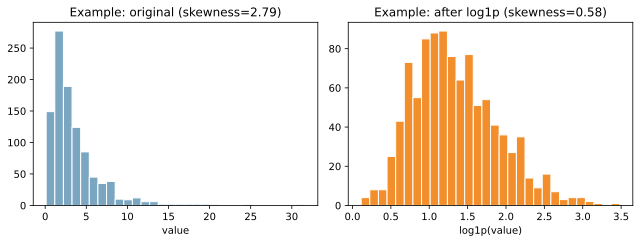
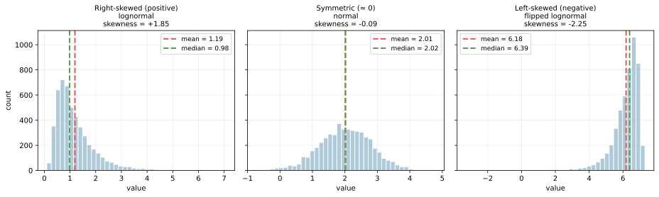
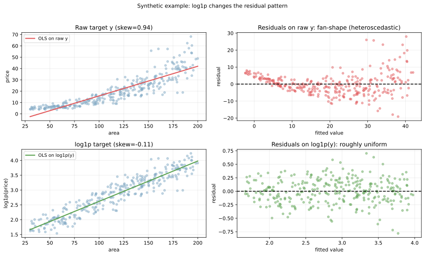

歪度（skewness、わいど）は、分布の「左右の非対称さ」を 1 つの数で表す指標です。[平均](../mean/) が分布の中心、[分散](../variance/) と[標準偏差](../stddev/) が広がりを表すのに対して、歪度は「形のバランス」を表します。

- 正の歪度（右に長い尾）: 大半の値が小さく、少数の大きな値が裾を伸ばす
- 負の歪度（左に長い尾）: 大半の値が大きく、少数の小さな値が裾を伸ばす
- 歪度 0: 左右対称な分布（正規分布など）は 0。ただし逆は成り立たず、非対称でも 0 になる分布がある

実用上は正の歪度を持つデータが多いです。給与・取引金額・アクセス回数・待ち時間・株価のような「下限はあるが上限は無い」量は、構造的に右に裾を引きやすいです。

---

### 定義と「なぜ 3 乗するか」

代表的な定義は「標準化された 3 次モーメント」です。

- `skewness = E[((X - mu) / sigma)^3]`
- `mu` は平均、`sigma` は標準偏差

3 乗を使うのは、左右の非対称性を符号付きで捉えるためです。差 `(X - mu)` をそのまま足し合わせると（1 乗）正と負が打ち消し合って常に 0 になります。差を 2 乗すると（[分散](../variance/) になる）符号が消えて広がりだけが残ります。差を 3 乗すれば符号が保たれ、かつ大きく離れた値が強調されます（`差 2 → 8 倍`, `差 -2 → -8 倍`）。

`(X - mu) / sigma` のように標準偏差で割って標準化してから 3 乗するのは、無次元量にして単位やスケールに依存しない指標にするためです。これにより異なるデータ間で歪度の値を直接比較できるようになります。

歪度の絶対値の目安は次の通りです。

- `|skewness| < 0.5`: ほぼ対称
- `0.5 ≤ |skewness| < 1.0`: 中程度の歪み
- `|skewness| ≥ 1.0`: 強い歪みと呼ばれることがある

この区分は分布の種類や標本数を無視した経験的な目安です。閾値だけで変換の要否を決めず、ヒストグラム、外れ値、モデルの誤差診断を合わせて確認します。

---

### 尖度との対比

歪度と並んで分布の形を測る指標に「尖度（kurtosis）」があります。

- 歪度（3 次モーメント）: 左右の非対称さ
- 尖度（4 次モーメント）: 裾の重さ（外れ値の出やすさ）

正規分布の尖度は 3（3 を引いた超過尖度では 0）です。尖度が高い分布は裾が重く、外れ値が出やすいです。名前から中心の尖り具合を表すと誤解されやすいですが、尖度は山の形をほとんど表しません（[Westfall, 2014](https://pmc.ncbi.nlm.nih.gov/articles/PMC4321753/)）。歪度と尖度を組み合わせると、平均・分散だけでは見えない「分布の癖」が定量化できます。

---

### 前提・注意

- 外れ値の影響を強く受ける（3 乗するので、極端な値が支配的になりやすい）
- サンプル数が小さいと推定が不安定
- 歪度は「形の傾向」を示すだけで、分布の全体像を代替しない。ヒストグラムや [KDE](../kde/) で形を目視するのが先決
- 多峰性（山が複数）の判断はできない

---

## log1p 変換

log1p 変換は `log(1 + x)` を適用する変換で、右に長い裾を圧縮して極端な値の影響を和らげます。`log(x)` は `x=0` で定義できませんが、`log1p` は 0 を含むデータもそのまま変換できます。`x` が小さいときは `log(1 + x) ≈ x` なので、0 付近の値はあまり変わらず、大きな値ほど強く縮みます。

---

### 使いどころ

- 取引金額やアクセス回数など、右に長い分布の特徴量
- 外れ値の影響を抑えたいとき
- 変数のスケール差が大きく、学習が不安定なとき

---

### 注意点

- 数学的な定義域は `x > -1`。件数や金額のような `x >= 0` の量で使うと、変換後の意味を追いやすい

---

## Python での実例

以下は計算部分の抜粋で、各ブロックは単独で実行できます。描画を含む[生成コード](https://github.com/nao1215/debimate/blob/main/projects/ml/scripts/notes/skewness_gen.py)は GitHub にあります。歪度は [scipy.stats.skew](https://docs.scipy.org/doc/scipy/reference/generated/scipy.stats.skew.html) の既定（`bias=True`）で計算します。

```python
import numpy as np
from scipy import stats

rng = np.random.default_rng(0)
raw = rng.lognormal(mean=1.0, sigma=0.8, size=1000)
log1p = np.log1p(raw)
print(f"raw:   skew={stats.skew(raw):.2f}")
print(f"log1p: skew={stats.skew(log1p):.2f}")
```

出力:

```text
raw:   skew=2.79
log1p: skew=0.58
```



右に長く伸びていた裾が縮み、歪度は 2.79 から 0.58 に下がります。

---

### 右歪み・対称・左歪みの並列比較

3 種類のデータで、歪度の符号と分布形の対応を並べて見ます。

```python
import numpy as np
from scipy import stats

rng = np.random.default_rng(0)
right = rng.lognormal(0.0, 0.6, 5000)
sym = rng.normal(2.0, 0.8, 5000)
left = -rng.lognormal(0.0, 0.6, 5000) + np.exp(2)
for name, data in [("right", right), ("sym", sym), ("left", left)]:
    print(f"{name + ':':6} skew={stats.skew(data):+.2f}, mean={data.mean():.2f}, median={np.median(data):.2f}")
```

出力:

```text
right: skew=+1.85, mean=1.19, median=0.98
sym:   skew=-0.09, mean=2.01, median=2.02
left:  skew=-2.25, mean=6.18, median=6.39
```



3 つのヒストグラムで、赤線が平均、緑線が中央値です。この人工データでは、左の図で平均が中央値より右に、中央ではほぼ同じ位置に、右の図では左にあります。正規分布から引いた標本でも歪度はちょうど 0 にならず、-0.09 です。ただし、この位置関係だけから歪度の符号や分布の形を判定することはできません。歪度は 3 次モーメント、中央値は順位に基づく別の統計量なので、図と歪度の値を併読します。

---

### 回帰の残差プロットで効く log 変換

右に歪んだ目的変数では、元の尺度での残差が予測値とともに広がる場合があります。以下は乗法的なノイズを加えた人工データの例です。`log1p(y)` で学習するとこの例では残差の広がりが小さくなりますが、変換は等分散性や予測性能を保証しません。元の尺度へ戻した予測値と残差も評価します。次のコードは、予測値の小さい半分と大きい半分で残差の標準偏差を比べます。

```python
import numpy as np
from sklearn.linear_model import LinearRegression

rng = np.random.default_rng(3)
area = rng.uniform(30, 200, 300)
price = np.exp(1.0 + 0.015 * area + rng.normal(0, 0.25, 300))  # right-skewed
X = area.reshape(-1, 1)
for name, y in [("raw", price), ("log1p", np.log1p(price))]:
    pred = LinearRegression().fit(X, y).predict(X)
    resid = y - pred
    low = pred < np.median(pred)
    print(f"{name + ':':6} resid std low={resid[low].std():.2f}, high={resid[~low].std():.2f}")
```

出力:

```text
raw:   resid std low=4.08, high=8.26
log1p: resid std low=0.22, high=0.23
```



上段が生の `y` での回帰と残差プロット、下段が `log1p(y)` での回帰と残差プロットです。生の `y` では予測値の大きい側で残差の標準偏差が約 2 倍（4.08 → 8.26）になり、右上の図は扇形に広がります。`log1p(y)` では 0.22 と 0.23 でほぼ揃い、右下の図は比較的一様に見えます。

なお木系モデル（[RandomForest](../../ml/random-forest/)・[勾配ブースティング](../../ml/gradient-boosting/)）は分割点で特徴量の順序しか見ないため、特徴量への単調変換では予測が変わりません。一方、目的変数の変換は分割の評価に使う損失を変えるため、木系モデルでも結果が変わります。

---

### 数学での使いどころ

- 分布の形状把握（非対称性の定量化）
- 正規性の仮定チェックの補助指標

---

### 機械学習での使いどころ

歪度の高い特徴量は、線形モデルや距離ベースのモデルで学習を不安定にしやすいため、変換を入れるかの判断に歪度を使います。

- EDA（Exploratory Data Analysis、探索的データ分析）: 歪度をスキャンして変換対象を絞る
- log1p 変換・Box-Cox 変換（正の値向けの冪変換）の候補出し: 歪度、値域、ヒストグラム、残差を併せて確認
- 線形回帰・[LogisticRegression](../../ml/logistic-regression/) の入力前処理: 右に長い特徴量を圧縮して極端な値の影響を抑える
- 目的変数の前処理: 価格予測などで目的変数が右に歪んでいる場合、`log1p(y)` で学習してから `expm1(y_pred)` で戻す

---

### 適さないケース

- 負の値を多く含む変数（別の変換が必要）
- 元の単位での解釈が重要な場面（変換で単位の意味が変わる）
