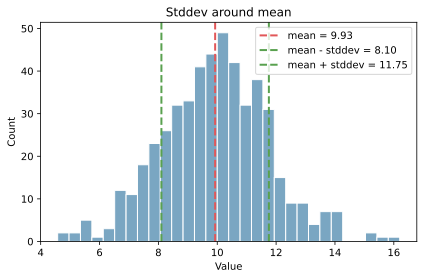
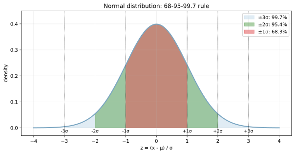
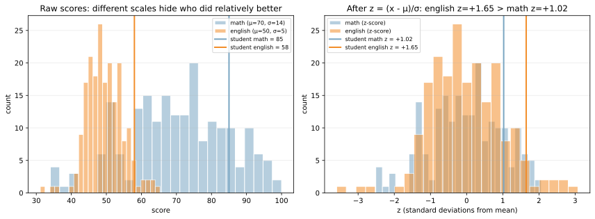

標準偏差（standard deviation）は[分散](../variance/)の平方根で、データが[平均](../mean/)の周りにどれくらい散らばっているかを元データと同じ単位で表す指標です。身長（cm）のデータなら、分散は `cm²` という解釈しにくい単位になりますが、標準偏差は `cm` のまま扱えます。分散が `25 cm²` なら標準偏差は `5 cm` です。

- 母標準偏差: `sigma = sqrt(sigma2)`（データ数 `n` で割った分散の平方根）
- 標本標準偏差: `s = sqrt(s2)`（`n - 1` で割った分散の平方根）

どちらで割るかはライブラリの既定値で違います。[`numpy.std`](https://numpy.org/doc/stable/reference/generated/numpy.std.html) は `ddof=0`（`n` で割る）、[`pandas.Series.std`](https://pandas.pydata.org/docs/reference/api/pandas.Series.std.html) は `ddof=1`（`n - 1` で割る）が既定です。

```python
import numpy as np
import pandas as pd

h = [165, 168, 170, 172, 175]
print(f"{np.std(h):.2f} {np.std(h, ddof=1):.2f} {pd.Series(h).std():.2f}")
```

```text
3.41 3.81 3.81
```

同じ 5 人の身長でも、numpy の既定では 3.41 cm、pandas の既定では 3.81 cm です。比は `sqrt(n / (n - 1))` で、`n = 5` では約 12% の差になります。

平均 10・標準偏差 2 の正規分布から 500 個を作り、平均 ± 標準偏差の位置に線を引くと次の図になります。



標本の平均は 9.93、標準偏差は 1.83 で、2 本の緑の線（8.10 と 11.75）の間に 500 個のうち 70% が入っています。

<br>

本記事では、次の疑問を順に扱います。

- 標準偏差 1 つ分はデータのどれだけを覆うか。その目安が崩れるのはどんな分布か
- 外れ値が 1 個混ざると、標準偏差と「3σ を超えたら異常」という判定はどうなるか
- 平均もばらつきも違う 2 つのテストの点数はどう比べるか

---

### 68-95-99.7 ルール

データが正規分布に従う時、平均 ± 1σ・2σ・3σ の範囲には、それぞれ約 68%・95%・99.7% のデータが入ります。身長で `mu = 170 cm`、`sigma = 5 cm` なら、160〜180 cm に約 95% の人が入ります。



横軸は平均からの距離を σ 単位で測った値で、入れ子の 3 色の帯が ±1σ・±2σ・±3σ の範囲です。±3σ の外側は 0.27% で、1000 個に 3 個程度しか出ない値です。[異常検知](/ml/ml/anomaly-detection/)で使う「3σ を超えたら異常」という判定は、この数字を根拠にしています。

<br>

ただし、この割合は正規分布の性質であり、標準偏差の性質ではありません。裾の重い t 分布（自由度 5）と、右に長い裾を持つ対数正規分布（log-normal、`s = 1`）で、平均 ± kσ に入る確率を [`scipy.stats`](https://docs.scipy.org/doc/scipy/reference/stats.html) で計算します。

```python
from scipy import stats

for name, d in [("normal", stats.norm()), ("t(df=5)", stats.t(5)), ("lognormal", stats.lognorm(1))]:
    m, s = d.mean(), d.std()
    inside = [d.cdf(m + k * s) - d.cdf(m - k * s) for k in (1, 2, 3)]
    outside3 = d.sf(m + 3 * s) + d.cdf(m - 3 * s)
    print(name, [f"{p:.3f}" for p in inside], f"{outside3:.4f}")
```

```text
normal ['0.683', '0.954', '0.997'] 0.0027
t(df=5) ['0.747', '0.951', '0.988'] 0.0117
lognormal ['0.909', '0.963', '0.982'] 0.0180
```

t 分布では ±1σ に 75% が集まる一方で、±3σ の外は 1.2% と正規分布の約 4 倍です。対数正規分布では平均 − 3σ が負になり、負の値は出ないので、±3σ の外の 1.8% は全て右の裾にあります。正規分布の約 7 倍です。3σ の判定を使う前に、ヒストグラムや [KDE](../kde/) で分布の形を確かめます。

---

### 外れ値 1 個の影響

標準偏差は平均からの差を二乗して足すので、遠い 1 個の値に大きく引っ張られます。9 人分の身長に、1 人分だけミリメートルで入力された値を混ぜます。

```python
rng = np.random.default_rng(0)
heights = rng.normal(170, 5, 9).round(1)
print(f"9 people: mean={heights.mean():.2f} std={heights.std():.2f}")

for v in (1712.0, 17120.0, 171200.0):
    x = np.append(heights, v)
    z = (x - x.mean()) / x.std()
    print(f"v={v:g}: std={x.std():.1f} max z={z.max():.6f} flagged={bool((np.abs(z) > 3).any())}")
```

```text
9 people: mean=171.16 std=3.10
v=1712: std=462.3 max z=2.999939 flagged=False
v=17120: std=5084.7 max z=2.999999 flagged=False
v=171200: std=51308.7 max z=3.000000 flagged=False
```

`z = (x - mu) / sigma` は Z スコアで、平均から何 σ 離れているかを表します。入力ミス 1 個で標準偏差は 3.10 cm から 462.3 になり、ばらつきの目安として使えなくなりました。さらに、入力ミスの値の Z スコアは 3 を超えません。値を 100 倍にしても 3 に近付くだけで（最後の行は表示上 3.000000 でも 3 未満）、`|z| > 3` の判定には掛かりません。外れ値自身が標準偏差を押し上げ、自分の Z スコアを抑えるからです。

[Shiffler（1988）](https://doi.org/10.1080/00031305.1988.10475530)が示した通り、`n` 個のデータの Z スコアの絶対値には上限があり、`n - 1` で割った標準偏差では `(n - 1) / sqrt(n)`、`n` で割った標準偏差では `sqrt(n - 1)` です。`n = 10` ではそれぞれ 2.85 と 3 なので、10 件以下のデータでは `|z| > 3` の判定は何も検出しません。外れ値が混ざりうるデータでは、[中央値](../median/)や[四分位範囲](../quantile/)のような外れ値に強い指標を併用します。

---

### Z スコアで尺度の違う点数を比べる

Z スコアを使うと、平均もばらつきも違う 2 つのデータの値を「平均から何 σ 離れているか」という共通のものさしで比べられます。平均 70・標準偏差 15 の数学と、平均 50・標準偏差 5 の英語のテストを 200 人分作り、数学 85 点・英語 58 点の生徒の位置を比べます。

```python
rng = np.random.default_rng(0)
math_scores = rng.normal(70, 15, 200).clip(0, 100)
english_scores = rng.normal(50, 5, 200).clip(0, 100)
for name, s, x in [("math", math_scores, 85), ("english", english_scores, 58)]:
    print(f"{name}: mean={s.mean():.1f} std={s.std():.1f} z={(x - s.mean()) / s.std():+.2f}")
```

```text
math: mean=70.2 std=14.4 z=+1.02
english: mean=49.6 std=5.1 z=+1.65
```



左の生の点数では、数学 85 点の方が高く見えます。右の Z スコアでは、英語は平均との差 8.4 点を σ = 5.1 で割って +1.65、数学は差 14.8 点を σ = 14.4 で割って +1.02 になり、英語の方が上位にいます。偏差値は Z スコアを `50 + 10z` に変換した値で、この生徒は数学 60.2、英語 66.5 です。

機械学習の[標準化](../../ml/standardization/)は、特徴量ごとに同じ変換を掛けて平均 0・標準偏差 1 に揃える操作です。距離で近さを測る kNN や k-means、係数の大きさに罰則を掛ける Ridge・Lasso では、単位の大きい特徴量が結果を支配しないように標準化します。

---

### 使いどころ

- 誤差幅の報告: [交差検証](../../ml/cross-validation/)のスコアを `0.85 ± 0.03` と書く時の `± 0.03` は、fold 間のスコアのばらつきです。真の性能がこの範囲に入る確率を示す信頼区間ではありません
- 標準誤差と信頼区間: 標本平均 `x_bar` のばらつきは標準誤差 `sigma / sqrt(n)` で、`sigma` が既知か `n` が十分大きい時の 95% 信頼区間は `x_bar ± 1.96 * sigma / sqrt(n)` です。A/B テストでも、平均の差が標準誤差の何倍かで判定します
- [相関係数](../correlation/): 共分散を 2 変数の標準偏差の積で割った `r = Cov(X, Y) / (sigma_x * sigma_y)` です
- 重みの初期化: [He 初期化](https://arxiv.org/abs/1502.01852)は、入力数 `n_in` の層の重みを標準偏差 `sqrt(2 / n_in)` の正規分布から引きます

---

### 注意点と適さないケース

- 外れ値が混ざるデータでは、1 個で値が大きく動きます
- 分布が大きく歪んでいる時や裾が重い時は、68-95-99.7 の割合が成り立ちません
- 山が 2 つある分布では、平均 ± σ の範囲に典型的な値が無いことがあります
- `n` と `n - 1` のどちらで割ったかで値が変わります。件数が少ない時はライブラリの `ddof` を確かめます
