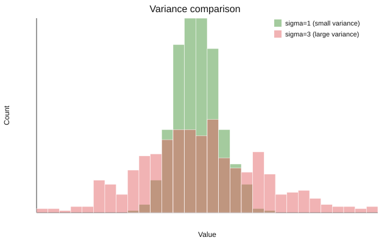
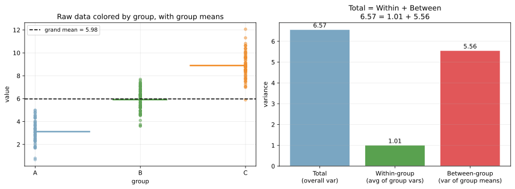
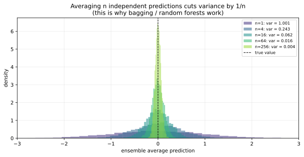

分散（variance）は、データの散らばり具合を「[平均](../mean/) からの差の二乗の平均」として定量化する指標です。平均が分布の中心を表すのに対して、分散は分布の広がりを表します。

- 母分散: `sigma2 = E[(X - mu)^2]`
- 標本分散: `s2 = sum((xi - x_bar)^2) / (n - 1)`

ここで `mu` は母平均、`x_bar` は標本平均、`X` は確率変数、`E[ ]` は[期待値](../expectation/)です。分散は単位が元の値の二乗になるので、元の単位で大きさを読む時は平方根を取った[標準偏差](../stddev/)を使います。

<br>

本記事では、[NumPy](https://numpy.org/) の乱数で次の疑問を順に確かめます。

- なぜ差の絶対値ではなく二乗を使うのか
- 標本分散の分母が `n` ではなく `n - 1` なのはなぜか
- 全体の分散が群内と群間に分けられるとはどういうことか
- 予測を平均すると分散が縮むのに、ランダムフォレストが木の相関を下げる工夫をするのはなぜか

---

### 平均が同じで分散が違う分布

以下は、平均 0 で標準偏差 1 と 3 の正規分布から 500 個ずつ値を引き、[Matplotlib](https://matplotlib.org/) で重ねた例です。

```python
import numpy as np
import matplotlib.pyplot as plt

rng = np.random.default_rng(0)
values1 = rng.normal(loc=0.0, scale=1.0, size=500)
values2 = rng.normal(loc=0.0, scale=3.0, size=500)

plt.figure(figsize=(6, 4))
plt.hist(values1, bins=30, color="#59a14f", alpha=0.55, edgecolor="white",
         label=f"sigma=1 (var={values1.var():.2f})")
plt.hist(values2, bins=30, color="#e15759", alpha=0.45, edgecolor="white",
         label=f"sigma=3 (var={values2.var():.2f})")
plt.title("Variance comparison: same mean, different spreads")
plt.xlabel("Value")
plt.ylabel("Count")
plt.legend()
plt.tight_layout()
plt.show()
```

出力:



中心はどちらも 0 付近ですが、標準偏差 3 の分布は横に 3 倍広がり、分散は理論上 9 倍になります。実測は 1.03 と 7.92 で、500 個の標本でも分散は理論値 9 から 1 割ほどずれます。

---

### 二乗する理由

平均からの差を二乗すると、次の性質が得られます。

- 符号の打ち消しを避ける: 差 `xi - mu` をそのまま足すと、正と負が打ち消し合って常にゼロになる。絶対値 `|xi - mu|` の平均（平均絶対偏差、mean absolute deviation）も使えるが、絶対値は 0 で微分できず、式の変形が面倒になる
- 大きな逸脱を強調する: 差 2 は 4、差 10 は 100 の寄与になる。そのため、分散は外れ値の影響を強く受ける
- L2 損失と対応する: 分散は「平均で代表させた時の二乗誤差」そのもの。線形回帰は残差の二乗和を最小化し、[PCA](../../ml/pca/) は射影後の分散を最大化する
- 加法性が成り立つ: 独立な確率変数 `X` と `Y` について `Var(X + Y) = Var(X) + Var(Y)`。絶対値ベースの指標には、この性質が無い

平均絶対偏差や[四分位範囲](../quantile/)は外れ値に強い一方で、上記の加法性や分解を使えません。外れ値が多いデータでは、分散だけで散らばりを判断しないようにします。

---

### 分母が n - 1 の理由

標本分散で `n` で割ると、平均的に母分散より小さい値が出ます。`x_bar` は標本との二乗誤差を最小にする点なので、真の `mu` を基準にした時より差の二乗和が必ず小さくなるからです。期待値は `(n - 1) / n × sigma2` になり、`n - 1` で割るとこのずれが消えます（不偏推定量）。

分散 1 の正規分布から 5 個を引く試行を 10 万回繰り返し、2 つの割り方の平均を比べます。

```python
import pandas as pd

rng = np.random.default_rng(0)
samples = rng.normal(0.0, 1.0, (100_000, 5))
print(f"ddof=0: {samples.var(axis=1, ddof=0).mean():.4f}")
print(f"ddof=1: {samples.var(axis=1, ddof=1).mean():.4f}")

x = samples[0]
print(f"np.var: {np.var(x):.4f}, pd.Series.var: {pd.Series(x).var():.4f}")
```

出力:

```text
ddof=0: 0.8024
ddof=1: 1.0030
np.var: 0.1466, pd.Series.var: 0.1833
```

`n` で割った方は理論値 `4/5 = 0.8` の通りに小さく、`n - 1` で割った方は 1 に戻りました。ここで実装上の落とし穴があります。[`numpy.var`](https://numpy.org/doc/stable/reference/generated/numpy.var.html) の既定は `ddof=0`（`n` で割る）、[`pandas.Series.var`](https://pandas.pydata.org/docs/reference/api/pandas.Series.var.html) の既定は `ddof=1`（`n - 1` で割る）です。最後の行のように、同じ 5 個の値でも 0.1466 と 0.1833 という別の値が返ります。`n` が大きければ差は小さいですが、少数の標本を NumPy と pandas で混ぜて計算すると数値が合いません。

---

### 分散分解

データを群（クラスや特徴量の値ごと）に分けると、全体の分散は群内と群間の 2 つに分解できます。

```text
Var(全体) = E[Var(X|Group)] + Var(E[X|Group])
             群内分散の平均     群平均の分散
```

平均 3, 6, 9・標準偏差 1 の 3 群から 80 個ずつ値を引き、この分解を確かめます。群平均には、生成に使った 3, 6, 9 ではなく、標本から計算した値を使います。

```python
rng = np.random.default_rng(0)
groups = ["A", "B", "C"]
data_by_group = {g: rng.normal(m, 1.0, 80) for g, m in zip(groups, [3.0, 6.0, 9.0])}
all_data = np.concatenate(list(data_by_group.values()))

total = all_data.var()
within = np.mean([v.var() for v in data_by_group.values()])
between = np.mean([(v.mean() - all_data.mean()) ** 2 for v in data_by_group.values()])
print(f"total = {total:.4f}, within = {within:.4f}, between = {between:.4f}")
print(f"within + between = {within + between:.4f}")
```

出力:

```text
total = 6.5681, within = 1.0081, between = 5.5600
within + between = 6.5681
```



左の図は 3 群の生データと各群の平均（色付きの横線）、右の棒グラフは 3 つの分散です。分解は近似ではなく恒等式で、群の大きさが等しく `n` で割る時はこの単純平均の式で厳密に一致します。群平均に生成時の 3, 6, 9 を使うと群間は 6.0005 になり、合計が 7.01 となって全体の 6.57 と合いません。標本の群平均は 3.12, 5.92, 8.90 で、3, 6, 9 からずれているからです。

ANOVA（分散分析）は、この分解で群間分散が群内分散より十分大きいかを検定します。回帰木の分割基準（MSE（Mean Squared Error、平均二乗誤差）の減少）も同じ発想で、分割後の子ノードの分散をサンプル数で重み付けして平均し、分割前より小さくなるかで分割を評価します。図の描画を含む[生成コード](https://github.com/nao1215/debimate/blob/main/projects/ml/scripts/notes/variance_gen.py)は GitHub で確認できます。

---

### 加法性と平均化

分散には、線形変換と和について次の性質があります（1 行目は `X` と `Y` が独立な場合）。

```text
Var(X + Y)  = Var(X) + Var(Y)
Var(aX + b) = a^2 * Var(X)
```

2 つを組み合わせると、独立で分散が等しい `n` 個の値の平均について次の式が得られます。

`Var((X_1 + X_2 + ... + X_n) / n) = (1/n^2) × n × Var(X_i) = Var(X_i) / n`

これがバギング（bagging, bootstrap aggregating）やランダムフォレストの理論的根拠です。ただし、独立でなければ和の分散に共分散の項が残ります。予測どうしの相関が `rho` なら、平均の分散は `rho × sigma2 + (1 - rho) × sigma2 / n` となり、`n` を増やしても `rho × sigma2` より下がりません。独立な場合と、相関 0.5 の場合を比べます。

```python
rng = np.random.default_rng(1)
n_trials = 5000
for n in [1, 4, 16, 64, 256]:
    samples = rng.normal(0.0, 1.0, (n_trials, n)).mean(axis=1)
    print(f"independent n={n:3d}: var = {samples.var():.4f}")

rho = 0.5
for n in [1, 4, 16, 64, 256]:
    shared = rng.normal(0.0, 1.0, (n_trials, 1))  # 全員に共通する誤差
    own = rng.normal(0.0, 1.0, (n_trials, n))     # 各予測に固有の誤差
    preds = np.sqrt(rho) * shared + np.sqrt(1 - rho) * own
    print(f"rho=0.5     n={n:3d}: var = {preds.mean(axis=1).var():.4f}")
```

出力:

```text
independent n=  1: var = 1.0013
independent n=  4: var = 0.2428
independent n= 16: var = 0.0624
independent n= 64: var = 0.0156
independent n=256: var = 0.0040
rho=0.5     n=  1: var = 1.0094
rho=0.5     n=  4: var = 0.6405
rho=0.5     n= 16: var = 0.5217
rho=0.5     n= 64: var = 0.5030
rho=0.5     n=256: var = 0.4824
```



図は独立な場合の「平均値の分布」で、`n` が増えるほど真の値 0 の周りに集中します。分散は 1/n の速さで縮み、64 個の平均で 0.0156（理論値 1/64 ≈ 0.0156）です。一方で、相関 0.5 の予測は 256 個を平均しても 0.48 前後で止まり、独立な場合の 100 倍以上残りました（理論値 0.502 との差は 5000 回の試行による揺らぎです）。ランダムフォレストが木ごとに特徴量をサンプリングして木どうしの相関を下げるのは、この下限を下げるためです。

---

### 共分散への橋渡し

分散は 1 変数の散らばりを表します。2 変数の関係を見る場合は「共分散（covariance）」 に拡張されます。

```text
Cov(X, Y) = E[(X - mu_x)(Y - mu_y)]
```

`Cov(X, X) = Var(X)` なので、共分散は分散の 2 変数版と見ることができます。前節の相関 `rho` は、共分散を両者の[標準偏差](../stddev/) で割って正規化した[相関係数](../correlation/)です。

---

### 機械学習での使いどころ

機械学習では、分散は前処理・学習アルゴリズム・評価のあらゆる場面で出てきます。

- [標準化](../../ml/standardization/): 特徴量を平均 0・分散 1 に揃える。[ロジスティック回帰](../../ml/logistic-regression/)や [kNN](../../ml/knn/) など、スケールに敏感なモデルの前処理
- [特徴量選択](../../ml/feature-selection/)の初手: scikit-learn の [`VarianceThreshold`](https://scikit-learn.org/stable/modules/generated/sklearn.feature_selection.VarianceThreshold.html) で、分散がしきい値未満のほぼ定数の特徴量を捨てる
- [PCA](../../ml/pca/): 共分散行列の固有値が、その主成分の軸上での分散になる
- [アンサンブル学習](../../ml/ensemble-learning/)・[ランダムフォレスト](../../ml/random-forest/): 前節の通り、予測を平均して分散を抑える
- [バイアス-バリアンストレードオフ](../../ml/bias-variance-tradeoff/): 誤差を「バイアス² + 分散 + ノイズ」に分解する。[過学習](../../ml/overfitting/)はモデルの分散が大きい状態
- A/B テストの検定: 群内分散から求めた標準誤差で群平均の差を割り、t 値を計算する
- [大数の法則・中心極限定理](../lln-clt/): 標本平均の分散が `sigma2 / n` に縮むことが土台になる
