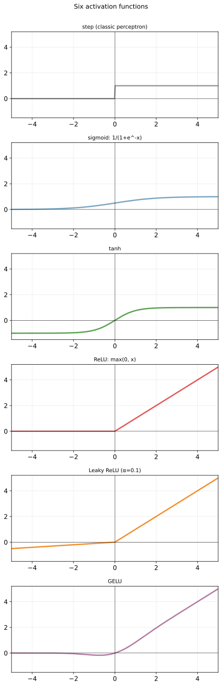
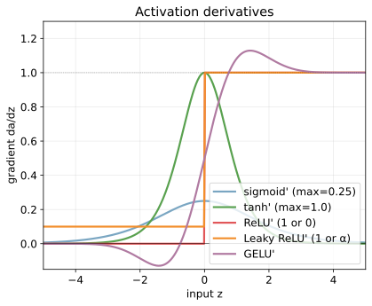
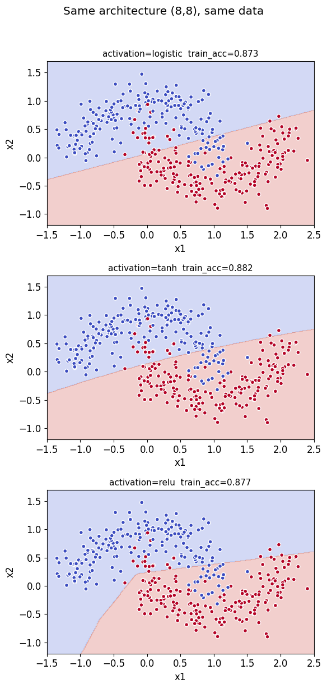
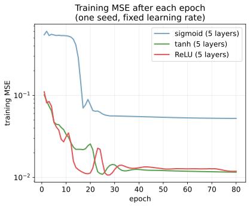
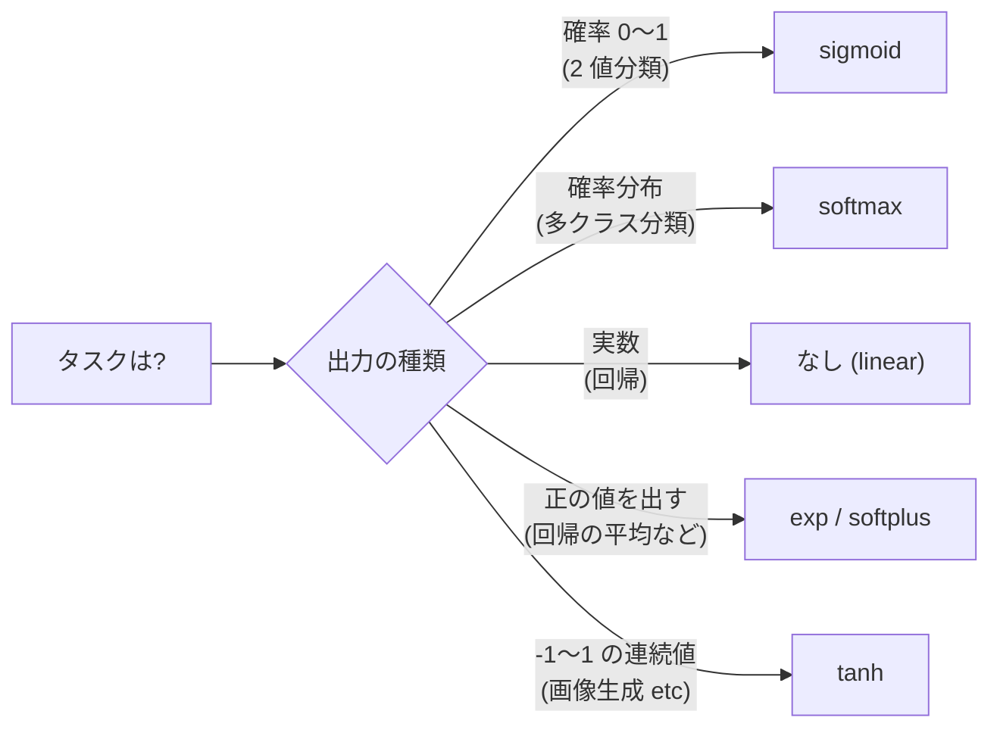

活性化関数（activation function）は、ニューラルネットの各ニューロンで「重み付き和にバイアスを足した結果 `z = w · x + b` を非線形に変換する関数」のことです。層の間に非線形な変換を挟むことで、線形なモデルだけでは表せない入力と出力の関係を学習できます。

線形変換だけを何層積んでも、合成は結局 1 つの線形変換に潰れます（`A_2 (A_1 x) = (A_2 A_1) x`）。深さに意味を持たせるためには、層と層の間に「非線形」を入れる必要があります。その非線形を担うのが活性化関数で、選び方が学習の速さ・最終精度・[勾配消失](#勾配消失問題と-relu-の登場) の起きにくさを大きく左右します。

[パーセプトロン](../perceptron/)ではstep関数を使い、勾配を使って学習するネットワークではsigmoid、tanh、ReLU、GELUなどを使います。

<br>

本記事では、各関数の入力に対する出力と微分を比べ、同じネットワークで活性化関数を変えた時の学習結果を確認します。

---

### 代表的な活性化関数の形

6つの活性化関数の入力と出力を並べます。以下のコードは計算部分の抜粋です。[NumPy](https://numpy.org/)と[Matplotlib](https://matplotlib.org/)を使った[描画を含む生成コード](https://github.com/nao1215/debimate/blob/main/projects/ml/scripts/notes/activation-functions_gen.py)はGitHubで確認できます。

```python
import numpy as np
import matplotlib.pyplot as plt

x = np.linspace(-5, 5, 400)
sigmoid = 1 / (1 + np.exp(-x))
tanh = np.tanh(x)
relu = np.maximum(0, x)
leaky_relu = np.where(x > 0, x, 0.1 * x)
gelu = 0.5 * x * (1 + np.tanh(np.sqrt(2/np.pi) * (x + 0.044715 * x ** 3)))
step = np.where(x > 0, 1, 0).astype(float)
# 描画処理は省略
```



| 関数 | 値域と形 |
|---|---|
| step | 0か1。不連続 |
| sigmoid | `(0, 1)`。両端で飽和 |
| tanh | `(-1, 1)`。両端で飽和 |
| ReLU | `[0, ∞)`。0で折れ曲がる |
| Leaky ReLU | `α > 0`なら実数全体。負側にも傾きがある |
| GELU | 下限は約−0.170、上は有界でない。滑らか |

[GELUの定義](https://docs.pytorch.org/docs/stable/generated/torch.nn.GELU.html)は `z Φ(z)` で、Φは[標準正規分布](../../math/probability-distributions/)の累積分布関数です。図のコードではtanhによる近似式を使っています。厳密式は `z ≈ -0.752` で約−0.170の最小値を取り、負の無限大では0へ近づきます。値域は実数全体ではありません。近似式の最小値も近い値ですが、厳密には異なります。

数式:

- `sigmoid(z) = 1 / (1 + exp(-z))`
- `tanh(z) = (exp(z) - exp(-z)) / (exp(z) + exp(-z))`
- `ReLU(z) = max(0, z)`
- `LeakyReLU(z) = z if z > 0 else α z` (typical α = 0.01 or 0.1)
- `GELU(z) ≈ 0.5 z (1 + tanh(√(2/π) (z + 0.044715 z³)))`

---

### 勾配消失問題と ReLU の登場

[誤差逆伝播法](../backpropagation/)では、活性化関数の微分だけでなく層の重みも掛けながら勾配を伝えます。その積が小さくなり続けると、入力側の層へ十分な勾配が届きにくくなります。これが勾配消失です。下図は、その要因の1つである活性化関数の微分を比べています。
```python
sigmoid_grad = sigmoid * (1 - sigmoid)        # max = 0.25 at z=0
tanh_grad = 1 - tanh ** 2                      # max = 1.0 at z=0
relu_grad = np.where(x > 0, 1, 0)              # 1 or 0
# 描画処理は省略
```



- sigmoidの微分は最大0.25。活性化関数の微分だけを10個掛けても上限は `0.25^10 ≈ 9.54×10^-7` となる。ただし、これは重みを含めたネットワーク全体の勾配ではない
- tanhの微分は原点で1、入力の絶対値が大きい飽和域では0に近づく
- ReLUの微分は正側で1、負側で0。正側では活性化関数による減衰を避けられるが、重みや他の層による勾配消失まで防ぐわけではない。0では微分できず、図では慣例的に0を割り当てる

ReLUを使った深いネットワークの学習は、[Glorotらの研究](https://proceedings.mlr.press/v15/glorot11a.html)などで扱われています。ただし、活性化関数だけで学習の成否が決まるわけではなく、初期化や正規化、接続方法も関わります。

ある入力でReLUが負側に入っただけでは、永久に学習しなくなるとは言えません。他の入力では正側になったり、前段の更新で入力が変わったりするためです。一方、全訓練入力で負側になり、入力を変える更新も起きなければ、そのニューロンを通る勾配が0の状態が続きます。Leaky ReLUは負側に傾きを残しますが、それだけで学習の成功を保証するものではありません。

---

### 同じネットワークで活性化関数を変えた決定境界

[scikit-learnのMLPClassifier](https://scikit-learn.org/stable/modules/generated/sklearn.neural_network.MLPClassifier.html)で、隠れ層8-8、同じ合成データ、`random_state=0` の条件を揃えます。scikit-learnではsigmoidを `activation="logistic"` で指定します。図の正解率は訓練データ上の値であり、汎化性能の比較ではありません。

```python
from sklearn.datasets import make_moons
from sklearn.neural_network import MLPClassifier

X, y = make_moons(n_samples=400, noise=0.2, random_state=0)
for act in ["logistic", "tanh", "relu"]:
    mlp = MLPClassifier(hidden_layer_sizes=(8, 8), activation=act,
                        max_iter=3000, random_state=0).fit(X, y)
# 描画処理は省略
```



この図は、活性化関数を変えて学習した境界の違いを示します。境界の滑らかさだけから、学習速度や未知のデータへの性能は判断できません。

重み付きの和にバイアスを足す計算をアフィン変換と呼びます。これとReLUを組み合わせた隠れ層の出力は、入力の領域ごとに異なるアフィン関数で表せます。ただし、これを[決定木](../decision-tree/)の軸に沿った分割と同じものと考えることはできません。

---

### 同じ更新回数での学習曲線

隠れ層が16ニューロン×5層の回帰モデルで、活性化関数を変えます。入力は `[-3, 3]` の一様乱数、目的値は `sin(x)` にノイズを加えた値です。学習率0.01、乱数seed 0、80 epochに固定します。epochは訓練データを一巡する単位で、実時間の速さを示すものではありません。

[`MLPRegressor.partial_fit`](https://scikit-learn.org/stable/modules/generated/sklearn.neural_network.MLPRegressor.html)で1 epochずつ学習し、重みを更新する最適化手法Adamの内部状態も継続します。各epochの終了後に全訓練データの予測を計算し、[平均二乗誤差（MSE）](../loss-functions/)を測ります。`loss_`をそのまま使うと、二乗誤差の係数や正則化項を含むためです。

```python
from sklearn.neural_network import MLPRegressor

rng = np.random.default_rng(0)
n = 1000
X_data = rng.uniform(-3, 3, (n, 1))
y_data = np.sin(X_data.squeeze()) + 0.1 * rng.normal(size=n)

def train_curve(activation, n_epochs=80):
    mlp = MLPRegressor(hidden_layer_sizes=(16, 16, 16, 16, 16),
                       activation=activation, solver="adam",
                       max_iter=1, random_state=0,
                       learning_rate_init=0.01)
    losses = []
    for _ in range(n_epochs):
        mlp.partial_fit(X_data, y_data)
        losses.append(float(np.mean((mlp.predict(X_data) - y_data) ** 2)))
    return losses

for act in ["logistic", "tanh", "relu"]:
    print(act, f"{train_curve(act)[-1]:.6f}")
```



scikit-learn 1.8.0、NumPy 2.4.1での80 epoch後の結果です。

```text
logistic 0.052425
tanh 0.011603
relu 0.011914
```

この条件ではsigmoidの訓練MSEが他の2つより大きく、tanhとReLUは近い値になりました。ただし、勾配自体を測定していないため、曲線の差を勾配消失だけが原因だと断定はできません。同じ乱数seedでも活性化関数によって初期化の尺度が変わるため、重みが完全に同じ比較でもありません。

また、訓練MSEが小さいことは未知のデータで良いことを保証しません。手法を選ぶには、複数のseedや学習率、評価用データで比較する必要があります。

---

### 出力層の活性化関数

ここまでの比較は、隠れ層の活性化関数を変える実験でした。出力層では、予測したい値の範囲や意味に合わせて関数を選びます。



| タスク | 出力活性化 | 損失関数 |
|---|---|---|
| 2 値分類 | sigmoid | binary cross-entropy |
| 多クラス分類 | softmax | categorical cross-entropy |
| 回帰 | linear（なし） | MSE / MAE |
| 正の連続値 | exp / softplus | MSEや、仮定した連続分布の負の対数尤度 |
| 非負整数のカウント | exp / softplusで平均を出す | Poissonの負の対数尤度 |
| ピクセル値生成 | tanh / sigmoid | MSE / cross-entropy |

これらは [損失関数](../loss-functions/) の選び方とセットで決まります。sigmoid + binary cross-entropy、softmax + categorical cross-entropy は数値的に安定な実装が標準で、フレームワークでは [`BCEWithLogitsLoss`](https://docs.pytorch.org/docs/stable/generated/torch.nn.BCEWithLogitsLoss.html) や [`CrossEntropyLoss`](https://docs.pytorch.org/docs/stable/generated/torch.nn.CrossEntropyLoss.html) が「activation + loss」を内部で融合してくれます。

---

### 数学での使いどころ

- 非線形変換と万能近似性: 適切な活性化関数と十分な幅などの条件の下で、コンパクトな範囲の連続関数を近似する。特定の学習法でその近似を得られる保証とは別
- 連鎖律と勾配計算: [偏微分と勾配](../../math/partial-derivative-gradient/)・[誤差逆伝播法](../backpropagation/) の核心
- フーリエ近似と ReLU: ReLU の組み合わせが基底関数として機能する
- [凸性](../../math/convex-functions/)とニューラルネット: ReLUは2つのアフィン関数 `0` と `z` の最大値なので凸。ただし、多層ネットワークの重みについて損失が凸になるわけではない
- 確率分布の出力: sigmoid / softmaxは実数のスコアを確率へ変換する

---

### 機械学習での使いどころ

- 隠れ層のデフォルト: ReLUやGELUなど。モデルの容量だけで選ばず、学習条件と併せて比較
- 2 値分類の出力層: sigmoid + BCE 損失
- 多クラス分類の出力層: softmax + CE 損失
- 回帰の出力層: なし（linear）+ MSE / MAE
- LSTM / GRU のゲート: sigmoid（0〜1 を「開ける/閉める」割合として）
- 自然言語処理 (Transformer): [GELU](https://arxiv.org/abs/1606.08415)などを利用。全てのモデルが同じ関数を使うわけではない
- 画像生成 (GAN, Diffusion): tanh（出力を -1〜1 に正規化する場合）
- 強化学習のポリシー: softmax（離散行動）または tanh（連続行動）

ReLU の問題（dead neuron）が顕在化したケースでは、Leaky ReLU、ELU、Swish、GELU を試します。関数を変える場合も、同じ評価条件で比較します。

---

### 適さないケース / 落とし穴

- ReLUの負側ではその入力からの勾配が0になる。ただし1回負になったことと、全訓練入力で更新が止まることは別
- 出力にReLUを使うと負の値を出せない。目的変数の範囲と出力関数を合わせる
- 確率として扱う出力は範囲と正規化を確認する。logitsを受け取る損失へsigmoidやsoftmaxを二重に適用しない
- 勾配消失・爆発は、活性化関数だけでなく重みの初期化、正規化、接続方法にも依存する
- 活性化関数の比較では、データ、学習率、更新回数、初期化、評価対象を記録する。1回の訓練曲線で優劣を一般化しない
