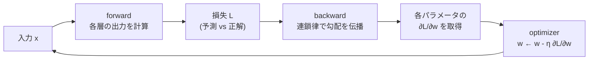

誤差逆伝播法（backpropagation, backprop）は、ニューラルネットの全パラメータについて損失の勾配を効率的に計算するアルゴリズムです。[偏微分と勾配](../../math/partial-derivative-gradient/) で扱った連鎖律（chain rule）を計算グラフに沿って適用します。ネットワークの深さや幅によらず、全パラメータの勾配を `O(forward の計算量)` で求められます。

backprop 自体は学習則ではなく、勾配を計算するだけの手続きです。求めた勾配を [最急降下法・SGD](../../math/gradient-descent-sgd/) や [Adam](https://arxiv.org/abs/1412.6980) に渡してパラメータを更新する、という分業構造になっています。`forward → loss → backward → optimizer.step()` の 1 セットが深層学習の学習ループそのものとなります。

---

### 全体像: forward と backward の対



forward と backward は逆方向に走ります。backward は forward で計算した中間値（activations）を使うので、forward の中間値を全部メモリに保持しておく必要があります。

---

### 最小例で手計算

2 層 NN を 1 サンプルで動かして、forward と backward を全部書き下します。

ネットワーク:

`z_1 = w_1 x + b_1`
`a_1 = ReLU(z_1)`
`z_2 = w_2 a_1 + b_2`
`L = (z_2 - y)^2`

数値: `x=2, w_1=3, b_1=-1, w_2=0.5, b_2=2, y=5`

```python
# Forward
x, w1, b1, w2, b2, y = 2.0, 3.0, -1.0, 0.5, 2.0, 5.0
z1 = w1 * x + b1            # 5
a1 = max(0, z1)              # 5 (ReLU)
z2 = w2 * a1 + b2            # 4.5
L = (z2 - y) ** 2            # 0.25

# Backward (chain rule)
dL_dz2 = 2 * (z2 - y)        # -1
dL_dw2 = dL_dz2 * a1          # -5
dL_db2 = dL_dz2 * 1           # -1
dL_da1 = dL_dz2 * w2          # -0.5
dL_dz1 = dL_da1 * (1 if z1 > 0 else 0)  # -0.5
dL_dw1 = dL_dz1 * x           # -1
dL_db1 = dL_dz1 * 1           # -0.5

print(f"L = {L}")
print(f"∂L/∂w1 = {dL_dw1}, ∂L/∂b1 = {dL_db1}")
print(f"∂L/∂w2 = {dL_dw2}, ∂L/∂b2 = {dL_db2}")
```

出力:

```text
L = 0.25
∂L/∂w1 = -1.0, ∂L/∂b1 = -0.5
∂L/∂w2 = -5.0, ∂L/∂b2 = -1.0
```



青い矢印が forward で、各ノードの中に値、右上に赤で勾配 `∂L/∂node` を書いています。backward は L から左へ進み、各ノードの勾配を 1 つ右のノードの勾配から求めます。たとえば `∂L/∂w2` と `∂L/∂a1` はどちらも `∂L/∂z2 = -1` を使うので、z2 より右の計算を繰り返さずに済みます。

---

### 連鎖律の本質

`L = f(g(h(x)))` のような合成関数の微分は、

`dL/dx = (dL/df) × (df/dg) × (dg/dh) × (dh/dx)`

と「各段階の微分の積」になります。これが連鎖律で、深いネットでは層の数だけ微分を掛け合わせることに対応します。



青の forward 矢印が値の計算、赤の backward 矢印が勾配の伝播です。各段階で必要なのは forward で求めた値とその段階の微分だけなので、深さ N に対して N 回の掛け算で全勾配が取れます。

図の例は `L = log(exp(sin²x)) = sin²x` なので、4 つの微分を掛けると `(1/f) × exp(g) × 2h × cos(x) = 2 sin(x) cos(x)` になり、`sin²x` を直接微分した結果と一致します。

連鎖律自体は 17 世紀の Leibniz の頃からあります。それを多層のニューラルネットの学習に使い、隠れ層が有用な表現を学べることを示して広めたのが Rumelhart, Hinton, Williams（1986）の論文 [Learning representations by back-propagating errors](https://www.nature.com/articles/323533a0) です。

---

### 計算グラフとしての見方

複雑な NN を「計算グラフ（computational graph）」として捉えると、backward の方向が「グラフを逆向きに辿る」だけになります。



各ノードは「演算」、エッジは「データの流れ」を表します。forward では入力から損失まで値を計算して保持し、backward では損失から始めて各ノードの勾配を上流に伝播していきます。

[PyTorch](https://pytorch.org/) / [TensorFlow](https://www.tensorflow.org/) / [JAX](https://github.com/jax-ml/jax) といったフレームワークは、内部でこの計算グラフを自動構築し、`loss.backward()` 1 行で全勾配を取得できる仕組み（automatic differentiation, autograd）を提供しています。

```python
# PyTorch での例
import torch

x = torch.tensor(2.0, requires_grad=True)
w1 = torch.tensor(3.0, requires_grad=True)
b1 = torch.tensor(-1.0, requires_grad=True)
w2 = torch.tensor(0.5, requires_grad=True)
b2 = torch.tensor(2.0, requires_grad=True)
y = torch.tensor(5.0)

z1 = w1 * x + b1
a1 = torch.relu(z1)
z2 = w2 * a1 + b2
L = (z2 - y) ** 2

L.backward()  # 自動で全パラメータの勾配を計算
print(f"∂L/∂w1 = {w1.grad}")  # ∂L/∂w1 = -1.0
print(f"∂L/∂w2 = {w2.grad}")  # ∂L/∂w2 = -5.0
```

`requires_grad=True` を付けたテンソルは [autograd](https://docs.pytorch.org/docs/stable/autograd.html) の追跡対象になり、`backward()` で勾配が `.grad` 属性に書き込まれます。手計算と同じ -1 と -5 が得られます。ネットワーク構造が複雑になっても、勾配を計算する backward の処理を手書きする必要はありません。

---

### 勾配消失問題: なぜ深いと学習が遅いのか

連鎖律で勾配を掛け合わせる時、1 層ごとに掛かる係数（活性化関数の微分と重み）が 1 より小さいと、入力側の層ほど勾配が指数的に小さくなります。これが [活性化関数](../activation-functions/) のノートでも触れた勾配消失（vanishing gradient）問題です。

実際に 10 層の全結合ネット（各層 64 ユニット）を NumPy で組み、forward と backward を手で書いて、初期化直後の各層の重みの勾配の大きさ `‖∂L/∂W_i‖` を測ります。活性化関数だけを sigmoid・tanh・ReLU で入れ替え、重み・入力・正解は同じ乱数で揃えます。

```python
import numpy as np

ACTS = {
    "sigmoid": (lambda z: 1 / (1 + np.exp(-z)),
                lambda z: (s := 1 / (1 + np.exp(-z))) * (1 - s)),
    "tanh": (np.tanh, lambda z: 1 - np.tanh(z) ** 2),
    "relu": (lambda z: np.maximum(z, 0), lambda z: (z > 0).astype(float)),
}


def layer_grad_norms(act, n_layers=10, width=64, batch=256, seed=0):
    rng = np.random.default_rng(seed)
    f, df = ACTS[act]
    # 重みは平均 0、標準偏差 1/√width の正規分布で初期化する
    Ws = [rng.normal(0, 1 / np.sqrt(width), (width, width)) for _ in range(n_layers)]
    x = rng.normal(size=(batch, width))
    t = rng.normal(size=(batch, width))

    # forward: 各層の入力 h と活性化前の z を保持する
    hs, zs = [x], []
    for W in Ws:
        zs.append(hs[-1] @ W)
        hs.append(f(zs[-1]))

    # L は二乗誤差の和をバッチ数で割ったもの。g は ∂L/∂(最終層の出力)
    g = 2 * (hs[-1] - t) / batch

    # backward: 出力側から 1 層ずつ連鎖律を適用する
    norms = [0.0] * n_layers
    for i in reversed(range(n_layers)):
        g = g * df(zs[i])                       # ∂L/∂z_i
        norms[i] = np.linalg.norm(hs[i].T @ g)  # ||∂L/∂W_i||
        g = g @ Ws[i].T                         # ∂L/∂h_i（1 つ入力側の層へ渡す）
    return norms


for act in ["sigmoid", "tanh", "relu"]:
    n = layer_grad_norms(act)
    print(f"{act:7s} 10層目={n[-1]:.2e}  1層目={n[0]:.2e}  1層目/10層目={n[0] / n[-1]:.1e}")
```

出力:

```text
sigmoid 10層目=7.72e+00  1層目=4.16e-06  1層目/10層目=5.4e-07
tanh    10層目=3.00e+00  1層目=2.52e+00  1層目/10層目=8.4e-01
relu    10層目=1.44e-01  1層目=1.97e-01  1層目/10層目=1.4e+00
```



図は各層の勾配を 10 層目（出力側）との比で表しています。sigmoid は入力側へ 1 層進むごとにおよそ 5 分の 1 になり、1 層目では 10 層目の `5.4e-07` 倍しか残りません。

sigmoid の微分は最大でも 0.25（z = 0 の時）なので、重みの標準偏差を `1/√64` にして信号の大きさを保つ初期化でも、1 層ごとに 4 分の 1 以下に縮みます。これでは入力側の重みがほぼ更新されず、学習が進みません。

tanh と ReLU は、この条件では 1 層目まで同じ桁の勾配が届きます。tanh は 0 付近の微分が 1 に近く、ReLU は正の領域で微分がちょうど 1 だからです。ただし tanh も入力が大きくなって飽和すると、微分が 0 に近づいて勾配が消えます。

seed を 1〜3 に変えても、sigmoid の比は `4e-07`〜`6e-07` に収まりました。上記の backward は、同じ重みで PyTorch の autograd が計算した勾配とも相対誤差 `1e-15` 以下で一致しています。

勾配消失への主な対策は次のとおりです。

- ReLU 系の [活性化関数](../activation-functions/) を使う（正の領域で飽和しない）
- Residual connection（[ResNet](https://arxiv.org/abs/1512.03385)）: 勾配を skip 接続で直接下位層に届ける
- [Batch normalization](https://arxiv.org/abs/1502.03167): 各層の入力分布を正規化して活性化関数の飽和域を回避
- 適切な重み初期化（[Xavier](https://proceedings.mlr.press/v9/glorot10a.html) / [He](https://arxiv.org/abs/1502.01852)）: 層を通るたびに信号と勾配が縮んだり膨らんだりしないように分散を揃える

これらが組み合わさって、現代の 100 層 / 1000 層の超深層モデルが学習可能になっています。

---

### Forward / backward のメモリと計算量

backprop の計算量は forward と同じオーダーですが、全層の中間値を保持する分だけメモリが大きくなります。深いネットほどメモリを消費する主因はここです。以下の表の N は層の数です。

| 量 | forward だけ | backprop |
|---|---|---|
| 計算量 | `O(N)` | `O(N)`（実質 2-3 倍） |
| メモリ | `O(layer width)`（前層のみ保持） | `O(N × layer width)`（全層保持） |

大規模モデル（LLM 等）でメモリが厳しい時の対処:

- [Gradient checkpointing](https://docs.pytorch.org/docs/stable/checkpoint.html): 中間値を保存せず、必要時に再計算（メモリ↓、計算量↑）
- Mixed precision（fp16, bf16）: 中間値の精度を下げてメモリ半減
- Activation offloading: 中間値を CPU や別 GPU に退避

これらは PyTorch / [DeepSpeed](https://github.com/deepspeedai/DeepSpeed) / [Megatron-LM](https://github.com/NVIDIA/Megatron-LM) 等のフレームワークが標準サポートしています。

---

### 数学での使いどころ

- 連鎖律の機械的適用: [偏微分と勾配](../../math/partial-derivative-gradient/) のノートで扱った合成関数の微分そのもの
- 自動微分（automatic differentiation）の理論: forward mode と reverse mode、後者が backprop に対応
- ヤコビ行列の計算: NN の各層は線形変換 + 非線形なので、層ごとにヤコビ行列を計算して掛け合わせる
- 微分可能プログラミング: NN 以外の微分可能な計算（物理シミュレーション、レンダリング）にも backprop を使う
- 計算複雑性: 勾配全体を関数の計算量の定数倍で求められることは [Baur-Strassen の定理（1983）](https://doi.org/10.1016/0304-3975(83)90110-X) で示されている

---

### 機械学習での使いどころ

backprop はニューラルネット学習のあらゆる場面で使われます。

- 教師あり学習: CNN / RNN / Transformer の全モデル
- 強化学習: ポリシー勾配法（REINFORCE）、Actor-Critic
- 生成モデル: VAE、GAN、Diffusion Model
- 大規模言語モデル: BERT / GPT などの pre-training と fine-tuning
- RNN: 時間方向に展開して backprop を適用する backprop through time (BPTT)
- メタ学習: MAML 等の二階微分を含むアルゴリズム

すべて「微分可能な計算をグラフ化 → backward で勾配取得 → optimizer で更新」の同じパターンで動いています。

---

### 適さないケース / 落とし穴

- 微分不可能な演算（argmax、サンプリング、整数演算）: 勾配が定義されない。straight-through estimator、Gumbel-Softmax、REINFORCE 等で代用
- 計算グラフが極端に深い（RNN を 1000 step 展開等）: メモリ使用量が増え、勾配消失も起こりやすくなる。truncated BPTT、Transformer への切り替え
- forward と backward の不整合: 独自の演算で backward を手書きすると、forward の微分とずれることがある。[torch.autograd.gradcheck](https://docs.pytorch.org/docs/stable/generated/torch.autograd.gradcheck.gradcheck.html) で数値微分と照合する
- 勾配爆発: 連鎖律の積で勾配が指数的に大きくなる現象（消失の逆）。gradient clipping で対処
- detach し忘れ: 「教師信号として固定したいテンソル」を `.detach()` せずに使うと、そこから勾配が流れて学習が壊れる
- in-place 演算: backward に必要な中間値を `a += 1` のように書き換えると、PyTorch は `backward()` の時点で RuntimeError を出す。`a = a + 1` なら新しいテンソルになる
- 重みの初期値の大きさが不適切: 層を通るたびに勾配が縮むか膨らみ、学習の最初から勾配消失・爆発が起きる。活性化関数に合わせた He / Xavier 初期化が標準
- 勾配の数値精度: fp16 で計算すると勾配がアンダーフローする。loss scaling や bf16 で対処
- backprop と勾配降下を混同: backprop は勾配を計算するだけ、勾配降下（SGD / Adam）は計算した勾配を使ってパラメータを更新する別ステップ。両者は分業
- backprop の代替を検討する: [forward-forward](https://arxiv.org/abs/2212.13345) など実験的な手法が提案されている。ただし、勾配計算の効率と実績の面で、backprop を置き換えるには至っていない
