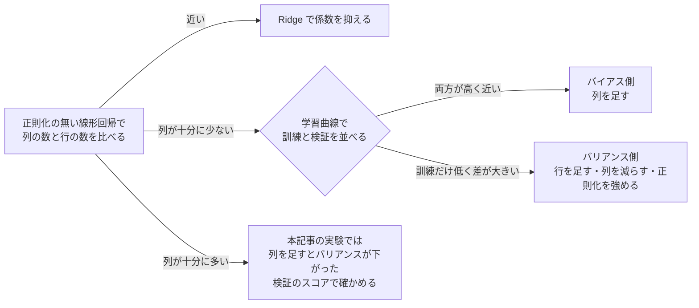

バイアス-バリアンストレードオフ（bias-variance tradeoff）は、モデルの誤差を 2 つの成分に分けて、モデルの複雑さとの関係を説明する考え方です。1 つ目のバイアスは、学習データを替えて何度も学習した時に、予測の平均が正解からどれだけずれるかです。2 つ目のバリアンスは、学習データを替えるたびに予測がどれだけばらつくかです。

定番の教科書 [The Elements of Statistical Learning](https://hastie.su.domains/ElemStatLearn/)（第 2 版、2.9 節）は、この関係を次のように書いています。

> More generally, as the model complexity of our procedure is increased, the variance tends to increase and the squared bias tends to decrease.

訳すと「一般に、手法の複雑さを上げるとバリアンスは増える傾向にあり、バイアスの 2 乗は減る傾向にある」です。複雑にし過ぎるとバリアンスが増えて誤差が上がるので、その手前の釣り合う所を選ぶ、というのがトレードオフの意味です。本はこの文の直前で、[k 近傍法](../knn/)で近傍に使う数 k を例に挙げています。k が小さいほど複雑で、バリアンスが大きくなります。

この 1 文を手元で試しました。[scikit-learn](https://scikit-learn.org/stable/) に同梱の手書き数字 [load_digits](https://scikit-learn.org/stable/modules/generated/sklearn.datasets.load_digits.html) から 200 行を選んで線形回帰を学習し、64 画素から乱数で作る列（特徴量）を 5〜4000 本に増やしました。列が多いほど細かい形を表せるので、列の数を複雑さとみなします。列ごとに別の 200 行で 40 回学習し直し、バイアスとバリアンスを測りました。



列が 200 本より少ない左側は、引用のとおりでした。列を増やすとバイアスの 2 乗は減り、バリアンスは増え、数字を外した割合（誤分類率）は列 75 本の 0.119 で底を打ちます。ところが列の数が学習に使う行の数と同じ 200 本になると、バリアンスは 1593 まで跳ね上がり、10 択の数字を 8 割外しました。その先で列を増やし続けると、バリアンスもバイアスも下がり、列 4000 本の誤分類率は 0.045 と、左側の一番良い所の半分以下になりました。

検証のスコアが伸びない時に、列を足すか、行を集めるか、正則化を掛けるかは、よくある判断です。学習に使う行より列やパラメータの方が多いモデルは、遺伝子や文書の単語を列にした表でも、大きなニューラルネットでも珍しくありません。上記の図にある線形回帰では、同じ「列を足す」でも、どこから足すかで結果が逆になりました。

<br>

本記事では、ML を学び始めた人と、scikit-learn で手元のデータにモデルを使う人に向けて、次の疑問に答えます。

- バイアスとバリアンスは、何を数えた値なのか。
- 列を増やし続けると、バリアンスは増え続けるのか。
- 列の数が行の数に並ぶと、なぜ誤差が跳ね上がるのか。
- 行を足せば、誤差は必ず下がるのか。
- 正則化を掛けると、この山はどう変わるのか。
- 手元の 1 組のデータでバリアンスを測る時、何に気を付けるのか。

実験は scikit-learn 1.9.1 と [NumPy](https://numpy.org/) 2.5.4 で行いました。図を描く処理も含めた完全なコードは [bias-variance-tradeoff_gen.py](https://github.com/nao1215/debimate/blob/main/projects/ml/scripts/notes/bias-variance-tradeoff_gen.py) にあります。

---

### バイアスとバリアンスの数え方

load_digits は、8 × 8 画素の手書き数字 1797 枚で、各行は 64 画素の濃さです。正解の数字に当たる列だけを 1 にした 10 列を目標にして[線形回帰](../linear-regression/)で当てはめ、10 列のうち一番大きい値を予測の数字にします。

列は、scikit-learn の [RBFSampler](https://scikit-learn.org/stable/modules/generated/sklearn.kernel_approximation.RBFSampler.html) で 64 画素から作ります。RBFSampler は、乱数で決めた向きに画素を重み付けして足し、指定した本数だけ、その値の cos を取った列を作ります。[Rahimi 氏と Recht 氏の論文](https://papers.nips.cc/paper/3182-random-features-for-large-scale-kernel-machines)で提案された方法で、本数が多いほど、細かい形まで表せます。本記事では、この本数 p をモデルの複雑さとして扱います。

```python
X, y = load_digits(return_X_y=True)   # 8×8 画素の手書き数字 1797 枚
X = X / 16.0                           # 画素の値を 0〜1 に
Y = np.eye(10)[y]                      # 正解の数字の列だけ 1 にした 10 列
rng = np.random.default_rng(0)
order = rng.permutation(len(X))
test, pool = order[:400], order[400:]  # 測る 400 枚と、学習に使う行を選ぶ元の 1397 枚
n = 200                                # 1 回の学習に使う行の数
R = 40                                 # 学習し直す回数


def features(p):
    """64 画素から、乱数で決めた p 本の列を作る（全行分）。"""
    return RBFSampler(gamma=0.05, n_components=p, random_state=0).fit(X).transform(X)


# 切片を付けると山の位置が 1 本ずれるので、作った列だけで当てはめる
def bias_variance(p, n=n, make=lambda: LinearRegression(fit_intercept=False), seed=1):
    F = features(p)
    rng = np.random.default_rng(seed)
    preds = np.empty((R, len(test), 10))
    for r in range(R):
        rows = rng.choice(pool, n, replace=False)   # 毎回違う 200 行で学習し直す
        preds[r] = make().fit(F[rows], Y[rows]).predict(F[test])
    mean = preds.mean(axis=0)                        # 40 個のモデルが出した予測の平均
    bias2 = np.mean(np.sum((mean - Y[test]) ** 2, axis=1))
    var = np.mean(np.sum(preds.var(axis=0), axis=1))
    miss = np.mean(np.argmax(preds, axis=2) != y[test])
    return bias2, var, miss, preds
```

`bias_variance` は、選ぶ元の 1397 枚から重複無しで 200 行を選んで学習する操作を 40 回繰り返し、テストの 400 枚に対する 40 組の予測を集めます。テストの 1 枚目（正解は 6）について、列 10 本・200 本・4000 本のそれぞれで、40 個のモデルが「6」の列に付けた点数を比べます。正解なら 1 になるのが理想です。

```python
img = test[0]
for p in [10, 200, 4000]:
    *_, preds = bias_variance(p)
    s = preds[:, 0, y[img]]                          # 正解の数字の列に付けた点数
    print(f"p={p:<5} 平均 {s.mean():6.2f}  正解との差 {s.mean() - 1:6.2f}  標準偏差 {s.std():6.2f}"
          f"  最小 {s.min():7.2f}  最大 {s.max():7.2f}")
```

```text
p=10    平均   0.39  正解との差  -0.61  標準偏差   0.07  最小    0.25  最大    0.51
p=200   平均   2.43  正解との差   1.43  標準偏差   3.68  最小   -4.10  最大   15.93
p=4000  平均   1.08  正解との差   0.08  標準偏差   0.06  最小    0.95  最大    1.25
```



点の固まりの中心が 1 からずれる量がバイアス、点の広がりがバリアンスです。列 10 本は、どの 200 行で学習しても 0.4 付近に揃い、そろって正解に届きません。列 200 本は、学習した 200 行によって -4.1 から 15.9 まで散らばります。列 4000 本は、中心がほぼ 1 で、広がりも列 10 本と同じくらい小さくなっています。

<br>

#### 二乗誤差を 2 つに分ける式

テストの 1 行の正解を `y`、学習データを替えて得た予測を `ŷ` とし、学習データの選び方について平均を取る記号を `E[ ]` と書きます。この平均が[期待値](../../math/expectation/)です。予測の平均 `E[ŷ]` を引いて足すと、二乗誤差は次の 2 つに分かれます。

```text
E[(y − ŷ)²] = (y − E[ŷ])² + E[(ŷ − E[ŷ])²]
```

右辺の 1 つ目がバイアスの 2 乗（以下、バイアス²）、2 つ目がバリアンス（予測の[分散](../../math/variance/)）です。展開すると残る掛け算の項は、`E[ŷ − E[ŷ]] = 0` なので消えます。上記のコードは、この 2 つを 10 列とテストの 400 行について足し、平均しています。

この足し算が成り立つのは二乗誤差なので、本記事で 2 つに分けるのは二乗誤差だけで、誤分類率は結果として並べます。バリアンスが大きく効いて訓練データにだけ合う状態が[過学習](../overfitting/)、バイアスが大きく効いて訓練データにも合わない状態が未学習です。

<br>

<details>
<summary>二乗誤差以外の損失と、ノイズの項</summary>

誤分類率のように当たりか外れかだけを数える[損失](../loss-functions/)では、同じ足し算になりません。Domingos 氏の[論文](https://homes.cs.washington.edu/~pedrod/papers/mlc00a.pdf)は、当たり外れの損失に合わせた分け方を提案し、多数決の予測が外れている点ではバリアンスが増えるほど誤差が減る、という直感に反する例も示しています。交差エントロピーでも、二乗誤差と似た形の分け方が[導かれています](https://arxiv.org/abs/2511.08789)。

教科書では、正解そのものの揺れ（ノイズ）を 3 つ目の項「ノイズの分散」として足すのが普通です。load_digits ではノイズだけを取り出せないので、本記事のバイアス² はノイズを含んだ値です。

</details>

<br>

40 個のモデルで予測を平均すれば、バリアンスの大部分は消えます。これを手法にしたのが[アンサンブル学習](../ensemble-learning/)のバギングで、多数の[決定木](../decision-tree/)を平均する[ランダムフォレスト](../random-forest/)もその 1 つです。前のモデルが外した分を順に直す[勾配ブースティング](../gradient-boosting/)は、逆にバイアスを減らす側の手法です。

---

### 列の数を増やした結果

列の数 p を 5 本から 4000 本まで 24 通りに変えて `bias_variance` を呼んだ結果が、冒頭の図です。

```python
ps = [5, 10, 20, 30, 50, 75, 100, 125, 150, 175, 190, 200, 210, 225, 250, 300,
      400, 500, 700, 1000, 1500, 2000, 3000, 4000]
rows = []
for p in ps:
    b2, var, miss, _ = bias_variance(p)
    rows.append((p, b2, var, miss))
    print(f"p={p:<5} バイアス² {b2:8.3f}  バリアンス {var:9.3f}  二乗誤差 {b2 + var:9.3f}  誤分類率 {miss:.3f}")
res = np.array(rows)   # 列ごとに p・バイアス²・バリアンス・誤分類率
```

```text
p=5     バイアス²    0.766  バリアンス     0.016  二乗誤差     0.783  誤分類率 0.590
p=75    バイアス²    0.280  バリアンス     0.165  二乗誤差     0.445  誤分類率 0.119
p=150   バイアス²    0.198  バリアンス     0.525  二乗誤差     0.722  誤分類率 0.163
p=190   バイアス²    0.273  バリアンス     3.278  二乗誤差     3.550  誤分類率 0.440
p=200   バイアス²   41.453  バリアンス  1593.168  二乗誤差  1634.621  誤分類率 0.798
p=210   バイアス²    0.242  バリアンス     3.333  二乗誤差     3.575  誤分類率 0.439
p=300   バイアス²    0.150  バリアンス     0.355  二乗誤差     0.505  誤分類率 0.113
p=1000  バイアス²    0.117  バリアンス     0.104  二乗誤差     0.221  誤分類率 0.053
p=4000  バイアス²    0.106  バリアンス     0.077  二乗誤差     0.183  誤分類率 0.045
```

出力は 24 行のうち 9 行の抜粋で、全ての行を描いたのが冒頭の図です。図を左から読むと、形は 3 つの区間に分かれます。

列 150 本までは、引用の文のとおりです。二乗誤差は列 50〜75 本で底を打ち、そこから上がる U 字を描きます。p = 200 より手前の 190 本からバリアンスが急に増え、200 本で 1593 になります。バイアス² は 40 個の予測を平均してから正解との差を測るので、平均そのものに残る揺れ、つまりバリアンスを 40 で割った分が混ざります。p = 200 でバイアス² が 41 と大きいのは、この混ざる分が 1593 ÷ 40 で 40 ほどあるためです。

p = 200 を越えると、列を足すたびにバリアンスもバイアスの 2 乗も下がります。複雑にしたのにバリアンスが減るので、右側では「列の数＝複雑さ」という見方が当てはまっていません。誤差が一度下がり、上がり、また下がる形は二重降下（double descent）と呼ばれ、Belkin 氏らの[論文](https://arxiv.org/abs/1812.11118)が名付けました。この論文は、RBFSampler と同じ作り方の列で MNIST という手書き数字のデータを学習した結果に加え、全結合のニューラルネットやランダムフォレストでも同じ形を示しています。

Nakkiran 氏らの [Deep Double Descent](https://arxiv.org/abs/1912.02292) は、画像に使う畳み込みニューラルネットや、文章に使う Transformer でも、幅を広げた時や学習を長く続けた時に同じ形が出ることを報告しています。

---

### 列の数が行の数に並ぶ所

山が p = 200 に出るのは、行の数が 200 だからです。列の数 p と行の数 n の大小で、線形回帰が解く問題が変わります。点を通る直線にならって、学習データのどの行でも予測が正解と一致することを「全ての行を通る」と書きます。

- p < n: 全ての行を通る係数は無いので、誤差の二乗和が最小の係数を選ぶ
- p = n: 全ての行をちょうど通る係数が 1 つだけある
- p > n: 全ての行を通る係数が無数にあり、どれかを選ぶ必要がある

p > n の時、scikit-learn の [LinearRegression](https://scikit-learn.org/stable/modules/generated/sklearn.linear_model.LinearRegression.html) は SciPy の [lstsq](https://docs.scipy.org/doc/scipy/reference/generated/scipy.linalg.lstsq.html) を呼び、全ての行を通る係数のうち、係数の 2 乗和が一番小さいものを返します。これを最小ノルム解（minimum-norm solution）と呼びます。

次のコードは、1 組の 200 行について、列を 200 行 × p 列に並べた行列で一番小さい特異値と、学習した係数の大きさを測ります。[特異値](../../math/eigen-decomposition/)は、長さ 1 の係数ベクトルに行列を掛けた時、向きごとに、予測の長さが何倍になるかを並べた値です。一番小さい特異値が 0 に近い向きは、その向きの係数を大きくしても学習データの予測がほとんど変わりません。

```python
rows_one = np.random.default_rng(1).choice(pool, n, replace=False)   # 1 組の 200 行
for p in ps:
    Fp = features(p)[rows_one]
    s = np.linalg.svd(Fp, compute_uv=False)                          # 大きい順の特異値
    model = LinearRegression(fit_intercept=False).fit(Fp, Y[rows_one])
    if p in (100, 200, 4000):
        ref = np.linalg.lstsq(Fp, Y[rows_one], rcond=None)[0].T
        print(f"p={p:<5} 最小の特異値 {s[-1]:.2e}  係数の大きさ {np.linalg.norm(model.coef_):9.2f}"
              f"  NumPy の最小ノルム解と一致: {np.allclose(model.coef_, ref, atol=1e-6)}")
```

```text
p=100   最小の特異値 6.78e-02  係数の大きさ     27.66  NumPy の最小ノルム解と一致: True
p=200   最小の特異値 4.01e-04  係数の大きさ    871.18  NumPy の最小ノルム解と一致: True
p=4000  最小の特異値 4.88e-02  係数の大きさ     30.30  NumPy の最小ノルム解と一致: True
```



p = 200 では、200 本の列でちょうど 200 行を通す必要があります。一番小さい特異値は 4.0e-4 で、p = 100 の 170 分の 1 です。係数を求める時は正解を特異値で割る形になり、この向きでは予測の長さが 4.0e-4 倍にしかならないので、係数は逆に 1 ÷ 4.0e-4 で 2500 倍に引き伸ばされます。学習データに含まれる正解の小さな揺れもこの倍率で係数に入るので、係数の大きさは 871 になり、選んだ 200 行ごとに予測が大きく変わります。冒頭の図でバリアンスが作る山は、この拡大です。

p > n では、全ての行を通る係数が無数にあり、列が多いほど、同じ 200 行を通す方法の中から 2 乗和の小さいものを選べます。列 4000 本では係数の大きさが 30 で、1 本ずつの係数は小さく、予測は滑らかになります。列を足すと、係数を小さくする余地が増え、[正則化](../regularization/)を掛けたのに近い効き方をするということです。Hastie 氏らの[論文](https://arxiv.org/abs/1903.08560)は、最小ノルム解が出す誤差を p と n の比から計算しています。

<br>

<details>
<summary>scikit-learn が小さい特異値を切り捨てる条件</summary>

scikit-learn 1.9 の LinearRegression は、一番大きい特異値の 1e-6 倍より小さい特異値を 0 として切り捨てますが、この実験の p = 200 の比は 3.5e-5 で、切り捨てには届いていません。

</details>

<br>

---

### 行を足すと悪化する範囲

山の位置が p = n で決まるなら、列を 200 本に固定して行を増やしても、n = 200 で同じ山が出るはずです。次のコードは、列 200 本のまま、学習に使う行を 50 行から 600 行まで変えました。

```python
ns = [50, 75, 100, 125, 150, 175, 190, 200, 210, 225, 250, 300, 400, 500, 600]
for m in ns:
    b2, var, miss, _ = bias_variance(200, n=m)
    print(f"n={m:<4} 二乗誤差 {b2 + var:9.3f}  誤分類率 {miss:.3f}")
```

```text
n=100  二乗誤差     0.509  誤分類率 0.147
n=150  二乗誤差     0.776  誤分類率 0.177
n=200  二乗誤差  1634.621  誤分類率 0.798
n=300  二乗誤差     0.470  誤分類率 0.088
n=600  二乗誤差     0.216  誤分類率 0.029
```



行を 100 行から 200 行に倍にすると、誤分類率は 0.147 から 0.798 に悪くなりました。行を足して良くなるのは、300 行を越えてからです。Nakkiran 氏の [More Data Can Hurt for Linear Regression](https://arxiv.org/abs/1912.07242) は、行を足すと誤差が上がる範囲が線形回帰にあることを計算と実験で示しています。

行を増やしながら訓練と検証のスコアを並べた図を学習曲線（learning curve）と呼び、scikit-learn の [learning_curve](https://scikit-learn.org/stable/modules/generated/sklearn.model_selection.learning_curve.html) で描けます。上記の図は、学習曲線の検証側に当たる線が、途中で跳ねる例です。行を足す前に列の数と比べておけば、この山は避けられます。行の数が列の数に近付く所では、行を足すより先に、次で扱う正則化を掛けます。

<br>

#### 山から離れた所の学習曲線

山から離れた所では、学習曲線を見れば、左側の U 字のどちら寄りにいるかが分かります。列を 10 本と 150 本にして、行を 200 行から 1000 行まで増やし、学習に使った行とテストの 400 行で二乗誤差を測りました。ここではテストの 400 行が検証の役をします。

```python
def train_test_error(p, n, seed=1):
    F = features(p)
    rng = np.random.default_rng(seed)
    tr, te = [], []
    for r in range(R):
        rows = rng.choice(pool, n, replace=False)
        model = LinearRegression(fit_intercept=False).fit(F[rows], Y[rows])
        tr.append(np.mean(np.sum((model.predict(F[rows]) - Y[rows]) ** 2, axis=1)))
        te.append(np.mean(np.sum((model.predict(F[test]) - Y[test]) ** 2, axis=1)))
    return np.mean(tr), np.mean(te)

for p in (10, 150):
    for m in [200, 300, 400, 600, 800, 1000]:
        a, b = train_test_error(p, m)
        print(f"p={p:<4} n={m:<5} 訓練の二乗誤差 {a:.3f}  テストの二乗誤差 {b:.3f}")
```

```text
p=10   n=200   訓練の二乗誤差 0.645  テストの二乗誤差 0.724
p=10   n=1000  訓練の二乗誤差 0.670  テストの二乗誤差 0.695
p=150  n=200   訓練の二乗誤差 0.036  テストの二乗誤差 0.722
p=150  n=1000  訓練の二乗誤差 0.137  テストの二乗誤差 0.195
```



列 10 本では、訓練とテストの誤差が近いまま、行を 1000 行にしても 0.7 前後から下がりません。これがバイアス側の形です。列 150 本では、200 行の時に訓練だけが低く、テストとの差が大きく開いています。行を足すほど差が縮み、テストの誤差は 0.195 まで下がりました。これがバリアンス側の形です。

列 10 本の内訳を `bias_variance(10, n=m)` で測ると、行を 50 行から 800 行に増やした時、バリアンスは 0.168 から 0.0035 に減り、バイアス² は 0.701 から 0.694 とほぼ同じでした。行を足して減るのは主にバリアンスで、列が足りないことから来るバイアスは残ります。

---

### Ridge で山を消す

最小ノルム解は、全ての行をちょうど通すことを優先します。[Ridge](https://scikit-learn.org/stable/modules/generated/sklearn.linear_model.Ridge.html) は、誤差の二乗和に係数の 2 乗和の alpha 倍を足した値を最小にするので、全ての行を通すことを諦めてでも、係数を小さく抑えます。`bias_variance` の `make` を Ridge に替えて、同じ 24 通りの p で測りました。

```python
alphas = [1e-3, 1e-2, 1e-1]
ridge = {}
for a in alphas:
    ridge[a] = []
    for p in ps:
        b2, var, miss, _ = bias_variance(p, make=lambda a=a: Ridge(alpha=a, fit_intercept=False))
        ridge[a].append((b2 + var, miss))
    ridge[a] = np.array(ridge[a])
for p in (50, 200, 4000):
    i = ps.index(p)   # res は前の節で LinearRegression を測った結果
    cells = "  ".join(f"alpha={a:g} {ridge[a][i, 0]:7.3f}" for a in alphas)
    print(f"p={p:<5} LinearRegression {res[i, 1] + res[i, 2]:9.3f}  {cells}")
```

```text
p=50    LinearRegression     0.445  alpha=0.001   0.444  alpha=0.01   0.433  alpha=0.1   0.397
p=200   LinearRegression  1634.621  alpha=0.001   0.515  alpha=0.01   0.293  alpha=0.1   0.257
p=4000  LinearRegression     0.183  alpha=0.001   0.180  alpha=0.01   0.174  alpha=0.1   0.201
```



alpha = 0.001 でも、p = 200 の二乗誤差は 1634 から 0.515 に下がりました。alpha = 0.01 以上では山が消え、列を増やすほど誤差が下がる 1 本の曲線になります。Nakkiran 氏らの [Optimal Regularization Can Mitigate Double Descent](https://arxiv.org/abs/2003.01897) は、alpha を適切に選べば、線形回帰のいくつかの設定で二重降下が消えることを示しています。

一方で、列 4000 本では alpha = 0.1 の 0.201 が、LinearRegression の 0.183 より悪くなりました。右側では列の多さが係数を小さくしているので、強い alpha は削り過ぎになります。alpha の効き目はデータや列の大きさでも変わるので、[交差検証](../cross-validation/)で選びます。

---

### 手元の 200 行でバリアンスを測る

ここまでの実験は、選ぶ元の 1397 枚から、別の 200 行を何度でも選べました。実際の作業では手元のデータが 1 組だけで、バリアンスを測るには、その 1 組から行を選び直して学習を繰り返します。よく使うのが、重複を許して同じ数の行を選び直すブートストラップ（bootstrap）です。1 組の 200 行から 40 回ブートストラップして、同じ式でバリアンスを測りました。

```python
def boot_variance(p, base, seed=2):
    F = features(p)
    rng = np.random.default_rng(seed)
    preds = np.empty((R, len(test), 10))
    uniq = []
    for r in range(R):
        rows = rng.choice(base, len(base), replace=True)   # 重複を許して 200 行を選び直す
        uniq.append(len(np.unique(rows)))
        preds[r] = LinearRegression(fit_intercept=False).fit(F[rows], Y[rows]).predict(F[test])
    return np.mean(np.sum(preds.var(axis=0), axis=1)), np.mean(uniq)


boot = [boot_variance(p, rows_one) for p in ps]   # rows_one は前の節で選んだ 1 組の 200 行
bvar = np.array([b[0] for b in boot])
print(f"選び直した 200 行に含まれる、違う行の数（平均）: {np.mean([b[1] for b in boot]):.1f}")
for p in (50, 125, 200, 1000):
    i = ps.index(p)
    print(f"p={p:<5} 別の 200 行のバリアンス {res[i, 2]:9.3f}  ブートストラップのバリアンス {bvar[i]:9.3f}")
```

```text
選び直した 200 行に含まれる、違う行の数（平均）: 126.9
p=50    別の 200 行のバリアンス     0.109  ブートストラップのバリアンス     0.143
p=125   別の 200 行のバリアンス     0.347  ブートストラップのバリアンス    16.834
p=200   別の 200 行のバリアンス  1593.168  ブートストラップのバリアンス     0.313
p=1000  別の 200 行のバリアンス     0.104  ブートストラップのバリアンス     0.070
```



ブートストラップの山は p = 125 にあり、本当に山がある p = 200 では 0.313 と、何も起きていないような値でした。200 行を重複を許して選び直すと、違う行は平均で 127 行ほどしか入りません。同じ行を 2 回並べても通す点は増えないので、選び直した行で学習したモデルにとって、行の数は約 127 行になり、山もそこへ動きます。

山から離れた p = 50 や p = 1000 では、2 つのバリアンスの差は 1.5 倍以内に収まりました。ブートストラップの値を読む時は、違う行の数を数えて、列の数がその数や元の 200 行に近くないかを先に見ます。近ければ、その範囲のバリアンスは信用せず、Ridge を掛けるか、列の数を行の数から離します。交差検証では試していませんが、各回の学習に使う行は全体の (k − 1) / k に減るので、山の位置は同じ向きにずれるはずです。

---

### 列を足すか行を足すか決める前に

正則化を掛けない線形回帰で検証のスコアが伸びない時、最初に見るのは、学習に使う行の数と列の数がどれだけ近いかです。本記事の実験では、2 つが近い所で教科書の U 字の考え方が当てはまらず、列を足しても行を足しても誤差が大きく上下しました。近ければ、Ridge のように係数を小さく抑える正則化を先に掛けます。決定木やニューラルネットでは、山の位置を列の数と行の数だけで読めるとは限りません。

列の数が行の数より十分に少ない左側では、引用の文どおりに考えてよく、バリアンスが大きければ行を足すか、列を減らすか、正則化を強めます。バイアスが大きければ列を足します。行を集めてもバイアスはほとんど減らないので、データを集める手間を掛ける前に、どちらが大きいかを決めます。

どちらが大きいかは、学習曲線で訓練と検証の誤差を並べると見当が付きます。両方が高く近ければバイアス側、訓練だけ低く検証との差が大きければバリアンス側です。予測のばらつきを数で知りたい時は学習データを選び直して測りますが、ブートストラップでは行の数が実質 6 割ほどになることを差し引いて読みます。列の数や alpha のように学習の前に決める値の探し方は、[ハイパーパラメータ](../hyperparameter/)で扱っています。



列の数が行の数を大きく越える右側では、本記事で試した範囲だと、列を足すほど係数が小さくなり、バリアンスも下がりました。入力から乱数で作った列を最小ノルム解で当てはめた結果で、別の作り方の列や別のモデルで同じになるかは測っていません。列 4000 本のモデルは学習した 200 行を全て通すので、訓練の二乗誤差は 7.5e-29 とほぼ 0 ですが、テストの誤分類率 0.045 は、列 3000 本と並んで 24 通りの中で一番低い値でした。訓練と検証で誤差が開く大きさは、どちらへ動かすかの手がかりにはなりますが、モデルの良し悪しは検証のスコアそのもので比べます。訓練と検証でデータの分布が違う時は、この差は[データドリフト](../../mlops/data-drift/)でも開くので、バリアンスのせいと決める前に分布を比べます。
