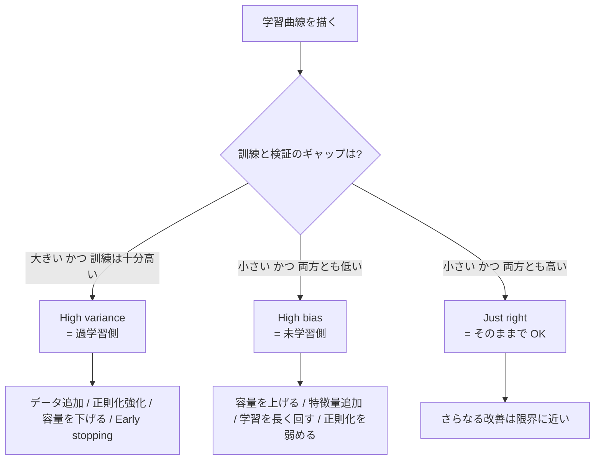

バイアス-バリアンス分解（bias-variance decomposition）は、教師あり学習の期待誤差を「Bias の 2 乗」「Variance」「ノイズ（既約誤差）」の 3 項に切り分ける枠組みです。モデルが外す原因を「表現力が足りない（high bias）」と「訓練データの揺らぎに過敏（high variance）」のどちらか（あるいは両方）に診断し、モデルの変更やデータの追加を検討します。

[過学習（overfitting）](../overfitting/) は high variance 側の症状、その対概念である未学習（underfitting）は high bias 側の症状にあたります。バイアス-バリアンス分解は両者を同じ式で扱えるようにする道具で、学習曲線や検証誤差の読み解きと組み合わせると、現状のモデルがどちらの方向に偏っているかを判定できます。

---

### 数式での分解

回帰の二乗誤差で書くと、未知の入力 `x` に対する期待誤差は次の 3 項に分かれます。

```text
E[(y - f_hat(x))^2] = Bias[f_hat(x)]^2 + Var[f_hat(x)] + sigma^2
```

各項の意味:

- Bias = `E[f_hat(x)] - f(x)`。多数の訓練セットで学習を繰り返した時の平均予測と、真の関数 `f(x)` のずれ。モデルの表現力不足を表す
- Variance = `Var[f_hat(x)]`。訓練セットの揺らぎによって予測がどれだけ振れるか。モデルの不安定さを表す
- ノイズ `sigma^2`。データに本質的に含まれる削れない誤差（irreducible error）

[期待値](/ml/math/expectation/)・[分散](/ml/math/variance/)はいずれも「訓練セット集団」に対する統計量である点に注意が必要です。1 つの訓練セットで学習した 1 つの予測値だけを見ても Bias と Variance は直接観察できず、データを変えながら再学習した予測の挙動から測ることになります。

---

### Bias と Variance を視覚化する

同じ真の関数 `sin(2πx) + 0.4x` に対して、観測点 30 個から[多項式回帰](../linear-regression/)（scikit-learn の [PolynomialFeatures](https://scikit-learn.org/stable/modules/generated/sklearn.preprocessing.PolynomialFeatures.html) で x のべき乗を特徴量に足し、[LinearRegression](https://scikit-learn.org/stable/modules/generated/sklearn.linear_model.LinearRegression.html) で当てはめる）を行い、次数を `1 / 3 / 15` と変えた 3 例を並べます。本記事のコードは軸の範囲や凡例などの体裁を省いています。完全なコードは [bias-variance-tradeoff_gen.py](https://github.com/nao1215/debimate/blob/main/projects/ml/scripts/notes/bias-variance-tradeoff_gen.py) にあります。

```python
import numpy as np
import matplotlib.pyplot as plt
from sklearn.linear_model import LinearRegression
from sklearn.pipeline import make_pipeline
from sklearn.preprocessing import PolynomialFeatures

rng = np.random.default_rng(0)
x_train = rng.uniform(0.0, 1.0, 30)
y_train = np.sin(2 * np.pi * x_train) + 0.4 * x_train + rng.normal(0.0, 0.25, 30)
x_grid = np.linspace(0.0, 1.0, 200)
y_true = np.sin(2 * np.pi * x_grid) + 0.4 * x_grid

fig, axes = plt.subplots(1, 3, figsize=(12, 4), sharey=True)
for ax, deg, title in zip(
    axes,
    [1, 3, 15],
    ["degree=1 (high bias)", "degree=3 (just right)", "degree=15 (high variance)"],
):
    model = make_pipeline(PolynomialFeatures(deg), LinearRegression())
    model.fit(x_train.reshape(-1, 1), y_train)
    ax.scatter(x_train, y_train, color="#999999", s=22)
    ax.plot(x_grid, y_true, color="#59a14f", lw=2, ls="--", label="true f(x)")
    ax.plot(x_grid, model.predict(x_grid.reshape(-1, 1)), color="#e15759", lw=2)
    ax.set_title(title)
plt.tight_layout()
plt.savefig("polyfit_compare.svg", bbox_inches="tight")
```



左端の直線（degree=1）は、波打つ真の関数を 1 次式で押さえ込もうとして全域で外しています。これがバイアスの正体で、訓練セットをいくら入れ替えても直線は直線のままなので「平均しても真の関数からずれる」性質を持ちます。一方の右端（degree=15）は訓練点の 1 つ 1 つに張り付き、観測点が少し変わるだけで形が大きく揺れます。この揺れがバリアンスです。

中央の degree=3 は真の関数の波に沿っています。ただし 1 回の当てはめでは Bias と Variance は測れないので、次の節で訓練セットを入れ替えて測ります。

---

### モデル複雑度との関係

次数ごとに 25 点の訓練セットを 200 回作り直し、そのつど学習したモデルのテスト点 50 個での予測から Bias^2 と Variance を計算します。次数 9 では、誤差が最も大きかった訓練セットを 1 つだけ除いた値も出します。

```python
import numpy as np
from sklearn.linear_model import LinearRegression
from sklearn.pipeline import make_pipeline
from sklearn.preprocessing import PolynomialFeatures

rng = np.random.default_rng(0)
x_test = np.linspace(0.05, 0.95, 50)
y_true = np.sin(2 * np.pi * x_test) + 0.4 * x_test

for d in range(1, 16):
    preds = np.zeros((200, len(x_test)))
    x_sets = np.zeros((200, 25))
    for t in range(200):
        x_tr = rng.uniform(0.0, 1.0, 25)
        y_tr = np.sin(2 * np.pi * x_tr) + 0.4 * x_tr + rng.normal(0.0, 0.25, 25)
        m = make_pipeline(PolynomialFeatures(d), LinearRegression())
        m.fit(x_tr.reshape(-1, 1), y_tr)
        preds[t] = m.predict(x_test.reshape(-1, 1))
        x_sets[t] = x_tr
    bias_sq = np.mean((preds.mean(axis=0) - y_true) ** 2)
    variance = np.mean(preds.var(axis=0))
    total = bias_sq + variance + 0.25**2
    print(f"degree={d:2d} bias^2={bias_sq:.4f} variance={variance:.4f} total={total:.4f}")
    if d == 9:
        # 誤差が最も大きかった訓練セットを 1 つだけ除いて計算し直す
        worst = ((preds - y_true) ** 2).mean(axis=1).argmax()
        rest = np.delete(preds, worst, axis=0)
        print(f"  worst set: x in [{x_sets[worst].min():.3f}, {x_sets[worst].max():.3f}]")
        print(f"  without it: bias^2={np.mean((rest.mean(axis=0) - y_true) ** 2):.4f}"
              f" variance={np.mean(rest.var(axis=0)):.4f}")
```

```text
degree= 1 bias^2=0.1529 variance=0.0209 total=0.2363
degree= 2 bias^2=0.1484 variance=0.0497 total=0.2607
degree= 3 bias^2=0.0029 variance=0.0107 total=0.0761
degree= 4 bias^2=0.0026 variance=0.0203 total=0.0854
degree= 5 bias^2=0.0001 variance=0.0363 total=0.0989
degree= 6 bias^2=0.0005 variance=0.1222 total=0.1852
degree= 7 bias^2=0.0019 variance=0.5441 total=0.6085
degree= 8 bias^2=0.0096 variance=1.8263 total=1.8983
degree= 9 bias^2=0.6058 variance=122.4722 total=123.1405
  worst set: x in [0.394, 0.994]
  without it: bias^2=0.0011 variance=0.1459
degree=10 bias^2=0.0154 variance=1.6657 total=1.7436
degree=11 bias^2=0.0034 variance=1.2578 total=1.3237
degree=12 bias^2=0.5198 variance=76.8490 total=77.4314
degree=13 bias^2=5.1113 variance=954.5296 total=959.7034
degree=14 bias^2=0.1151 variance=20.2059 total=20.3834
degree=15 bias^2=9.4015 variance=1967.1729 total=1976.6370
```

この値を対数軸で描いたものが次の図です。Total は Bias^2 と Variance の和にノイズ（点線の 0.0625）を足したものです。



次数 8 までは、おおむね教科書どおりの動きです。Bias^2 は次数 1〜2 の 0.15 前後から次数 5 の 0.0001 まで下がり、Variance は次数 3 の 0.011 から次数 8 の 1.83 まで上がります。Total は次数 3 の 0.0761 が最小です。

ただし、どちらの曲線も単調ではありません。Variance は次数 2→3 で 0.050 から 0.011 に下がっています。放物線は波の形に合わないので、25 点がどこに落ちたかで当てはめ方が大きく変わるからです。

上のコードの `rng.normal(0.0, 0.25, 25)` を `rng.normal(0.0, 0.0, 25)` にしてノイズを消しても、Variance は次数 2 で 0.044、次数 3 で 0.001 でした。

次数 9 以降の Bias^2 と Variance は大きく跳ねます。原因は 200 回のうちの 1 回です。次数 9 で誤差が最大だった訓練セットは x が 0.394〜0.994 にしかなく、0〜0.39 の範囲に点が 1 つもありません。9 次の多項式はその空白を外挿で埋めて暴れました。この 1 セットを除くと、Bias^2 は 0.606 から 0.0011、Variance は 122 から 0.146 に下がります。

Bias^2 まで跳ねるのは、Bias^2 を 200 個の予測の平均から計算しているためです。平均そのものも揺れ、その 2 乗の期待値は Variance / 200 になるので、その分が Bias^2 に上乗せされます。

次数 9・13・15 の Variance を 200 で割ると 0.61、4.77、9.84 で、Bias^2 の 0.606、5.11、9.40 とほぼ一致します。次数 6〜8 で Bias^2 が少しずつ増えるのも同じ理由です。高い次数の Bias^2 が大きいのは、表現力が下がったからではありません。

大きく見ると、Bias を下げると Variance が上がるトレードオフ関係が、複雑度という[ハイパーパラメータ](../hyperparameter/)の背後で起こっています。Total が最小になる複雑度の選び方そのものが、[交差検証](../cross-validation/) や [正則化](../regularization/) の役割と直結します。

---

### 学習曲線で診断する

実モデルで Bias と Variance を直接測るのは難しいので、学習曲線（learning curve, 訓練サンプル数を増やしながら訓練 accuracy と検証 accuracy を追跡したもの。scikit-learn では [learning_curve](https://scikit-learn.org/stable/modules/generated/sklearn.model_selection.learning_curve.html)）で両者の正解率を比較します。max_depth を 1・6・制限なしと変えた[決定木](../decision-tree/) 3 つで、曲線の形を並べてみます。

```python
import numpy as np
import matplotlib.pyplot as plt
from sklearn.datasets import make_classification
from sklearn.model_selection import learning_curve
from sklearn.tree import DecisionTreeClassifier

X, y = make_classification(n_samples=1500, n_features=20, n_informative=10,
                          n_redundant=5, n_classes=2, random_state=0)

models = [
    ("high bias (depth=1)", DecisionTreeClassifier(max_depth=1, random_state=0)),
    ("middle (depth=6)", DecisionTreeClassifier(max_depth=6, random_state=0)),
    ("high variance (depth=None)", DecisionTreeClassifier(max_depth=None, random_state=0)),
]

fig, axes = plt.subplots(1, 3, figsize=(13, 4), sharey=True)
for ax, (title, est) in zip(axes, models):
    sizes, tr, va = learning_curve(est, X, y, train_sizes=np.linspace(0.1, 1.0, 8),
                                   cv=5, scoring="accuracy", random_state=0)
    ax.plot(sizes, tr.mean(axis=1), "o-", color="#7aa6c2", label="train")
    ax.plot(sizes, va.mean(axis=1), "s-", color="#e15759", label="validation")
    ax.set_title(title)
plt.tight_layout()
plt.savefig("learning_curves_diagnose.svg", bbox_inches="tight")
```



3 つの図に現れるパターンの読み方:

- 左（high bias）: 訓練・検証ともに 0.685 前後で並走し、データを増やしても上がらない。モデルが表現力不足
- 中央（depth=6）: 1200 件で訓練 0.907、検証 0.817。差は 0.09 まで縮む
- 右（high variance）: 訓練は 1.0 に張り付き、検証は 0.834。差（汎化ギャップ）は 0.17 と大きいが、検証はデータを増やすほど上がっている

depth=None の検証正解率が depth=6 より高い点に注意してください。ギャップの大きさは「どちらへ動かすか」の手がかりで、モデルの良し悪しは検証スコアそのもので比べます。同じコードで max_depth を 6 から 15 まで変えると、1200 件での検証正解率は 0.817〜0.837 で大差がありません。

---

### 診断フロー

学習曲線を見て改善方法を選ぶ手順を示します。



ギャップが大きく訓練だけ高い場合は high variance、ギャップが小さく両方低い場合は high bias を疑います。フローでは「両方低くてギャップも大きい」というケースを省いています。この場合は両方への対処を検討します。まずモデル容量を上げて high bias を減らし、その後で訓練スコアと検証スコアの差を確認します。

---

### 各シナリオの打ち手

学習曲線の状態と対処法を表にまとめます。

| 症状 (symptom) | 診断 | 改善方法 (effective) | 改善しにくい・悪化させる方法 (ineffective) |
|---|---|---|---|
| 訓練 ≒ 検証、両方とも目標未満で頭打ち | High bias (未学習) | 容量を上げる（深い木・ブースティング・大きなニューラルネット）／ 有用な特徴量追加 ／ 学習エポック増 ／ 正則化を弱める | 正則化強化 ／ 訓練データ追加 ／ Early stopping |
| 訓練 ≫ 検証、ギャップが顕著、訓練は十分高い | High variance (過学習) | 訓練データ追加 ／ 正則化強化 ／ Early stopping ／ 容量を下げる ／ ドロップアウト | 容量をさらに上げる ／ 特徴量をさらに増やす |
| 訓練 ≈ 検証、両方とも十分高い | Just right | そのまま運用 ／ 別軸の改善（推論速度・解釈性）に切り替え | 過剰なチューニング（過学習に振れるリスク） |

原因に合わない方法を選ぶと、スコアが改善しなかったり、悪化したりします。例として、上の depth=1 の木は訓練データを 120 件から 1200 件に増やしても検証正解率が 0.674 から 0.685 にしか上がりません。データ追加で減るのは主に Variance で、表現力不足による Bias はほとんど減らないからです。

一方で high variance の状態でモデルを大きくすると、多項式の次数 7 以降のように Variance が膨らみやすくなります。表は目安で、どの方法がどれだけ効くかは学習曲線を描き直して確認します。

---

### 機械学習での使いどころ

- モデル選定の初期段階で「もっと大きいモデルを試すべきか、データ追加に投資すべきか」の判断に使う
- ハイパーパラメータ探索の方向性決め（深さを上げる方向か、正則化係数を上げる方向か）
- [交差検証](../cross-validation/) で訓練 / 検証スコアを取った後、ギャップの大きさを見て次のサイクルの仮説を立てる
- [アンサンブル](../ensemble-learning/)（[ランダムフォレスト](../random-forest/) / [勾配ブースティング](../gradient-boosting/)）が「なぜ素の決定木より強いか」を理解する枠組みとして。バギングは Variance を平均で打ち消し、ブースティングは弱学習器の Bias を逐次補正する操作と読める
- [kNN](../knn/) のハイパーパラメータ `k` の選び方（`k` が小さい = high variance、`k` が大きい = high bias）

---

### 適さないケース / 限界

バイアス-バリアンス分解を適用する場合には、次の制約があります。

- 損失によっては分解が足し算にならない。[交差エントロピー](../loss-functions/)を含む Bregman ダイバージェンスでは、MSE と同じ形の分解が[導かれている](https://arxiv.org/abs/2511.08789)。ただし、訓練セットをまたいだ予測の平均は単純な平均ではなくなる。0-1 損失では、[Domingos（2000）](https://homes.cs.washington.edu/~pedrod/papers/mlc00a.pdf)が示すとおり、多数決の予測が外れる点では Variance が増えると誤差が減る。実用上は「同じ直感を分類タスクの学習曲線で読む」運用で代用する
- 「Bias と Variance の値」を 1 つの訓練セットから直接出すことはできない。上の多項式の実験のように複数訓練セットの再サンプリングが必要で、学習曲線の形による定性診断で代用するのが普通である
- 訓練データを完全に再現できる規模を超えてパラメータを増やすと、テスト誤差が再び下がる [double descent](https://arxiv.org/abs/1812.11118) が報告されている。この論文はニューラルネットだけでなく、random Fourier features やランダムフォレスト、L2-boosting でも同じ曲線を示している。古典的な U 字曲線の枠から外れる挙動なので、超大規模モデルにはそのまま適用しにくい
- 分布シフト下では「訓練と検証が同じ分布から来る」という前提が崩れるため、ギャップの原因が Variance なのか [データドリフト](../../mlops/data-drift/) なのかを別途切り分ける必要がある
