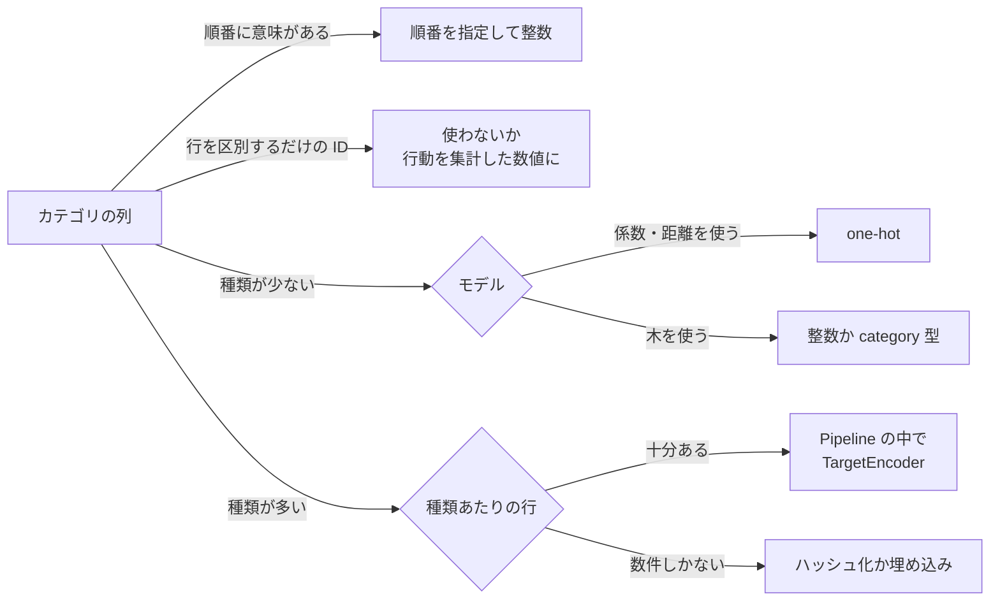

カテゴリ変数は、地区名・屋根材・商品の型番のように、決まった種類の中から 1 つを取る列です。[scikit-learn](https://scikit-learn.org/stable/) の線形回帰や決定木は数値しか受け取れないので、文字列のカテゴリを数値の列に置き換えてから渡します。勾配ブースティングを実装したライブラリには、カテゴリをそのまま受け取れるものもあり、これは後の節で扱います。この置き換えをカテゴリ変数のエンコーディング（categorical encoding）と呼びます。

代表的なエンコード方法は、種類ごとに 0 と 1 の列を立てる one-hot エンコーディング、種類に整数を振る ordinal encoding、種類ごとに目的変数の平均を求めて置き換えるターゲットエンコーディング（target encoding）の 3 つです。目的変数は、住宅価格のようにモデルで予測したい値の列を指します。本記事では、エンコード方法を短く置き換え方とも呼びます。

ターゲットエンコーディングを scikit-learn で行う [`TargetEncoder`](https://scikit-learn.org/stable/modules/generated/sklearn.preprocessing.TargetEncoder.html) には、学習データを置き換える書き方が 2 つあります。

```python
enc = TargetEncoder()
Z1 = enc.fit(X_train, y_train).transform(X_train)   # 平均を求めてから、同じ行を置き換える
Z2 = TargetEncoder().fit_transform(X_train, y_train)  # 平均を求めながら置き換える
```

米国アイオワ州エイムズ（Ames）の住宅価格データに、店舗 ID やユーザー ID のように種類の多い列の代わりとして、家ごとに別の番号を振っただけの意味の無い列を足し、地区名と一緒に 2 つの書き方で置き換えて線形回帰に渡しました。1460 軒のうち 30% は最後に評価するテストデータとして別にしておき、残りを学習データにしています。

予測の当たり具合は決定係数 R² で測ります。R² は 1 なら全ての家で価格を当て、0 なら全ての家に平均の価格を答えるのと同じ値です。学習データを 5 つに分けて 1 つずつ評価に使う交差検証と、テストデータで、Z1 と Z2 の R² はどう変わるでしょうか。



Z1 の書き方で家ごとに別の番号を置き換えると、学習データで行う交差検証の R² は 1.00 になり、テストデータでは 0.00 でした。番号の種類を 500 に減らしても、交差検証は 0.66 と地区名だけの 0.56 より良く見え、テストは 0.35 まで落ちます。Z2 の書き方は、番号の種類によらず地区名だけの時と同じ R² に留まりました。scikit-learn はどちらの書き方でもエラーも警告も出しません。

カテゴリ変数は、手元のデータに使う時に必ず出会います。店舗 ID・郵便番号・ユーザー ID のように種類が数百から数千ある列を one-hot エンコーディングにすると列が増えすぎるので、ターゲットエンコーディングを選ぶことがよくあります。種類が少ない列でも、整数を振るか 0 と 1 の列を立てるかでモデルが読み取る中身が変わり、予測の時に学習データに無かった種類が来ると処理が止まることもあります。

<br>

本記事では、カテゴリ変数を初めて扱う人と、scikit-learn で手元の表データに使う人に向けて、次の疑問に答えます。

- 3 つの置き換え方は、同じ列をどんな数値に変えるのか。
- 整数を振るだけの置き換えで、モデルは何を読み取るのか。
- 学習時に無かった種類が来ると、何が起きるのか。
- 目的変数の平均で置き換えると、なぜ Z1 と Z2 の差が出るのか。
- モデルごとに、どの置き換え方を選べばよいのか。

実験は scikit-learn 1.9.1、NumPy 2.5.4、pandas 3.1.1 で行いました。図を描く処理も含めた完全なコードは [categorical-encoding_gen.py](https://github.com/nao1215/debimate/blob/main/projects/ml/scripts/notes/categorical-encoding_gen.py) にあります。

---

### 3 つの置き換え方

データは [OpenML の house_prices](https://www.openml.org/d/42165) で、エイムズで売れた家 1460 軒の価格と 79 列の属性です。De Cock 氏が[回帰の教材として公開した Ames Housing](https://jse.amstat.org/v19n3/decock.pdf)を元にしています。

地区名の列 Neighborhood は 25 種類の文字列を取ります。価格は桁が大きく偏っているので、全ての実験で価格の対数を目的変数にし、以下では対数価格と呼びます。4 つの地区について、行の数、[`OrdinalEncoder`](https://scikit-learn.org/stable/modules/generated/sklearn.preprocessing.OrdinalEncoder.html) が振る整数、対数価格の平均、`TargetEncoder` が置き換える値を並べました。

```python
ames = fetch_openml(data_id=42165, as_frame=True).frame
y = np.log(ames["SalePrice"].to_numpy())        # 価格の対数を予測する
nb = ames[["Neighborhood"]].astype(str)
names = sorted(nb["Neighborhood"].unique())       # OrdinalEncoder の既定はアルファベット順

show = ["CollgCr", "MeadowV", "NoRidge", "OldTown"]
te = TargetEncoder(cv=KFold(5, shuffle=True, random_state=0)).fit(nb, y)
te_val = dict(zip(te.categories_[0].tolist(), te.encodings_[0]))
counts = nb["Neighborhood"].value_counts()
mean_log = pd.Series(y).groupby(nb["Neighborhood"].to_numpy()).mean()
for n in show:
    print(f"{n:<8} 行 {counts[n]:>3}  整数 {names.index(n):>2}  価格の対数の平均 {mean_log[n]:.3f}  TargetEncoder {te_val[n]:.3f}")
```

```text
CollgCr  行 150  整数  5  価格の対数の平均 12.164  TargetEncoder 12.163
MeadowV  行  17  整数 10  価格の対数の平均 11.475  TargetEncoder 11.484
NoRidge  行  41  整数 15  価格の対数の平均 12.676  TargetEncoder 12.668
OldTown  行 113  整数 17  価格の対数の平均 11.704  TargetEncoder 11.706
```

同じ 4 行を 3 つの方法で置き換えると、次の表になります。

| 地区 | one-hot（25 列のうち 4 列） | ordinal encoding | ターゲットエンコーディング |
|---|---|---|---|
| CollgCr | `1 0 0 0` | 5 | 12.163 |
| MeadowV | `0 1 0 0` | 10 | 11.484 |
| NoRidge | `0 0 1 0` | 15 | 12.668 |
| OldTown | `0 0 0 1` | 17 | 11.704 |

[`OneHotEncoder`](https://scikit-learn.org/stable/modules/generated/sklearn.preprocessing.OneHotEncoder.html) は 25 種類に 25 本の列を立て、行ごとに 1 本だけを 1 にします。`OrdinalEncoder` は種類をアルファベット順に並べて 0 から番号を振り、列は 1 本のままです。`TargetEncoder` も列は 1 本で、値はその地区で求めた対数価格の平均です。

行の少ない MeadowV では、`TargetEncoder` の値 11.484 が平均の 11.475 より全体の平均 12.02 へ寄っています。行が少ない種類の平均は偶然で大きく揺れるので、全体の平均へ寄せてから使います。この寄せる度合いは、冒頭の結果に関わるので後の節で扱います。

---

### 整数の並び順を読む線形回帰

ordinal encoding の整数は、アルファベット順という意味の無い順番です。線形回帰は列の値に 1 つの係数を掛けるので、「整数が 1 増えるごとに価格が一定だけ変わる」という形しか表せません。地区名だけで価格を予測し、25 種類の並べ方を無作為に 500 通り作って、[交差検証](../cross-validation/)で R² を比べました。交差検証は全て 5 分割です。

```python
cv = KFold(5, shuffle=True, random_state=0)


def cv_r2(enc, model):
    return cross_val_score(make_pipeline(enc, model), nb, y, cv=cv).mean()


onehot_lin = cv_r2(OneHotEncoder(handle_unknown="ignore"), LinearRegression())
alpha_lin = cv_r2(OrdinalEncoder(categories=[names]), LinearRegression())
by_price = list(ames.groupby("Neighborhood", observed=True)["SalePrice"].median().sort_values().index.astype(str))
price_lin = cv_r2(OrdinalEncoder(categories=[by_price]), LinearRegression())
rng = np.random.default_rng(0)
perms = [list(rng.permutation(names)) for _ in range(500)]
perm_lin = np.array([cv_r2(OrdinalEncoder(categories=[p]), LinearRegression()) for p in perms])
perm_tree3 = np.array([cv_r2(OrdinalEncoder(categories=[p]), DecisionTreeRegressor(max_depth=3, random_state=0)) for p in perms])
perm_tree = np.array([cv_r2(OrdinalEncoder(categories=[p]), DecisionTreeRegressor(random_state=0)) for p in perms])
onehot_tree3 = cv_r2(OneHotEncoder(handle_unknown="ignore"), DecisionTreeRegressor(max_depth=3, random_state=0))
onehot_tree = cv_r2(OneHotEncoder(handle_unknown="ignore"), DecisionTreeRegressor(random_state=0))
print(f"線形回帰: one-hot {onehot_lin:.3f}、アルファベット順 {alpha_lin:.3f}、価格の中央値の順 {price_lin:.3f}")
print("線形回帰、無作為な順 500 通り: 最小 {:.3f} 中央値 {:.3f} 最大 {:.3f}".format(perm_lin.min(), np.median(perm_lin), perm_lin.max()))
print("決定木 max_depth=3、無作為な順: 最小 {:.3f} 中央値 {:.3f} 最大 {:.3f}、one-hot {:.3f}".format(
    perm_tree3.min(), np.median(perm_tree3), perm_tree3.max(), onehot_tree3))
print("決定木 深さの制限なし、無作為な順: 最小 {:.3f} 最大 {:.3f}、one-hot {:.3f}".format(perm_tree.min(), perm_tree.max(), onehot_tree))
```

```text
線形回帰: one-hot 0.543、アルファベット順 0.027、価格の中央値の順 0.537
線形回帰、無作為な順 500 通り: 最小 -0.013 中央値 0.004 最大 0.229
決定木 max_depth=3、無作為な順: 最小 0.073 中央値 0.279 最大 0.478、one-hot 0.217
決定木 深さの制限なし、無作為な順: 最小 0.536 最大 0.543、one-hot 0.542
```



線形回帰では、one-hot の 0.54 に対し、既定のアルファベット順は 0.03 でした。地区名に含まれる価格の情報が、整数の順番に埋もれて消えています。無作為な 500 通りの中央値は 0.004 で、一番良い並べ方でも 0.23 です。

整数を地区ごとの価格の[中央値](../../math/median/)が安い順に振ると 0.54 になり、one-hot と並びます。ただし、この順番は目的変数から作ったものなので、ターゲットエンコーディングと同じく、学習データの外で順番を決めないと後の節と同じ漏れが起きます。

並び順そのものに意味がある列なら、整数を振っても困りません。Ames で外装の品質を表す ExterQual には、Fa・TA・Gd・Ex の 4 段階が出てきます。`OrdinalEncoder(categories=[["Fa", "TA", "Gd", "Ex"]])` と悪い順に渡せば、整数の大小が品質の上下と揃います。既定のアルファベット順では Ex が 0、Fa が 1、Gd が 2、TA が 3 になり、一番良い Ex が一番悪い Fa より前に来ます。

<br>

#### 決定木では順番が分け方を決める

[決定木](../decision-tree/)は「整数が 7 以下か」のように値で行を左右へ分けるので、係数は持ちません。それでも深さを 3 に制限すると、並べ方によって R² は 0.07 から 0.48 まで散らばりました。1 回の分け方で選べるのは「並べた順で前半か後半か」だけなので、価格の近い地区が隣り合う並べ方ほど少ない回数で分けられます。

one-hot の 0.22 は、無作為な並べ方の中央値 0.28 より低くなりました。0 と 1 の列で分けると、1 回で「ある 1 つの地区か、それ以外か」しか選べず、深さ 3 では地区を 3 つしか切り出せないためと考えられます。深さを制限しないと、どの並べ方も one-hot も 0.54 前後に揃います。

---

### 学習時に無かった種類

交差検証は、データを 5 つに分け、4 つで学習して残り 1 つで評価することを 5 回繰り返します。種類の少ないカテゴリは、評価する側の分割にだけ入ることがあります。Ames の 79 列のうち文字列の 43 列を `OneHotEncoder` の既定のまま、係数を小さく抑える [Ridge 回帰](../regularization/)に渡し、5 分割の交差検証をしました。

```python
cat_cols = [c for c in ames.columns if not pd.api.types.is_numeric_dtype(ames[c])]
Xc = ames[cat_cols].astype(str)
with warnings.catch_warnings(record=True) as w:
    warnings.simplefilter("always")
    s_err = cross_val_score(make_pipeline(OneHotEncoder(), Ridge()), Xc, y, cv=cv)
print("handle_unknown='error'（既定）:", s_err, "警告", sum("Scoring failed" in str(x.message) for x in w), "件")
s_ign = cross_val_score(make_pipeline(OneHotEncoder(handle_unknown="ignore"), Ridge()), Xc, y, cv=cv)
print("handle_unknown='ignore'     :", s_ign.round(3))
```

```text
handle_unknown='error'（既定）: [nan nan nan nan nan] 警告 5 件
handle_unknown='ignore'     : [0.735 0.785 0.794 0.793 0.826]
```

既定の `handle_unknown='error'` では、5 回とも R² が nan になりました。`OneHotEncoder` は学習時に無かった種類を見ると例外を投げますが、`cross_val_score` はその例外を警告に変えて nan を返し、処理は最後まで進みます。平均を取ると nan になるので気づけますが、警告を読まずに次の処理へ渡すと、どこで止まったのかが分かりません。



1 回の検証で 292 行を使い、そのうち 3〜7 行が学習側に無い種類を含んでいました。屋根材 RoofMatl の Membran・Metal・Roll は 1460 軒の中に 1 軒ずつしか無く、地区の Blueste も 2 軒だけで、2 軒とも 5 番目の分割に入りました。本番の予測でも、新しくできた地区や新商品の型番のように、学習時に無かった種類は必ず来ると考えた方が安全です。

<br>

#### 置き換え方ごとの既定の動き

学習時に無かった種類の扱いは、置き換え方ごとに既定が違います。scikit-learn 1.9.1 の文書とソースでは、次のとおりです。

| 置き換え方 | 既定 | 変えた時 |
|---|---|---|
| `OneHotEncoder` | 例外を投げる | `"ignore"` で全ての列を 0 |
| `OrdinalEncoder` | 例外を投げる | `"use_encoded_value"` で指定の値 |
| `TargetEncoder` | 目的変数の平均（全体） | 変えられない |

`OneHotEncoder` には、学習データで `min_frequency` 回より少ない種類を 1 本の「まれな種類」の列にまとめ、`handle_unknown="infrequent_if_exist"` で未知の種類もそこへ入れる設定もあります。`OrdinalEncoder` に `unknown_value=-1` を指定すると、線形回帰は -1 を「アルファベット順で一番前より 1 つ前」として読むので、並び順の問題がもう 1 つ増えます。

---

### 種類の多い列

one-hot エンコーディングは種類の数だけ列が増えます。Ames で文字列の 43 列を置き換えても 268 本になり、店舗 ID のように数千種類ある列なら数千本です。`OneHotEncoder` は既定で、0 でない値だけを持つ疎行列（CSR 形式）を返します。10 万行 × 1 万種類なら、0 まで全部持つ float64 の行列は 8.0 GB ですが、疎行列は 1.6 MB で済みます。

ロジスティック回帰や [kNN](../knn/) は疎行列をそのまま受け取れますが、行の少ない種類の列からは係数をほとんど学べず、列が多いほど[次元の呪い](../curse-of-dimensionality/)も強く効きます。ターゲットエンコーディングは何種類あっても 1 本で済みます。考え方は Micci-Barreca 氏の [2001 年の論文](https://doi.org/10.1145/507533.507538)にあり、`TargetEncoder` の文書もこの論文を参照しています。

冒頭の実験は、地区名と意味の無い番号の 2 列を置き換え、線形回帰で学習しました。学習と交差検証に使ったのは、テストデータを除いた 1022 行です。

```python
def leak_run(n_levels, seed=0):
    rng = np.random.default_rng(seed)
    if n_levels >= len(ames):
        code = np.arange(len(ames))                     # 家ごとに別の番号
    else:
        code = rng.integers(0, n_levels, len(ames))     # 番号を n_levels 通りから無作為に振る
    X = pd.DataFrame({"Neighborhood": ames["Neighborhood"].astype(str),
                      "番号": code.astype(str)})
    X_tr, X_te, y_tr, y_te = train_test_split(X, y, test_size=0.3, random_state=seed)
    res = {}
    for way in ["fit→transform", "fit_transform"]:
        enc = TargetEncoder(cv=KFold(5, shuffle=True, random_state=0))
        if way == "fit→transform":
            Z_tr = enc.fit(X_tr, y_tr).transform(X_tr)  # 学習データを、学習データ全体の平均で置き換える
        else:
            Z_tr = enc.fit_transform(X_tr, y_tr)        # 交差して置き換える
        Z_te = enc.transform(X_te)
        model = LinearRegression().fit(Z_tr, y_tr)
        cv_r2 = cross_val_score(LinearRegression(), Z_tr, y_tr, cv=KFold(5, shuffle=True, random_state=1)).mean()
        res[way] = (model.score(Z_tr, y_tr), cv_r2, model.score(Z_te, y_te))
    return res


levels = [10, 30, 100, 300, 500, 700, 1000, 1460]
leak = {k: leak_run(k) for k in levels}
for k in levels:
    a, b = leak[k]["fit→transform"], leak[k]["fit_transform"]
    print(f"番号 {k:>4} 通り  fit→transform: 学習 {a[0]:.2f} 交差検証 {a[1]:.2f} テスト {a[2]:.2f}"
          f"  | fit_transform: 学習 {b[0]:.2f} 交差検証 {b[1]:.2f} テスト {b[2]:.2f}")
```

出力のうち、5 通りの行を抜き出しました。地区名だけを置き換えた時は、テストデータで R² が 0.56 です。

```text
番号   10 通り  fit→transform: 学習 0.57 交差検証 0.56 テスト 0.56  | fit_transform: 学習 0.55 交差検証 0.54 テスト 0.56
番号  100 通り  fit→transform: 学習 0.58 交差検証 0.57 テスト 0.55  | fit_transform: 学習 0.55 交差検証 0.54 テスト 0.56
番号  500 通り  fit→transform: 学習 0.67 交差検証 0.66 テスト 0.35  | fit_transform: 学習 0.55 交差検証 0.54 テスト 0.56
番号 1000 通り  fit→transform: 学習 0.73 交差検証 0.73 テスト 0.25  | fit_transform: 学習 0.55 交差検証 0.54 テスト 0.56
番号 1460 通り  fit→transform: 学習 1.00 交差検証 1.00 テスト -0.00  | fit_transform: 学習 0.55 交差検証 0.54 テスト 0.56
```

`fit` と `transform` を分けた書き方では、番号の種類が増えるほど学習と交差検証の R² が上がり、テストの R² が下がります。交差検証は、置き換えた後の列を分割しているだけなので、置き換えに使った平均には、評価に使う分割に入った家の価格も入っています。これは目的変数の情報が説明に使う列へ漏れるターゲットリーク（target leakage）で、[データリーク](../data-leakage/)の 1 つです。

テストデータで下がるのは、モデルが学習で覚えた関係が外れるからです。学習データでは、番号の列を置き換えた値がその家の価格に近く、線形回帰は「置き換えた値が高ければ価格も高い」と覚えます。

テストデータの家は学習データの平均で置き換わるので、その値には自分の価格が入っていません。学習時に無かった番号なら全体の平均になり、あっても、同じ番号を持つ別の家から求めた値です。覚えた関係が当てはまらないまま番号の列に大きな係数が掛かるので、地区名だけの時より外れます。

<br>

#### 1 軒しかない種類は価格そのものになる

家ごとに別の番号では、どの種類も 1 軒しかありません。1460 軒全部の番号について、`fit` と `transform` で置き換えた値と `fit_transform` で置き換えた値を対数価格と並べました。

```python
ids = pd.DataFrame({"番号": np.arange(len(ames)).astype(str)})
enc = TargetEncoder(cv=KFold(5, shuffle=True, random_state=0))
z_fit = enc.fit(ids, y).transform(ids).ravel()
z_cross = TargetEncoder(cv=KFold(5, shuffle=True, random_state=0)).fit_transform(ids, y).ravel()
print("fit→transform と y の差の最大:", np.abs(z_fit - y).max())
print("fit_transform の値: 最小 {:.4f} 最大 {:.4f}、y の平均 {:.4f}".format(z_cross.min(), z_cross.max(), y.mean()))
```

```text
fit→transform と y の差の最大: 0.0
fit_transform の値: 最小 12.0136 最大 12.0362、y の平均 12.0241
```



`fit` と `transform` で置き換えた値は、価格の対数と差が 0.0 で、価格そのものでした。3 つの置き換え方の節で見た、行の少ない種類を全体の平均へ寄せる処理が、1 軒しかない種類では働いていません。

同じ理由で、種類ごとの行が少ない列は、目的変数と無関係でも[相互情報量](../../math/information-theory/)が高く出ます。1 軒しかない種類は、その家の価格を言い当てるからです。

`TargetEncoder` の `smooth` は既定で `"auto"` です。この設定では、その種類の中で価格がどれだけばらつくかから、種類ごとに寄せる度合いを決めます。行が少ない種類や、ばらつきが大きい種類ほど全体の平均に寄せますが、1 軒しかない種類はばらつきが 0 なので全く寄せず、その家の価格をそのまま使います。この計算は scikit-learn 1.9.1 のソースで読みました。

<br>

#### fit_transform は自分の行を使わない

`fit_transform` は、学習データを 5 つの組に分け、各組の行を残り 4 組の平均で置き換えます。scikit-learn はこの手順を cross fitting と呼んでいます。



家ごとに別の番号なら、残り 4 組にその番号は 1 軒も無いので、学習時に無かった種類と同じく全体の平均に近い値になります。1 軒しかない種類を並べた散布図では、右側で全ての点が 12.01〜12.04 に集まったのはこのためで、線形回帰は番号の列から何も読み取れず、地区名だけの時と同じ 0.56 に留まりました。テストデータの置き換えは、`fit_transform` の後に `transform` を呼ぶと、学習データ全体の平均を使います。

`fit(X, y).transform(X)` が `fit_transform(X, y)` と一致しないことは、`TargetEncoder` の文書にも注記があります。scikit-learn の [`Pipeline`](https://scikit-learn.org/stable/modules/generated/sklearn.pipeline.Pipeline.html) は学習の時に前処理の `fit_transform` を呼ぶので、`TargetEncoder` を `Pipeline` に入れて `cross_val_score` に渡せば、この漏れは起きません。冒頭の Z1 のように前処理だけを手で書いた時に起きます。

勾配ブースティングを実装した [CatBoost](https://catboost.ai/) は、行を並べた順に、前にある行だけで平均を求める ordered target statistics で同じ漏れを防いでいます。手順は [Prokhorenkova 氏らの論文](https://arxiv.org/abs/1706.09516)にあります。

<br>

#### 列の数を先に決めるハッシュ化と埋め込み

目的変数を使わずに列を減らす方法もあります。ハッシュ化（hashing trick）は、種類の名前をハッシュ関数で列番号に変え、決めた本数の列に押し込みます。scikit-learn の [`FeatureHasher`](https://scikit-learn.org/stable/modules/generated/sklearn.feature_extraction.FeatureHasher.html) は既定で 2^20 本の列を使い、ハッシュ関数は符号付き 32 ビットの MurmurHash3 です。`n_features=16` にすれば、100 万種類あっても 16 列に収まります。

別の種類が同じ列に入る衝突が代償です。既定の `alternate_sign=True` では、列に足す値にもハッシュ値で決めた +1 か −1 の符号を付け、衝突した種類どうしが打ち消し合って、内積がおおよそ保たれるようにします。学習時に無かった種類も、同じ計算で列が決まります。

ハッシュ化を自分で書く時は、Python 組み込みの `hash()` を使いません。文字列の `hash()` は [`PYTHONHASHSEED`](https://docs.python.org/3/using/cmdline.html#envvar-PYTHONHASHSEED) を指定しない限りプロセスごとに変わり、`[hash(c) % 2 for c in "ABC"]` を 3 回実行すると `[1, 1, 0]`、`[0, 1, 0]`、`[1, 0, 0]` と毎回違う列になりました。学習と推論で列がずれます。

ニューラルネットでは、種類ごとに数値のベクトルを学習する埋め込み（embedding）も使われます。[PyTorch の `nn.Embedding`](https://docs.pytorch.org/docs/stable/generated/torch.nn.Embedding.html) が代表で、言語モデルが[トークン](/notes/generative-ai/tokenizer/)の番号をベクトルに変えるのも同じ仕組みです。

---

### モデルごとの置き換え方

ここまでは地区名や番号だけを使い、置き換え方の差が目立つ形で実験しました。79 列を全部使うと、差はどれくらいになるでしょうか。数値の 36 列はそのまま、文字列の 43 列を 3 つの方法で置き換え、Ridge 回帰と、[勾配ブースティング](../gradient-boosting/)の [`HistGradientBoostingRegressor`](https://scikit-learn.org/stable/modules/generated/sklearn.ensemble.HistGradientBoostingRegressor.html) で 5 分割の交差検証をしました。評価には、対数価格の誤差を 2 乗して平均し、平方根を取った RMSE で、小さいほど当たっています。

```python
encoders = {
    "one-hot": lambda: OneHotEncoder(handle_unknown="ignore", sparse_output=False),
    "整数": lambda: OrdinalEncoder(handle_unknown="use_encoded_value", unknown_value=-1),
    "目的変数の平均": lambda: TargetEncoder(cv=KFold(5, shuffle=True, random_state=0)),
}
for enc_name, mk in encoders.items():
    for model_name in ["Ridge", "HistGradientBoosting"]:
        if model_name == "Ridge":
            pre = make_column_transformer((make_pipeline(SimpleImputer(), StandardScaler()), num_cols),
                                          (make_pipeline(mk(), StandardScaler()), cat_cols))
            model = make_pipeline(pre, Ridge(alpha=10.0))
        else:
            pre = make_column_transformer(("passthrough", num_cols), (mk(), cat_cols))
            model = make_pipeline(pre, HistGradientBoostingRegressor(random_state=0))
        r = cross_validate(model, X_all, y, cv=cv, scoring="neg_root_mean_squared_error")
# 文字列の列を category 型にして、HistGradientBoosting にそのまま渡す
r = cross_validate(HistGradientBoostingRegressor(random_state=0), X_cat, y, cv=cv,
                   scoring="neg_root_mean_squared_error")
```

コードは抜粋です。組み合わせごとに `r["test_score"]` を平均し、符号を戻した値を次の表にまとめました。

| モデル | 置き換え方 | 交差検証の RMSE | モデルに渡す列 |
|---|---|---|---|
| Ridge | one-hot | 0.1641 | 304 |
| Ridge | 整数 | 0.1668 | 79 |
| Ridge | 目的変数の平均 | 0.1574 | 79 |
| HistGradientBoosting | one-hot | 0.1315 | 304 |
| HistGradientBoosting | 整数 | 0.1308 | 79 |
| HistGradientBoosting | 目的変数の平均 | 0.1272 | 79 |
| HistGradientBoosting | カテゴリのまま | 0.1283 | 79 |

どのモデルでも、置き換え方による差はモデルどうしの差より小さく、Ridge と勾配ブースティングの差 0.03 前後に対して、置き換え方の差は 0.01 以内でした。Ames では広さや築年数などの数値の列が価格の大半を説明するので、文字列の列をどう置き換えるかが効く範囲は狭いと考えられます。冒頭の実験や整数の並び順の実験のように、カテゴリの列が予測の主な手がかりになるデータほど差は大きくなります。

整数に置き換えた Ridge が一番悪いのは、線形回帰が並び順を読む節と同じ理由です。勾配ブースティングは木を何本も重ねて分け方を細かくできるので、整数でも one-hot と並びました。

<br>

#### HistGradientBoosting にカテゴリのまま渡す

`HistGradientBoostingRegressor` は、列の型が pandas の category なら、置き換えずにカテゴリとして扱います。分ける度に種類を目的変数に合わせて並べ直し、その順で前後に分けるので、並び順の問題が起きません。この並べ直しは scikit-learn の[文書](https://scikit-learn.org/stable/modules/ensemble.html#categorical-support-gbdt)で説明されています。学習時に無かった種類は欠損値と同じ扱いになり、この扱いは変えられません。

既定の `categorical_features="from_dtype"` は category 型の列だけを見るので、pandas 3 の文字列型のままでは扱われず、`astype("category")` が要ります。種類は `max_bins`（既定 255）以下でなければならず、数千種類ある列には使えません。[LightGBM](https://lightgbm.readthedocs.io/en/stable/Advanced-Topics.html#categorical-feature-support) と [CatBoost](https://catboost.ai/docs/en/features/categorical-features) も、カテゴリの列を置き換えずに受け取れます。置き換え方を変えた比較は scikit-learn の[例](https://scikit-learn.org/stable/auto_examples/ensemble/plot_gradient_boosting_categorical.html)でも、同じ Ames のデータで行われています。

---

### 置き換え方を決める前に見ること

カテゴリの列を置き換える前に、使うモデルと種類の数を見ます。[線形回帰](../linear-regression/)や[ロジスティック回帰](../logistic-regression/)のように列に係数を掛けるモデルや、値の差を距離にする kNN では、整数を振ると順番を読まれるので one-hot にします。外装の品質のように順番に意味がある列だけは、順番を指定して整数にします。

地区名だけの実験では、アルファベット順の整数で R² が 0.54 から 0.03 に落ちました。木を何本も重ねる勾配ブースティングなら整数でも大きくは崩れず、`HistGradientBoosting` なら category 型のまま渡せます。

種類が数百を超えて one-hot では列が増えすぎる時は、先にその列が何を表すかを見ます。注文 ID や冒頭の家ごとの番号のように行を区別するだけの列は、特徴量にしません。ユーザー ID なら、過去の購入回数や平均の購入額のように、その ID に紐づく行動を集計した数値の列に変える方が、学習時に無かった ID にも使えます。

ただし、同じ ID が大量の行に繰り返し現れる推薦では、ID ごとの埋め込みを学習する方法もよく使われます。ID のまま使うか集計に変えるかは、ID あたりの行数と、新しい ID がどれだけ来るかで決めます。ユーザー ID のように個人を指す列は、ID のままモデルに持たせること自体が避けたい理由にもなります。



どの置き換え方でも、学習時に無かった種類は来ます。各列で行の少ない種類を数え、1 軒しかない屋根材のように、検証側や本番にだけ出てくる種類に備えて、`handle_unknown` を既定の `"error"` から変えるか、`min_frequency` でまれな種類をまとめます。`cross_val_score` の R² に nan が混じったら、警告に含まれる例外を読みます。

ID ではない種類の多い列を使う時は、まず 1 種類あたりの行数を数えます。ロジスティック回帰や kNN のように疎行列を受け取れるモデルなら、数千種類でも one-hot のまま渡せます。URL や型番のように数万〜数百万種類あり、1 種類の行が数件しかない列では、ターゲットエンコーディングの平均も安定しないので、ハッシュ化か埋め込みに切り替えます。

目安として、種類が 20 程度までは one-hot、1 万を超えたらハッシュ化や埋め込みを考えます。境界は行数・モデル・メモリで変わります。

ターゲットエンコーディングを使う時は、`Pipeline` の中で使います。`fit` と `transform` を手で分けて学習データを置き換えると、冒頭の図で赤い線のように交差検証の R² が上がり、未知のデータで下がります。交差検証とは別にしておいたテストデータで R² を測り、2 つの値が冒頭の 0.66 と 0.35 のように開いていたら、置き換えた列に目的変数が漏れていないかを疑います。
