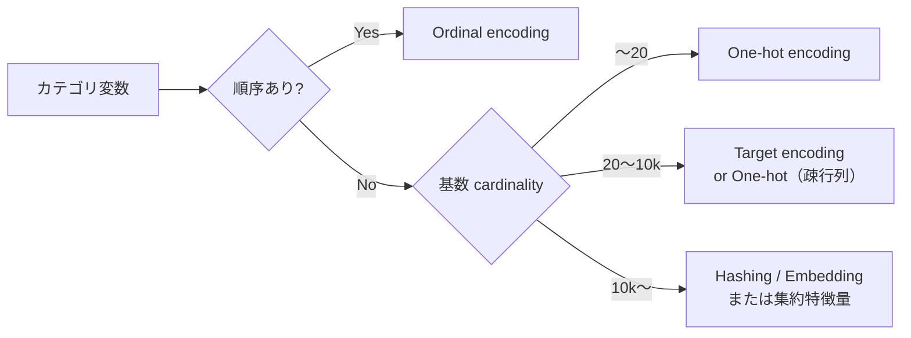

カテゴリ変数のエンコーディング（categorical encoding）は、文字列やカテゴリ値で表された特徴量を数値ベクトルに変換する前処理操作の総称です。

機械学習モデルの大半（[ロジスティック回帰](../logistic-regression/) / [kNN](../knn/) / [ニューラルネット](../perceptron/) / [GradientBoosting](../gradient-boosting/) など）は数値入力を前提とします。そのため、`category='electronics'` や `prefecture='東京'` のような値はそのままでは渡せません。

選び方を間違えると、列数が膨れてメモリに載らない、順序を勝手に持ち込んでしまう、[データリーク](../data-leakage/) を起こすといった事故につながります。方式を選ぶ時は、カテゴリの種類数（cardinality、基数）、順序の有無、目的変数を変換に使うかを確認します。

---

### 基数で第一候補が決まる



順序がある場合は Ordinal、ない場合は基数に応じて方式を選びます。境界の 20 や 1 万は目安で、行数・モデル・メモリの上限と合わせて決めます。ユーザー ID のような識別子は、多くの場合で集約特徴量に変えます（後半の節）。

---

### 4 種類のエンコーディングを並べて見る

同じ入力 `["A", "B", "C", "A", "B", "C"]` に対して、4 つの方式がどんな出力を返すかを並べます。以下は [scikit-learn](https://scikit-learn.org/) 1.9.1、[pandas](https://pandas.pydata.org/) 3.1.1 で実行したコードです。

```python
import numpy as np
import pandas as pd
from sklearn.feature_extraction import FeatureHasher
from sklearn.preprocessing import OneHotEncoder, OrdinalEncoder

data = pd.DataFrame({
    "category": ["A", "B", "C", "A", "B", "C"],
    "target":   [10,  20,  30,  12,  18,  32],
})

oh = OneHotEncoder(sparse_output=False).fit_transform(data[["category"]])
ord_enc = OrdinalEncoder().fit_transform(data[["category"]])
target_map = data.groupby("category")["target"].mean()
te = data["category"].map(target_map).to_numpy().reshape(-1, 1)
hasher = FeatureHasher(n_features=2, input_type="string")
hash_result = hasher.transform([[c] for c in data["category"]]).toarray()

for name, arr in [("one-hot", oh), ("ordinal", ord_enc),
                  ("target", te), ("hashing", hash_result)]:
    print(f"{name:8s}", arr[:3].tolist())  # A, B, C の 3 行だけ表示
```

```text
one-hot  [[1.0, 0.0, 0.0], [0.0, 1.0, 0.0], [0.0, 0.0, 1.0]]
ordinal  [[0.0], [1.0], [2.0]]
target   [[11.0], [19.0], [31.0]]
hashing  [[1.0, 0.0], [-1.0, 0.0], [0.0, -1.0]]
```

6 行全ての出力を並べると次の図になります。描画部分は上のコードから省いています（[図の生成コード](https://github.com/nao1215/debimate/blob/main/projects/ml/scripts/notes/categorical-encoding_gen.py)）。



One-hot は基数と同じ 3 列、Ordinal と Target encoding は 1 列、Hashing は事前に決めた 2 列です。Hashing では A と B が同じ列 h0 に入り、符号だけが違います（衝突）。

---

### One-hot encoding

各カテゴリに対して 0/1 の独立した列を割り当てます。

- 利点: 順序を持ち込まない（モデルが「A < B」と解釈しない）、解釈が明確、ほぼ全てのモデルに使える
- 欠点: 基数と同じだけ列数が増える。密行列にするとメモリを食う
- scikit-learn: [`OneHotEncoder`](https://scikit-learn.org/stable/modules/generated/sklearn.preprocessing.OneHotEncoder.html) または pandas の [`pd.get_dummies`](https://pandas.pydata.org/docs/reference/api/pandas.get_dummies.html)
- 適切な使用場面: 順序なしで、基数が 20 程度以下。疎行列のまま扱えるモデルなら数千〜数万でも使える

`OneHotEncoder` の既定の出力は、0 以外の値だけを持つ疎行列（CSR 形式）です。

---

### Ordinal encoding

各カテゴリに整数を割り当てて 1 列で済まします。

- 利点: 1 列で済み、メモリ・計算が軽い
- 欠点: 整数の大小関係に意味を持たせてしまう（`'electronics'=0` `'food'=1` `'books'=2` だと「electronics と food は近く、books は遠い」と[線形モデル](../linear-regression/)が解釈する）
- scikit-learn: [`OrdinalEncoder`](https://scikit-learn.org/stable/modules/generated/sklearn.preprocessing.OrdinalEncoder.html)
- 適切な使用場面: 順序があるカテゴリ（`low < medium < high`、星評価、学年など）。順序なしには使ってはならない

決定木系（[RandomForest](../random-forest/) / [GradientBoosting](../gradient-boosting/)）は「値が 0.5 以下か」のような閾値で分割するので、Ordinal の整数でも学習できます。ただし、整数の並びは分割の形を縛ります。A=0、B=1、C=2 で {A, C} と {B} に分けたい時は、閾値 1 回では分けられず 2 回の分割が要ります。

---

### Target encoding

各カテゴリを「そのカテゴリでの目的変数の集約値」に置き換えます。1 列で目的変数との関係を埋め込めるので、高基数カテゴリで効きやすいです。

- 欠点: [データリーク](../data-leakage/) を起こしやすい。全データで集約してから CV（[交差検証](../cross-validation/)）すると、テスト fold の目的変数が訓練 fold の特徴量に混ざる
- 防御: 変換と学習をまとめる [`Pipeline`](https://scikit-learn.org/stable/modules/generated/sklearn.pipeline.Pipeline.html) に [`TargetEncoder`](https://scikit-learn.org/stable/modules/generated/sklearn.preprocessing.TargetEncoder.html)（scikit-learn 1.3 以降）を入れ、`cross_val_score` などに渡す。`TargetEncoder` の `fit_transform` は、各行を自分以外の fold の平均で置き換える cross fitting を行う
- 適切な使用場面: 基数が 20〜数万のカテゴリ（都道府県、商品カテゴリ、ユーザーセグメントなど）

<br>

真の信号が無いランダムデータで、リークが入るとどう見えるかを確認します。50 個のランダムカテゴリ × 二値ランダムラベルなら、正しく CV 内で集約すれば accuracy は 0.5 付近になるはずです。

```python
import numpy as np
import pandas as pd
from sklearn.linear_model import LogisticRegression
from sklearn.model_selection import StratifiedKFold, cross_val_score
from sklearn.pipeline import Pipeline
from sklearn.preprocessing import TargetEncoder

rng = np.random.default_rng(0)
n = 500
df = pd.DataFrame({"cat": rng.integers(0, 50, n).astype(str)})
y = rng.integers(0, 2, n)

# Wrong: 全データで集約してから CV
target_map = (pd.DataFrame({"cat": df["cat"], "y": y})
              .groupby("cat")["y"].mean())
X_wrong = df["cat"].map(target_map).values.reshape(-1, 1)
cv_wrong = cross_val_score(
    LogisticRegression(max_iter=2000), X_wrong, y, cv=5,
).mean()

# Correct: Pipeline で TargetEncoder を CV fold 内に閉じる
pipe = Pipeline([
    ("te", TargetEncoder(target_type="binary",
                         cv=StratifiedKFold(5, shuffle=True, random_state=0))),
    ("clf", LogisticRegression(max_iter=2000)),
])
cv_correct = cross_val_score(pipe, df[["cat"]], y, cv=5).mean()

print(f"Wrong (full-data fit): CV accuracy = {cv_wrong:.3f}")
print(f"Correct (Pipeline):    CV accuracy = {cv_correct:.3f}")
```

```text
Wrong (full-data fit): CV accuracy = 0.618
Correct (Pipeline):    CV accuracy = 0.534
```



全データで集約すると（図の Wrong）0.618、Pipeline 内で集約すると（図の Correct）0.534 でした。後者は、多い方のラベルを常に答えた時の 0.524 とほぼ同じです。乱数のシードを 0〜5 に変えても、前者は 0.604〜0.654、後者は 0.480〜0.548 でした。

前者が当たる理由は、各行の特徴量に自分自身のラベルが入っているからです。1 カテゴリは平均 10 行なので、自分のラベルだけで平均が約 0.1 動きます。モデルはこのずれを手がかりに当てています。Target encoding の集約は、CV の訓練 fold の中だけで行います。

---

### Hashing trick と Embedding

基数が極端に大きい場面（URL、商品 ID、[トークン](/notes/generative-ai/tokenizer/)など）では、One-hot の列が膨れ、Target encoding もカテゴリごとの行数が少なすぎて平均値が安定しないことがあります。

- Hashing trick: カテゴリ名をハッシュ関数で列番号に変え、固定長のベクトルに押し込む。例えば `n_features=16` なら基数が 100 万でも 16 列に収まる。代償として、別カテゴリが同じ列に入る衝突が起きる。scikit-learn の [`FeatureHasher`](https://scikit-learn.org/stable/modules/generated/sklearn.feature_extraction.FeatureHasher.html) は既定で 2<sup>20</sup> 列を使い、衝突しても内積がおおよそ保たれるように、ハッシュ値で決めた符号を付ける（上の例の A の +1 と B の −1）
- Embedding: ニューラルネットでカテゴリごとの密ベクトルを学習する。似た振る舞いのカテゴリが近いベクトルになる。ただし、ニューラルネットの訓練が前提になる。[PyTorch の `nn.Embedding`](https://docs.pytorch.org/docs/stable/generated/torch.nn.Embedding.html) や [Keras の `Embedding`](https://keras.io/api/layers/core_layers/embedding/) 層を使う

Hashing を手で書く時は、Python 組み込みの `hash()` を使わないでください。文字列の `hash()` は [`PYTHONHASHSEED`](https://docs.python.org/3/using/cmdline.html#envvar-PYTHONHASHSEED) を指定しない限りプロセスごとに乱数で変わります。

`hash(c) % 2` で A, B, C の列を決めるコードを 3 回実行すると、列は `[1, 0, 0]`、`[1, 0, 1]`、`[0, 1, 1]` と毎回変わりました。学習時と推論時で列がずれるので、`FeatureHasher` のように固定のハッシュ関数（MurmurHash3）を使います。

---

### 基数で選ぶ判断軸

基数が増えると One-hot の列数は比例して増えますが、Target encoding と Hashing の列数は一定です。



ただし、列が増えても疎行列なら問題にならない場合があります。10 万行 × 1 万カテゴリで比べます。

```python
import numpy as np
from sklearn.preprocessing import OneHotEncoder

rng = np.random.default_rng(0)
cats = rng.integers(0, 10_000, 100_000).astype(str).reshape(-1, 1)
sp = OneHotEncoder().fit_transform(cats)  # 既定は CSR 形式の疎行列
dense_gb = sp.shape[0] * sp.shape[1] * 8 / 1e9
sparse_mb = (sp.data.nbytes + sp.indices.nbytes + sp.indptr.nbytes) / 1e6
print(f"shape={sp.shape}, nonzero={sp.nnz}")
print(f"dense float64: {dense_gb:.1f} GB, sparse CSR: {sparse_mb:.1f} MB")
```

```text
shape=(100000, 10000), nonzero=100000
dense float64: 8.0 GB, sparse CSR: 1.6 MB
```

密行列なら 8 GB ですが、疎行列なら 1.6 MB です。scikit-learn のロジスティック回帰や kNN は疎行列をそのまま受け取れます。問題は、密行列を要求する処理に渡した時と、カテゴリごとの行数が少なく係数が学習できない時です。

| 基数（種類数） | 第一候補 | 注意点 |
|---|---|---|
| 〜20 | One-hot | 順序があれば Ordinal |
| 20〜10,000 | One-hot（疎行列）または Target encoding | Target は CV 内で集約必須 |
| 10,000〜 | Hashing trick / Embedding / 集約特徴量 | カテゴリあたりの行数を確認する |

---

### ID 系は集約特徴量にする

ユーザー ID や商品 ID のような識別子を One-hot や Target encoding でそのまま変換すると、次の問題が起きます。

- ID ごとの行が数件しかないと、係数や平均値がほぼノイズになる
- 推論時の新規 ID は学習時に無いカテゴリ（OOV、out of vocabulary）になり、学んだことが使えない
- 個人を指す ID をモデルに持たせることになる

打ち手は「ID をやめて、その ID に紐づく行動を集約した数値特徴量に変換する」ことです。例:

- ユーザー ID → 過去 30 日の購入回数、平均購入額、最終購入からの経過日数、利用カテゴリ数
- 商品 ID → 過去 7 日の販売数、平均レビュー点、在庫日数
- 注文 ID → 特徴量化しない（識別子は集計の主キーとして使う）

ただし、推薦システムのように同じ ID が大量の行に繰り返し現れる場合は、ID ごとの Embedding を学習する方法もよく使われます。ID の扱いは、ID あたりの行数と新規 ID の多さで決めます。

---

### 機械学習での使いどころ

カテゴリ列を前処理する時は、変換後の列数、値の意味、目的変数を使う範囲を確認します。

- 高基数カテゴリ（ID 系を含む）の扱い方を最初に決める
- 学習時に無いカテゴリが来た時の扱いを決める（`OneHotEncoder` は既定でエラー、`handle_unknown="ignore"` なら全列 0、`TargetEncoder` は全体の平均値、`FeatureHasher` はそのままハッシュする）
- One-hot の列数が数千を超えそうな時は、疎行列のまま扱えるモデルかを確認し、[次元の呪い](../curse-of-dimensionality/) も意識する
