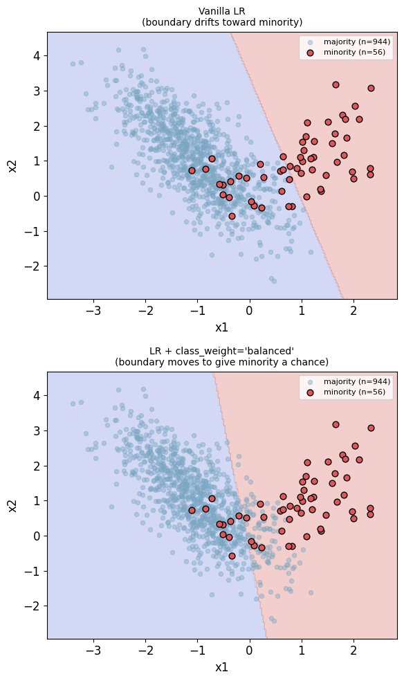
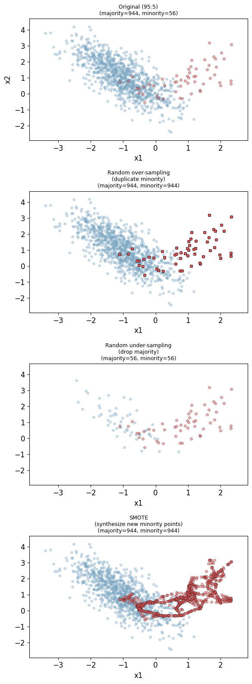
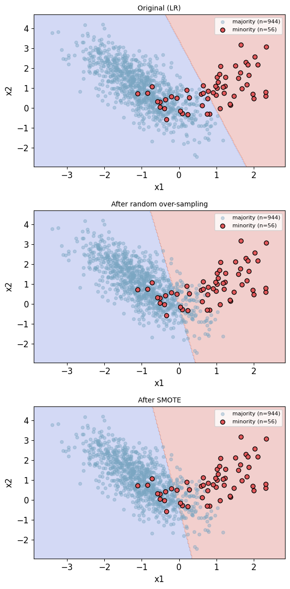
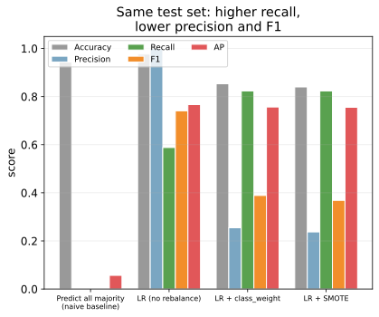

クラス不均衡（class imbalance）は、分類問題でクラス間のサンプル数が大きく偏っている状況を指します。例えば、故障の検知で正常な記録が大半を占め、検出したい故障の記録が少数しかない場合です。

多数派を常に返すだけでも、正解率が高くなる場合があります。ただし、クラス不均衡だけで実際の正例のうち検出できた割合（Recall）が 0 になったり、確率の校正が必ず崩れたりするわけではありません。

<br>

本記事では同じデータで重み付け・リサンプリング・閾値変更を比べ、見逃しと誤検出がどう変わるかを確認します。

[ROC-AUC / PR-AUC](../roc-pr-auc/) と[混同行列](../confusion-matrix/)で扱う指標を使います。ここでの合成データは手法の比較用で、個別の医療・金融サービスに適した判定基準を示すものではありません。

---

### 不均衡対処の判断軸

比較の前に、何を改善したいかを決めます。

- 見逃しを減らす：Recall を確認し、増えた誤検出の件数も調べる
- 誤検出を抑える：正例と予測したもののうち当たった割合（Precision）と、処理可能な件数を確認する
- 確率を期待損失に使う：クラス比率だけで判断せず、予測確率と実測割合の対応を確認する

重み付けや少数派のサンプルを増やす処理を入れるだけで、全ての指標が良くなるとは限りません。元のモデルを基準にし、同じ評価データで比較します。

---

### 多数派だけを返す基準

正例が約 5%の合成データを作ります。クラス比率の指定後に既定のラベルノイズも入るため、出来上がる比率は厳密な 95:5 ではありません。以下は [scikit-learn](https://scikit-learn.org/) 1.8.0、[NumPy](https://numpy.org/) 2.4.1、[imbalanced-learn](https://imbalanced-learn.org/) 0.14.1 で確認しました。

本文のコードは計算部分の抜粋です。[Matplotlib](https://matplotlib.org/) の描画処理を含む[生成コード](https://github.com/nao1215/debimate/blob/main/projects/ml/scripts/notes/class-imbalance_gen.py)は GitHub で確認できます。

```python
import numpy as np
from sklearn.datasets import make_classification
from sklearn.linear_model import LogisticRegression
from sklearn.metrics import accuracy_score, precision_score, recall_score, f1_score, average_precision_score
from sklearn.model_selection import train_test_split

X, y = make_classification(n_samples=1000, n_features=2, n_informative=2,
                            n_redundant=0, n_clusters_per_class=1,
                            weights=[0.95, 0.05], class_sep=1.0, random_state=0)
X_tr, X_te, y_tr, y_te = train_test_split(X, y, test_size=0.3, stratify=y, random_state=0)

predict_all_majority = np.zeros_like(y_te)
print(f"Accuracy = {accuracy_score(y_te, predict_all_majority):.3f}")
print(f"Recall   = {recall_score(y_te, predict_all_majority, zero_division=0):.3f}")
print(f"F1       = {f1_score(y_te, predict_all_majority, zero_division=0):.3f}")
```

出力:

```text
Accuracy = 0.943
Recall   = 0.000
F1       = 0.000
```

評価データ 300 件のうち正例は 17 件です。全て負例と予測すれば 283 件が当たり、Accuracy は約 94.3%になりますが、正例は 1 件も検出できません。このように、正解率だけでは正例の見逃しを評価できません。

Precision・Recall・F1 に加え、確率やスコアの順位を見る指標も使います。以下では [Average Precision（AP）](https://scikit-learn.org/stable/modules/generated/sklearn.metrics.average_precision_score.html)を使います。AP は Recall の増分で Precision を重み付けした値で、PR 曲線を台形で積分する PR-AUC とは計算法が異なります。

---

### 対処 1: 損失の重み付け（class_weight）

モデルの学習方法を変える対処の 1 つが、[損失関数](/ml/ml/loss-functions/)に「少数派サンプルの誤りを重く罰する」重みを掛けることです。ここでは[ロジスティック回帰](../logistic-regression/)を使い、重み付けの有無で決定境界を比べます。`scikit-learn` では `class_weight="balanced"` で重みを指定できます。

```python
from sklearn.linear_model import LogisticRegression

plain = LogisticRegression(max_iter=2000).fit(X, y)
weighted = LogisticRegression(class_weight="balanced", max_iter=2000).fit(X, y)
# 描画処理は省略
```



この図はデータ全体へ当てはめた境界の説明用です。重み付け後は正例と予測する領域が広がります。未知のデータでの指標は、後の節で学習用と評価用を分けて比較します。

`balanced` は自動的に `n_samples / (n_classes × bincount(y))` で重みを計算します。損失（誤検出と見逃しのコスト）が分かるなら、`class_weight={0: 1, 1: 20}` のように、コストに応じた重みを指定できます。

---

### 対処 2: リサンプリング

データ側でクラス比率を変える方法です。imbalanced-learn は、scikit-learn と組み合わせる API を提供しています。ここでは点の配置を示すためにデータ全体を使います。後の性能比較では、分割後の訓練データだけをリサンプリングします。

```python
from imblearn.over_sampling import RandomOverSampler, SMOTE
from imblearn.under_sampling import RandomUnderSampler

samplers = {
    "Random over": RandomOverSampler(random_state=0).fit_resample(X, y),
    "Random under": RandomUnderSampler(random_state=0).fit_resample(X, y),
    "SMOTE": SMOTE(random_state=0).fit_resample(X, y),
}
# 描画処理は省略
```



3 つのアプローチの違い:

- Random over-sampling: 少数派のサンプルを単純に複製。情報量は増えないが少数派のサンプルが学習時の損失に寄与する割合が増える
- Random under-sampling: 多数派からランダムに間引く。多数派の情報を失うが計算が軽い
- SMOTE（Synthetic Minority Over-sampling Technique）: 少数派サンプル同士を結ぶ線分上に「合成サンプル」を作る。同じクラスの近傍点間を補間する。実際に意味のある入力になるかは特徴量に依存する

リサンプリングによって分類結果がどう変わるかも確認します。各リサンプリング後のデータへ[ロジスティック回帰](../logistic-regression/)を当て、元のデータ上に決定境界を描きます。



この例では、リサンプリング後に正例と予測する領域が広がっています。直前のサンプル配置図には合成点も含みますが、この決定境界図の点は元データです。

注意: リサンプリングは訓練データだけに適用します。テストデータも resample してしまうと、評価が現実と乖離します（[data leakage](../data-leakage/) と同じ罠）。[交差検証（CV）](../cross-validation/)では、検証用に取り分けた各部分集合（fold）へ合成点の情報が漏れないようにします。[imbalanced-learn の Pipeline](https://imbalanced-learn.org/stable/common_pitfalls.html) を使うと、各回の訓練データ内でリサンプリングできます。

---

### 同じ評価データでの比較

ここからは、最初に分けた訓練 700 件と評価 300 件を使います。多数派だけを返す基準、通常のロジスティック回帰、重み付き回帰、SMOTE 後の回帰を比べます。評価データのクラス比率は変えません。

```python
plain_lr = LogisticRegression(max_iter=2000).fit(X_tr, y_tr)
balanced_lr = LogisticRegression(class_weight="balanced", max_iter=2000).fit(X_tr, y_tr)
Xs, ys = SMOTE(random_state=0).fit_resample(X_tr, y_tr)
smote_lr = LogisticRegression(max_iter=2000).fit(Xs, ys)
for name, model in [("LR", plain_lr), ("weighted", balanced_lr), ("SMOTE", smote_lr)]:
    pred = model.predict(X_te)
    proba = model.predict_proba(X_te)[:, 1]
    print(name, f"precision={precision_score(y_te, pred):.3f}",
          f"recall={recall_score(y_te, pred):.3f}",
          f"F1={f1_score(y_te, pred):.3f}",
          f"AP={average_precision_score(y_te, proba):.3f}")
```



```text
LR precision=1.000 recall=0.588 F1=0.741 AP=0.767
weighted precision=0.255 recall=0.824 F1=0.389 AP=0.757
SMOTE precision=0.237 recall=0.824 F1=0.368 AP=0.755
```

この例では重み付けと SMOTE で Recall が上がる一方、Precision と F1 は下がりました。AP もわずかに下がっています。単に「不均衡対策を入れたから性能が上がった」とは言えません。

全て同じスコアを返す多数派基準の AP は `17/300 ≈ 0.0567` で、0 ではありません。正例の順位を付けられないため、評価集合の正例率になります。図では多数派基準の Precision・Recall・F1 と AP を区別して読みます。

用途に応じて、許容できる見逃し数と誤検出数を決めます。F1 や AP など 1 つの値を選ぶ場合も、その値が何を数え、何を数えないかを確認します。Matthews 相関係数（MCC）も、混同行列の 4 要素から計算する指標です。クラス比率の影響を完全に除けるわけではありません。

---

### 閾値調整: 同じモデルで Precision/Recall を動かす

確率出力を持つモデルなら、リサンプリングや重み付けをしなくても、判定閾値を動かすと、正例と判断する件数が変わり、Precision と Recall も変化します。例えば、デフォルト閾値 0.5 を 0.3 に下げれば、少数派を取りこぼしにくくなる（Recall は上がるか同じ）が、負例を誤検出する件数も増えるか同じになります。ただし、有限のデータで Precision が閾値に対して単調に変わるとは限りません。

```python
proba = LogisticRegression(max_iter=2000).fit(X_tr, y_tr).predict_proba(X_te)[:, 1]
for thr in [0.5, 0.3, 0.1]:
    pred = (proba >= thr).astype(int)
    print(f"thr={thr}: precision={precision_score(y_te, pred):.2f}, recall={recall_score(y_te, pred):.2f}")
```

```text
thr=0.5: precision=1.00, recall=0.59
thr=0.3: precision=0.85, recall=0.65
thr=0.1: precision=0.33, recall=0.71
```

上記は閾値の作用を見る例です。実際に閾値を選ぶ場合は検証データで調整し、未使用のテストデータで最終評価します。選択と最終評価を同じ集合で繰り返すと、評価に合わせ込みます。

閾値 0.5 はクラス比率が等しいことを仮定した値ではありません。確率が適切に推定され、誤検出と見逃しのコストが等しければ、正例確率が 0.5 以上で正例を選ぶ判断になります。コストが異なる場合や処理件数に制約がある場合は、その条件に応じて閾値を決めます。

---

### 数学での使いどころ

- 事前確率の歪み: [ベイズの定理](/ml/math/bayes-theorem/)の `P(y)` が訓練と本番で違うときの補正（label shift）
- 期待リスクの再定義: クラスごとの誤分類コストを取り込んだ目的関数
- F1 / F_β スコアの導出: Precision と Recall の調和平均、`β` でどちらを重視するかを制御
- ROC 曲線とコスト曲線: 閾値変化に対する FPR / TPR の軌跡
- MCC: 混同行列の 4 要素を使う相関ベースの指標 `MCC = (TP·TN - FP·FN) / √((TP+FP)(TP+FN)(TN+FP)(TN+FN))`

---

### 機械学習での使いどころ

故障や不正の検知など、興味のある事象が少ない分類で、見逃しと誤検出を別々に評価する時に役立ちます。対象が少ないという理由だけで手法を決めず、正例の件数、特徴量の意味、許容できる誤りを確認します。

重み付け・リサンプリング・閾値変更は異なる操作です。前の 2 つは学習するモデルを変え、閾値変更は学習済みモデルの出力からラベルを決める境界を変えます。同じ効果になるとは限らないため、同条件の評価で比較します。

---

### 適さないケース / 落とし穴

- 評価データもリサンプリングする：適用先のクラス比率と違う評価になる。訓練だけへ適用する
- CV の外でリサンプリングする：検証 fold の情報が訓練側へ入り得る。訓練 fold ごとに処理する
- 特徴量の意味を確認せず SMOTE を使う：補間した点が実在し得る入力か確認する。高次元では近傍の意味も弱まる場合がある
- 重み付け後の確率を無条件に信頼する：学習の目的やクラス比率を変えた影響を、適用先に近いデータで確認する。[確率の校正](../probability-calibration/)は候補だが、必ず改善するわけではない
- 不均衡を理由に閾値 0.5 を必ず変更する：コストや確率の意味を確認して判断する
- データ収集の偏りをモデルだけで補う：正例の取り逃しやラベルの誤りがあれば、収集・付与方法も見直す
