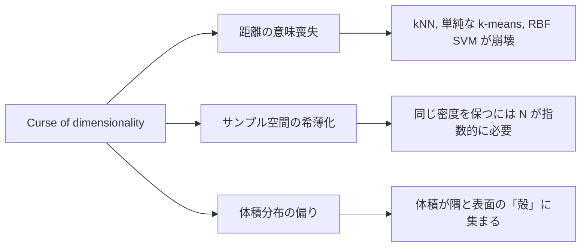
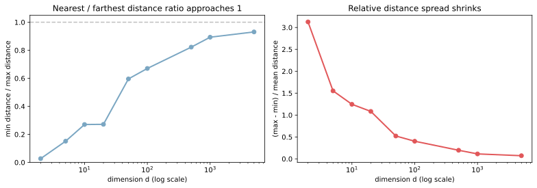
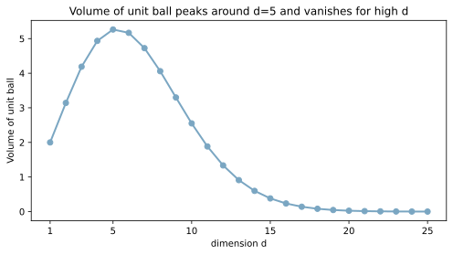
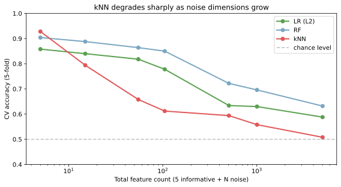

次元の呪い（curse of dimensionality）は、特徴量の次元が高くなるにつれて距離・体積・サンプル密度の常識的な感覚が崩れ、距離ベースのアルゴリズムが機能しなくなる現象群の総称です。[Richard Bellman](https://en.wikipedia.org/wiki/Curse_of_dimensionality) が動的計画法の問題を扱う中で名付けた用語です。

機械学習の文脈では、「特徴量を増やすほど精度が上がるとは限らない、むしろ kNN や RBF（Radial Basis Function）カーネルが先に動かなくなる」という現実問題として現れます。予測に効く特徴量 5 個にノイズ特徴量を足す本記事の実験では、[kNN](../knn/) が 15 次元で崩れ始め、[ロジスティック回帰](../logistic-regression/) と [RandomForest](../random-forest/) は 100 次元前後でも kNN ほどは落ちません。対処としては [PCA](../pca/) などの次元削減、[L1 正則化](../regularization/) による[特徴量選択](/ml/ml/feature-selection/)、距離指標の見直しがあります。

---

### 3 つの症状

本記事では、距離の集中、サンプル密度の低下、体積分布の偏りの 3 つを説明します。



対処方法は症状ごとに異なるので、距離、サンプル密度、体積分布のどれに問題があるかを確認します。

---

### 症状 1: 距離の意味喪失

`d` 次元空間にランダムに配置した `N` 点について、ある 1 点から見た「最近傍点までの距離」と「最遠点までの距離」の比 `min / max` は、`d` が大きくなるほど 1 に近づきます。距離が「近さ」を意味しなくなり、距離ベースの判定が機能しなくなります。次のコードは、各次元が独立な標準正規分布に従う 1000 点で比を測ります。

```python
import matplotlib.pyplot as plt
import numpy as np

rng = np.random.default_rng(0)
dims = [2, 5, 10, 20, 50, 100, 500, 1000, 5000]
ratios = []
spreads = []
for d in dims:
    points = rng.standard_normal((1000, d))
    dists = np.linalg.norm(points[1:] - points[0], axis=1)
    ratios.append(dists.min() / dists.max())
    spreads.append((dists.max() - dists.min()) / dists.mean())

for d, r in zip(dims, ratios):
    print(f"d={d:<5d} min/max = {r:.3f}")

fig, axes = plt.subplots(1, 2, figsize=(11, 4))
axes[0].plot(dims, ratios, "o-", color="#7aa6c2", linewidth=2)
axes[0].set_xscale("log")
axes[0].set_xlabel("dimension d (log scale)")
axes[0].set_ylabel("min distance / max distance")
axes[0].set_title("Nearest / farthest distance ratio approaches 1")
axes[0].set_ylim(0, 1.05)
axes[0].axhline(1.0, color="gray", linestyle="--", alpha=0.5)
axes[1].plot(dims, spreads, "o-", color="#e15759", linewidth=2)
axes[1].set_xscale("log")
axes[1].set_xlabel("dimension d (log scale)")
axes[1].set_ylabel("(max - min) / mean distance")
axes[1].set_title("Relative distance spread shrinks")
plt.tight_layout()
plt.savefig("curse-of-dimensionality_distance.svg", bbox_inches="tight")
```

実行結果:

```text
d=2     min/max = 0.027
d=5     min/max = 0.151
d=10    min/max = 0.270
d=20    min/max = 0.272
d=50    min/max = 0.596
d=100   min/max = 0.670
d=500   min/max = 0.822
d=1000  min/max = 0.893
d=5000  min/max = 0.931
```



2 次元では最近傍が最遠点の 3% の距離にありますが、5000 次元では 93% です。ほぼすべての点が「同じくらいの距離」にあるので、kNN の「k 個の最近傍を取る」操作は、ランダムに k 点を取る操作に近づきます。

<br>

ただし、この集中は各次元が独立したノイズである場合の話です。[Beyer らの 1999 年の論文](https://link.springer.com/chapter/10.1007/3-540-49257-7_15)は、各次元が独立に同じ分布に従うデータでは最近傍が意味を失う一方で、そうでないデータでは意味を保つ場合があると示しています。次のコードは前のコードの続きで、5 次元の点をランダムな行列で 5000 次元へ写したデータ（見かけは 5000 次元、実質は 5 次元）で同じ比を測ります。

```python
rng = np.random.default_rng(0)


def min_max_ratio(points):
    dists = np.linalg.norm(points[1:] - points[0], axis=1)
    return dists.min() / dists.max()


iid = rng.standard_normal((1000, 5000))
latent = rng.standard_normal((1000, 5))
embedded = latent @ rng.standard_normal((5, 5000))
print(f"iid 5000 dims         : min/max = {min_max_ratio(iid):.3f}")
print(f"5 latent -> 5000 dims : min/max = {min_max_ratio(embedded):.3f}")
print(f"5 dims                : min/max = {min_max_ratio(latent):.3f}")
```

実行結果:

```text
iid 5000 dims         : min/max = 0.943
5 latent -> 5000 dims : min/max = 0.109
5 dims                : min/max = 0.108
```

乱数を引き直しているので、独立な 5000 次元の値は上の表の 0.931 と少しずれます。列の数が同じ 5000 でも、実質 5 次元のデータの比は 5 次元のデータとほぼ同じです。距離が効くかどうかは、列の数ではなくデータの本質的な次元（intrinsic dimension）で決まります。

---

### 症状 2: サンプル空間の希薄化

`d` 次元空間で「同じ密度」を保ったままサンプルを配置しようとすると、必要なサンプル数が `d` に対して指数的に増えます。例として、各次元を 10 個のビンに切ると、`d` 次元では `10^d` 個のビンがあります。

- `d=2`: 100 ビン → 1000 サンプルあれば各ビン平均 10 個
- `d=5`: 100,000 ビン → 1000 サンプルなら各ビンほぼ空
- `d=10`: 100 億ビン → ビン数が多く、大半のビンが空になる

機械学習では、学習データが特徴量空間を覆い尽くせなくなる形で現れます。kNN は近傍点の多数決を前提とするので、空間が希薄だと近くに点が無く、遠くの無関係な点が「近傍」として選ばれます。

---

### 症状 3: 体積分布の偏り

`d` 次元の単位球（半径 1 の球）の体積は、`V_d = π^(d/2) / Γ(d/2 + 1)` で表されます。これは `d=5` で最大（約 5.26）になり、それ以降は急減して `d=20` では約 0.026 になります。

```python
import math

d_values = list(range(1, 26))
volumes = [math.pi ** (d / 2) / math.gamma(d / 2 + 1) for d in d_values]

fig, ax = plt.subplots(figsize=(7, 4))
ax.plot(d_values, volumes, "o-", color="#7aa6c2", linewidth=2)
ax.set_xlabel("dimension d")
ax.set_ylabel("Volume of unit ball")
ax.set_title("Volume of unit ball peaks around d=5 and vanishes for high d")
ax.set_xticks([1, 5, 10, 15, 20, 25])
plt.tight_layout()
plt.savefig("curse-of-dimensionality_volume.svg", bbox_inches="tight")
```



この球が一辺 2 の立方体に占める割合 `V_d / 2^d` は、`d=2` で 79%、`d=10` で 0.25%、`d=20` で約 2.5 × 10^-8 です。高次元の立方体の体積は、ほとんどが「隅」にあります。

<br>

球の中でも、体積は表面近くの「殻」に集中します。半径の外側 5% の殻が占める体積は `1 - 0.95^d` で、`d=2` では 10% ですが、`d=100` では 99.4% です。球の中に一様に点を置くと、ほとんどの点が表面近く、つまり中心からほぼ同じ距離に来ます。症状 1 の距離の集中と根は同じです。

---

### kNN が先に崩れる理由

信号特徴量 5 個 + ノイズ特徴量 N 個のデータで、kNN、ロジスティック回帰、RandomForest の 5-fold CV の正解率を比べます。データは scikit-learn の [make_classification](https://scikit-learn.org/stable/modules/generated/sklearn.datasets.make_classification.html) で作る 500 件の 2 クラス分類です。次のコードは症状 1 のコードの続きで、`np` と `plt` を使います。

```python
from sklearn.datasets import make_classification
from sklearn.ensemble import RandomForestClassifier
from sklearn.linear_model import LogisticRegression
from sklearn.model_selection import cross_val_score
from sklearn.neighbors import KNeighborsClassifier
from sklearn.preprocessing import StandardScaler


def make_dataset(n_noise: int, seed: int = 0):
    X_sig, y = make_classification(
        n_samples=500, n_features=5, n_informative=5,
        n_redundant=0, random_state=seed,
    )
    if n_noise > 0:
        X_noise = np.random.default_rng(seed).standard_normal((500, n_noise))
        return np.column_stack([X_sig, X_noise]), y
    return X_sig, y


noise_levels = [0, 10, 50, 100, 500, 1000, 5000]
scores = {"kNN": [], "LR (L2)": [], "RF": []}
for n in noise_levels:
    X, y = make_dataset(n)
    X_std = StandardScaler().fit_transform(X)
    scores["kNN"].append(cross_val_score(
        KNeighborsClassifier(n_neighbors=5), X_std, y, cv=5).mean())
    scores["LR (L2)"].append(cross_val_score(
        LogisticRegression(max_iter=2000), X_std, y, cv=5).mean())
    scores["RF"].append(cross_val_score(
        RandomForestClassifier(n_estimators=100, random_state=0),
        X_std, y, cv=5).mean())

dims_total = [5 + n for n in noise_levels]
print(f"{'dim':>6} {'LR':>8} {'RF':>8} {'kNN':>8}")
for d, lr_s, rf_s, knn_s in zip(
    dims_total, scores["LR (L2)"], scores["RF"], scores["kNN"]
):
    print(f"{d:>6} {lr_s:>8.3f} {rf_s:>8.3f} {knn_s:>8.3f}")

fig, ax = plt.subplots(figsize=(8, 4.5))
for name, color in zip(["LR (L2)", "RF", "kNN"],
                       ["#59a14f", "#7aa6c2", "#e15759"]):
    ax.plot(dims_total, scores[name], "o-", color=color, linewidth=2,
            label=name)
ax.set_xscale("log")
ax.set_xlabel("Total feature count (5 informative + N noise)")
ax.set_ylabel("CV accuracy (5-fold)")
ax.set_title("kNN degrades sharply as noise dimensions grow")
ax.axhline(0.5, color="gray", linestyle="--", alpha=0.5,
           label="chance level")
ax.set_ylim(0.4, 1.0)
ax.legend()
plt.tight_layout()
plt.savefig("curse-of-dimensionality_knn_decay.svg", bbox_inches="tight")
```

実行結果:

```text
   dim       LR       RF      kNN
     5    0.858    0.904    0.928
    15    0.840    0.888    0.794
    55    0.818    0.864    0.658
   105    0.778    0.850    0.612
   505    0.634    0.722    0.594
  1005    0.630    0.696    0.558
  5005    0.588    0.632    0.508
```



ノイズが 10 個増えただけで、kNN は 0.928 から 0.794 に落ちます。LR と RF の低下は 0.02 程度です。この差は、各モデルが何に依存しているかで説明できます。

- kNN: 全特徴量を使った距離計算が核。ノイズの次元も距離に同じ重みで足されるので、信号 5 次元の差が埋もれる
- LR（ロジスティック回帰）: 各特徴量の係数を学習するので、ノイズ特徴量の係数は小さくなる。ただし 500 件に対して特徴量が数百を超えると、[L2 正則化](../regularization/)があってもノイズに合わせた係数が付き、過学習で落ちる
- RF: 各分割は「特徴量 `X` が閾値 `t` 以下か」の 1 次元判定で、距離を使わない。ただし [RandomForestClassifier](https://scikit-learn.org/stable/modules/generated/sklearn.ensemble.RandomForestClassifier.html) は各分割で既定 `sqrt(特徴量数)` 個の候補しか見ない。5005 次元では候補 70 個に信号特徴量が 1 つでも入る確率が約 7% しかなく、ほとんどの分割がノイズで切られる

kNN が先に崩れるのは距離の集中が原因で、LR と RF が後から落ちるのは、500 件に対してノイズ特徴量が多すぎて、過学習や分割の質の低下が起きるためです。どちらも次元の呪いの症状ですが、効く対処は異なります。

---

### 対処

対処は次の 4 系統に分かれます。

1. 次元削減で本質的な次元だけ残す
    - [PCA](../pca/): 分散を最大化する方向に射影。線形手法でスケール感を残す
    - [t-SNE](https://scikit-learn.org/stable/modules/generated/sklearn.manifold.TSNE.html) / [UMAP](https://umap-learn.readthedocs.io/en/latest/): 主に 2D 可視化用。近傍関係を保つ非線形射影で、点間の距離そのものは保たれない（[t-SNE と UMAP](../tsne-umap/) のノート）
    - オートエンコーダー: ニューラルネットで非線形圧縮
2. 特徴量選択で意味のある列だけ残す
    - [L1 正則化](../regularization/)（Lasso）: 不要な係数を 0 にする副作用で特徴量選択になる
    - 相互情報量や F 値: 目的変数との関連度で上位を選ぶ
    - [SHAP](https://github.com/shap/shap) / [特徴量重要度](/ml/ml/feature-importance/): 学習後に効いている特徴を抽出して再学習
3. 距離指標を見直す
    - コサイン距離: ベクトルの長さを無視して向きだけ比べる。bag-of-words のようなスパースなベクトルやテキスト埋め込みで使う
    - マハラノビス距離: 特徴量の共分散を考慮した距離
4. 距離に頼らないアルゴリズムを選ぶ
    - 線形モデル: LR, Ridge, Lasso
    - 木系: 決定木, [RandomForest](../random-forest/), [GradientBoosting](../gradient-boosting/)
    - 確率モデル: Naive Bayes

前節の実験のようにノイズ特徴量が原因なら、4 の手法も特徴量が増えれば落ちるので、2 の特徴量選択が先です。

---

### 機械学習での使いどころ

特徴量の数が増えた時は、次の点を確認します。

- アルゴリズム選択: 列が多く本質的な次元も高いデータでは、kNN / 単純な k-means / RBF SVM を第一候補にしない
- 前処理設計: PCA による次元削減や L1 による特徴量選択を試し、残す次元数ごとの検証スコアで比べる
- 特徴量設計レビュー: 「特徴量を増やせば精度が上がる」という前提に歯止めをかける

---

### よくある誤解

- 「次元の呪いはスケール問題と同じ」ではない: スケール問題は [標準化](../standardization/) で解決する。一方、次元の呪いは標準化しても残る。kNN が先に崩れる理由の実験も、標準化済みのデータで kNN が落ちている
- 「特徴量を増やせば精度が上がる」とは限らない: 信号が無いノイズ特徴量を増やすと、距離ベース手法から先に精度が下がる
- 「次元削減すれば必ず良くなる」とは限らない: PCA は線形な分散最大化なので、非線形な構造を持つデータでは情報を失う。t-SNE / UMAP も可視化向きで、後段の予測に使うと結果が不安定になる場合がある
- 「列が多いデータは必ず呪われる」ではない: 画像・テキスト・音声は素の次元こそ高いものの、実際のデータは低次元の多様体に乗っていることが多い（manifold hypothesis）。症状 1 の実質 5 次元のデータのように、本質的な次元が低ければ距離は意味を保つ。だから次元削減や深層学習の埋め込みが効く
