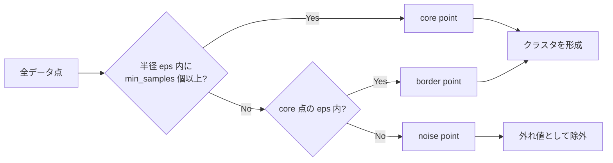

DBSCAN（Density-Based Spatial Clustering of Applications with Noise、[Ester et al., 1996](https://cdn.aaai.org/KDD/1996/KDD96-037.pdf)）は、点の密度に基づいてクラスタを構成するクラスタリングアルゴリズムです。[k-means](../k-means/) と違い「クラスタ数 `k` を事前に決める必要がない」「非凸（曲がった）形状のクラスタも見つけられる」「外れ値（noise）を別カテゴリとして扱う」という 3 つの強みを持ち、不規則な形のクラスタや、クラスタに属さない点を検出できます。

球形に近いクラスタで数 `k` を指定できる場合は [k-means](../k-means/) が候補になります。DBSCAN は密集した点をまとめ、外れ値も区別したい場合に使います。クラスタ同士の階層関係は [階層的クラスタリング](../hierarchical-clustering/) で調べます。

---

### k-means との対比

非凸データ（[`make_moons`](https://scikit-learn.org/stable/modules/generated/sklearn.datasets.make_moons.html) で作る三日月型）に対する両者の挙動です。本記事のコードは[生成コード](https://github.com/nao1215/debimate/blob/main/projects/ml/scripts/notes/dbscan_gen.py)から描画を除いた抜粋で、scikit-learn 1.9.1 と NumPy 2.5.4 で実行しました。

```python
from sklearn.cluster import DBSCAN
from sklearn.datasets import make_moons

X, _ = make_moons(n_samples=400, noise=0.08, random_state=0)
for eps in [0.17, 0.2]:
    labels = DBSCAN(eps=eps, min_samples=5).fit(X).labels_
    print(f"eps={eps}: clusters={len(set(labels) - {-1})}, noise={(labels == -1).sum()}")
```

```text
eps=0.17: clusters=2, noise=0
eps=0.2: clusters=1, noise=0
```



k-means（左、[`KMeans`](https://scikit-learn.org/stable/modules/generated/sklearn.cluster.KMeans.html)`(n_clusters=2, random_state=0)`）はクラスタを「球形」で近似するため、三日月型データを縦に分けてしまいます。DBSCAN（右、`eps=0.17`）は「密につながった点同士は同じクラスタ」と判定し、2 つの月を noise 0 件で取り出します。ただし `eps=0.2` にすると、月の端同士がつながって 1 クラスタになります。半径を 0.03 広げただけで結果が変わります。

---

### コア・ボーダー・ノイズの 3 分類

DBSCAN は各点を 3 種類に分類します。

- core point（コア点）: 自分自身を含め、半径 `eps` 以内に `min_samples` 個以上の点を持つ
- border point（ボーダー点）: コア点ではないものの、コア点の近傍 `eps` に入る
- noise point（ノイズ点）: どちらでもない外れ値



30 点の塊に、境界に置いた 1 点と離れた 3 点を足したデータで確認します。

```python
import numpy as np
from sklearn.cluster import DBSCAN

rng = np.random.default_rng(0)
cluster = rng.normal([0, 0], 0.4, (30, 2))
border_pt = np.array([[1.0, 0.0]])
noise_pts = np.array([[2.5, 1.5], [-2.5, 2.0], [2.0, -2.0]])
X = np.vstack([cluster, border_pt, noise_pts])

db = DBSCAN(eps=0.6, min_samples=5).fit(X)
core = set(db.core_sample_indices_)
border = [i for i, label in enumerate(db.labels_) if i not in core and label != -1]
print(f"core: {len(core)}, border: {len(border)}, "
      f"noise: {sum(db.labels_ == -1)}")
```

```text
core: 30, border: 1, noise: 3
```



赤い点が core 点で、その周りの薄い赤の円が各 core 点の `eps` 範囲です。密集地帯にあるコア点同士が「density-reachable」（相互に近傍を辿れる）であれば、同じクラスタにまとめられます。

橙の 1 点が `(1.0, 0.0)` に置いた点です。自分の近傍数は `min_samples` 未満でも、core 点の近傍にあるためボーダー点になります。ノイズ点は外れ値として `label = -1` で返されます。

---

### eps と min_samples の選び方

DBSCAN の 2 つの[ハイパーパラメータ](/ml/ml/hyperparameter/)です。

- `eps`（半径）: クラスタの「密度しきい値」を間接的に決める
- `min_samples`（最小サンプル数）: コア点の判定基準

`eps` の効果を見ます。データは [`make_blobs`](https://scikit-learn.org/stable/modules/generated/sklearn.datasets.make_blobs.html) で作った中心 `(0, 0)`・`(4, 4)`・`(-3, 3)` の 3 つの塊（計 300 点、右上の `(4, 4)` だけ散らばりが大きい）に、一様ノイズ 30 点を足した 330 点です。

```python
import numpy as np
from sklearn.cluster import DBSCAN
from sklearn.datasets import make_blobs

X, _ = make_blobs(n_samples=300, centers=[(0, 0), (4, 4), (-3, 3)],
                  cluster_std=[0.8, 1.2, 0.6], random_state=0)
noise = np.random.default_rng(0).uniform([-5, -2], [6, 6], (30, 2))
X = np.vstack([X, noise])
for eps in [0.3, 0.8, 2.0]:
    labels = DBSCAN(eps=eps, min_samples=5).fit(X).labels_
    print(f"eps={eps}: clusters={len(set(labels) - {-1})}, "
          f"noise={(labels == -1).sum()}")
```

```text
eps=0.3: clusters=10, noise=166
eps=0.8: clusters=2, noise=25
eps=2.0: clusters=1, noise=2
```



- `eps = 0.3`: 半径が小さく、10 個の断片と 166 件の noise に分かれる。散らばりの大きい右上の塊はほとんどが noise になる
- `eps = 0.8`: 2 クラスタと 25 件の noise になる。右上の塊は 1 つのクラスタになるが、左上と中央下の塊は間の点でつながり、1 つのクラスタに併合される
- `eps = 2.0`: 半径が大きく、ほぼ全てが 1 つの大クラスタになる（noise は 2 件）

3 つの塊を 3 つのクラスタとして取り出せる `eps` は、この 3 つの中にありません。右上の疎な塊をまとめられる半径では、密な 2 つの塊の間もつながってしまうからです。

`eps` の選び方の定石として「k-distance プロット」があります。各点の `k` 番目近傍までの距離をソートしてグラフ化し、曲がり角（elbow）の高さを `eps` の目安にします。次のコードは直前のブロックの `X`（330 点）に [`NearestNeighbors`](https://scikit-learn.org/stable/modules/generated/sklearn.neighbors.NearestNeighbors.html) を当てます。

```python
from sklearn.neighbors import NearestNeighbors

k = 5  # min_samples と同じ値を使う
nbrs = NearestNeighbors(n_neighbors=k).fit(X)
distances, _ = nbrs.kneighbors(X)  # 1 番目は距離 0 の自分自身
k_distances = np.sort(distances[:, -1])
for eps in [0.3, 0.8, 2.0]:
    print(f"eps={eps}: {(k_distances <= eps).sum()} 点")
```

```text
eps=0.3: 110 点
eps=0.8: 292 点
eps=2.0: 328 点
```



横軸が「ソートされた点」、縦軸が「k 番目近傍までの距離」です。3 本の水平線は上で試した `eps` で、自動で選んだ値ではありません。この図では 0.6〜0.9 あたりで曲線が立ち上がり始め、`eps = 0.8` はその曲がり角の付近にあります。

`kneighbors` は自分自身を 1 番目に数えるので、k-distance が `eps` 以下の点は、自分を含めて `eps` 以内に 5 点以上を持つ点、つまりコア点です。実際に `eps = 0.3 / 0.8 / 2.0` のコア点の数を DBSCAN で数えると 110 / 292 / 328 点で、上の出力と一致します。

候補は 95 パーセンタイルのような固定規則で決めず、候補ごとにクラスタ数とノイズ点を確認します。特徴量の尺度、`min_samples`、期待するノイズ率を変えると候補も変わります。

`min_samples` は次の目安で選びます。

- 2D データなら `min_samples ≥ 4`、3D 以上なら `min_samples = 2 × n_features`
- ノイズが多いデータほど大きく
- 「最小限のクラスタサイズ」と捉えて、ドメイン的に意味のある最小サンプル数で

---

### 数学での使いどころ

- density-reachable / density-connected の概念: グラフ理論との接続
- ε-近傍：[距離関数](../knn/) ベースの幾何
- k-distance plot: 距離の分布を[分位点](../../math/quantile/)の目で読み、曲がり角を探す
- 密度推定の応用: [KDE](../../math/kde/) との発想の共通性
- 高次元での「密度」の崩壊: [次元の呪い](../curse-of-dimensionality/) で eps の選択が困難に

---

### 機械学習での使いどころ

- 地理データのクラスタリング（GPS 座標から「人が集まる場所」の検出）
- 画像セグメンテーション（カラー空間でのクラスタリング）
- センサーデータの異常検知（[anomaly-detection](../anomaly-detection/) と組み合わせ）
- 顧客セグメンテーション（外れ値顧客を別扱い）
- 不正検知（クラスタに属さない取引を異常としてフラグ）

scikit-learn では [`sklearn.cluster.DBSCAN`](https://scikit-learn.org/stable/modules/generated/sklearn.cluster.DBSCAN.html)、密度が異なるクラスタ向けに [`HDBSCAN`](https://scikit-learn.org/stable/modules/generated/sklearn.cluster.HDBSCAN.html)（階層型 DBSCAN、scikit-learn 1.3 以降）があります。HDBSCAN は複数の密度でのクラスタから安定したものを選ぶため、`eps` を指定しません。上の 330 点に `HDBSCAN(min_cluster_size=5)` を当てると、DBSCAN では分けられなかった 3 つの塊が 3 クラスタ（noise 28 件）に分かれます。

---

### 適さないケース / 落とし穴

- 高次元データ（>10〜20 次元）: [次元の呪い](../curse-of-dimensionality/) で密度の概念が崩れる。先に [PCA](../pca/) や [t-SNE/UMAP](../tsne-umap/) で次元削減
- 密度が大きく異なる複数クラスタ: 単一の `eps` では全部をうまく扱えない。HDBSCAN を検討
- スケールが揃っていない: 距離計算が歪む。[標準化](../standardization/) を必ず先に
- 巨大データで `eps` を大きく取る: scikit-learn の実装は近傍を一括で求めるため、最悪でメモリが `O(n²)` になる。近傍グラフを事前計算して `metric="precomputed"` で渡すか、[OPTICS](https://scikit-learn.org/stable/modules/generated/sklearn.cluster.OPTICS.html) を検討
- [カテゴリ変数](../categorical-encoding/)を含むデータ: ユークリッド距離が意味を持たない。[Gower 距離](https://doi.org/10.2307/2528823)か、別のクラスタリングを検討
- noise を必ず捨てる: 業務によっては noise こそ重要（不正検知、希少事例）
- `eps` を本番運用中も固定: [データ分布が変わる](/ml/mlops/data-drift/)と noise 率が変動する。定期的に再校正
- `min_samples = 1` の罠: 全点がコアになり noise が出ない。結果は単連結法の階層的クラスタリングを高さ `eps` で切ったものと同じになる
- クラスタの「中心」が欲しいケース: DBSCAN は中心を返さない。代わりに各クラスタの centroid を後計算する
