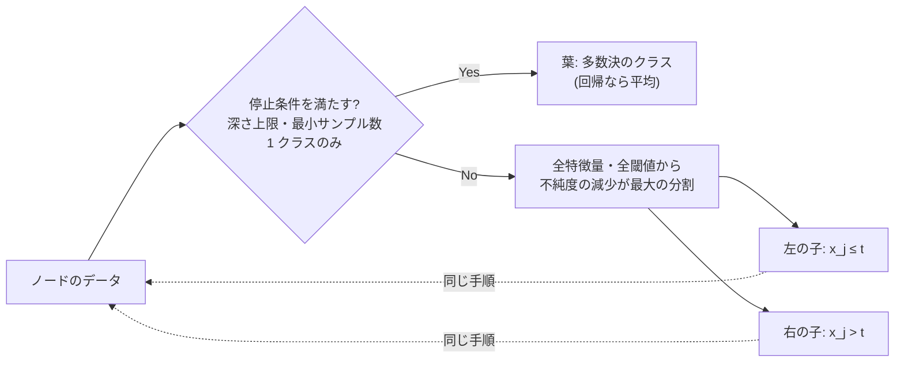
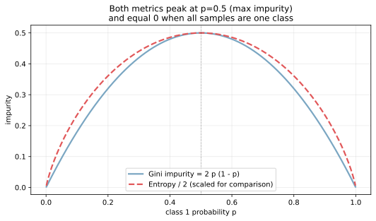
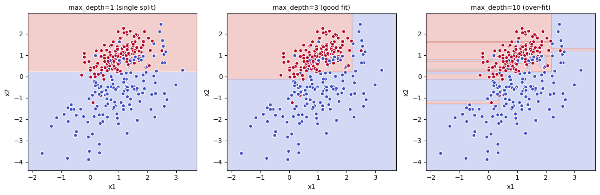
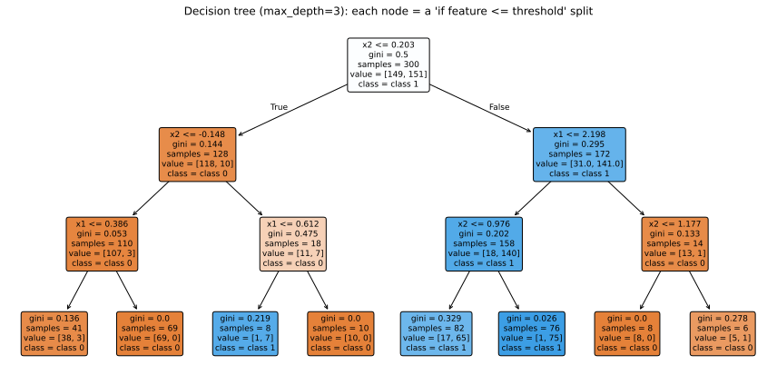
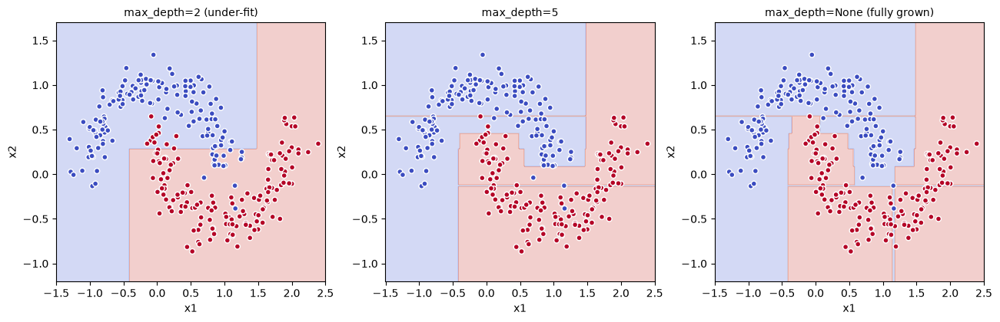

決定木（decision tree）は、「特徴量 `x_j` が閾値 `t` 以下か」という質問を繰り返してデータを分け、たどり着いた葉ノードでクラス（分類）または値（回帰）を返すモデルです。学習では、各ノードで最も良い質問を 1 つずつ貪欲に選びます。分岐条件を読めば予測の根拠を追えますし、特徴量のスケーリングも要りません。

単体の決定木は過学習しやすいので、深さや葉のサンプル数を制限して使うか、[ランダムフォレスト](../random-forest/) や [勾配ブースティング](../gradient-boosting/) の部品として使うのが一般的です。

<br>

本記事では、scikit-learn の [`DecisionTreeClassifier`](https://scikit-learn.org/stable/modules/generated/sklearn.tree.DecisionTreeClassifier.html) を使って次の疑問を確かめます。

- 各ノードで、どの特徴量・閾値をどう選んでいるのか
- Gini 不純度とエントロピーで、選ばれる分割は変わるのか
- 木を深くすると、学習データと未知のデータでの精度はどう変わるのか

---

### 分割の選び方

学習はトップダウンに次の手順を繰り返します。scikit-learn は [CART](https://doi.org/10.1201/9781315139470)（Classification And Regression Trees）を最適化した実装で、どのノードも左右 2 つに分けます。



分割の良し悪しは不純度（impurity）の減少量で測ります。不純度は、ノード内のクラスがどれだけ混ざっているかを表す値です。分割前の不純度から、左右の子の不純度をサンプル数で重み付けして平均したものを引いた値が減少量で、これが最大になる `(特徴量, 閾値)` を選びます。閾値の候補は、各特徴量の値を並べた時の隣り合う 2 値の中点です。

---

### 不純度: Gini とエントロピー

分類木の不純度には、Gini 不純度と[エントロピー](/ml/math/information-theory/)がよく使われます。`p_k` はノード内でクラス `k` が占める割合です。

- Gini: `G(p) = Σ_k p_k (1 - p_k) = 1 - Σ_k p_k^2`
- エントロピー: `H(p) = -Σ_k p_k log_2 p_k`

エントロピーの減少量は情報利得（information gain）と呼ばれ、[ID3](https://doi.org/10.1007/BF00116251) や C4.5 などの決定木で使われてきました。二値分類（`p_1 = p`）では、どちらも `p` だけの関数です（エントロピーは比較のため 1/2 倍）。



どちらも `p = 0.5`（クラスが半々）で最大、`p = 0` または `p = 1`（1 クラスだけ）で 0 になり、形はよく似ています。違いは、エントロピーが端の近くで急に立ち上がり、クラスが少し混ざっただけのノードをより重く数える点です。Gini は対数を使わないので計算が軽く、scikit-learn の既定（`criterion="gini"`）になっています。

<br>

形が似ていても、選ばれる分割が同じとは限りません。次のコードは、2 特徴量・300 点の分類データで最初の分割を総当たりで探し、scikit-learn が選んだ根ノードの分割と比べます。

```python
import numpy as np
from sklearn.datasets import make_classification
from sklearn.tree import DecisionTreeClassifier

X, y = make_classification(n_samples=300, n_features=2, n_informative=2, n_redundant=0,
                           n_clusters_per_class=1, class_sep=0.9, random_state=0)


def gini(t):
    p = np.bincount(t, minlength=2) / len(t)
    return 1 - np.sum(p**2)


def entropy(t):
    p = np.bincount(t, minlength=2) / len(t)
    p = p[p > 0]
    return -np.sum(p * np.log2(p))


def best_split(X, y, impurity):
    best = (0.0, None, None)
    for j in range(X.shape[1]):
        v = np.unique(X[:, j])
        for t in (v[:-1] + v[1:]) / 2:  # 隣り合う値の中点を閾値の候補にする
            left = X[:, j] <= t
            n_l, n_r = left.sum(), (~left).sum()
            gain = impurity(y) - (n_l * impurity(y[left]) + n_r * impurity(y[~left])) / len(y)
            if gain > best[0]:
                best = (gain, j, t)
    return best


for name, f in [("gini", gini), ("entropy", entropy)]:
    gain, j, t = best_split(X, y, f)
    root = DecisionTreeClassifier(max_depth=1, criterion=name, random_state=0).fit(X, y).tree_
    print(f"{name:7s} 手計算: x{j + 1} <= {t:.3f} (減少量 {gain:.3f})"
          f"  scikit-learn: x{root.feature[0] + 1} <= {root.threshold[0]:.3f}")
```

```text
gini    手計算: x2 <= 0.203 (減少量 0.269)  scikit-learn: x2 <= 0.203
entropy 手計算: x2 <= -0.148 (減少量 0.451)  scikit-learn: x2 <= -0.148
```

手計算の閾値は scikit-learn と一致しました。一方で、同じデータでも Gini は `x2 <= 0.203`、エントロピーは `x2 <= -0.148` を選んでいます。ただし次節の深さ 3 の木で比べると、交差検証の精度は 0.897 と 0.883 で、差は 0.014 でした。

回帰木（`DecisionTreeRegressor`）は、既定で子ノードの二乗誤差の合計が最小になる分割を選びます。葉の予測値は葉内の `y` の平均で、平均は二乗誤差を最小にする定数なので、分散の減少量で分割を選ぶことと同じです。

---

### 深さと決定境界

各分割は 1 つの特徴量と閾値で決まるため、決定境界は座標軸に平行な線分をつないだ階段状になります。次の図は、前節と同じデータで `max_depth` を 1・3・10 にした時の決定境界です。本記事のコードは計算部分だけで、描画を含む[図の生成コード](https://github.com/nao1215/debimate/blob/main/projects/ml/scripts/notes/decision-tree_gen.py)は GitHub にあります。



深さ 1 は `x2 = 0.203` の横線 1 本だけで分けます。深さ 3 では赤のクラスを囲む階段ができ、深さ 10 では数点だけを囲む細い帯が何本も現れます。この帯が未知のデータで役に立つかは、図を見ても分かりません。そこで、学習データの精度と、5 分割の交差検証を 10 回繰り返した平均精度（CV）を並べます。前節のコードの `X`、`y` を使います。

```python
from sklearn.model_selection import RepeatedStratifiedKFold, cross_val_score

cv = RepeatedStratifiedKFold(n_splits=5, n_repeats=10, random_state=0)
for criterion in ["gini", "entropy"]:
    for depth in [1, 3, 10]:
        clf = DecisionTreeClassifier(max_depth=depth, criterion=criterion, random_state=0)
        train = clf.fit(X, y).score(X, y)
        valid = cross_val_score(clf, X, y, cv=cv).mean()
        print(f"{criterion:7s} depth={depth:2d} 葉={clf.get_n_leaves():2d}"
              f"  学習={train:.3f}  CV={valid:.3f}")
```

```text
gini    depth= 1 葉= 2  学習=0.863  CV=0.847
gini    depth= 3 葉= 8  学習=0.923  CV=0.897
gini    depth=10 葉=35  学習=1.000  CV=0.868
entropy depth= 1 葉= 2  学習=0.850  CV=0.841
entropy depth= 3 葉= 7  学習=0.897  CV=0.883
entropy depth=10 葉=32  学習=0.987  CV=0.871
```

Gini の深さ 10 は葉が 35 個まで増え、学習データを全て当てました（1.000）。しかし CV は 0.868 で、葉 8 個の深さ 3（0.897）より低くなっています。学習データにだけ合う帯を作った分、未知のデータで外れたわけです。これが決定木の過学習です。

---

### 木構造を読む

決定木は、学習結果をそのまま人間が読めます。scikit-learn の [`plot_tree`](https://scikit-learn.org/stable/modules/generated/sklearn.tree.plot_tree.html) に深さ 3（Gini）の木を渡すと、ノードごとの分岐条件と内訳を描きます。

```python
from sklearn.tree import plot_tree

clf3 = DecisionTreeClassifier(max_depth=3, random_state=0).fit(X, y)
plot_tree(clf3, feature_names=["x1", "x2"], class_names=["class 0", "class 1"],
          filled=True, rounded=True)
```



各ノードには、分岐条件、Gini 不純度、サンプル数、クラスごとのサンプル数（`value`）、多数決のクラスが書かれます。条件を満たすサンプルは左の子へ進みます。色はそのノードで多いクラスを表し、濃いほど 1 クラスに偏っています。

例えば根ノードは `x2 <= 0.203` で、前節の手計算と同じ分割です。`x2 > 0.203` かつ `x1 <= 2.198` かつ `x2 > 0.976` の葉には 76 点が落ち、そのうち 75 点が class 1 です。新しいサンプルの予測は「x2 が 0.203 より大きく、x1 が 2.198 以下で、x2 が 0.976 より大きいので class 1」のように文章で説明できます。

ただし、深さ 10 の木は葉が 35 個あり、全ての経路を人が読むのは現実的ではありません。説明に使うなら、読める深さで精度が足りるかを交差検証で確かめます。

---

### 曲がった境界と深さの選び方

曲がった境界も、決定木は階段を細かくすれば覆えます。三日月型のデータ（[`make_moons`](https://scikit-learn.org/stable/modules/generated/sklearn.datasets.make_moons.html)）で深さを変えた結果が次の図です。



深さ 2 は階段が粗く、月の内側の凹みを表現できません。深さを制限しない木（`max_depth=None`）は、葉が全て 1 クラスになるまで分けます。精度は前節と同じ方法で測ります。

```python
from sklearn.datasets import make_moons

X_m, y_m = make_moons(n_samples=300, noise=0.15, random_state=0)
for depth in [2, 5, None]:
    clf = DecisionTreeClassifier(max_depth=depth, random_state=0)
    train = clf.fit(X_m, y_m).score(X_m, y_m)
    valid = cross_val_score(clf, X_m, y_m, cv=cv).mean()
    print(f"depth={str(depth):4s} 葉={clf.get_n_leaves():2d}  学習={train:.3f}  CV={valid:.3f}")
```

```text
depth=2    葉= 4  学習=0.913  CV=0.902
depth=5    葉=15  学習=0.990  CV=0.957
depth=None 葉=20  学習=1.000  CV=0.972
```

前節とは逆に、制限なしの木の CV（0.972）が最も高くなりました。このデータはノイズが小さく、2 つの月がほとんど重ならないので、学習データを全て当てても葉は 20 個で済み、余計な帯がほとんどできません。学習精度が 1.000 であること自体は過学習の証拠ではなく、未知のデータでの精度と並べて初めて判断できます。

深さなどの[ハイパーパラメータ](/ml/ml/hyperparameter/)は、図の見た目ではなく[交差検証](../cross-validation/)で選びます。候補は `max_depth`、`min_samples_split`、`min_samples_leaf`、`ccp_alpha`（コスト複雑度枝刈りの強さ）です。木そのものを安定させたい場合は、多数の木の多数決や平均を取るランダムフォレストや、前の木の誤差を次の木で順に補う勾配ブースティングに進みます。

---

### 数学での位置付け

- 区分定数近似: 入力空間を軸に平行な直方体に分け、各領域で定数を予測する関数
- 情報理論: 情報利得は、分岐の結果とクラスラベルの相互情報量に等しい
- 貪欲法: 各ノードの分割は局所最適で、最適な二分木を求める問題は [NP 完全](https://doi.org/10.1016/0020-0190(76)90095-8) と示されている
- boosting: 深さ 1 の木（決定株）など浅い木は、boosting の弱学習器としてよく使われる

---

### 機械学習での使いどころ

- 説明性が必須の分類・回帰で、浅い木 1 本をそのまま使う
- [アンサンブル学習](../ensemble-learning/) の部品にする。ランダムフォレストは bagging、勾配ブースティングは boosting で木を組み合わせる
- 分割で減らした不純度の合計から[特徴量重要度](../feature-importance/)を得る
- 不均衡データでは `class_weight="balanced"` で少数クラスの重みを上げる（[クラス不均衡](../class-imbalance/)）
- 欠損値は、scikit-learn の決定木が [1.3](https://scikit-learn.org/stable/auto_examples/release_highlights/plot_release_highlights_1_3_0.html) から扱える。勾配ブースティングの [XGBoost](https://xgboost.readthedocs.io/en/stable/faq.html)、[LightGBM](https://lightgbm.readthedocs.io/en/stable/Advanced-Topics.html)、[CatBoost](https://catboost.ai/docs/en/concepts/algorithm-missing-values-processing) も欠損値の振り分け先を学習する

---

### 適さないケース / 落とし穴

- 不安定: 学習データが少し変わるだけで、根に近い分割が変わり木全体が変わる。安定性が要るならアンサンブルを使う
- 斜めの境界: 軸に対して傾いた直線が本質の問題では、階段で近似するために多くの葉が要る。[ロジスティック回帰](../logistic-regression/)や SVM（サポートベクターマシン）の方が少ないパラメータで済む
- 滑らかな回帰・外挿: 予測は区分定数なので滑らかな関数は苦手で、学習データの範囲外では端の葉の値を返し続ける。傾向を伸ばす予測には[線形回帰](../linear-regression/)などを検討する
- カテゴリ変数: [scikit-learn の決定木](https://scikit-learn.org/stable/modules/tree.html)はカテゴリ変数を直接扱えないので、[エンコーディング](../categorical-encoding/)が必要（LightGBM や CatBoost は内部で扱える）
- 相関の強い特徴量: どちらで分けても同程度なら片方だけが選ばれ、もう片方の重要度が低く見える
- 不純度ベースの重要度: 値の種類が多い特徴量ほど分割候補が多く、重要度が高く出やすい。permutation importance でも確かめる

図の生成コードは [GitHub](https://github.com/nao1215/debimate/blob/main/projects/ml/scripts/notes/decision-tree_gen.py) にあります。