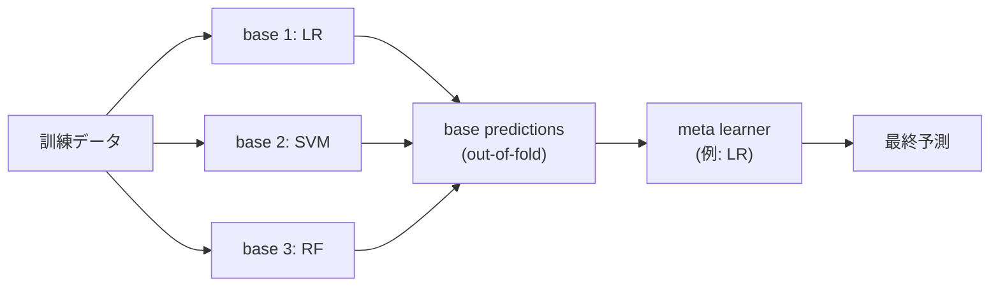

アンサンブル学習（ensemble learning）は、複数のモデルを学習して予測をまとめ、単体のモデルより安定した、または精度の高い予測を作る手法です。まとめ方は大きく bagging（bootstrap aggregating）、boosting、stacking の 3 系統に分かれます。

[ランダムフォレスト](../random-forest/) は bagging の代表、[勾配ブースティング](../gradient-boosting/) は boosting の代表で、いずれも単体の [決定木](../decision-tree/) を構成要素として使います。

<br>

本記事では、3 系統の違いを [バイアス-バリアンス分解](../bias-variance-tradeoff/) の「Variance を抑える」「Bias を抑える」の軸で整理し、[scikit-learn](https://scikit-learn.org/stable/modules/ensemble.html) での実験で次の疑問を確認します。

- 木を 100 本平均すると、予測の分散は 1/100 になるのか
- 残差を追い続ける boosting は、どこから[過学習](../overfitting/)に入るのか
- 複数のモデルを stacking すれば、一番良い単体モデルを必ず超えるのか

---

### 3 系統のアンサンブルの違い


- title: Bagging
  body: Variance を抑える。
  steps:
  - 各モデルを独立・並列に学習
  - 出力を平均 / 多数決でまとめる
- title: Boosting
  body: Bias を抑える。
  steps:
  - 前の誤差 / 残差を補正するモデルを逐次追加
  - 弱学習器の出力を足し合わせる
- title: Stacking
  body: 個々の弱点を補完する。
  steps:
  - 異種モデル群を学習
  - 出力をメタ学習器で結合


| 系統 | 並列性 | 抑えるもの | 代表 |
|---|---|---|---|
| Bagging | 完全並列（独立学習） | Variance | [ランダムフォレスト](../random-forest/) |
| Boosting | 逐次的（前の結果に依存） | Bias | [勾配ブースティング](../gradient-boosting/)（XGBoost / LightGBM / CatBoost） |
| Stacking | 階層的（base + meta） | 各モデルの弱点を相互補完 | [StackingClassifier](https://scikit-learn.org/stable/modules/generated/sklearn.ensemble.StackingClassifier.html) |

似た手法の [VotingClassifier](https://scikit-learn.org/stable/modules/generated/sklearn.ensemble.VotingClassifier.html) は、異なるモデルの予測を多数決か確率の平均でまとめるだけで、メタ学習器を持ちません。Stacking はまとめ方そのものを学習する点が異なります。

---

### 決定境界で見る違い

同じデータに単一の決定木、Bagging（[`RandomForestClassifier`](https://scikit-learn.org/stable/modules/generated/sklearn.ensemble.RandomForestClassifier.html)）、Boosting（[`GradientBoostingClassifier`](https://scikit-learn.org/stable/modules/generated/sklearn.ensemble.GradientBoostingClassifier.html)）を適用して、決定境界の形と精度を比べます。データは 2 つの三日月が重なる合成データ（[make_moons](https://scikit-learn.org/stable/modules/generated/sklearn.datasets.make_moons.html)）で、半分の 200 点で学習し、残り 200 点で測ります。

以下は scikit-learn 1.9.1、[NumPy](https://numpy.org/) 2.5.4 で実行したコードです。本記事のコードは計算部分で、図の描画を省いています。描画を含む[図と数値の生成コード](https://github.com/nao1215/debimate/blob/main/projects/ml/scripts/notes/ensemble-learning_gen.py)は GitHub で公開しています。

```python
from sklearn.datasets import make_moons
from sklearn.ensemble import GradientBoostingClassifier, RandomForestClassifier
from sklearn.model_selection import train_test_split
from sklearn.tree import DecisionTreeClassifier

X, y = make_moons(n_samples=400, noise=0.3, random_state=0)
X_tr, X_te, y_tr, y_te = train_test_split(X, y, test_size=0.5, random_state=0)
models = {
    "tree": DecisionTreeClassifier(max_depth=4, random_state=0),
    "bagging": RandomForestClassifier(n_estimators=100, max_depth=4, random_state=0),
    "boosting": GradientBoostingClassifier(n_estimators=100, max_depth=4, random_state=0),
}
for name, m in models.items():
    m.fit(X_tr, y_tr)
    print(f"{name:8s} train={m.score(X_tr, y_tr):.3f} test={m.score(X_te, y_te):.3f}")
```

出力:

```text
tree     train=0.900 test=0.890
bagging  train=0.910 test=0.890
boosting train=1.000 test=0.885
```



単一決定木は数本の直線で区切った粗い境界で、Bagging（ランダムフォレスト）は段差が細かくなります。Boosting は訓練点を 1 つ残らず正しく分ける入り組んだ境界を作り、訓練精度は 1.000 です。

ところがテスト精度は 3 つとも 0.89 前後で、Boosting との差はテスト 200 点のうち 1 点しかありません。ノイズの多いデータでは、境界を訓練点に合わせるほど良くなるとは限りません。この差の理由を Bagging と Boosting の仕組みから順に見ます。

---

### Bagging: Variance を平均で打ち消す

[Bagging](https://doi.org/10.1007/BF00058655)（bootstrap aggregating）は、訓練データから bootstrap サンプリング（重複を許す復元抽出）でデータセットを `B` 個作り、それぞれでモデルを学習します。最終予測は全モデルの出力の平均（回帰）か多数決（分類）です。bootstrap の詳しい手順は [ランダムフォレスト](../random-forest/) のノートで扱っています。

[分散](../../math/variance/) のノートで触れた通り、独立な `B` 個の予測値を平均すると分散は `1/B` に縮みます。Bagging はこの性質を使って、過学習しがちな深い決定木の予測分散を抑えます。

次のコードは、40 点の訓練データを 20 回引き直し、毎回「深い決定木 1 本」と「深い決定木 100 本の [BaggingRegressor](https://scikit-learn.org/stable/modules/generated/sklearn.ensemble.BaggingRegressor.html)」を学習します。各 `x` で 20 本の予測の分散を求め、`x` について平均します。

```python
import numpy as np
from sklearn.ensemble import BaggingRegressor
from sklearn.tree import DecisionTreeRegressor

def true_f(x):
    return np.sin(x) + 0.3 * x

x_grid = np.linspace(0, 10, 200).reshape(-1, 1)
single, bagged = [], []
for seed in range(20):  # 訓練データを 20 回引き直す
    rng = np.random.default_rng(seed)
    x_tr = rng.uniform(0, 10, 40).reshape(-1, 1)
    y_tr = true_f(x_tr.ravel()) + rng.normal(0, 0.5, 40)
    tree = DecisionTreeRegressor(max_depth=8).fit(x_tr, y_tr)
    bag = BaggingRegressor(estimator=DecisionTreeRegressor(max_depth=8),
                           n_estimators=100, random_state=seed).fit(x_tr, y_tr)
    single.append(tree.predict(x_grid))
    bagged.append(bag.predict(x_grid))

print(f"single tree: {np.var(single, axis=0).mean():.3f}")
print(f"bagging:     {np.var(bagged, axis=0).mean():.3f}")
```

出力:

```text
single tree: 0.238
bagging:     0.119
```



左の単一決定木はノイズに合わせて細かく上下し、右の Bagging は真の関数（破線）の周りに集まります。

ただし分散は 0.238 から 0.119 で、半分にしかなっていません。100 本の木は同じ 40 点から復元抽出したデータで学習するので、予測が互いに似ており、独立ではないからです。bootstrap 標本で学習した木 1 本の予測の分散を `σ²`、木同士の[相関](/ml/math/correlation/)を `ρ` とすると、`B` 本の平均の分散は次の式になります（[The Elements of Statistical Learning](https://hastie.su.domains/ElemStatLearn/) 15.2 節の式 (15.1)）。

`ρσ² + (1 − ρ)σ² / B`

`B` を増やして消えるのは第 2 項だけで、`ρσ²` は残ります。`B = 100` では第 2 項がほぼ消えるので、残った 0.119 の大半は相関による分です。ランダムフォレストは各分岐で見る特徴量を一部に絞り、`ρ` そのものを下げます。

---

### Boosting: Bias を逐次補正する

Boosting は弱学習器（単体ではランダムな予測より少しだけ良いモデル）を 1 つずつ追加していきます。典型的には深さ 1 の決定木（stump）から深さ 3 前後の浅い木を使います。各ラウンドで「これまでの予測の残差（または誤分類されたサンプル）」を補正する方向に新しい学習器を学習します。

`F_m(x) = F_{m-1}(x) + ν · h_m(x)`

- `F_m(x)`: ラウンド `m` までの累積予測
- `h_m(x)`: ラウンド `m` で学習した弱学習器
- `ν`: 学習率（shrinkage）。0.01〜0.3 程度

次のコードは、二乗誤差の勾配ブースティングを手で書いたものです。各ラウンドで深さ 2 の木を残差に当て、`ν = 0.3` を掛けて足します。比較用に、真の関数 `sin(x) + 0.3x` で予測した時の訓練 MSE（平均二乗誤差）も出します。

```python
import numpy as np
from sklearn.tree import DecisionTreeRegressor

x = np.linspace(0, 10, 200).reshape(-1, 1)
f = np.sin(x.ravel()) + 0.3 * x.ravel()
y = f + np.random.default_rng(0).normal(0, 0.4, 200)
print(f"true f:   train MSE = {np.mean((y - f) ** 2):.3f}")

pred = np.zeros(200)
for r in range(1, 31):
    weak = DecisionTreeRegressor(max_depth=2).fit(x, y - pred)  # 残差に当てる
    pred += 0.3 * weak.predict(x)                                # ν = 0.3
    if r in (1, 5, 10, 30):
        print(f"round {r:2d}: train MSE = {np.mean((y - pred) ** 2):.3f}")
```

出力:

```text
true f:   train MSE = 0.148
round  1: train MSE = 2.131
round  5: train MSE = 0.305
round 10: train MSE = 0.144
round 30: train MSE = 0.088
```



予測曲線はラウンド 1 の粗い段差から、ラウンド 30 でデータに沿った形になり、訓練 MSE は単調に下がります。

右の図の破線 0.148 は真の関数で予測した時の訓練 MSE で、データに入れたノイズの大きさに当たります。Boosting は 10 ラウンド目（0.144）でこの線を下回りました。真の関数より訓練データに合っているのは、ノイズまで覚え始めた証拠です。決定境界の実験で Boosting だけ訓練精度が 1.000 になったのも同じ現象です。

そのため、検証データのスコアが改善しなくなった時点で追加を止めます（early stopping）。止め方は [勾配ブースティング](../gradient-boosting/) のノートで扱っています。

Boosting には複数の変種があります。

- [AdaBoost](https://doi.org/10.1006/jcss.1997.1504): 誤分類サンプルに高い重みを付けて次のラウンドを学習（古典）
- [勾配ブースティング](https://doi.org/10.1214/aos/1013203451): [損失関数](../loss-functions/)の負の勾配を残差として扱う（微分可能な損失なら使える）
- [XGBoost](https://xgboost.readthedocs.io/) / [LightGBM](https://lightgbm.readthedocs.io/) / [CatBoost](https://catboost.ai/): 勾配ブースティングの高速な実装

---

### Stacking: 異なるモデルを組み合わせる

[Stacking](https://doi.org/10.1016/S0893-6080(05)80023-1)（stacked generalization）は、異なる種類のモデルを組み合わせます。基本モデル（base learners）の予測を [交差検証](../cross-validation/) で作り、その out-of-fold 予測（そのサンプルを学習に使わなかったモデルの予測）をメタ学習器（meta learner）の入力にします。



scikit-learn の StackingClassifier は、既定で 5 分割の交差検証から out-of-fold 予測を作り、別に全データで base を学習し直します。base ごとに 6 回学習する計算です。

単一決定木、3 系統のアンサンブル、Stacking の base を単体で使った場合の 5 分割交差検証の正解率を比べます。データは [make_classification](https://scikit-learn.org/stable/modules/generated/sklearn.datasets.make_classification.html) で作った合成データ（1500 サンプル、15 特徴量）です。

```python
from sklearn.datasets import make_classification
from sklearn.ensemble import (GradientBoostingClassifier, RandomForestClassifier,
                              StackingClassifier)
from sklearn.linear_model import LogisticRegression
from sklearn.model_selection import cross_val_score
from sklearn.svm import SVC
from sklearn.tree import DecisionTreeClassifier

X, y = make_classification(n_samples=1500, n_features=15, n_informative=8,
                           n_redundant=3, random_state=0)
base = [
    ("lr", LogisticRegression(max_iter=2000)),
    ("svc", SVC(random_state=0)),
    ("rf", RandomForestClassifier(n_estimators=50, random_state=0)),
]
models = {
    "single tree": DecisionTreeClassifier(max_depth=5, random_state=0),
    "bagging (RF)": RandomForestClassifier(n_estimators=100, random_state=0),
    "boosting (GB)": GradientBoostingClassifier(n_estimators=100, max_depth=3,
                                                random_state=0),
    "stacking": StackingClassifier(estimators=base,
                                   final_estimator=LogisticRegression(max_iter=2000)),
}
models.update({f"base only: {n}": m for n, m in base})

for name, m in models.items():
    s = cross_val_score(m, X, y, cv=5)
    print(f"{name:16s} {s.mean():.3f} (±{s.std():.3f})")
```

出力（括弧内は 5 分割の標準偏差）:

```text
single tree      0.888 (±0.020)
bagging (RF)     0.939 (±0.010)
boosting (GB)    0.937 (±0.006)
stacking         0.951 (±0.005)
base only: lr    0.912 (±0.013)
base only: svc   0.954 (±0.006)
base only: rf    0.937 (±0.008)
```



単一決定木の 0.888 から、どのアンサンブルも 0.94〜0.95 まで上がり、Stacking が 0.951 で最も高い値でした。

一方で、base に入れた [SVM](../svm/)（RBF カーネルの [SVC](https://scikit-learn.org/stable/modules/generated/sklearn.svm.SVC.html)）は単体で 0.954 です。このデータでは SVM 1 つでほぼ足りており、ロジスティック回帰とランダムフォレストを足しても上積みはありませんでした。Stacking を採用する前に base を単体でも評価し、6 倍の学習と保守の手間に見合うかを確認します。

---

### 数学での使いどころ

- 分散縮小と平均化: 相関 `ρ` を持つ `B` 個の推定量の平均は、分散が `ρσ² + (1 − ρ)σ² / B`
- バイアス補正: Boosting は損失関数の関数空間での[勾配降下](/ml/math/gradient-descent-sgd/)（functional gradient descent）
- 弱学習器の理論: PAC（Probably Approximately Correct）学習の枠組みで、弱学習器を組み合わせれば強学習器を作れることが[証明されています](https://doi.org/10.1007/BF00116037)。AdaBoost はその実用的な実現方法
- マージン理論: AdaBoost は訓練誤差が 0 になった後もマージンが広がり、テスト誤差が下がり続ける場合がある（[Schapire ら 1998](https://doi.org/10.1214/aos/1024691352)）
- 2 段階の学習: Stacking は base learner の out-of-fold 予測を特徴量として、もう 1 段のモデルを学習する

---

### 機械学習での使いどころ

- 表データの分類・回帰: 勾配ブースティング（XGBoost、LightGBM、CatBoost）が定番
- 高分散モデルの安定化: 深い決定木をランダムフォレストで平均化
- Kaggle などのコンペティション: 勾配ブースティングと Stacking の組み合わせが定番
- [異常検知](../anomaly-detection/): [Isolation Forest](https://doi.org/10.1109/ICDM.2008.17)（scikit-learn では [`IsolationForest`](https://scikit-learn.org/stable/modules/generated/sklearn.ensemble.IsolationForest.html)）は、ランダムに分割する木を多数作り、孤立までの分割回数を平均して異常度にする
- 予測区間: ランダムフォレストの葉に入った訓練データの分布から[分位点](/ml/math/quantile/)を求める（[quantile regression forests](https://jmlr.org/papers/v7/meinshausen06a.html)）

---

### 適さないケース / 落とし穴

- 解釈性が必要: アンサンブルは単体の決定木より大幅に解釈しにくい。[特徴量重要度](../feature-importance/) や [SHAP](https://shap.readthedocs.io/) 値で間接的に説明する
- 線形関係が支配的: [線形回帰](../linear-regression/)や [ロジスティック回帰](../logistic-regression/) で十分な場合、アンサンブルは過剰
- 推論のレイテンシが厳しい: 推論時間は木の本数に比例して増える。木の本数を減らすか、別アルゴリズムを検討する
- Stacking の交差検証ミス: 同じサンプルで学習した base の予測をメタ学習器に渡すと過学習し、テストデータまで混ぜると深刻なデータリークになる（[データリーク](../data-leakage/) 参照）。手で組む時も out-of-fold 予測を使う
- Boosting で学習率が大きい: 少ないラウンドで訓練データに合わせ込む。`learning_rate` を 0.01〜0.1 に下げて `n_estimators` を増やし、early stopping で止める
- 個別モデルが似すぎている Bagging: 相関 `ρ` が高いと `ρσ²` が残り、本数を増やしても分散が下がらない
- メタ学習器に複雑なモデルを使う Stacking: 過学習しやすい。線形モデルや浅い決定木が一般的
- アンサンブルでも防げない問題: データリーク、[不均衡データ](../class-imbalance/)、[特徴量設計](../feature-selection/) の不備は、いくらモデルを重ねても解消しない。これらが先決
