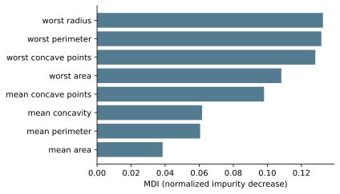
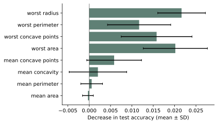
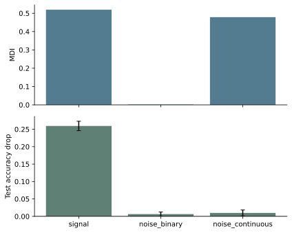
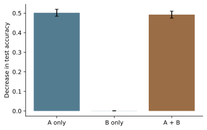

特徴量重要度（feature importance）は、学習済みモデルが予測にどの入力を利用しているかを調べる指標です。例えば、分類結果の説明や、[特徴量選択](../feature-selection/)で列を減らす候補を探す時に使います。ただし、重要度が高いからといって、その特徴量が結果の原因だとは限りません。

学習中に多く使われた列でも、未知のデータの予測に役立つとは限りません。

<br>

本記事では、無関係な乱数の列が高く評価される例と、同じ値を持つ列の重要度が違って見える例を確かめます。


- title: 学習時の使われ方
  body: 木の分割で不純度がどれだけ下がったか。MDI で測ります。
- title: 予測時の依存
  body: 列を並べ替えると評価スコアがどれだけ落ちるか。Permutation importance で測ります。
- title: 個別の予測への寄与
  body: ある 1 件の予測値を特徴量ごとの寄与へ分けます。SHAP（予測値を特徴量の寄与へ分配する手法）などで調べます。


以下は [scikit-learn](https://scikit-learn.org/) 1.8.0、[NumPy](https://numpy.org/) 2.4.1 で実行した結果です。[図と数値の生成コード](https://github.com/nao1215/debimate/blob/main/projects/ml/scripts/notes/feature-importance_gen.py)は GitHub で公開しています。本文のコードは抜粋で、[Matplotlib](https://matplotlib.org/) の描画設定や保存処理を省略しています。

---

### 木の分割から求める MDI

[ランダムフォレスト](../random-forest/)では、各分割の不純度の減少をその分割を通るサンプルの割合で重み付けして集計します。これを特徴量ごとにまとめた値が MDI（mean decrease in impurity、不純度減少に基づく重要度）です。`feature_importances_` では全特徴量の合計が 1 になるよう正規化されています。

乳がんの測定データから良性・悪性を分類するモデルで、上位 8 列を確認します。この例はモデルの説明方法を調べるもので、診断への利用を評価しているわけではありません。

```python
from sklearn.datasets import load_breast_cancer
from sklearn.ensemble import RandomForestClassifier
from sklearn.inspection import permutation_importance
from sklearn.model_selection import train_test_split
import numpy as np
import matplotlib.pyplot as plt

# label 1 means benign in this dataset; this example explains the model, not diagnosis.
data = load_breast_cancer()
X_tr, X_te, y_tr, y_te = train_test_split(
    data.data, data.target, test_size=0.3, stratify=data.target, random_state=0)
rf = RandomForestClassifier(n_estimators=200, random_state=0).fit(X_tr, y_tr)
mdi = rf.feature_importances_
perm = permutation_importance(
    rf, X_te, y_te, scoring="accuracy", n_repeats=20, random_state=0, n_jobs=1)
print(f"breast cancer: train={rf.score(X_tr, y_tr):.4f}, test={rf.score(X_te, y_te):.4f}")
order = np.argsort(mdi)[-8:]
fig, ax = plt.subplots(figsize=(6, 3.5))
ax.barh(data.feature_names[order], mdi[order], color=BLUE)
ax.set_xlabel("MDI (normalized impurity decrease)")
plt.tight_layout()
save("featimp_mdi.svg")
```



このモデルの正解率は訓練データで 1.0000、テストデータで 0.9532 でした。MDI は学習済みの木から取り出せるため、特徴量ごとに予測をやり直す必要がありません。一方で、学習データにだけ合う分割も集計に含まれます。

---

### 列を崩した時のスコア低下

Permutation importance（並べ替え重要度）は、モデルを学習し直さずに 1 列の値を行間で並べ替え、予測スコアの変化を測ります。値の集合を保ったまま、その列と正解ラベルの対応を崩す操作です。


- title: 基準を測る
  body: 元の評価データでスコアを計算。
- title: 1 列を並べ替える
  body: 他の列と正解ラベルは動かさない。
- title: 差を測る
  body: 元のスコアから並べ替え後のスコアを引く。
- title: 繰り返す
  body: 並べ替えを変え、差の平均とばらつきを求める。


先ほどのコードでは、`permutation_importance` にテストデータと `scoring="accuracy"` を渡しています。結果を MDI の図と同じ列順で並べると、次のようになります。



この実験では、MDI は不純度の減少割合、Permutation importance は正解率の差です。Permutation importance が 0.02 なら、並べ替えによって正解率が平均 2 ポイント下がったことを意味します。単位が違うため、MDI と棒の長さを直接比較することはできません。

黒い線は 20 回の並べ替えで得た差の[標準偏差](/ml/math/stddev/)です。学習データやモデルを変えた時の不確実性や、重要度の信頼区間を表すものではありません。評価スコアが元より上がると、重要度は負になります。

[公式の説明](https://scikit-learn.org/stable/modules/permutation_importance.html)にもあるように、重要度は選んだモデル・評価データ・指標に依存します。[クラス不均衡](../class-imbalance/)が強ければ、正解率だけでは捉えにくい変化もあります。特徴量を選ぶために繰り返し見るデータは検証用とし、最終評価用のテストデータを別に残します。

---

### 無関係な連続値への過学習

正解と関係する `signal` と、正解とは独立に生成した 2 列の乱数を用意します。`noise_binary` は 0 か 1、`noise_continuous` は連続値です。正解ラベルは `signal` の値を 15%の確率で反転させます。このため、`signal` だけでは全てのラベルを説明できません。木が乱数列を使って訓練データの例外まで覚えるかを観察します。

```python
rng = np.random.default_rng(7)
n = 3000
signal = rng.integers(0, 2, n)
y = signal.copy()
flip = rng.random(n) < 0.15
y[flip] = 1 - y[flip]
X = np.column_stack([signal, rng.integers(0, 2, n), rng.normal(size=n)])
names = ["signal", "noise_binary", "noise_continuous"]
X_tr, X_te, y_tr, y_te = train_test_split(
    X, y, test_size=0.4, stratify=y, random_state=7)
rf_noise = RandomForestClassifier(n_estimators=200, random_state=7).fit(X_tr, y_tr)
p = permutation_importance(
    rf_noise, X_te, y_te, scoring="accuracy", n_repeats=20, random_state=7, n_jobs=1)
print(f"noise: train={rf_noise.score(X_tr, y_tr):.4f}, test={rf_noise.score(X_te, y_te):.4f}")
for name, mdi_value, pi in zip(names, rf_noise.feature_importances_, p.importances_mean):
    print(f"{name:16s} MDI={mdi_value:.4f} permutation={pi:.4f}")
fig, axes = plt.subplots(2, 1, figsize=(6, 4.8), sharex=True)
axes[0].bar(names, rf_noise.feature_importances_, color=BLUE)
axes[0].set_ylabel("MDI")
axes[1].bar(names, p.importances_mean, yerr=p.importances_std, color=GREEN, capsize=3)
axes[1].set_ylabel("Test accuracy drop")
axes[1].axhline(0, color="#555555", linewidth=0.7)
plt.tight_layout()
save("featimp_mdi_bias.svg")
```



実行結果は次の通りです。図では単位の違う MDI と正解率の差を上下の別の軸にしています。

```text
noise: train=1.0000, test=0.7625
signal           MDI=0.5194 permutation=0.2594
noise_binary     MDI=0.0017 permutation=0.0064
noise_continuous MDI=0.4789 permutation=0.0098
```

無関係な連続値でも、訓練データ上で分割を探すと MDI が 0.4789 に達しました。連続値には分割候補が多く、たまたま正解に合う境界を選べるためです。一方で、テストデータでその列を並べ替えた時の正解率の低下は約 1 ポイントでした。有限個のデータでは、独立な乱数でも測定値がちょうど 0 になるとは限りません。

これは[高カーディナリティの特徴量に対する MDI の偏り](https://scikit-learn.org/stable/auto_examples/inspection/plot_permutation_importance.html)を確認する例です。連続値の特徴量を使うかは、MDI に加え、未知のデータでの予測性能も確認して判断します。

---

### 同じ情報を持つ 2 列

相関の強い特徴量では、片方を並べ替えても、もう片方から予測に必要な情報を取れることがあります。その結果、単独の重要度が小さくなります。ただし、どちらへ依存するかは学習したモデル次第です。

まったく同じ値を持つ列 A・B から、値が 0 より大きいかを予測します。深さ 1 の木を集めたランダムフォレストを使い、A だけ、B だけ、両方を並べ替えた結果を比べます。両方を並べ替える時は同じ行順を使い、A と B が等しい関係を保ちます。

```python
# Each column is a perfect copy. A shallow forest can use either column.
rng = np.random.default_rng(12)
x = rng.normal(size=2000)
y = (x > 0).astype(int)
X = np.column_stack([x, x])
X_tr, X_te, y_tr, y_te = train_test_split(X, y, test_size=0.4, random_state=12)
rf_pair = RandomForestClassifier(
    n_estimators=200, max_depth=1, max_features=1, random_state=12).fit(X_tr, y_tr)
baseline = rf_pair.score(X_te, y_te)
drops = []
for columns in ([0], [1], [0, 1]):
    values = []
    for _ in range(20):
        shuffled = X_te.copy()
        rows = rng.permutation(len(X_te))
        shuffled[:, columns] = X_te[rows][:, columns]
        values.append(baseline - rf_pair.score(shuffled, y_te))
    drops.append(values)
drops = np.array(drops)
for name, value in zip(["A only", "B only", "A + B"], drops.mean(axis=1)):
    print(f"{name}: accuracy drop={value:.4f}")
fig, ax = plt.subplots(figsize=(5, 3.2))
ax.bar(["A only", "B only", "A + B"], drops.mean(axis=1),
       yerr=drops.std(axis=1), color=[BLUE, BLUE, BROWN], capsize=3)
ax.set_ylabel("Decrease in test accuracy")
plt.tight_layout()
save("featimp_correlated.svg")
```



```text
A only: accuracy drop=0.5019
B only: accuracy drop=0.0006
A + B: accuracy drop=0.4925
```

この学習結果では A だけを並べ替えると大きく低下し、B だけではほぼ変わりませんでした。この例では、200 本の木のうち 102 本が A、98 本が B で分割しています。各木の出力を集計したモデル全体の判定が、A 側に依存しているためです。B が正解について情報を持たないわけではありません。A と B は同じ値なので、B だけでも同じ分類規則を学習できます。

[相関のある特徴量の公式例](https://scikit-learn.org/stable/auto_examples/inspection/plot_permutation_importance_multicollinear.html)では、単独の重要度がどれも小さいケースも扱っています。相関する列をグループとして並べ替える、代表の列に絞って再学習する、といった確認が必要です。後者はモデル自体も変わるので、列を並べ替えた時の重要度とは別の比較になります。

個別予測の説明には [SHAP](https://shap.readthedocs.io/en/latest/generated/shap.TreeExplainer.html) も使えますが、特徴量の依存関係をどう扱うかという仮定が必要です。SHAP へ替えるだけで、相関する列の解釈が一意になるわけではありません。

---

### 使いどころと限界

不自然に高い列があれば[データリーク](../data-leakage/)を調べ、低い列を削るなら再学習後の性能で確かめます。

- 重要度から因果関係は決まらない。列の値を変えれば結果も変わるという介入の効果とは別
- 学習できていないモデルでは、有用な特徴量も低く出る。先にモデルの評価スコアを確認
- 列を並べ替えると、相関する列との組み合わせが元データにはない状態になる場合がある
- [One-hot encoding](../categorical-encoding/) でカテゴリごとに分割した列は、元のカテゴリ変数全体を評価したいならまとめて扱う
- 線形モデルの係数も重要度の手掛かりになるが、単位や[標準化](../standardization/)の条件を揃えて比較する
- Permutation importance には特徴量数×繰り返し回数分の予測が必要。分割や学習の乱数も変えて安定性を見る場合は、さらに計算量が増える
