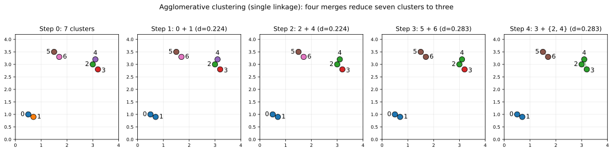
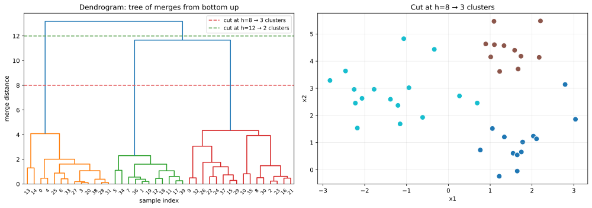
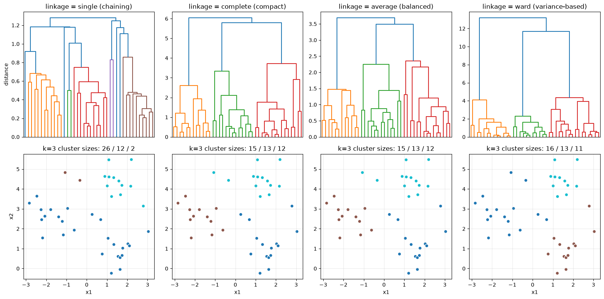

階層的クラスタリング（hierarchical clustering）は、データ点を徐々にマージしていく（または分割していく）ことで、樹形図（dendrogram）として全階層のクラスタ構造を可視化するアルゴリズムです。[k-means](../k-means/) や [DBSCAN](../dbscan/) のように「事前に `k` やパラメータを決める」必要がなく、樹形図を見てから「どこで切るか」で粒度を選べます。ただし計算量が `O(n²)` 〜 `O(n³)` なので、大規模データには向きません。

---

### 凝集型と分割型

- 凝集型（agglomerative, bottom-up）: 各点を 1 クラスタとして始め、最も近い 2 クラスタを順にマージ
- 分割型（divisive, top-down）: 全データを 1 クラスタとして始め、繰り返し 2 分割

ライブラリの実装はほぼ凝集型です（[scikit-learn](https://scikit-learn.org/) の [`AgglomerativeClustering`](https://scikit-learn.org/stable/modules/generated/sklearn.cluster.AgglomerativeClustering.html)、[SciPy](https://scipy.org/) の [`scipy.cluster.hierarchy`](https://docs.scipy.org/doc/scipy/reference/cluster.hierarchy.html)）。分割型は計算量が大きく、scikit-learn の [`BisectingKMeans`](https://scikit-learn.org/stable/modules/generated/sklearn.cluster.BisectingKMeans.html) のように k-means で 2 分割を繰り返す実装が使われる程度です。

次のコードは、7 点を SciPy の single linkage（最も近い 2 点の距離をクラスタ間の距離にする方法。後述）で凝集し、最初の 4 回の結合を表示します。

```python
import numpy as np
from scipy.cluster.hierarchy import linkage

# 図と同じ 7 点（番号 0〜6）
points = np.array([[0.5, 1.0], [0.7, 0.9], [3.0, 3.0], [3.2, 2.8],
                   [3.1, 3.2], [1.5, 3.5], [1.7, 3.3]])
Z = linkage(points, method="single")
for a, b, dist, size in Z[:4]:  # 最初の 4 回の結合
    print(f"{int(a)} + {int(b)}: 距離 {dist:.3f}, 点の数 {int(size)}")
```

```text
0 + 1: 距離 0.224, 点の数 2
2 + 4: 距離 0.224, 点の数 2
5 + 6: 距離 0.283, 点の数 2
3 + 8: 距離 0.283, 点の数 3
```

[`linkage`](https://docs.scipy.org/doc/scipy/reference/generated/scipy.cluster.hierarchy.linkage.html) の戻り値 `Z` は 1 行が 1 回の結合で、2 つのクラスタの番号、距離、結合後の点の数を持ちます。7 以降の番号は結合で作られたクラスタで、4 行目の 8 は 2 回目に作った {2, 4} です。



7 点から `k = 3` にするには、クラスタ数を 4 つ減らすため 4 回の結合が必要です。図のステップ 1 から 3 で 3 組の近い点を結合し、ステップ 4 で点 3 を {2, 4} に加えて右上の 3 点を 1 クラスタにします。ステップ 1 と 2（0.224）、ステップ 3 と 4（0.283）はそれぞれ同じ距離なので結合の順は実装次第ですが、4 回後のクラスタは変わりません。

各ステップで「最近接の 2 クラスタ」を選ぶ単純なアルゴリズムですが、最近接の定義（リンク方法）で結果が変わります。

---

### 樹形図（dendrogram）と切り方

凝集型の出力は「樹形図」で可視化します。

```python
from scipy.cluster.hierarchy import linkage, dendrogram, fcluster
import matplotlib.pyplot as plt
from sklearn.datasets import make_blobs

X, _ = make_blobs(n_samples=40, centers=3, cluster_std=0.8, random_state=0)
Z = linkage(X, method="ward")

dendrogram(Z, color_threshold=8)
labels = fcluster(Z, t=8, criterion="distance")  # 高さ 8 で切ってクラスタを得る
plt.savefig("hierarchical_dendrogram.svg", bbox_inches="tight")
```

次の図は、このコードに高さ 8 と 12 の線と、`labels` で色分けした散布図を足した[生成コード](https://github.com/nao1215/debimate/blob/main/projects/ml/scripts/notes/hierarchical-clustering_gen.py)で描いています。



左の樹形図は「下からマージしていく階層」を表します。高さ `h` で水平に切ると、その時点での「未マージのサブツリー数」がクラスタ数になります。

- 高さ 8 で切る: 3 つのクラスタ
- 高さ 12 で切る: 2 つのクラスタ（このデータでは高さ 15 は 1 つ）
- 高さ 0 で切る: n 個のクラスタ（各点独立）

右の散布図は `h = 8` で切った結果です。`k` を事前に決めなくても、樹形図を眺めて「どの高さで切るのが自然か」を判断できます。結合する高さの差が大きい箇所が、クラスタを分ける候補になります。

---

### リンク方法（linkage method）

「2 つのクラスタ間の距離」をどう定義するかで、樹形図の形と結果が変わります。

| 手法 | クラスタ間距離 | 性質 |
|---|---|---|
| single | 最近接 2 点 | チェーン状にくっつく |
| complete | 最遠接 2 点 | コンパクトな球形クラスタ |
| average | 全ペアの平均距離 | single と complete の中間 |
| ward | マージ前後の分散増加 | 球形で大きさの近いクラスタ |

次のコードは、前節と同じ 40 点に 4 種類の linkage を適用し、上段に樹形図、下段に `k = 3` の結果と各クラスタの点の数を描きます。

```python
import matplotlib.pyplot as plt
import numpy as np
from scipy.cluster.hierarchy import dendrogram, linkage
from sklearn.cluster import AgglomerativeClustering
from sklearn.datasets import make_blobs

X, _ = make_blobs(n_samples=40, centers=3, cluster_std=0.8, random_state=0)

fig, axes = plt.subplots(2, 4, figsize=(16, 8))
for col, method in enumerate(["single", "complete", "average", "ward"]):
    # 上段: 樹形図
    dendrogram(linkage(X, method=method), ax=axes[0, col], no_labels=True)
    axes[0, col].set_title(f"linkage = {method}")
    # 下段: k = 3 で切った結果と、各クラスタの点の数
    ac = AgglomerativeClustering(n_clusters=3, linkage=method).fit(X)
    axes[1, col].scatter(X[:, 0], X[:, 1], c=ac.labels_, cmap="tab10")
    sizes = sorted(np.bincount(ac.labels_).tolist(), reverse=True)
    axes[1, col].set_title(f"k=3 cluster sizes: {sizes}")
plt.tight_layout()
plt.savefig("hierarchical_linkage_compare.png", bbox_inches="tight")
```



- single: 樹形図がチェーン状に伸び、2 つの塊が 1 つにつながりました。離れた 2 点だけが別クラスタです（26 / 12 / 2）
- complete: まとまった塊を作りやすい反面、外れ値の影響を受けやすい方法です（15 / 13 / 12）
- average: このデータでは complete と同じ分け方です（15 / 13 / 12）
- ward: 大きさの近い球形のクラスタを作りやすく、`AgglomerativeClustering` のデフォルトです（16 / 13 / 11）

最初は ward で試し、細長く伸びた非凸の塊があれば single も比べます。比べる時は次節の指標を使えます。

---

### コフェネティック相関係数で linkage を選ぶ

linkage を比べる指標の 1 つが、コフェネティック相関係数（cophenetic correlation coefficient）です。樹形図上の 2 点の距離（2 点が初めて同じクラスタに入る結合の高さ）と元の距離の相関で、1 に近いほど樹形図が元の距離関係を保っています。SciPy では [`cophenet`](https://docs.scipy.org/doc/scipy/reference/generated/scipy.cluster.hierarchy.cophenet.html) で計算します。

```python
from scipy.cluster.hierarchy import linkage, cophenet
from scipy.spatial.distance import pdist
from sklearn.datasets import make_blobs

X, _ = make_blobs(n_samples=40, centers=3, cluster_std=0.8, random_state=0)

dist_orig = pdist(X)
for method in ["single", "complete", "average", "ward"]:
    Z = linkage(X, method=method)
    c, _ = cophenet(Z, dist_orig)
    print(f"{method}: cophenetic r = {c:.3f}")
```

```text
single: cophenetic r = 0.739
complete: cophenetic r = 0.798
average: cophenetic r = 0.801
ward: cophenetic r = 0.776
```

このデータでは average が最も高く、2 つの塊をつないだ single が最も低い値でした。ただし、この指標が測るのは距離関係の保存度です。得られたクラスタが分析目的に合うかは、別に確認します。

---

### 数学での使いどころ

- 距離行列の計算（[ベクトル/行列の演算](../../math/vector-matrix-ops/) 参照）
- ward 法と分散減少（[分散](../../math/variance/)）
- 樹形図と二分木構造
- ultrametric 不等式（cophenetic distance の性質）
- 系統樹（phylogenetic tree）との関係

---

### 機械学習での使いどころ

- 遺伝子発現データのクラスタリング: heatmap と樹形図を並べ、似た発現パターンをまとめる
- 顧客・市場のセグメンテーション: 切る高さを変えて、顧客層を 2 / 5 / 20 区分で切り替える
- 文書のトピック階層化（NLP）
- 動物・植物や言語の系統分類
- データ探索（EDA）: 「とりあえず構造を見たい」

scikit-learn の `AgglomerativeClustering`、`scipy.cluster.hierarchy` の `linkage / dendrogram / fcluster` がメインです。[seaborn](https://seaborn.pydata.org/) の [`clustermap`](https://seaborn.pydata.org/generated/seaborn.clustermap.html) は heatmap と樹形図を同時に描けるので、EDA で重宝します。

---

### 適さないケース / 落とし穴

- 大規模データ（n > 10⁴ 〜 10⁵）: 計算量 `O(n²)` でメモリ・時間が破綻。`MiniBatchKMeans` か `Birch` を検討
- 一度マージしたら撤回できない: greedy なので、初期の誤りが最後まで残る
- ノイズに弱い（特に single linkage）: 外れ値が「chain effect」で他のクラスタを橋渡しすることがある
- スケールが揃っていない: 距離が歪む。[標準化](../standardization/) を必ず先に
- 樹形図を読み間違える: x 軸の点の並び順は意味を持たない（左右の枝を入れ替えても同じ木で、重要なのは高さだけ）
- ward はユークリッド距離が前提: 他の距離（manhattan、cosine）では single / complete / average を使う
- 樹形図の縦軸の単位を無視: linkage によって意味が異なる（average なら平均距離、ward なら分散の増加量から計算した値）
- 「自然な切れ目」が無い: 別のクラスタリング（[DBSCAN](../dbscan/)、k-means + silhouette）を検討。切る高さは silhouette score や gap statistic で複数候補を比較できる
- 階層構造が無いデータに無理やり適用: フラットなクラスタなら [k-means](../k-means/) で十分
- カテゴリ変数を含む: 距離が定義しにくい。Gower 距離、または one-hot 後にコサイン類似度
