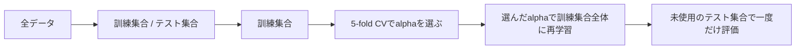

ハイパーパラメータは、学習を始める前に決める設定値です。データから推定されるモデルのパラメータとは異なり、`Ridge(alpha=1.0)` の `alpha` や RandomForest の木数は、候補を比べて選びます。

重要なのは、候補を選ぶデータと最終性能を測るデータを分けることです。本記事では Ridge の `alpha` を例に、交差検証で候補を選び、最後に触れていないテスト集合で評価する順序を確認します。

<br>

### パラメータとの違い

- パラメータ: `Ridge.fit()`の後に得られる係数のように、学習データから決まる値です。
- ハイパーパラメータ: `alpha`、[kNN](../knn/) の `n_neighbors`、RandomForest の `max_depth` のように、学習前に候補を指定する値です。

パラメータは訓練集合に合わせて更新されます。ハイパーパラメータは、訓練集合をさらに分割する[交差検証](../cross-validation/)で比較してから固定します。

---

### 候補を選ぶ場所

データを訓練用とテスト用に一度だけ分けます。テスト集合は `alpha` の候補を選ぶまで見ません。訓練集合の中を 5 分割し、各 `alpha` の平均 R² と分割間のばらつきを比較します。



探索中にテスト R² を見て `alpha` を選ぶと、テスト集合にも合わせ込んでしまいます。候補数が多い場合や選択自体を評価したい場合は、外側の評価と内側の探索を分ける nested CV を使います。

---

### Ridge の探索を実行する

以下の実験では、訓練集合だけで 19 個の `alpha` を 5-fold CV し、最も高い平均 R² を選びます。灰色は訓練 R²、青は CV R²、誤差棒は fold 間の標準偏差です。

```python
search = GridSearchCV(
    make_pipeline(StandardScaler(), Ridge()),
    param_grid={"ridge__alpha": alphas},
    cv=KFold(n_splits=5, shuffle=True, random_state=17),
    scoring="r2",
    return_train_score=True,
).fit(X_train, y_train)

test_r2 = search.score(X_test, y_test)
```


訓練 R² だけを見ると弱い正則化が良く見えます。一方、CV R² は過度に小さい `alpha` で下がる場合があり、未知データに対する候補選びの根拠になります。テスト R² は選び終えた後に一度だけ出します。

---

### モデルごとの設定

| モデル | 主なハイパーパラメータ | 何を変えるか |
| --- | --- | --- |
| [kNN](../knn/) | `n_neighbors`、`metric` | 近傍の広さと距離の測り方 |
| Ridge / Lasso | `alpha` | 正則化の強さ |
| RandomForest | `n_estimators`、`max_depth`、`max_features` | 木の数・複雑さ・木同士の違い |
| Gradient Boosting | `learning_rate`、`n_estimators`、`max_depth` | 一回の更新量と木の複雑さ |
| ニューラルネット | 学習率、層数、batch size | 更新量と表現力 |

候補は広い範囲から始め、CV の結果を見て狭めます。探索を続けるほど CV への過適合も起きるため、改善幅が小さい場合はデータ・特徴量・評価指標を見直します。

### 適さないケース / 落とし穴

- `random_state`は乱数を再現する設定であり、性能を良くするための探索対象ではありません。
- 時系列や同一ユーザーの複数行には、通常の KFold を使いません。TimeSeriesSplit や GroupKFold のようにデータの構造を保つ分割を使います。
- テスト集合を繰り返し見た場合は、すでに独立したテストではありません。新しい評価集合を用意するか、評価が楽観的になり得ることを明記します。

図の再現用コードは [GitHub](https://github.com/nao1215/debimate/blob/main/projects/ml/scripts/notes/hyperparameter_gen.py) にあります。
