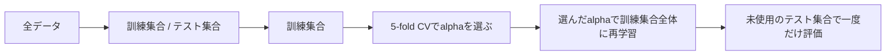
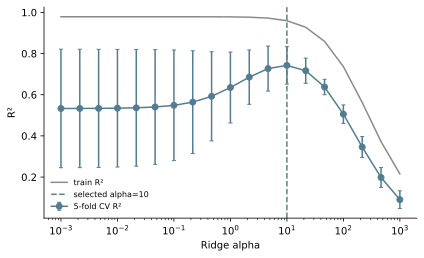

ハイパーパラメータは、学習を始める前に決める設定値です。データから推定されるモデルのパラメータとは異なり、[`Ridge(alpha=1.0)`](https://scikit-learn.org/stable/modules/generated/sklearn.linear_model.Ridge.html) の `alpha` や [RandomForest](../random-forest/) の木数は、候補を比べて選びます。

重要なのは、候補を選ぶデータと最終性能を測るデータを分けることです。本記事では Ridge の `alpha` を例に、交差検証で候補を選び、最後に触れていないテスト集合で評価する順序を確認します。

<br>

### パラメータとの違い

- パラメータ: `Ridge.fit()` の後に得られる係数のように、学習データから決まる値です。
- ハイパーパラメータ: `alpha`、[kNN](../knn/) の `n_neighbors`、RandomForest の `max_depth` のように、学習前に候補を指定する値です。

パラメータは訓練集合に合わせて更新されます。ハイパーパラメータは、訓練集合をさらに分割する[交差検証](../cross-validation/)で比較してから固定します。

---

### 候補を選ぶ場所

データを訓練用とテスト用に一度だけ分けます。テスト集合は `alpha` の候補を選ぶまで見ません。訓練集合の中を 5 分割し、各 `alpha` の平均 R² と分割間のばらつきを比較します。



探索中にテスト R² を見て `alpha` を選ぶと、テスト集合にも合わせ込んでしまいます。候補数が多い場合や選択自体を評価したい場合は、外側の評価と内側の探索を分ける nested CV を使います。

---

### Ridge の探索を実行する

以下の実験は、[`make_regression`](https://scikit-learn.org/stable/modules/generated/sklearn.datasets.make_regression.html) で作った 150 行・60 特徴量（うち予測に効くのは 10 個）の回帰データを使います。訓練集合は 112 行で、各 fold の学習に使えるのは約 90 行です。特徴量に対して行が少ないため、[正則化](../regularization/)が弱いと訓練データのノイズまで覚えます。[`GridSearchCV`](https://scikit-learn.org/stable/modules/generated/sklearn.model_selection.GridSearchCV.html) で、訓練集合だけを使って 19 個の `alpha` を 5-fold CV し、平均 R² が最も高い候補を選びます。

```python
import numpy as np
from sklearn.datasets import make_regression
from sklearn.linear_model import Ridge
from sklearn.model_selection import GridSearchCV, KFold, train_test_split
from sklearn.pipeline import make_pipeline
from sklearn.preprocessing import StandardScaler

X, y = make_regression(n_samples=150, n_features=60, n_informative=10, noise=40, random_state=17)
X_train, X_test, y_train, y_test = train_test_split(X, y, test_size=0.25, random_state=17)
alphas = np.logspace(-3, 3, 19)

search = GridSearchCV(
    make_pipeline(StandardScaler(), Ridge()),
    param_grid={"ridge__alpha": alphas},
    cv=KFold(n_splits=5, shuffle=True, random_state=17),
    scoring="r2",
    return_train_score=True,
).fit(X_train, y_train)

result = search.cv_results_
for i in range(0, len(alphas), 3):
    print(f"alpha={alphas[i]:>7g}  train R²={result['mean_train_score'][i]:.3f}  "
          f"CV R²={result['mean_test_score'][i]:.3f} ± {result['std_test_score'][i]:.3f}")
print(f"selected alpha={search.best_params_['ridge__alpha']:g}")
print(f"test R²={search.score(X_test, y_test):.3f}")
```

```text
alpha=  0.001  train R²=0.979  CV R²=0.533 ± 0.288
alpha=   0.01  train R²=0.979  CV R²=0.535 ± 0.286
alpha=    0.1  train R²=0.979  CV R²=0.548 ± 0.269
alpha=      1  train R²=0.978  CV R²=0.635 ± 0.172
alpha=     10  train R²=0.960  CV R²=0.743 ± 0.091
alpha=    100  train R²=0.737  CV R²=0.506 ± 0.045
alpha=   1000  train R²=0.215  CV R²=0.090 ± 0.043
selected alpha=10
test R²=0.862
```

出力は 19 候補のうち 7 個を抜き出したものです。全候補を図にすると次のようになります。灰色は訓練 R²（train R²）、青は CV R²、誤差棒は fold 間の[標準偏差](/ml/math/stddev/)です。



訓練 R² は `alpha` が小さいほど高く、0.001 では 0.979 です。訓練 R² だけで選ぶと最も弱い正則化を選びますが、その CV R² は 0.533 で、fold 間のばらつきも ±0.288 と大きくなります。反対に `alpha` を 100 以上にすると、訓練 R² と CV R² がそろって下がり、係数を縮めすぎた[未学習](../overfitting/)になります。CV R² は両者の間の `alpha=10` で 0.743 と最も高くなり、これを選びます。テスト R² の 0.862 は、選び終えた後に一度だけ出した値です。テスト集合は 38 行と小さいため、CV R² より高く出ることもあります。

---

### モデルごとの設定

| モデル | 主なハイパーパラメータ | 何を変えるか |
| --- | --- | --- |
| [kNN](../knn/) | `n_neighbors`、`metric` | 近傍の広さと距離の測り方 |
| Ridge / Lasso | `alpha` | 正則化の強さ |
| RandomForest | `n_estimators`、`max_depth`、`max_features` | 木の数・複雑さ・木同士の違い |
| [Gradient Boosting](../gradient-boosting/) | `learning_rate`、`n_estimators`、`max_depth` | 一回の更新量と木の複雑さ |
| ニューラルネット | [学習率](/ml/math/gradient-descent-sgd/)、層数、batch size | 更新量と表現力 |

候補は広い範囲から始め、CV の結果を見て狭めます。探索を続けるほど CV への過適合も起きるため、改善幅が小さい場合はデータ・特徴量・評価指標を見直します。1 つの設定を 1 回ずつ学習させて並べると、1 位の設定が seed しだいで入れ替わる様子は、[実験管理](../../mlops/experiment-tracking/)で測っています。

---

### 適さないケース / 落とし穴

- `random_state` は乱数を再現する設定であり、性能を良くするための探索対象ではありません。
- 時系列や同一ユーザーの複数行には、通常の KFold を使いません。[TimeSeriesSplit](../time-series-forecasting/) や GroupKFold のようにデータの構造を保つ分割を使います。
- テスト集合を繰り返し見た場合は、すでに独立したテストではありません。新しい評価集合を用意するか、評価が楽観的になり得ることを明記します。

図を含む再現用コードは [GitHub](https://github.com/nao1215/debimate/blob/main/projects/ml/scripts/notes/hyperparameter_gen.py) にあります。
