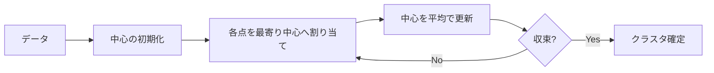
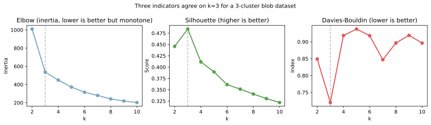

k-means（k 平均法）は、データを「k 個のクラスタ」に分け、各クラスタの中心（重心）に最も近い点同士を集める教師なし学習の手法です。
目的は「クラスタ内のばらつきを最小化し、クラスタ間の分離を良くする」ことです。分類器ではなく、分割・要約のための手法です。

距離計算がユークリッド距離に依存するため、特徴量数が増えると点同士の距離が均一化する [次元の呪い](../curse-of-dimensionality/) の影響を強く受けます。高次元データに直接適用するより、先に [PCA](../pca/) で次元を落としてから k-means を当てる組み合わせが定番となります。

ここでの「クラスタ内平方和（SSE）を最小化」とは、次を意味します。  
1. 初期中心の設定：ランダムまたは [k-means++](https://theory.stanford.edu/~sergei/papers/kMeansPP-soda.pdf) で k 個の中心を決める
2. 割り当て：各点を最も近い中心に割り当てる
3. 更新：割り当てられた点の平均を新しい中心にする
4. 収束：中心がほぼ動かなくなるまで 2〜3 を繰り返す



---

### 前提・注意

- k（クラスタ数）は事前に決める必要がある
- 初期値により結果が変わる（局所解）
- 距離は通常ユークリッド距離（連続値が前提）
- スケールが違うと結果が歪むので[標準化](../standardization/)が基本

---

### 利点
- 実装が簡単で高速
- 大規模データに向く
- 結果が直感的（中心と距離）

---

### 欠点
- k を事前に決める必要がある
- 非凸形状のクラスタに弱い
- 外れ値に引っ張られやすい
- カテゴリ変数が扱いにくい

---

## Python での実例

手順 1〜4 を [NumPy](https://numpy.org/) だけで書き、3 つの塊を持つ人工データに k=3 で当てます。

```python
import numpy as np
import matplotlib.pyplot as plt

# 分かりやすい人工データ（3 クラスタ）
rng = np.random.RandomState(0)
X1 = rng.randn(100, 2) + np.array([0, 0])
X2 = rng.randn(100, 2) + np.array([3, 3])
X3 = rng.randn(100, 2) + np.array([0, 4])
X = np.vstack([X1, X2, X3])

def kmeans(X, k, max_iter=100, seed=0):
    # 1. 初期中心をデータ点からランダムに選ぶ
    rng = np.random.RandomState(seed)
    init_centers = X[rng.choice(len(X), k, replace=False)]
    centers = init_centers

    for n_iter in range(1, max_iter + 1):
        # 2. 各点を最も近い中心へ割り当て
        dists = np.linalg.norm(X[:, None, :] - centers[None, :, :], axis=2)
        labels = np.argmin(dists, axis=1)

        # 3. 割り当てられた点の平均を新しい中心にする
        new_centers = centers.copy()
        for i in range(k):
            members = X[labels == i]
            if len(members) > 0:
                new_centers[i] = members.mean(axis=0)
            else:
                # 0 件だと平均が NaN になるので、中心から最も遠い点へ移す
                far = np.argmax(dists[np.arange(len(X)), labels])
                new_centers[i] = X[far]

        # 4. 中心がほぼ動かなくなったら終了
        if np.allclose(centers, new_centers, atol=1e-4):
            break
        centers = new_centers

    return labels, centers, init_centers, n_iter

labels, centers, init_centers, n_iter = kmeans(X, k=3)
print("反復回数:", n_iter)
print("初期中心:", init_centers.round(2).tolist())
print("最終中心:", centers.round(2).tolist())
print("各クラスタの点数:", np.bincount(labels))

# 図1：元データ + 初期中心
plt.figure()
plt.scatter(X[:, 0], X[:, 1], alpha=0.3)
plt.scatter(init_centers[:, 0], init_centers[:, 1], c="black", s=120, marker="x")
plt.title("Original data + initial centers")
plt.xlabel("x1")
plt.ylabel("x2")
plt.axis("equal")
plt.show()

# 図2：k-means後
plt.figure()
plt.scatter(X[:, 0], X[:, 1], c=labels, cmap="tab10", alpha=0.5)
plt.scatter(centers[:, 0], centers[:, 1], c="black", s=120, marker="x")
plt.title("k-means clustering")
plt.xlabel("x1")
plt.ylabel("x2")
plt.axis("equal")
plt.show()
```

出力:

```text
反復回数: 7
初期中心: [[0.37, 4.14], [3.64, 1.43], [2.27, -1.45]]
最終中心: [[-0.1, 4.05], [2.91, 2.77], [-0.09, 0.16]]
各クラスタの点数: [ 98 101 101]
```






左の図の黒い × が初期中心、右の図の × が収束後の中心です。初期中心の 1 つは塊から外れた (2.27, -1.45) に落ちましたが、割り当てと平均の更新を 7 回繰り返すうちに左下の塊の中心 (-0.09, 0.16) へ移りました。最終中心は、データを作った (0, 0)・(3, 3)・(0, 4) の近くです。

`kmeans()` の `else` 節は、割り当てが 0 件のクラスタ（空クラスタ）の扱いです。例えば同じ座標の点を 2 つ初期中心に選ぶと、距離が同じ点はすべて番号の小さい中心に割り当てられ、もう一方は 0 件になります。

```python
import numpy as np

X_dup = np.array([[0.0, 0.0], [0.0, 0.0], [5.0, 5.0]])
centers = X_dup[[0, 1]]  # 同じ座標の 2 点を初期中心に選んだ
dists = np.linalg.norm(X_dup[:, None, :] - centers[None, :, :], axis=2)
labels = np.argmin(dists, axis=1)
print(labels)                           # [0 0 0]
print(X_dup[labels == 1].mean(axis=0))  # [nan nan] と RuntimeWarning
```

NaN の中心は以後どの点とも距離が NaN になり、結果が壊れます。上の `kmeans()` は、空クラスタの中心を今の中心から最も遠い点へ移します。scikit-learn も [同じ考え方で空クラスタを移しています](https://github.com/scikit-learn/scikit-learn/blob/1.9.1/sklearn/cluster/_k_means_common.pyx)（`_relocate_empty_clusters_dense`）。

---

### k の選び方

「クラスタ数 `k` を事前に決める必要がある」のが k-means の最大の制約で、`k` をどう決めるかは独立した問題になります。

最初に注意したいのは、イナーシャ（クラスタ内分散の合計, SSE）は「`k` を増やすほど単調に減る量」という性質です。極端には `k = n`（サンプル数と同じ）にすればイナーシャ = 0 になります。「イナーシャ最小だから良いクラスタ」という選び方は「訓練精度 100% だから良いモデル」と同型の誤りなので、イナーシャだけを最小化する選び方は採用できません。

次の 3 つの指標を併用して、k の候補を比較します。

- イナーシャ（inertia, SSE）: `k` で単調減少。曲がり角（elbow, 肘）を目視で探す
- シルエット係数（silhouette score）: 各点について「同じクラスタ内の他点との平均距離 a」と「最も近い他クラスタの点との平均距離 b」から `(b - a) / max(a, b)` を求める指標。-1〜+1 で「高い」ほど良い（0.5 以上で良好、0.2 以下は怪しい）
- Davies-Bouldin インデックス: クラスタ内分散とクラスタ間距離の比。「低い」ほど良い

[scikit-learn](https://scikit-learn.org/stable/modules/clustering.html#k-means) で 3 指標を一度に計算する例を示します。

```python
import matplotlib.pyplot as plt
from sklearn.cluster import KMeans
from sklearn.datasets import make_blobs
from sklearn.metrics import davies_bouldin_score, silhouette_score

X, _ = make_blobs(n_samples=300, centers=3, cluster_std=1.0, random_state=0)

ks = list(range(2, 11))
inertias, silhouettes, db_scores = [], [], []
for k in ks:
    km = KMeans(n_clusters=k, n_init=10, random_state=0).fit(X)
    inertias.append(km.inertia_)
    silhouettes.append(silhouette_score(X, km.labels_))
    db_scores.append(davies_bouldin_score(X, km.labels_))

fig, axes = plt.subplots(1, 3, figsize=(12, 3.5))
panels = [
    (inertias, "#7aa6c2", "Elbow (inertia, lower is better but monotone)", "Inertia"),
    (silhouettes, "#59a14f", "Silhouette (higher is better)", "Score"),
    (db_scores, "#e15759", "Davies-Bouldin (lower is better)", "Index"),
]
for ax, (values, color, title, ylabel) in zip(axes, panels):
    ax.plot(ks, values, "o-", color=color, linewidth=2)
    ax.axvline(3, color="gray", linestyle="--", alpha=0.5)
    ax.set_title(title); ax.set_xlabel("k"); ax.set_ylabel(ylabel)
fig.suptitle("Three indicators agree on k=3 for a 3-cluster blob dataset", fontsize=11)
plt.tight_layout()
plt.savefig("k-means_selection.svg", bbox_inches="tight")

print("k    inertia   silhouette   davies-bouldin")
for k, ine, sil, db in zip(ks, inertias, silhouettes, db_scores):
    print(f"{k:<5d} {ine:8.1f}   {sil:10.3f}   {db:8.3f}")
```

出力:

```text
k    inertia   silhouette   davies-bouldin
2       1010.1        0.446      0.849
3        536.4        0.484      0.720
4        448.6        0.411      0.919
5        372.2        0.390      0.938
6        315.1        0.361      0.918
7        279.9        0.351      0.847
8        241.1        0.341      0.897
9        219.1        0.330      0.919
10       202.0        0.322      0.896
```



イナーシャは k=2→3 で 1010.1 から 536.4 へ半分近く下がり、k=3→4 では 448.6 までしか下がらないので、曲がり角は k=3 です。シルエット係数は k=3 で最大の 0.484、Davies-Bouldin インデックスは k=3 で最小の 0.720 です。3 つとも k=3 を指すので、この例では k=3 が候補になります。

クラスタリングは正解ラベルが無いため、技術指標で出した `k` が業務として運用しやすいかをセグメント設計の担当者と確認する必要があります。次の点を確認します。

- セグメントごとに違う施策が打てるか
- 各セグメントを言語化（命名）できるか
- 運用体制でその数のセグメントを扱えるか

---

### 数学での使いどころ

数学・統計の文脈では、k-means は以下の用途で使われます。

- データの代表点（プロトタイプ）抽出
- データの量子化（ベクトル量子化）
- 距離に基づく分割の理解

数学的には、以下で定式化されます。

- 目的関数：クラスタ内平方和（SSE, Sum of Squared Errors）の最小化
- 「割り当て」と「中心更新」を交互に行う最適化
- k-means は EM アルゴリズムの特例とみなせる

---

### 機械学習での使いどころ

機械学習では、k-means は主に教師なし学習として使われます。

- クラスタリングの基礎手法
- 特徴量の要約・圧縮（Bag of Visual Words など）
- セグメンテーション（画像や顧客のグルーピング）

具体的な利用例：

- 顧客の購買パターン分割
- 画像の色クラスタリング
- 文書のトピック概略の抽出
- k-means でのクラスタラベルを特徴量として使う

---

### 適さないケース

- 非凸形状のクラスタ（同心円など）→ [DBSCAN](../dbscan/) や [階層的クラスタリング](../hierarchical-clustering/) を検討
- クラスタサイズ・密度が大きく違うデータ → DBSCAN や、DBSCAN を階層的に拡張した HDBSCAN（Hierarchical DBSCAN）
- 外れ値が多いデータ → [異常検知](../anomaly-detection/) と組み合わせるか、DBSCAN のように外れ値を別扱いするアルゴリズム
- 距離の意味が弱いカテゴリ中心のデータ → Gower 距離や別のクラスタリング
