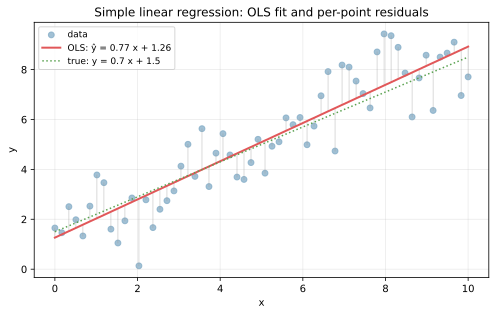
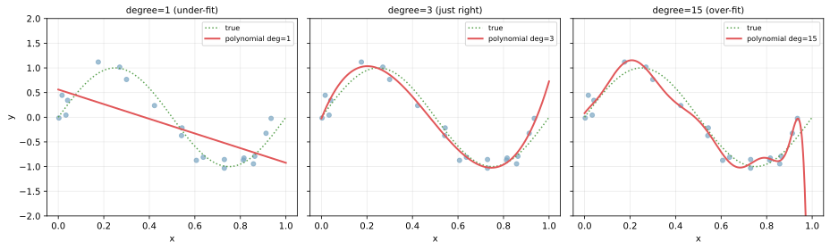
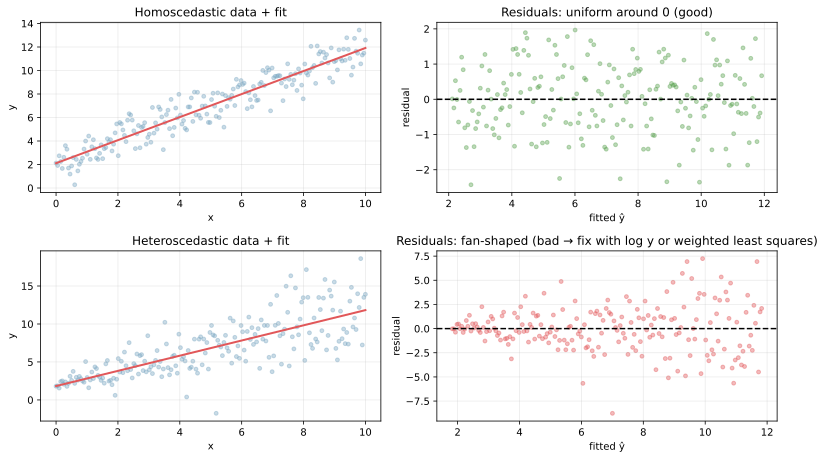
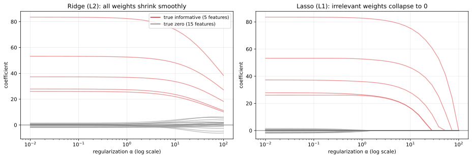

線形回帰（linear regression）は、入力特徴量の線形和でターゲットを予測する最も基本的な教師あり回帰モデルです。

`ŷ = w_1 x_1 + w_2 x_2 + ... + w_d x_d + b = w · x + b`

線形回帰には、次の特徴があります。`(1)` 解析解 `w = (X^T X)^-1 X^T y` が閉形式で出る、`(2)` 係数の解釈が直接できる（他の特徴量を固定して `x_k` を 1 増やすと `ŷ` が `w_k` 増える）、`(3)` [正則化](../regularization/) と組み合わせて Ridge / Lasso に拡張できる、という 3 点です。

[ロジスティック回帰](../logistic-regression/)や[サポートベクターマシン](../svm/)、ニューラルネットの各層でも、入力の線形和を計算します。

---

### 数式と直感

`n` 個のサンプル、`d` 個の特徴量を持つデータ行列 `X`（`n × d`）と重み `w`（`d × 1`）について、`y_pred = X w + b` の予測式に対して、[平均二乗誤差（MSE）](../loss-functions/) を最小化する `w, b` を求めるのが OLS（ordinary least squares, 最小二乗法）です。

`min_w (1/n) Σ_i (y_i - (w · x_i + b))^2`

このコスト関数は `w` について二次の凸関数なので、勾配を 0 と置いた正規方程式 `X^T X w = X^T y` を満たす点が最小解です（バイアス項 `b` は、特徴量に常に 1 の列を加えれば `w` に含められます）。`X^T X` が逆行列を持つ時、つまり特徴量の列が線形独立な時に限り、最小解は 1 つに決まり、次の形で書けます。

`w = (X^T X)^-1 X^T y`

特徴量の数がサンプル数より多い時や、ある特徴量が他の特徴量の線形和で書ける時は逆行列が無く、最小解が無数にあります。逆行列があっても、特徴量同士の相関が極端に強い（[多重共線性](#多重共線性と正則化)）と数値的に不安定になります。

scikit-learn の [`LinearRegression`](https://scikit-learn.org/stable/modules/generated/sklearn.linear_model.LinearRegression.html) は、密な行列なら [`scipy.linalg.lstsq`](https://docs.scipy.org/doc/scipy/reference/generated/scipy.linalg.lstsq.html) で解きます。既定の LAPACK ドライバ gelsd は SVD（Singular Value Decomposition、特異値分解）を使い、`(X^T X)^-1` を直接計算しないので、数値的に安定します。最小解が無数にある時は、その中でノルムが最小の解を返します。

---

### 単回帰の見た目

最も単純な「特徴量 1 つ vs ターゲット」のデータに OLS を当てる例です。scikit-learn の結果と、正規方程式を直接解いた結果を並べます。

```python
import numpy as np
from sklearn.linear_model import LinearRegression

rng = np.random.default_rng(0)
x = np.linspace(0, 10, 60)
y = 0.7 * x + 1.5 + rng.normal(0, 1.2, 60)

ols = LinearRegression().fit(x.reshape(-1, 1), y)
print(f"slope = {ols.coef_[0]:.3f}, intercept = {ols.intercept_:.3f}")

# 常に 1 の列を足し、正規方程式 (X^T X) w = X^T y を直接解く
X1 = np.column_stack([np.ones_like(x), x])
b, w = np.linalg.solve(X1.T @ X1, X1.T @ y)
print(f"normal equation: slope = {w:.3f}, intercept = {b:.3f}")
```

出力:

```text
slope = 0.766, intercept = 1.265
normal equation: slope = 0.766, intercept = 1.265
```

2 つの解き方で同じ値になります。次の図は同じデータを描いたもので、本記事の図の描画コードは[生成コード](https://github.com/nao1215/debimate/blob/main/projects/ml/scripts/notes/linear-regression_gen.py)にあります。



赤い線が OLS の推定直線、灰色の縦線が各サンプルの残差（`y_i - ŷ_i`）で、これらの二乗和が最小になるように直線が引かれます。緑の点線は真の関係 `y = 0.7 x + 1.5` です。推定した傾き 0.766 と切片 1.265 は、60 点に乗ったノイズの分だけ真の値からずれています。

傾き 0.766 は「`x` が 1 増えると `y` が約 0.77 増える」と直接読めます。決定木やニューラルネットでは同じ読み方ができないので、説明性が要求される場面で線形モデルが選ばれることが多いです。

---

### 線形モデルの「表現力」と複雑度

「線形」は重み `w` について線形であって、特徴量については任意の変換を施せます。多項式特徴量 `x, x^2, x^3, ...` を加えれば曲線も表現できます（多項式回帰）が、次数を上げすぎると過学習します。訓練に使わなかった 200 点で、テスト時の MSE も測ります（以降のコードは、前のコードの import の続きで実行します）。

```python
from sklearn.metrics import mean_squared_error
from sklearn.pipeline import make_pipeline
from sklearn.preprocessing import PolynomialFeatures

rng = np.random.default_rng(0)
x_train = np.sort(rng.uniform(0, 1, 20))
y_train = np.sin(2 * np.pi * x_train) + rng.normal(0, 0.25, 20)
x_test = rng.uniform(0, 1, 200)
y_test = np.sin(2 * np.pi * x_test) + rng.normal(0, 0.25, 200)

for deg in [1, 3, 15]:
    model = make_pipeline(PolynomialFeatures(deg), LinearRegression())
    model.fit(x_train.reshape(-1, 1), y_train)
    mse_tr = mean_squared_error(y_train, model.predict(x_train.reshape(-1, 1)))
    mse_te = mean_squared_error(y_test, model.predict(x_test.reshape(-1, 1)))
    print(f"degree={deg:2d}: train MSE = {mse_tr:.3f}, test MSE = {mse_te:.3f}")
```

出力:

```text
degree= 1: train MSE = 0.218, test MSE = 0.294
degree= 3: train MSE = 0.018, test MSE = 0.105
degree=15: train MSE = 0.010, test MSE = 1.365
```



degree=1 は直線なので、波打つ真の関係（緑点線）を表現できず、訓練時もテスト時も MSE が大きくなります。これが under-fit です。degree=3 は真の関数 `sin(2πx)` の形を捉え、テスト時の MSE が最も小さくなります。degree=15 は訓練時の MSE が最も小さいのに、テスト時は 1.365 まで悪化します。[過学習](../overfitting/) のノートと同じ構図です。

degree=15 の曲線は訓練点の間で波打ち、最後の訓練点（x ≈ 0.94）より右で急降下します。手元で誤差を分けると、テスト時の二乗誤差の 9 割以上が、この右端に落ちた 18 点から来ていました。高次の多項式は、訓練点が無い所で値が暴れます。

表現力と過学習のトレードオフは非線形モデルでも共通する課題で、[バイアス-バリアンス分解](../bias-variance-tradeoff/) の考え方と [交差検証](../cross-validation/) で次数や正則化の強さを選ぶのが定石です。

---

### 残差プロットで仮定をチェックする

OLS の前提は、何を求めるかで変わります。

- 係数を計算するだけ: `X^T X` が逆行列を持てば十分
- 推定値が偏らない（不偏）: 誤差の期待値が特徴量に依らず 0 であることが必要。特徴量と相関する変数を入れ忘れると崩れる
- ガウス・マルコフ定理（線形不偏推定量の中で OLS の分散が最小）: さらに誤差の等分散（homoscedastic）と無相関が必要
- 少ないサンプルで t 検定や信頼区間を正確に出す: さらに誤差の正規分布が必要

残差プロット（横軸: 予測値、縦軸: 残差）で主に分かるのは、等分散が崩れていないかと、関係に曲がりが残っていないかです。独立性は残差を時間順などに並べて、正規性はヒストグラムや Q-Q プロットで確かめます。

次のコードは、ばらつきが一定のデータと、`x` とともにばらつきが増えるデータに OLS を当てます。

```python
rng = np.random.default_rng(0)
x = np.linspace(0, 10, 200).reshape(-1, 1)
y_good = 1.0 * x[:, 0] + 2 + rng.normal(0, 1.0, 200)
y_bad = 1.0 * x[:, 0] + 2 + rng.normal(0, 0.3 + 0.4 * x[:, 0], 200)  # x とともに分散が増える

for name, y in [("good", y_good), ("bad", y_bad)]:
    m = LinearRegression().fit(x, y)
    resid = y - m.predict(x)
    print(f"{name}: slope = {m.coef_[0]:.3f}, "
          f"resid std (x<5) = {resid[:100].std():.2f}, (x>=5) = {resid[100:].std():.2f}")
```

出力:

```text
good: slope = 0.980, resid std (x<5) = 0.96, (x>=5) = 0.95
bad: slope = 0.999, resid std (x<5) = 1.52, (x>=5) = 3.02
```



上段の残差は予測値全域で均一に 0 の周りに散らばっています。下段は予測値が大きいほど残差が広がる「ファン型」で、出力でも `x >= 5` の残差の標準偏差が `x < 5` の約 2 倍です。これが不均一分散（heteroscedasticity）の症状です。

下段でも傾きは 0.999 で、推定値そのものは崩れていません。ずれるのは標準誤差です。通常の標準誤差の式は誤差の分散が一定だと仮定するので、信頼区間や係数の検定結果が当てになりません。対策は次のいずれかです。

- 目的変数を `log y` で変換する（`y` が正の値で、ばらつきが `y` の大きさに比例する場合。[歪度](../../math/skewness/) のノート参照）
- 重み付き最小二乗法（WLS）で分散の逆数を重みにする
- 不均一分散に頑健な標準誤差（White の標準誤差）で信頼区間を出し直す

---

### 多重共線性と正則化

特徴量同士の相関が高い場合、`(X^T X)` がほぼ特異になり、係数が極端な値を取る、符号が反転する、標準誤差が爆発するという不安定さが出ます。これを多重共線性（multicollinearity）と呼びます。

対策の一つが [正則化](../regularization/) で、係数の大きさを抑制するペナルティ項を損失に加えます。式は scikit-learn の [`Ridge`](https://scikit-learn.org/stable/modules/generated/sklearn.linear_model.Ridge.html) と [`Lasso`](https://scikit-learn.org/stable/modules/generated/sklearn.linear_model.Lasso.html) の定義に合わせています。

- Ridge（L2 正則化）: `min Σ (y_i - ŷ_i)^2 + α Σ w_k^2`
- Lasso（L1 正則化）: `min (1/(2n)) Σ (y_i - ŷ_i)^2 + α Σ |w_k|`
- ElasticNet（混合）: Ridge と Lasso のペナルティを線形結合

次のコードは、20 個の特徴量のうち 5 個だけがターゲットに効くデータを作り、標準化してから `α` を変えて Ridge と Lasso を当てます。

```python
from sklearn.datasets import make_regression
from sklearn.linear_model import Lasso, Ridge
from sklearn.pipeline import make_pipeline
from sklearn.preprocessing import StandardScaler

X, y, true_coef = make_regression(n_samples=80, n_features=20, n_informative=5,
                                  noise=10.0, random_state=0, coef=True)
print("informative:", np.flatnonzero(true_coef))

for alpha in [1, 10, 30, 100]:
    ridge = make_pipeline(StandardScaler(), Ridge(alpha=alpha)).fit(X, y)[-1]
    lasso = make_pipeline(StandardScaler(), Lasso(alpha=alpha, max_iter=20000)).fit(X, y)[-1]
    print(f"alpha={alpha:3}: Ridge の 0 = {np.sum(ridge.coef_ == 0):2d} 個, "
          f"Lasso が残した特徴量 = {np.flatnonzero(lasso.coef_)}")
```

出力:

```text
informative: [ 1  8 12 13 16]
alpha=  1: Ridge の 0 =  0 個, Lasso が残した特徴量 = [ 1  2  3  6  7  8 12 13 16]
alpha= 10: Ridge の 0 =  0 個, Lasso が残した特徴量 = [ 1  8 12 13 16]
alpha= 30: Ridge の 0 =  0 個, Lasso が残した特徴量 = [ 8 13 16]
alpha=100: Ridge の 0 =  0 個, Lasso が残した特徴量 = []
```



図は `α` を 0.01〜100 の 30 段階で変えた時の係数の推移で、赤い線が真に効く 5 個、灰色の線が効かない 15 個の特徴量の係数です。

- Ridge: 全係数が 0 に向かって滑らかに縮む（shrinkage）が、ちょうど 0 にはならない。重要な特徴量も縮むので、解釈は若干歪む
- Lasso: 効かない特徴量の係数から順に 0 に潰れる（sparse solution）。`α = 10` では真に効く 5 個だけが残り、[特徴量選択](../feature-selection/) として機能する

ただし `α = 30` では真に効く特徴量まで落ち、`α = 100` では全部 0 になり、under-fit します。`α = 0` は素の OLS に当たり、`α` は [交差検証](../cross-validation/) で選ぶのが標準です。

---

### 数学での使いどころ

- 最尤推定との関係: 誤差が正規分布の時、MSE 最小化が最尤推定と等価になる
- 射影の解釈: `ŷ = X w` は `y` を `X` の張る部分空間に正射影したもの
- 一般化線形モデル（GLM）の基礎: 線形回帰の枠組みを指数族分布に拡張すると、ロジスティック回帰やポアソン回帰になる

---

### 機械学習での使いどころ

- ベースライン回帰: 新しいタスクで最初に試すモデル。複雑なモデルがこれより悪いなら、データかパイプラインを疑う
- 高速・軽量な予測: 推論時は `w · x + b` の内積だけで済み、レイテンシ要件の厳しい本番でも採用される
- 説明性が必要な場面: 係数の符号と大きさで「どの特徴量がどれだけ効いたか」を直接示せる。規制業界（金融、医療）で重宝される
- 時系列の傾向除去: 線形トレンドを引いてから周期成分や残差を分析する前処理に（[時系列予測](../time-series-forecasting/) のノート参照）
- 因果推論の部品: 共変量を入れた回帰調整や、操作変数法の 2 段階最小二乗法の中で OLS を使う

---

### 適さないケース / 落とし穴

- 関係が強く非線形: 多項式特徴量や [決定木](../decision-tree/) / [勾配ブースティング](../gradient-boosting/) など、非線形な関係を表せる方法を検討する
- 特徴量同士が極端に相関: 係数の解釈が崩れる。Ridge / [PCA](../pca/) / 特徴量の事前選択で対処
- 外れ値が支配的: MSE は二乗するので外れ値が学習を歪める。[外れ値に頑健な回帰](https://scikit-learn.org/stable/modules/linear_model.html#robustness-regression-outliers-and-modeling-errors)（`HuberRegressor` / `RANSACRegressor`）や `QuantileRegressor` で対処
- 高次元（特徴量数 > サンプル数）: OLS は解が一意に決まらない。Ridge / Lasso / ElasticNet で解を絞る
- 標準化を忘れて Ridge / Lasso を当てる: 特徴量のスケールが違うとペナルティが偏る。[標準化](../standardization/) を先に挟む
- カテゴリ変数を整数のまま入れる: 順序が無いのに「1 < 2 < 3」の関係を仮定してしまう。[カテゴリ変数のエンコーディング](../categorical-encoding/) で one-hot などに変換する
- 因果関係の主張: 線形回帰の係数は「相関」を示すだけで、操作変数や RCT（Randomized Controlled Trial、ランダム化比較試験）などの設計が無いと「`x` を増やすと `y` が動く」とは言えない
