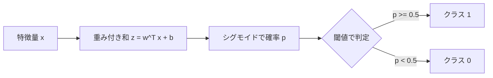
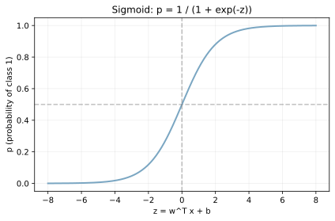
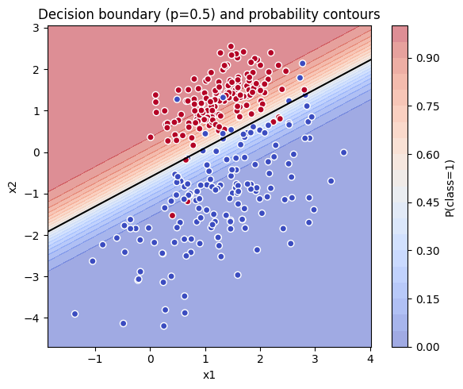
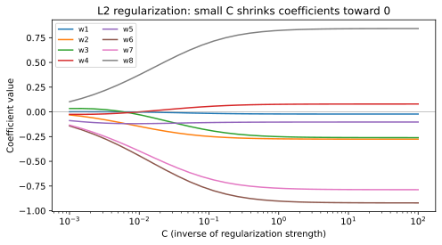
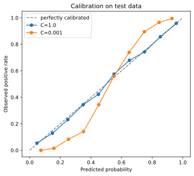

LogisticRegression（ロジスティック回帰）は、特徴量の重み付き和を[シグモイド関数](../activation-functions/)で 0〜1 の確率に変換し、二値分類に使うモデルです。名前に「回帰」と付いていますが、実用上は二値分類の代表的なベースラインモデルです。

[線形回帰](../linear-regression/) と同じく重み付き和 `w^T x + b` を計算しますが、その値の意味と学習方法は異なります。重み付き和は [log-odds](../../math/log-exp-logodds/)（確率 p のオッズ `p / (1 - p)` の対数）と見なします。確率は `(0, 1)` に収まる必要があるので重み付き和で直接表しにくく、値域が実数全体の log-odds なら表せます。学習では二乗誤差ではなく対数損失（[損失関数](../loss-functions/) のノート参照）を最小化し、線形回帰のような閉じた式の解は無いので、[反復計算](/ml/math/gradient-descent-sgd/)で係数を求めます。



[閾値](../confusion-matrix/)は 0.5 に限らず、見逃しを減らしたい場面では 0.3 に下げるなど、業務の制約に合わせて動かせます。

<br>

本記事では、次の疑問を順に扱います。

- 確率と決定境界はどう作られるのか
- 正則化の強さ `C` を変えると、係数と確率はどう変わるのか
- 学習した係数から何が読めるのか
- 標準化をしないと何が起きるのか

---

### 確率と決定境界

LogisticRegression の計算は次の 3 つです。

- 重み付き和（線形スコア）: `z = w^T x + b`
- 確率: `p = 1 / (1 + exp(-z))`
- 損失: 対数損失（交差エントロピー、`-y log p - (1-y) log (1-p)`）を最小化する

シグモイド関数は線形スコア `z` を 0〜1 の確率に押し込める単調増加関数で、`z=0` で `p=0.5` を通ります。`z` が +∞ に近づくと `p` は 1 に、-∞ に近づくと 0 に漸近します。



2 次元の特徴量に対して LogisticRegression を学習させると、確率の等高線は平行な直線の集まりになり、`p=0.5` の線が決定境界（クラス 0 とクラス 1 の境目）になります。下の図は学習データに `predict_proba` の確率を色塗りで重ねたものです。



決定境界が 2 次元なら直線、高次元なら超平面になることが、線形分類器と呼ばれる理由です。逆に言うと、円形や XOR のような曲がった境界が必要なデータは素のままでは扱えません。その場合は多項式特徴量を追加するか、[RandomForest](../random-forest/)・[勾配ブースティング](../gradient-boosting/)・SVM（Support Vector Machine、[サポートベクターマシン](/ml/ml/svm/)）の RBF（Radial Basis Function、動径基底関数）カーネル・[ニューラルネットワーク](../perceptron/)に切り替えます。

---

### 損失と正則化

対数損失は、正解クラスの確率が高いほど小さくなる損失です。例えば真のクラスが 1 で `p=0.9` なら `-log(0.9) ≈ 0.105`、`p=0.5` なら `-log(0.5) ≈ 0.693` と、確信度が低いほどペナルティが大きくなります。

[正則化](../regularization/) は損失に係数の大きさのペナルティを加えて、係数 `w` を小さく保つ仕組みです。

- L2 正則化（Ridge 系）: ペナルティ `λ ||w||^2`。すべての係数を 0 に向けて縮めるが、ちょうど 0 にはしない。scikit-learn の既定
- L1 正則化（Lasso 系）: ペナルティ `λ ||w||_1`。一部の係数を完全に 0 にする（[特徴量選択](/ml/ml/feature-selection/)になる）
- Elastic Net: L1 と L2 を混ぜたもの

[scikit-learn の `LogisticRegression`](https://scikit-learn.org/stable/modules/generated/sklearn.linear_model.LogisticRegression.html) では、正則化の強さを `C`（正則化強度の逆数）で指定します。`C` が小さいほど正則化が強くなり、係数は 0 に近づきます。下の図は `C` を変えた時の 8 つの係数の動きです。



`C` を 0.001 に近づけると、すべての係数が 0 へ縮んでいきます。逆に `C` を 100 まで大きくすると正則化がほぼ効かなくなり、係数の絶対値が大きくなって[過学習](../overfitting/)しやすくなります。実際の運用では `C` を [交差検証](../cross-validation/) で選びます。

---

### 係数の復元と確率の校正

正解の係数が分かっているデータで、係数から何が読めるかを確かめます。次のコードは `z = 2.0*x1 - 1.0*x2 + 0.5` から確率を作り、その確率でラベルを引いた 2 万件のデータを使います。前半の 1 万件で `C=1.0` と `C=0.001` のモデルを学習し、後半の 1 万件で確率の当たり具合を比べます。

```python
import numpy as np
import matplotlib.pyplot as plt
from sklearn.calibration import calibration_curve
from sklearn.linear_model import LogisticRegression
from sklearn.metrics import log_loss, roc_auc_score

# 正解の係数が分かっているデータを作る: z = 2.0*x1 - 1.0*x2 + 0.5
rng = np.random.default_rng(0)
n = 20000
X = rng.normal(size=(n, 2))
z = 2.0 * X[:, 0] - 1.0 * X[:, 1] + 0.5
y = (rng.random(n) < 1 / (1 + np.exp(-z))).astype(int)
X_train, X_test = X[:10000], X[10000:]
y_train, y_test = y[:10000], y[10000:]

fig, ax = plt.subplots(figsize=(5.5, 5))
ax.plot([0, 1], [0, 1], "k--", alpha=0.5, label="perfectly calibrated")
for C in (1.0, 0.001):
    model = LogisticRegression(C=C).fit(X_train, y_train)
    p = model.predict_proba(X_test)[:, 1]
    w = model.coef_[0]
    print(f"C={C}: w={np.round(w, 3)}, b={model.intercept_[0]:.3f}, "
          f"odds ratio={np.round(np.exp(w), 2)}, "
          f"AUC={roc_auc_score(y_test, p):.3f}, "
          f"log loss={log_loss(y_test, p):.3f}")
    frac_pos, mean_pred = calibration_curve(y_test, p, n_bins=10)
    ax.plot(mean_pred, frac_pos, "o-", label=f"C={C}")
ax.set_xlabel("Predicted probability")
ax.set_ylabel("Observed positive rate")
ax.set_title("Calibration on test data")
ax.legend()
fig.tight_layout()
fig.savefig("logistic-regression_calibration.svg")
```

実行結果:

```text
C=1.0: w=[ 1.99  -0.997], b=0.505, odds ratio=[7.32 0.37], AUC=0.884, log loss=0.421
C=0.001: w=[ 0.919 -0.464], b=0.350, odds ratio=[2.51 0.63], AUC=0.884, log loss=0.475
```

`C=1.0` の係数は 1.99・-0.997・0.505 で、データを作った時の 2.0・-1.0・0.5 をほぼ取り戻しています。係数を `exp` で戻した値はオッズ比です。`x1` が 1 増えるとオッズが約 7.3 倍、`x2` が 1 増えるとオッズが約 0.37 倍になる、と読めます。係数の符号でクラス 1 に引き寄せるか遠ざけるかが、大きさでその強さが分かります。

`C=0.001` では係数が半分以下に縮みました。2 つの係数が同じ割合で縮んだので確率の大小の順番は変わらず、順番だけを見る AUC は 0.884 のままです。一方で、確率の値そのものを評価する対数損失は 0.421 から 0.475 に悪化しました。下の図は [`calibration_curve`](https://scikit-learn.org/stable/modules/generated/sklearn.calibration.calibration_curve.html) で、予測確率を 10 区間に分け、各区間で実際に陽性だった割合を描いたものです。予測確率と実際の頻度が一致していれば対角線に乗ります。



`C=1.0` はほぼ対角線に乗ります。`C=0.001` は予測が約 0.16 の区間で実際の陽性は 1.5% しかなく、0.75 の区間では約 90% が陽性です。強い正則化は確率を 0.5 側へ寄せ、自信の無いモデルにします。AUC だけを見ているとこのずれには気付けないので、確率をそのまま使う場面では校正も確認します（詳しくは[確率の校正](../probability-calibration/) のノート参照）。

---

### スケーリングが必要な理由

LogisticRegression では[標準化](../standardization/)が事実上必須の前処理です。理由は 2 つあります。

1. 正則化のペナルティが特徴量の単位に依存する: 値の幅が小さい特徴量は、同じ影響を出すのに大きな係数が必要になり、その分だけ正則化で強く罰せられる
2. ソルバーの収束が安定する: 特徴量のスケールが大きく違うと損失の曲面が細長くなり、収束が遅くなる

1 つ目を確かめます。次のコードは、同じ重さで効く 2 つの特徴量のうち 2 列目だけを 100 分の 1 にして（cm で記録していた値を m で記録し直すのと同じ）、`C=0.01` で学習します。

```python
import numpy as np
from sklearn.linear_model import LogisticRegression
from sklearn.metrics import roc_auc_score
from sklearn.pipeline import make_pipeline
from sklearn.preprocessing import StandardScaler

rng = np.random.default_rng(0)
n = 2000
X = rng.normal(size=(n, 2))
z = 1.5 * X[:, 0] + 1.5 * X[:, 1]
y = (rng.random(n) < 1 / (1 + np.exp(-z))).astype(int)
X_train, X_test, y_train, y_test = X[:1500], X[1500:], y[:1500], y[1500:]

for unit in (1.0, 0.01):
    s = np.array([1.0, unit])  # 2 列目の単位だけを変える
    for scaled in (False, True):
        steps = [StandardScaler()] if scaled else []
        model = make_pipeline(*steps, LogisticRegression(C=0.01))
        model.fit(X_train * s, y_train)
        auc = roc_auc_score(y_test, model.predict_proba(X_test * s)[:, 1])
        print(f"unit={unit}, scaled={scaled}: "
              f"w={np.round(model[-1].coef_[0], 3)}, AUC={auc:.3f}")
```

実行結果:

```text
unit=1.0, scaled=False: w=[0.832 0.846], AUC=0.896
unit=1.0, scaled=True: w=[0.834 0.84 ], AUC=0.895
unit=0.01, scaled=False: w=[0.748 0.032], AUC=0.765
unit=0.01, scaled=True: w=[0.834 0.84 ], AUC=0.895
```

単位を変えただけで、標準化しないモデルは 2 列目の係数が 0.846 から 0.032 になり、AUC は 0.896 から 0.765 に落ちました。2 列目で元と同じ影響を出すには係数を 100 倍にする必要があり、L2 のペナルティは係数の 2 乗なので 1 万倍に効きます。モデルは罰を避けて 2 列目をほぼ捨てたわけです。`StandardScaler` を挟むと、単位を変える前と同じ係数と AUC に戻ります。係数を重要度として比べる時も、標準化していない係数は単位で値が変わるので比べられません。

---

### 前提・注意

- [クラス不均衡](../class-imbalance/)では `class_weight="balanced"` や閾値調整、[PR-AUC](../roc-pr-auc/) の併用が重要
- 多重共線性（相関の強い特徴量同士）があると、係数が不安定になる。L1 正則化で片方を 0 に潰すか、事前に[相関係数](../../math/correlation/)で除外する
- ソルバーの既定は `lbfgs`（L2 のみ）。L1 なら `liblinear` か `saga`、Elastic Net なら `saga` を使う。scikit-learn 1.8 から `penalty` 引数は非推奨になり、`l1_ratio`（0 なら L2、1 なら L1、その間なら Elastic Net）で指定する
- 3 クラス以上では、`liblinear` 以外のソルバーが多項ロジスティック回帰（ソフトマックス）として学習する。以前の `multi_class` 引数は 1.9.1 で指定するとエラーになる

---

### 利点

- 学習が速く、データ量や特徴量が増えてもスケールしやすい
- `predict_proba` で確率が直接出る
- 係数がオッズ比として読め、説明可能性が高い。[RandomForest](../random-forest/) や[勾配ブースティング](../gradient-boosting/)より精度は劣ることが多いが、軽量で解釈しやすい
- 正則化と組み合わせやすく、過学習対策は `C` を下げるだけで済む
- ニューラルネットワークの最終層（二値なら sigmoid、多クラスなら softmax）と同じ形なので、考え方がそのまま使える

---

### 欠点

- 線形分離できないデータ（XOR など）に弱く、非線形な効果や相互作用は多項式特徴量・交互作用項として自分で作る必要がある
- 多重共線性が強いと係数が不安定になり、解釈が崩れる
- 正則化が強いと、前の実験のように確率が 0.5 側へ寄り、実際の頻度とずれる
- ラベルの誤りや大きく外れた点に係数が引っ張られる。対数損失は誤分類の度合いにほぼ比例して増えるので、二乗誤差を使う線形回帰よりは影響が小さい

---

### 機械学習での使いどころ

二値分類では、まず LogisticRegression でベースラインを作り、より複雑なモデルと比べます。

- スパムフィルタ: 語の出現有無を特徴量に取って線形に重ね合わせる
- CTR（Click Through Rate、クリック率）予測や購買確率の予測: 確率をそのまま使い、係数で効いている要因を説明する
- 医療診断や信用スコアリング: 確率の校正と係数の説明の両方が求められる場面

逆に、次のデータには向きません。

- 非線形な境界や特徴量間の強い相互作用が本質の場合: 木系モデルや SVM の RBF カーネルを使う
- 画像・音声のように生の値から特徴を学習する必要がある場合: CNN（畳み込みニューラルネットワーク）などの専用モデルを使う
