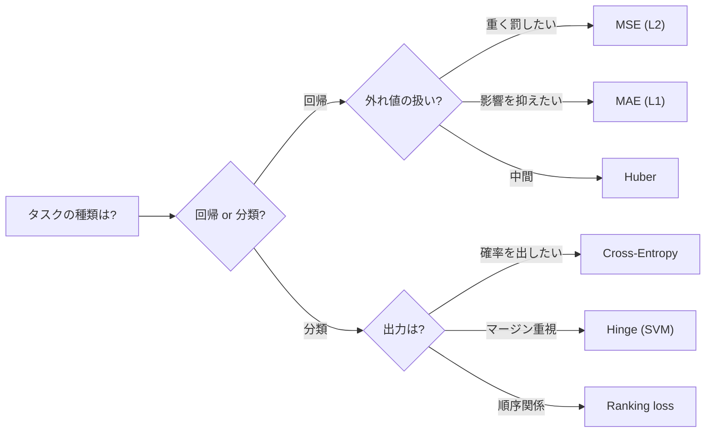
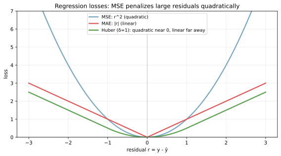
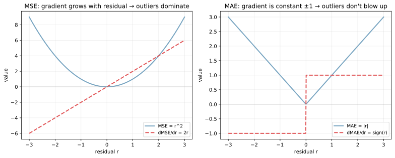
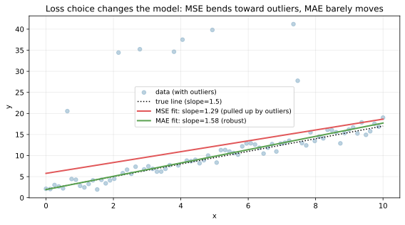
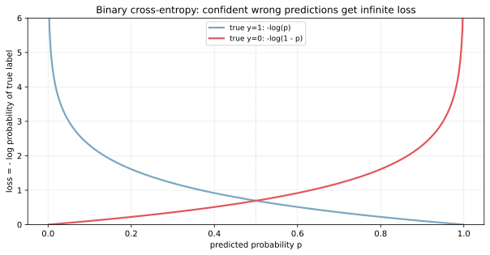

損失関数（loss function、cost function、objective function）は、モデルの予測 `ŷ` と正解 `y` のずれを 1 つの数に変換する関数です。学習はこの損失関数の値を最小化する操作で、どの損失関数を選ぶかは学習結果に大きく影響します。

回帰では平均二乗誤差（mean squared error, MSE）と平均絶対誤差（mean absolute error, MAE）が標準で、外れ値への感度で使い分けます。分類では確率分布の差を測る交差エントロピー（cross-entropy）が標準です。どの損失関数も、[最急降下法・確率的勾配降下法（SGD）](../../math/gradient-descent-sgd/)でパラメータを更新する時の最小化の対象になります。

---

### 損失関数が決めるもの

損失関数の選び方は次の 3 点を直接決めます。

- どの予測誤差を「重い」と見るか（外れ値への感度、誤分類の重み付け）
- パラメータの勾配の振る舞い（学習の安定性、収束速度）
- 学習結果が何を最適化するか（平均的な予測か、中央値的な予測か、確率分布の一致か）

例えば回帰問題で「外れ値を強く罰したい」なら MSE、「外れ値の影響を抑えたい」なら MAE、「その中間」なら Huber 損失を選びます。



---

### 回帰の損失関数: 形を見比べる

MSE・MAE・Huber を「残差 `r = y - ŷ`」の関数として並べます。

本記事のコードは同じセッションで続けて実行する前提で、`np`・`plt`・`r` は最初のコードで定義します。[NumPy](https://numpy.org/)・[Matplotlib](https://matplotlib.org/)・[scikit-learn](https://scikit-learn.org/) を使い、凡例や軸ラベルを省いた抜粋です。描画を含む[生成コード](https://github.com/nao1215/debimate/blob/main/projects/ml/scripts/notes/loss-functions_gen.py)は GitHub で確認できます。

```python
import numpy as np
import matplotlib.pyplot as plt

r = np.linspace(-3, 3, 400)
mse = r ** 2
mae = np.abs(r)
def huber(r, delta=1.0):
    return np.where(np.abs(r) <= delta, 0.5 * r ** 2,
                    delta * (np.abs(r) - 0.5 * delta))

plt.plot(r, mse, color="#7aa6c2", lw=2, label="MSE: r^2")
plt.plot(r, mae, color="#e15759", lw=2, label="MAE: |r|")
plt.plot(r, huber(r, 1.0), color="#59a14f", lw=2, label="Huber (δ=1)")
plt.savefig("loss_regression_shapes.svg", bbox_inches="tight")
```



3 本の曲線の読み方:

- MSE（青）: 二次関数。残差 `±1` の損失は 1。`±3` では損失が 9 に跳ね上がる。外れ値の影響が極端に大きい
- MAE（赤）: 線形。残差 `±1` で損失 1、`±3` で損失 3。外れ値の影響が線形にしか効かない
- Huber（緑）: 小さい残差では MSE（二次）、大きい残差では MAE（線形）。両者の良いとこ取りで、外れ値耐性と滑らかさを両立する。閾値 `δ` で切り替える残差を決める

定義式は次の通りです。

- MSE: `L = (1/n) Σ (y_i - ŷ_i)^2`
- MAE: `L = (1/n) Σ |y_i - ŷ_i|`
- Huber: `L = (1/n) Σ ℓ_δ(y_i - ŷ_i)`、`ℓ_δ(r) = r^2 / 2` if `|r| ≤ δ`, else `δ(|r| - δ/2)`

---

### 勾配が「学習の動き方」を決める

損失関数の勾配は、SGD の各ステップで「どの方向にどれだけパラメータを動かすか」を決める量です。MSE と MAE では勾配の振る舞いが対照的です。

```python
fig, axes = plt.subplots(1, 2, figsize=(11, 4.5))
axes[0].plot(r, r ** 2, color="#7aa6c2", lw=2, label="MSE")
axes[0].plot(r, 2 * r, color="#e15759", lw=2, ls="--", label="dMSE/dr = 2r")
axes[1].plot(r, np.abs(r), color="#7aa6c2", lw=2, label="MAE")
axes[1].plot(r, np.sign(r), color="#e15759", lw=2, ls="--", label="dMAE/dr = sign(r)")
plt.savefig("loss_gradient_behavior.svg", bbox_inches="tight")
```



左の MSE では勾配が残差に比例して `2r` で増えます。残差が 5 のサンプル 1 つは、残差が 1 のサンプル 5 つと同じ勾配を生むため、外れ値が更新の方向を支配しやすいです。右の MAE では勾配が ±1 で一定（`r = 0` でのみ不連続）です。外れ値も他のサンプルと同じ強さでパラメータを引っ張るので、影響が消えるわけではありません。どれだけ離れているかが効かなくなる点が「MAE は外れ値に強い」と言われる根拠です。

ただし MAE の勾配は `r = 0` で不連続なので、勾配を使う最適化では扱いにくいです。Huber 損失の勾配は連続で、大きな残差では `±δ` で頭打ちになります。

---

### 外れ値が支配する学習結果

外れ値なし・外れ値あり・同じ外れ値をさらに 100 上へ動かした場合の 3 通りで、MSE と MAE で当てた[線形回帰](../linear-regression/)の傾きを比べます。

```python
from sklearn.linear_model import LinearRegression, QuantileRegressor

rng = np.random.default_rng(0)
x = np.linspace(0, 10, 80)
y = 1.5 * x + 2.0 + rng.normal(0, 1.0, 80)  # true slope = 1.5
clean = y.copy()
idx = rng.choice(80, 8, replace=False)
y[idx] += rng.uniform(15, 30, 8)  # 8 outliers
far = y.copy()
far[idx] += 100                   # the same outliers, 100 further up

X = x.reshape(-1, 1)
for name, t in [("clean", clean), ("outliers", y), ("far outliers", far)]:
    mse = LinearRegression().fit(X, t).coef_[0]                          # MSE
    mae = QuantileRegressor(quantile=0.5, alpha=0.0).fit(X, t).coef_[0]  # MAE
    print(f"{name:12s} MSE slope = {mse:.2f}, MAE slope = {mae:.2f}")
```

出力:

```text
clean        MSE slope = 1.55, MAE slope = 1.57
outliers     MSE slope = 1.29, MAE slope = 1.58
far outliers MSE slope = 0.29, MAE slope = 1.58
```



図は 2 行目（外れ値あり）の当てはめです。外れ値 8 点（10%）を足すと、MSE の傾きは `1.55` から `1.29` へ下がって真の 1.5 から離れ、MAE は `1.57` から `1.58` へ少し動くだけでした。同じ 8 点をさらに 100 上へ動かすと、MSE は `0.29` まで崩れますが、MAE は `1.58` のままです。

MAE でも外れ値は「線より上にある」という符号の分だけ効き、どれだけ離れているかは効きません。回帰問題で予測精度が低い時は、外れ値の有無と損失関数の組み合わせを確認します。

---

### 分類の損失関数: 交差エントロピー

二値分類で出力 `p ∈ (0, 1)` を「正例である確率」と解釈する時、交差エントロピー（cross-entropy, log loss）は次のように書けます。

`L = -(1/n) Σ [ y_i log p_i + (1 - y_i) log(1 - p_i) ]`

- `y_i = 1`（正例）なら寄与は `-log p_i`
- `y_i = 0`（負例）なら寄与は `-log(1 - p_i)`

つまり「正解側の確率に対する負の対数」の平均です。正解が `y=1` の時、`p = 1` なら `-log 1 = 0`、`p → 0` なら `-log p → ∞` となり、自信を持って間違えるほど強く罰します。

```python
plt.figure()
p = np.linspace(0.001, 0.999, 400)
ce_pos = -np.log(p)
ce_neg = -np.log(1 - p)

plt.plot(p, ce_pos, color="#7aa6c2", lw=2, label="true y=1: -log(p)")
plt.plot(p, ce_neg, color="#e15759", lw=2, label="true y=0: -log(1-p)")
plt.savefig("loss_cross_entropy.svg", bbox_inches="tight")
```



`-log(p)` の曲線（正解が `y=1`）は、`p` が 1 に近づくほど 0 に近づき、0 に近づくほど無限大に発散します。`-log(1-p)` の曲線（正解が `y=0`）はその左右反転です。`p = 0.5` ではどちらの損失も `log 2 ≈ 0.69` で、正解がどちらでも損失を 0.69 以下に抑えられるのはこの点だけです。

実装では `log 0` を避けるため、`p` を 0 や 1 ちょうどにならないようクリップするか、確率にする前の `logits` から `logsumexp` で計算します。数値的に安定した計算方法は、[対数・指数関数と log-odds](../../math/log-exp-logodds/) を参照してください。

---

### 多クラスへの拡張: ソフトマックス + 交差エントロピー

多クラス分類（クラス数 `K`）では、出力 `K` 次元の `logits z = (z_1, ..., z_K)` をソフトマックスで確率に変換します。

`p_k = exp(z_k) / Σ_j exp(z_j)`

正解クラス `c` についての交差エントロピーは

`L = -log p_c = -z_c + log(Σ_j exp(z_j))`

の形になります。第 1 項は正解クラスの logit を上げる方向に効き、第 2 項の log-sum-exp は確率の正規化を担います。正解を one-hot の分布（正解クラスだけ確率 1）と見ると、この損失は正解分布と予測分布の KL ダイバージェンス（Kullback-Leibler divergence、2 つの確率分布のずれを測る量）に一致します。詳しくは[情報理論](../../math/information-theory/)で扱います。

---

### 数学での使いどころ

- 最尤推定との対応: MSE の最小化は正規分布のノイズ、MAE はラプラス分布のノイズ、交差エントロピーはベルヌーイ分布・カテゴリ分布を仮定した最尤推定と等価
- KL ダイバージェンス: 交差エントロピーは `H(p, q) = H(p) + KL(p || q)`（`p` は真の分布、`q` は予測分布）。`H(p)` は `q` に依存しないので、交差エントロピーの最小化は KL の最小化と同じ
- 凸最適化: 線形回帰やロジスティック回帰のようにパラメータが線形に効くモデルでは、MSE・MAE・交差エントロピーはパラメータについて[凸関数](../../math/convex-functions/)になり、局所最適解に捕まらない
- 正則化付きの目的関数: `L(θ) + λ ||θ||_2^2` のように [正則化](../regularization/) 項を加えて過学習を制御

---

### 機械学習での使いどころ

- 線形回帰の標準損失: MSE（最小二乗法）。閉形式解 `θ = (X^T X)^-1 X^T y` がある
- 外れ値に強い回帰: MAE (quantile regression q=0.5)、Huber 損失
- [ロジスティック回帰](../logistic-regression/): 二値交差エントロピーが標準
- 多クラス分類（softmax 回帰、ニューラルネット）: 多クラス交差エントロピー
- [サポートベクターマシン](../svm/): ヒンジ損失 `max(0, 1 - y · ŷ)`（`y ∈ {-1, +1}`）
- そのほか: 順位学習の ranking loss、メトリック学習の triplet loss、画像のセグメンテーションの Dice loss のように、タスク専用の損失関数がある

実装上、scikit-learn では `LinearRegression`（MSE）、`HuberRegressor`、`QuantileRegressor`、`LogisticRegression`（交差エントロピー）のように、損失関数がモデル名に組み込まれているのが普通です。[PyTorch](https://pytorch.org/) では `nn.MSELoss`、`nn.L1Loss`、`nn.HuberLoss`、`nn.CrossEntropyLoss` を選んで `loss.backward()` で勾配を計算する形になります。

---

### 適さないケース / 落とし穴

- 分類にシグモイド出力と MSE を組み合わせる: 勾配が `2(p - y)·p(1 - p)` になり、`y = 1` なのに `p ≈ 0` と自信を持って間違えた時ほど勾配が 0 に近づいて学習が進まない。交差エントロピーなら勾配は `p - y` で残る
- 交差エントロピーで `p = 0` を出してしまう: `-log 0 = ∞`。`p = clip(p, 1e-7, 1 - 1e-7)` でクリップするか、数値的に安定な実装に切り替える
- 外れ値が多いデータで MSE: 数件の外れ値が学習を支配する。MAE / Huber を検討するか、[外れ値検出](../../math/quantile/) で前処理する
- 損失と評価指標の不一致: 学習で MSE を最小化しても、評価指標が MAE だと改善方向が一致しないことがある。[勾配ブースティング](../gradient-boosting/) の `loss="absolute_error"` のように、評価指標に合わせた損失を選ぶ
- [クラス不均衡](../class-imbalance/) で標準の交差エントロピー: 多数クラスに引きずられる。クラスごとに重みを付けた交差エントロピーや Focal loss を使う
- 損失関数のスケールが極端に大きい / 小さい: 目的変数の単位を円から百万円に変えると MSE は 10^12 分の 1 になり、同じ学習率では発散や収束の遅れを招く。目的変数を標準化する
- 微分不可能な損失（accuracy、F1 そのもの）を直接最小化しようとする: 勾配が定義されない。代理損失（surrogate loss）として交差エントロピーを使い、評価は別指標で見る
