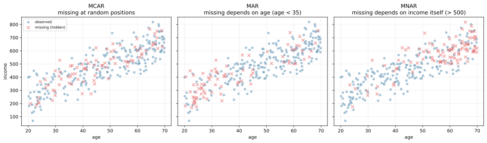
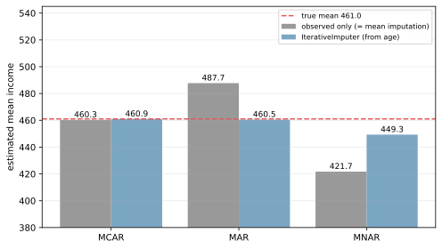
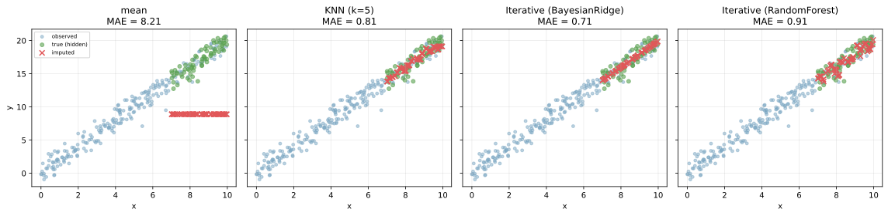

欠損値（missing values）は、観測や入力がされずに値がない状態です。アンケートの年収欄が空欄だった、センサーが一時的に止まった、といった場面で `NaN` として現れます。欠損値をそのまま学習器に渡すと、多くの実装でエラーになるか、そのサンプルが除外されて学習に使える件数が減ります。

欠損値は、[平均](/ml/math/mean/)で埋める（imputation、補完）か行ごと削除すれば、学習器はとりあえず動きます。ただし、値がどんな理由で欠けたかによって、同じ処理でも結果が正しくなる場合と偏る場合があります。

<br>

本記事では、次の疑問を順に説明します。

- 値の欠け方にはどんな種類があり、何が違うのか
- 欠け方によって、平均の推定がどれだけずれるのか
- 欠け方はデータから見分けられるのか
- 補完の手法と「欠損だったこと」を特徴量にする方法は、どう使い分けるのか

コードは [scikit-learn](https://scikit-learn.org/stable/) 1.9.1 と [NumPy](https://numpy.org/) 2.5.4 で実行しました。図の描画は[生成コード](https://github.com/nao1215/debimate/blob/main/projects/ml/scripts/notes/missing-values_gen.py)にあります。

---

### 欠損の 3 分類: MCAR / MAR / MNAR

欠損が起きる条件は、[Rubin（1976）](https://doi.org/10.1093/biomet/63.3.581)の分類で次の 3 種類に分かれます。例は「アンケートで年収を書かない人」です。

| 略称 | 正式名 | 欠ける条件 | 例 |
|---|---|---|---|
| MCAR | Missing Completely At Random（完全にランダムな欠損） | どの変数にも依存しない | 集計時の転記ミスでランダムに消えた |
| MAR | Missing At Random（観測変数で説明できる欠損） | 観測できている他の変数に依存する | 若い人ほど年収を書かない |
| MNAR | Missing Not At Random（ランダムでない欠損） | 欠けた値自身に依存する | 高収入の人ほど年収を書かない |

以下は、年齢と年収の人工データ（5,000 人のうち先頭 300 人）で 3 種類の欠け方を描いた図です。青が観測できた値（observed）、赤い × が欠損して隠れた値（missing）です。



MCAR（左）では、× が全域に散らばっています。MAR（中央）では、35 歳未満に × が集中しています。MNAR（右）では、年収 500 以上の高収入側に × が集中しています。MAR と MNAR は、どちらも散布図の端に × が寄る点で似ています。

---

### 欠け方で変わる平均の推定

3 種類の欠け方で、平均年収を推定します。比べるのは、観測できた値だけの平均と、[`IterativeImputer`](https://scikit-learn.org/stable/modules/generated/sklearn.impute.IterativeImputer.html) で年齢から年収を回帰して補完した後の平均です。`IterativeImputer` は実験的な機能のため、`enable_iterative_imputer` を先に import します。

```python
import numpy as np
from sklearn.experimental import enable_iterative_imputer  # noqa: F401
from sklearn.impute import IterativeImputer

rng = np.random.default_rng(0)
n = 5000
age = rng.uniform(20, 70, n)
income = 100 + 8 * age + rng.normal(0, 80, n)  # 年収（万円）

masks = {
    "MCAR": rng.random(n) < 0.3,                         # 年齢にも年収にも無関係
    "MAR": rng.random(n) < np.where(age < 35, 0.6, 0.15),  # 若い人ほど書かない
    "MNAR": rng.random(n) < np.where(income > 500, 0.6, 0.15),  # 高収入ほど書かない
}

print(f"真の平均年収: {income.mean():.1f}")
for name, miss in masks.items():
    obs = np.where(miss, np.nan, income)
    filled = IterativeImputer(random_state=0).fit_transform(np.c_[age, obs])[:, 1]
    corr = np.corrcoef(miss, age)[0, 1]
    print(f"{name:4s} 欠損率={miss.mean():.2f} "
          f"観測だけの平均={np.nanmean(obs):.1f} "
          f"回帰で補完した平均={filled.mean():.1f} "
          f"欠損フラグと年齢の相関={corr:+.2f}")
```

```text
真の平均年収: 461.0
MCAR 欠損率=0.28 観測だけの平均=460.3 回帰で補完した平均=460.9 欠損フラグと年齢の相関=+0.01
MAR  欠損率=0.28 観測だけの平均=487.7 回帰で補完した平均=460.5 欠損フラグと年齢の相関=-0.37
MNAR 欠損率=0.34 観測だけの平均=421.7 回帰で補完した平均=449.3 欠損フラグと年齢の相関=+0.35
```



灰色の棒は観測だけの平均です。平均値で補完しても列の平均は変わらないので、平均値補完の結果も同じ棒になります。

- MCAR: 観測だけの平均（460.3）が真の値（461.0）とほぼ一致します。欠損は件数を減らすだけです
- MAR: 年収の低い若年層が多く欠けるため、観測だけの平均は 487.7 と高く出ます。年齢から回帰して補完すると 460.5 まで戻ります
- MNAR: 高収入の人が多く欠けるため、観測だけの平均は 421.7 と低く出ます。補完しても 449.3 で、12 万円近く低いままです

MNAR で補完が途中まで効いたのは、このデータでは年齢と年収が[相関](/ml/math/correlation/)しているからです。年齢から推測できる分は戻りますが、「同じ年齢の中でも高収入の人ほど書かない」分は、観測データから推測できないので戻りません。

なお、MAR で補完が効いたのは、欠け方を決めた年齢を補完に使えたからです。欠け方に関わる変数を補完に入れなければ、MAR でも偏りは残ります。

---

### 欠け方の見分け方

前節の出力の最後の列は、欠損フラグ（欠損なら 1）と年齢の相関です。MCAR ではほぼ 0、MAR は −0.37、MNAR は +0.35 でした。相関が 0 から離れていれば、MCAR ではないことが分かります。複数の変数でまとめて調べるなら、[Little（1988）の MCAR 検定](https://doi.org/10.1080/01621459.1988.10478722)があります。

一方で、MAR と MNAR は相関では見分けられません。MNAR のデータでも、年収と相関する年齢に欠損フラグが相関するからです。MNAR かどうかは欠けた値を見ないと判定できないので、次のように扱います。

- 「高所得者ほど年収を書かない」「重症患者ほどフォローアップに来ない」のような構造がドメイン知識から疑えるなら、MNAR として扱う
- 補完後の値を一定量ずらした場合に結論が変わるかを調べる（感度分析）
- 可能なら、欠けた人の一部を追跡調査して値を集める

---

### 補完手法の比較

scikit-learn の [`sklearn.impute`](https://scikit-learn.org/stable/modules/impute.html) には、次の補完手法があります。

| 手法 | クラス | 仕組み | 弱み |
|---|---|---|---|
| 平均 / 中央値 / 最頻値 | `SimpleImputer` | 列ごとの統計量で埋める | 他の変数との関係を潰し、[分散](/ml/math/variance/)が縮む |
| [KNN](../knn/) | `KNNImputer` | 双方に値がある特徴量で距離を測り、近い k 件の平均で埋める | 計算が重い。[スケールを揃えない](../standardization/)と距離が偏る |
| Iterative | `IterativeImputer` | 欠けた列を他の列から回帰で予測し、これを繰り返す | 実験的な機能。重く、収束しないことがある |

`IterativeImputer` は R の [mice](https://cran.r-project.org/web/packages/mice/index.html) パッケージ（MICE: 連鎖方程式による多重代入）を参考にした実装ですが、既定では補完値を 1 組だけ返します。推定のばらつきまで扱う多重代入（multiple imputation）にするには、`sample_posterior=True` で乱数シードを変えて複数回実行します。

以下は、`y = 2x + ノイズ` のデータで `x > 7` の範囲の `y` を 60% 隠し（`x` に依存するので MAR）、4 つの設定で補完した結果です。

```python
import numpy as np
from sklearn.ensemble import RandomForestRegressor
from sklearn.experimental import enable_iterative_imputer  # noqa: F401
from sklearn.impute import IterativeImputer, KNNImputer, SimpleImputer

rng = np.random.default_rng(0)
n = 300
x = rng.uniform(0, 10, n)
y_true = 2 * x + rng.normal(0, 1, n)
missing = (x > 7) & (rng.random(n) < 0.6)
X = np.c_[x, np.where(missing, np.nan, y_true)]

imputers = {
    "mean": SimpleImputer(strategy="mean"),
    "KNN (k=5)": KNNImputer(n_neighbors=5),
    "Iterative (BayesianRidge)": IterativeImputer(random_state=0),
    "Iterative (RandomForest)": IterativeImputer(
        estimator=RandomForestRegressor(n_estimators=30, random_state=0),
        random_state=0),
}
print(f"欠損 {missing.sum()} 件、隠した y の平均 = {y_true[missing].mean():.2f}")
for name, imp in imputers.items():
    y_imp = imp.fit_transform(X)[:, 1]
    mae = np.abs(y_imp[missing] - y_true[missing]).mean()
    print(f"{name:26s} 補完値の平均={y_imp[missing].mean():6.2f}  MAE={mae:.2f}")
```

```text
欠損 70 件、隠した y の平均 = 17.11
mean                       補完値の平均=  8.89  MAE=8.21
KNN (k=5)                  補完値の平均= 16.99  MAE=0.81
Iterative (BayesianRidge)  補完値の平均= 17.08  MAE=0.71
Iterative (RandomForest)   補完値の平均= 16.95  MAE=0.91
```



赤い × が補完した値、緑が隠した本当の値、青が観測できた値です。[MAE](../regression-metrics/)（平均絶対誤差）は、補完値と本当の値の差の絶対値の平均です。

平均値補完（左端）は、欠けた 70 件を全て 8.89 で埋めます。隠した値の平均は 17.11 なので、`x` との関係が消え、値も大きく外れます。KNN と Iterative は右上がりの関係を保ち、MAE は 1 未満です。

`IterativeImputer` の既定の推定器は線形回帰の一種の `BayesianRidge` で、線形なこのデータでは最も誤差が小さくなりました。ランダムフォレストに替えると、KNN より誤差が増えています。手法は、観測できた値の一部を隠して当てる検証で選びます。

---

### 欠損フラグ: 「欠損だったこと」自体を特徴量にする

MNAR では、値が欠けたこと自体が情報を持ちます。前の例では「年収欄が空欄」が「高収入らしい」ことを示しますが、補完だけではこの情報がモデルに渡りません。

[`SimpleImputer`](https://scikit-learn.org/stable/modules/generated/sklearn.impute.SimpleImputer.html) に `add_indicator=True` を渡すと、欠損だった列ごとに 0/1 の欠損フラグの列が足されます。以下は、年収が高いほど上位プランを契約しやすく、高収入の人ほど年収を書かない（MNAR）データで、契約を予測する[ロジスティック回帰](../logistic-regression/)を比べたコードです。

```python
import numpy as np
from sklearn.ensemble import HistGradientBoostingClassifier
from sklearn.impute import SimpleImputer
from sklearn.linear_model import LogisticRegression
from sklearn.metrics import roc_auc_score
from sklearn.model_selection import train_test_split
from sklearn.pipeline import make_pipeline
from sklearn.preprocessing import StandardScaler

rng = np.random.default_rng(0)
n = 5000
age = rng.uniform(20, 70, n)
income = 100 + 8 * age + rng.normal(0, 80, n)
# 上位プランの契約は年収が高いほど起きやすい
y = rng.random(n) < 1 / (1 + np.exp(-(income - 500) / 50))
# 高収入ほど年収を書かない（MNAR）
obs = np.where(rng.random(n) < np.where(income > 500, 0.6, 0.15), np.nan, income)
miss = np.isnan(obs)
print(f"契約率: 年収あり {y[~miss].mean():.2f} / 空欄 {y[miss].mean():.2f}")
X = np.c_[age, obs]
X_tr, X_te, y_tr, y_te = train_test_split(X, y, test_size=0.3, random_state=0)

models = {
    "中央値で補完": make_pipeline(
        SimpleImputer(strategy="median"), StandardScaler(), LogisticRegression()),
    "中央値で補完 + 欠損フラグ": make_pipeline(
        SimpleImputer(strategy="median", add_indicator=True), StandardScaler(),
        LogisticRegression()),
    "HistGradientBoosting（NaN のまま）": HistGradientBoostingClassifier(random_state=0),
}
for name, model in models.items():
    model.fit(X_tr, y_tr)
    auc = roc_auc_score(y_te, model.predict_proba(X_te)[:, 1])
    print(f"{name}: ROC AUC = {auc:.3f}")
```

```text
契約率: 年収あり 0.31 / 空欄 0.62
中央値で補完: ROC AUC = 0.868
中央値で補完 + 欠損フラグ: ROC AUC = 0.889
HistGradientBoosting（NaN のまま）: ROC AUC = 0.887
```

出力の 1 行目の通り、年収を書かなかった人の契約率（0.62）は、書いた人（0.31）の約 2 倍です。中央値で補完すると、この人たちは「年収が中央値の人」として扱われます。欠損フラグを足すと空欄の意味を学習でき、[ROC AUC](../roc-pr-auc/) が 0.868 から 0.889 に上がりました。

3 行目の [`HistGradientBoostingClassifier`](https://scikit-learn.org/stable/modules/ensemble.html#missing-values-support) は、`NaN` を補完せずに受け取ります。学習時に、分割点ごとに欠損値を左右どちらの子に送るかを利得で決めるので、欠損フラグを足した場合と同程度の 0.887 になりました。[決定木](../decision-tree/)系のモデルなら、補完せずに渡す選択肢もあります。

---

### 列ごとの戦略

欠損率に応じた対処の目安です。経験則であり、出典のある基準ではありません。

| 欠損率 | 対処の目安 |
|---|---|
| < 5% | 平均 / 中央値の補完で十分なことが多い |
| 5〜30% | KNN または `IterativeImputer` に欠損フラグを併用する |
| 30〜50% | 予測への寄与を見て、補完するか列を落とすか判断する |
| > 50% | 列を落とすか、欠損フラグだけを特徴量にする |

欠損率が 90% でも、欠損フラグが予測に効くことがあるので、[特徴量重要度](../feature-importance/)も見て判断します。カテゴリ変数は最頻値か「unknown」という専用カテゴリで埋め（[カテゴリ変数のエンコーディング](../categorical-encoding/)）、時系列は直前の値で埋める前方フィルや線形補間（pandas の [`interpolate`](https://pandas.pydata.org/docs/reference/api/pandas.DataFrame.interpolate.html)）を使います。

---

### 数学での使いどころ

- [大数の法則](../../math/lln-clt/): MCAR なら観測だけの平均は真の平均に収束します。MAR / MNAR では、前節の実験のように別の値に収束します
- EM アルゴリズム: 欠損値を潜在変数として扱い、尤度を最大化するパラメータを推定します
- 多重代入法: 補完値を複数組作って分析し、結果のばらつきを推論の誤差に含めます
- ベイズ推定: 欠損値を確率変数として扱い、周辺化します（[ベイズの定理](../../math/bayes-theorem/)）

---

### 機械学習での使いどころ

- アンケートや会員登録の任意項目（年収、家族構成）
- センサーの故障や通信断による欠測
- 途中から追加された列や、テーブル結合で対応が無いレコード
- 推薦システムのユーザー × アイテム行列の空欄（低ランク行列分解で埋める）

---

### 適さないケース / 落とし穴

- テストデータを含めて補完の統計量を計算する: [データリーク](../data-leakage/)になります。上記の実験のように `Pipeline` に入れ、訓練データで `fit` してからテストデータを `transform` します
- MCAR を前提に行を削除する: MAR / MNAR なら推定が偏ります
- 平均値補完の後に統計的な推論をする: 分散が縮み、補完の不確かさも無視するので、標準誤差を過小評価します。推論が目的なら多重代入を使います
- [時系列](../time-series-forecasting/)で未来の値から補間する: 予測時点で使えない情報が混ざります。前方フィルなど過去側の値だけで埋めます
- 欠損が「9999」「-99」のような値で入っている: 数値として学習されます。EDA（探索的データ分析）で見つけて `np.nan` に置き換えてから処理します
- 欠損率を確認しない: 各列の欠損率は `df.isna().mean()`、欠損が同じ行に重なるパターンは [missingno](https://github.com/ResidentMario/missingno) で確認します