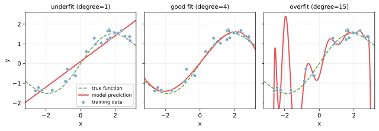
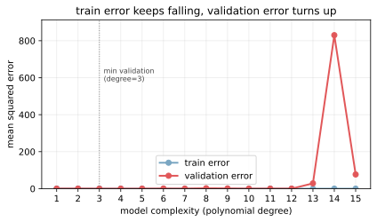

過学習（overfitting）は、モデルが訓練データの特徴を「覚えすぎ」て、未知のデータでうまく予測できなくなる現象です。  
訓練データではほぼ満点なのに、テストデータや本番データでは精度が大きく落ちる、という形で表に出ます。

逆に、モデルがデータの傾向を捉えきれずに訓練でもテストでも精度が低い状態を未学習（underfitting）と呼びます。良いモデルは「ちょうど良い複雑さ」でこの 2 つの間に位置します。

---

### 過学習に気づく方法

最初に確認するのは、訓練データとテストデータの精度差（汎化ギャップ）です。

- 訓練 Accuracy `0.99` ／ テスト Accuracy `0.62` のような大きな差 → 過学習の典型
- 訓練 Accuracy `0.65` ／ テスト Accuracy `0.62` のように両方低い → 未学習を疑う
- 訓練 Accuracy `0.92` ／ テスト Accuracy `0.90` のように差が小さい → うまく汎化している

汎化ギャップは 1 つの分割で判断するとブレるので、本番では[交差検証](../cross-validation/)で複数分割の平均を取って判断します。

---

### モデルの複雑さと過学習

多項式回帰で次数（複雑さ）を変えた 3 例を比較します。同じデータに対して、表現力の違うモデルを当てた結果を並べたものです。



- degree=1（直線）: データのカーブを表現しきれていない（underfit）
- degree=4: ちょうど真の関数（緑の点線）に沿う
- degree=15: 訓練点をほぼ全部通る複雑な曲線になり、データの「ノイズ」まで再現してしまっている（overfit）

degree=15 のモデルは訓練データ上では誤差ほぼゼロです。しかし、x=-2 や x=2 付近のように訓練点から少し外れると暴れ、未知の点を渡されると外します。

---

### 訓練誤差と検証誤差のカーブ

モデルの複雑さを少しずつ上げながら訓練誤差と検証誤差を追うと、典型的なパターンが現れます。



- 訓練誤差はモデルを複雑にするほど下がり続ける（極端に複雑にすればゼロにもできる）
- 検証誤差はある複雑さまでは下がる。そこを超えると上がり始める
- 検証誤差が最小になる点が「ちょうど良い複雑さ」

この例では、検証誤差が小さくなる複雑さを選びます。検証誤差を見ずに訓練誤差だけ追いかけると、必ず過学習側に倒れます。

---

### 主な原因

- モデルが複雑すぎる（決定木が深い、ニューラルネットの層が多い、多項式の次数が高い、など）
- 訓練データが少ない（複雑なモデルを支えるには情報が足りない）
- 特徴量が多すぎる（[次元の呪い](/ml/ml/curse-of-dimensionality/)／無関係な特徴がノイズになる）
- 同じデータで何度も[ハイパーパラメータ](../hyperparameter/)を調整した（評価データに対する「リーク」）
- データに偏りがある（訓練データに特定の傾向しか含まれていない）

---

### 対処法

過学習対策はいくつかの方向に分かれます。優先順位は状況によります。実装や計算の負担が小さい対策から試します。

1. モデルの複雑さや学習回数を制限する
    - [正則化](../regularization/)（L1 / L2）でパラメータの大きさにペナルティを与える
    - 決定木系（[RandomForest](../random-forest/) / [GradientBoosting](../gradient-boosting/)）では `max_depth` や葉ノード数の上限を絞る
    - 勾配ブースティングでは early stopping（検証誤差が下がらなくなった時点で学習を打ち切る）
2. 特徴量を絞る
    - 寄与の小さい特徴量を捨てる
    - 次元削減（[PCA](../pca/) など）
    - リーク疑いのある特徴（予測対象から直接導かれるもの）を除外
3. データ側を変える
    - データ量を増やす
    - データ拡張（画像なら回転や反転、テーブルなら合成サンプル生成）
    - ノイズの多いサンプルを取り除く
4. 評価の作り方を変える
    - [交差検証](../cross-validation/)で安定したハイパーパラメータを選ぶ
    - テストデータは最後の最後だけ使う（途中で何度も触らない）
5. モデル自体を変える
    - より単純なモデルに切り替える
    - 複数モデルの平均（バギング・アンサンブル）でばらつきを抑える

---

### Python での実例

ノイズの多いデータで、深い木・浅い木・深い RandomForest の精度を比べる最小例です。

```python
from sklearn.datasets import make_classification
from sklearn.ensemble import RandomForestClassifier
from sklearn.model_selection import train_test_split
from sklearn.tree import DecisionTreeClassifier

# flip_y=0.3: 3 割のサンプルのラベルをランダムに付け直す（ノイズの多いデータ）
X, y = make_classification(n_samples=500, n_features=20, flip_y=0.3, random_state=0)
X_tr, X_te, y_tr, y_te = train_test_split(X, y, test_size=0.3, random_state=0)

models = {
    # 深さを制限せず、葉が 1 サンプルになるまで分割 → ノイズまで覚える
    "deep tree": DecisionTreeClassifier(random_state=0),
    # 深さと葉のサンプル数を絞る → 細かいノイズを覚えられない
    "shallow tree": DecisionTreeClassifier(max_depth=4, min_samples_leaf=10, random_state=0),
    # 深い木を 100 本平均する
    "deep forest": RandomForestClassifier(random_state=0),
}
for name, m in models.items():
    m.fit(X_tr, y_tr)
    print(f"{name:12} train: {m.score(X_tr, y_tr):.3f} test: {m.score(X_te, y_te):.3f}")
```

scikit-learn 1.9.1 での出力です（random_state 固定のため毎回同じ値）。

```text
deep tree    train: 1.000 test: 0.553
shallow tree train: 0.806 test: 0.653
deep forest  train: 1.000 test: 0.713
```

深い木は訓練を全問正解しますが、テストは当て推量に近い 0.553 です。深さを絞るとテストは 0.653 に上がります。深い森も訓練は 1.000 ですが、木ごとに違うノイズを覚えるので平均すると打ち消し合い、テストは最も高い 0.713 です。採るモデルはギャップでなく検証の精度で決めます。

---

### 機械学習での使いどころ

過学習は「現象の名前」であって特定のアルゴリズムに紐づきません。あらゆる教師あり学習で常に意識する必要があります。

- モデル選び: 訓練だけ良くてテストで落ちるモデルは採用しない
- ハイパーパラメータ調整: [交差検証](../cross-validation/)で過学習しないパラメータを選ぶ
- 結果の解釈: 「訓練 0.99 のモデルができた」と言われても、テスト精度を確認しない限り意味がない
- 評価指標との組み合わせ: 不均衡データでは Accuracy だけでなく [ROC-AUC / PR-AUC](../roc-pr-auc/) を併用して汎化を多面的に見る


---

### よくある誤解

- テストデータの精度が高いから過学習していない、とは限らない: テストデータでハイパーパラメータを何度も調整していると、テストデータに対しても過学習する（だから検証データを別に切る）
- 単純なモデルは過学習しない、とは限らない: 特徴量が極端に多い・データが極端に少ない場合は単純なモデルでも起きる
- 過学習対策はモデル側だけの問題ではない: [データのリーク](../data-leakage/)（未来情報の混入など）が本質原因のことも多い
- 本番運用後の精度劣化は過学習と紛らわしいが別物: 学習時の現象と、本番運用後に入力やラベルの関係が変わる [データドリフト](../../mlops/data-drift/) は原因も対処も違う
