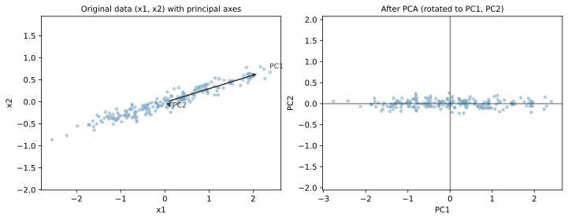

PCA（Principal Component Analysis、主成分分析）は、多次元データの「ばらつき（分散）が大きい方向」を見つけ、座標軸をその方向へ回転させてから、重要な軸だけ残す方法です。
目的は「情報量（分散）をできるだけ保ったまま、次元を減らす」ことです。PCA は予測や分類のモデルではなく、可視化や前処理に使います。

共分散行列を[固有値分解](../../math/eigen-decomposition/)すると、固有ベクトルから主成分の方向、固有値からその軸上の分散を求められます。データ行列を低次元に写す操作は [行列ベクトル積](../../math/vector-matrix-ops/) `Z = X V` で表せます。

ここでの「分散が最大になる直交基底へ線形変換」とは、次を意味します。
1. 座標軸の回転：元の軸：x₁, x₂, x₃, ...、PCA 後の軸：PC1, PC2, PC3, ...
2. 直交基底：軸同士が直角（内積 0）で、PC1 ⟂ PC2 ⟂ PC3 ⟂ …が成り立つ。新しい座標同士の[相関](../../math/correlation/)は 0 になるが、非線形な依存（例：PC2 が PC1 の 2 乗で決まる）は残りうる。
3. 分散が最大：第 1 主成分を最も分散が大きくなる方向とし、第 N+1 主成分は第 N 主成分までの全てと直交する方向のうち、次に分散が大きい方向とする。
4. 投影：必要な軸（例：PC1, PC2）だけ残して低次元に写す。


---

### 前提・注意

- 単位やスケールが違うと、分散の大きい特徴量が PC1 を独占する。単位が揃っていなければ[標準化](../standardization/)（[平均](../../math/mean/)0・[分散](../../math/variance/)1）してから使う
- 外れ値に引っ張られやすい

---

### 利点
- 相関の強い（冗長な）特徴量をまとめる
- 分散の小さい、ノイズの多い次元を落とす
- 2〜3 次元に落とせば、散布図でデータ全体の形を眺められる

---

### 欠点
- 線形変換しかできない
- ラベル情報を無視する
- 主成分は元の特徴量の重み付き和なので、「PC1 が何を表すか」の意味付けが難しい
- 分散が大きい＝重要とは限らない（目的変数に効く特徴が小分散のこともある）

---

## Python での実例

x2 が x1 のほぼ 0.3 倍になる細長いデータで、[NumPy](https://numpy.org/) の固有値分解から主成分を求め、PC1 だけ残すと何を失うかを確かめます。後半は x2 だけ 100 倍（単位を m から cm に変えた想定）にして、[scikit-learn の `PCA`](https://scikit-learn.org/stable/modules/generated/sklearn.decomposition.PCA.html) で標準化の有無を比べます。

```python
import matplotlib.pyplot as plt
import numpy as np
from sklearn.decomposition import PCA
from sklearn.preprocessing import StandardScaler

# 分かりやすい人工データ（x2 は x1 の 0.3 倍に小さなノイズを足しただけ）
rng = np.random.RandomState(0)
x = rng.randn(200)
y = 0.3 * x + 0.1 * rng.randn(200)
X = np.column_stack((x, y))

# 平均中心化 → 共分散行列 → 固有値分解
X_centered = X - X.mean(axis=0)
cov = np.cov(X_centered, rowvar=False)
eigvals, eigvecs = np.linalg.eigh(cov)

# 固有値の大きい順に並べ、向き（符号）は任意なので x1 成分を正に揃える
idx = np.argsort(eigvals)[::-1]
eigvals, eigvecs = eigvals[idx], eigvecs[:, idx]
eigvecs = eigvecs * np.sign(eigvecs[0])

print("固有値（各主成分の分散）:", eigvals.round(4))
print("寄与率:", (eigvals / eigvals.sum()).round(4))
print("PC1 の向き:", eigvecs[:, 0].round(3))

# 回転（PCA 変換）と、PC1 だけ残して元の空間へ戻した時の誤差
X_pca = X_centered @ eigvecs
X_back = X_pca[:, :1] @ eigvecs[:, :1].T
print("PCA 後の共分散:\n", np.cov(X_pca, rowvar=False).round(4) + 0.0)
print("PC2 を捨てた時の平均二乗誤差:", np.mean(np.sum((X_centered - X_back) ** 2, axis=1)).round(4))

# scikit-learn でも同じ寄与率になる
print("sklearn の寄与率:", PCA().fit(X).explained_variance_ratio_.round(4))

# x2 だけ単位を変えて 100 倍にすると、標準化の有無で PC1 が変わる
X_cm = np.column_stack((x, y * 100))
raw = PCA().fit(X_cm)
std = PCA().fit(StandardScaler().fit_transform(X_cm))
print("100 倍・標準化なし PC1:", np.abs(raw.components_[0]).round(3),
      "寄与率", raw.explained_variance_ratio_.round(4))
print("100 倍・標準化あり PC1:", np.abs(std.components_[0]).round(3),
      "寄与率", std.explained_variance_ratio_.round(4))

# 図：左が元データと主成分軸、右が主成分軸へ回転した後
POINT = "#7aa6c2"
INK = "#333333"
fig, axes = plt.subplots(1, 2, figsize=(10, 4))
ax = axes[0]
ax.scatter(X[:, 0], X[:, 1], s=12, alpha=0.5, color=POINT)
origin = X.mean(axis=0)
for i, name in enumerate(["PC1", "PC2"]):
    vec = eigvecs[:, i] * np.sqrt(eigvals[i]) * 2
    ax.annotate("", xy=origin + vec, xytext=origin,
                arrowprops=dict(arrowstyle="->", color=INK, lw=1.5))
    ax.text(*(origin + vec * 1.1 + [0.05, 0.05]), name, color=INK, fontsize=9)
ax.set_title("Original data (x1, x2) with principal axes", fontsize=10)
ax.set_xlabel("x1")
ax.set_ylabel("x2")
ax.axis("equal")

ax = axes[1]
ax.scatter(X_pca[:, 0], X_pca[:, 1], s=12, alpha=0.5, color=POINT)
ax.axhline(0, color=INK, lw=0.8)
ax.axvline(0, color=INK, lw=0.8)
ax.set_title("After PCA (rotated to PC1, PC2)", fontsize=10)
ax.set_xlabel("PC1")
ax.set_ylabel("PC2")
ax.axis("equal")

plt.tight_layout()
plt.savefig("pca_rotation.svg", bbox_inches="tight")
```

出力:

```text
固有値（各主成分の分散）: [1.1481 0.0081]
寄与率: [0.993 0.007]
PC1 の向き: [0.955 0.296]
PCA 後の共分散:
 [[1.1481 0.    ]
 [0.     0.0081]]
PC2 を捨てた時の平均二乗誤差: 0.0081
sklearn の寄与率: [0.993 0.007]
100 倍・標準化なし PC1: [0.03 1.  ] 寄与率 [9.999e-01 1.000e-04]
100 倍・標準化あり PC1: [0.707 0.707] 寄与率 [0.9789 0.0211]
```



左図の矢印は長い方が PC1、短い方が PC2 です（長さは各主成分の[標準偏差](/ml/math/stddev/)の 2 倍）。右図は同じ点を PC1・PC2 の座標へ回転して描き直したものです。

PC1 だけ残す（各点を PC1 軸へ垂直に落とす）と、2 次元を 1 次元に圧縮できます。PC1 の寄与率（全分散に占める割合）は 0.993 で、捨てる PC2 は 0.7% です。元の空間へ戻した時の平均二乗誤差 0.0081 は PC2 の固有値とほぼ同じで、捨てた軸の分散がそのまま失う情報になります。

x2 を 100 倍にすると、標準化しない PCA の PC1 は (0.03, 1.00) とほぼ x2 軸になります。scikit-learn の `PCA` は中心化だけ行い、スケールは揃えないためです。標準化すれば PC1 は (0.707, 0.707) に戻り、単位を変える前と同じ結果になります。

---

### 数学での使いどころ

- 多変量データの構造理解、相関の強い変数の要約
- データの可視化（特に 2 次元・3 次元）。曲がった多様体の可視化は [t-SNE / UMAP](../tsne-umap/) の方が向く

数学的には、共分散行列の固有値分解か、データ行列の特異値分解（SVD, Singular Value Decomposition）として定式化されます。固有値は「各主成分の分散」、固有ベクトルは「主成分の方向」です。少数の方向だけで行列を表す（低ランクで近似する）考え方は、学習済みモデルの重みの差分を細長い 2 つの行列で学習する [LoRA](/notes/generative-ai/lora/) とも共通します。

---

### 機械学習での使いどころ

機械学習では、主に前処理として特徴量の圧縮・ノイズ除去・学習の高速化に使います。

- [k-means](../k-means/) 前の次元削減
- [SVM](../svm/)（Support Vector Machine）・線形モデル前の特徴整理
- 高次元データ（画像のピクセル値・センサデータ）の圧縮、[次元の呪い](../curse-of-dimensionality/) への対策

---

### 適さないケース

- 曲がった構造で分かれるデータ（例：手書き数字の種類ごとの塊）を少ない次元で分けたい場合。線形な射影では塊が重なる。ピクセル値の圧縮のように線形近似で足りる用途とは区別する
- 分類において、分散の小さい特徴が重要な場合
- [カテゴリ変数](../categorical-encoding/)が主体のデータ
