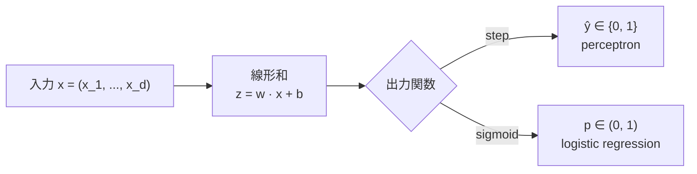
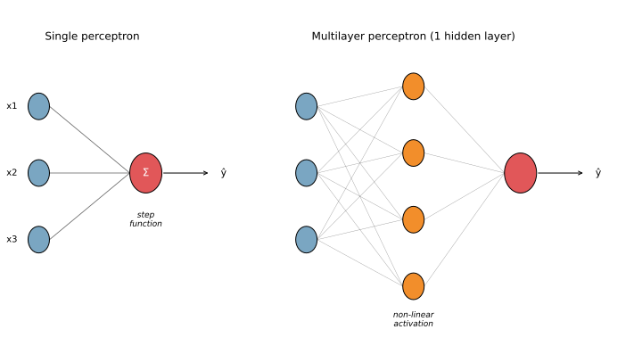
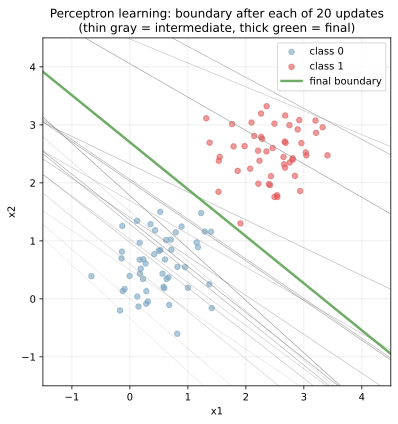
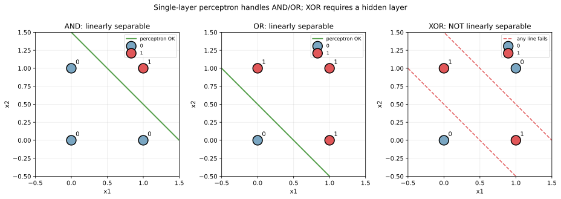
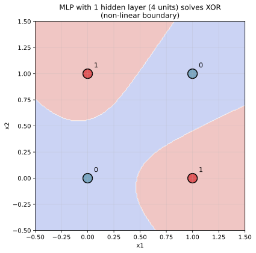

パーセプトロン（perceptron）は、1958 年に Frank Rosenblatt が[論文](https://doi.org/10.1037/h0042519)で提案した 2 クラス分類器です。入力特徴量に重みを掛けて足し合わせ、その和が 0 を超えれば 1、超えなければ 0 と判定します。

`ŷ = step(w_1 x_1 + w_2 x_2 + ... + w_d x_d + b)`

[ロジスティック回帰](../logistic-regression/) も同じ重み付き和 `z` を計算しますが、次の図の通り、出力関数が違います。



学習方法も違います。ロジスティック回帰は交差エントロピーを最小化し、正しく分類できた点からも[勾配](/ml/math/partial-derivative-gradient/)を受け取ります。パーセプトロンは、間違えたサンプルを見つけた時だけ重みを動かします。この単純な規則には「線形分離可能なら有限回で止まる」という保証があり、層を重ねた多層パーセプトロンは深層学習の出発点になりました。

<br>

本記事では、NumPy で学習則を書いて次の疑問を確かめます。

- 重みはいつ、どれだけ動き、いつ止まるのか
- XOR を学習させると何が起きるのか
- 層を 1 つ足すと、なぜ XOR を分けられるのか

---

### 単純パーセプトロンの構造と学習則

入力 → 重み付き和 → ステップ関数 → 出力、という最小構成です。



左が単純パーセプトロンで、入力 `x_1, x_2, x_3` に重み `w_1, w_2, w_3` を掛けて加算し、step function で `0/1` を出します。右は後半で扱う多層パーセプトロン（multi-layer perceptron, MLP）で、入力層と出力層の間に隠れ層を挟みます。

学習則（perceptron learning rule）は、サンプル `x_i` を 1 つずつ予測し、次の式で重みを更新します。

`w ← w + η × (y_i - ŷ_i) × x_i`

- `y_i ∈ {0, 1}`: 正解、`ŷ_i ∈ {0, 1}`: 予測、`η`: 学習率
- 正しく分類できた点では `y_i - ŷ_i = 0` なので重みは動かない。動くのは誤分類した点だけ
- 入力の末尾に常に 1 の特徴量を足すと、その重みが `b` の役をするので、`b` も同じ式で更新できる

データが線形分離可能なら、更新回数は有限で必ず止まります。これがパーセプトロン収束定理で、Novikoff（1962）は更新回数が `(R/γ)²` 以下になることを示しました。`R` はサンプルの長さの最大値、`γ` は最も余裕を持って分ける境界から最寄りの点までの距離で、どちらも末尾に 1 を足した入力で測ります。逆に、線形分離できないデータでは止まりません。

---

### 学習の様子

2 次元の線形分離可能なデータで学習を回し、epoch（全サンプルを 1 周すること）ごとの誤分類の回数を数えます。本記事のコードは[図の生成コード](https://github.com/nao1215/debimate/blob/main/projects/ml/scripts/notes/perceptron_gen.py)と同じデータ・学習則から描画を除き、出力を足したもので、NumPy 2.5.4 と scikit-learn 1.9.1 で実行しました。

```python
import numpy as np
from sklearn.svm import SVC

rng = np.random.default_rng(0)
X1 = rng.normal([0.5, 0.5], 0.5, (50, 2))  # クラス 0
X2 = rng.normal([2.5, 2.5], 0.5, (50, 2))  # クラス 1
X = np.vstack([X1, X2])
y = np.array([0] * 50 + [1] * 50)
X_aug = np.hstack([X, np.ones((len(X), 1))])  # 末尾の 1 に掛かる重みが b


def train(X_aug, y, eta=0.1, epochs=15):
    w = np.zeros(X_aug.shape[1])
    mistakes = []  # epoch ごとの誤分類（= 更新）の回数
    for epoch in range(epochs):
        m = 0
        for i in range(len(X_aug)):
            pred = 1 if X_aug[i] @ w > 0 else 0
            if pred != y[i]:
                w += eta * (y[i] - pred) * X_aug[i]
                m += 1
        mistakes.append(m)
    return w, mistakes


w, mistakes = train(X_aug, y)
print("誤分類:", mistakes, "合計", sum(mistakes))
print("w =", np.round(w, 3))
print("境界に最も近い点までの距離:",
      round(np.min(np.abs(X_aug @ w)) / np.linalg.norm(w[:2]), 3))
svm = SVC(kernel="linear", C=1e6).fit(X, y)
print("SVM のマージン:", round(1 / np.linalg.norm(svm.coef_), 3))
```

```text
誤分類: [1, 5, 4, 3, 3, 3, 1, 0, 0, 0, 0, 0, 0, 0, 0] 合計 20
w = [ 0.24   0.296 -0.8  ]
境界に最も近い点までの距離: 0.114
SVM のマージン: 0.227
```

20 回の更新の後、8 epoch 目で誤分類が 0 になり、以降は重みが動きません。次の図は、更新ごとの境界を灰色の細線、最終境界を緑の太線で描いたものです。



2 群は原点から離れた所にあるので、`b` を `-0.8` まで動かす必要があります。`b` は 1 回の更新で `η = 0.1` ずつしか動かないため、境界は更新のたびに少しずつ右上へずれていきます。

最終境界は、右下にある赤の 1 点の近くを通っています。パーセプトロンは誤分類が無くなった時点で止まり、点との距離を広げようとはしません。最寄りの点までの距離は 0.114 で、この距離を最大化する [サポートベクターマシン](../svm/)（SVM）の 0.227 の半分ほどです。

<br>

学習率 `η` も変えてみます。

```python
w, mistakes = train(X_aug, y, eta=100)
print("誤分類:", mistakes, "合計", sum(mistakes))
print("w =", np.round(w, 3))
```

```text
誤分類: [1, 5, 4, 3, 3, 3, 1, 0, 0, 0, 0, 0, 0, 0, 0] 合計 20
w = [ 240.182  296.241 -800.   ]
```

`η` を 1000 倍にしても、誤分類の列は同じで、`w` が 1000 倍になっただけです。`w = 0` から始めると、`w` は常に「`η` × 入力ベクトルの整数倍の和」になり、`η` は `w · x` の符号を変えません。初期値 0 の単純パーセプトロンでは、学習率は結果に効かないわけです。scikit-learn の [`Perceptron`](https://scikit-learn.org/stable/modules/generated/sklearn.linear_model.Perceptron.html) も重みを 0 から始め、学習率 `eta0` の既定値は 1 です。

---

### 線形分離可能性と XOR 問題

パーセプトロンが学習できるのは、1 本の直線（高次元なら超平面）で分けられるデータだけです。次の図は、論理演算の AND・OR・XOR の真理値表を 2 次元に置いたものです。



AND と OR は 1 本の緑線で 0 と 1 を分けられます。XOR では (0,0) と (1,1) が 0、(0,1) と (1,0) が 1 で、どこに直線を引いても対角の 2 点を同じ側に集められません。赤い破線は失敗する 2 本の例です。

前節の `train` で XOR を 1000 epoch 学習させます。

```python
X_xor = np.array([[0, 0], [0, 1], [1, 0], [1, 1]])
y_xor = np.array([0, 1, 1, 0])
X_xor_aug = np.hstack([X_xor, np.ones((4, 1))])
w, mistakes = train(X_xor_aug, y_xor, epochs=1000)
print("誤分類:", mistakes[:5], "...", mistakes[-3:])
print("3 epoch 目以降の最小:", min(mistakes[2:]), "w =", np.round(w, 3))
```

```text
誤分類: [2, 3, 4, 4, 4] ... [4, 4, 4]
3 epoch 目以降の最小: 4 w = [-0.1  0.   0.1]
```

3 epoch 目以降は、毎 epoch 4 点すべてを間違えています。1 点直すたびに別の点を壊し、epoch の終わりには同じ重みへ戻るので、何周回しても止まりません。

Minsky と Papert は 1969 年の書籍 [Perceptrons](https://doi.org/10.7551/mitpress/11301.001.0001) で、単層パーセプトロンが表せる関数の限界を数学的に示しました。XOR はその代表例で、この指摘はニューラルネット研究が下火になった一因と言われます。

層を重ねれば XOR を表せること自体は知られていました。足りなかったのは多層の重みを学習する方法で、1986 年に Rumelhart・Hinton・Williams が [誤差逆伝播法](../backpropagation/) の[論文](https://doi.org/10.1038/323533a0)を発表してから広まりました。

---

### 多層パーセプトロンと XOR

隠れ層を 1 層挟むと XOR を表せます。まず、重みを手で決めたパーセプトロン 3 個で確かめます。隠れ層の `h1` は OR、`h2` は NAND（AND の否定）を計算し、出力層は 2 つの AND を取ります。

```python
step = lambda z: (z > 0).astype(int)
h1 = step(X_xor @ np.array([1, 1]) - 0.5)    # OR
h2 = step(X_xor @ np.array([-1, -1]) + 1.5)  # NAND
print("h1 =", h1, "h2 =", h2, "出力 =", step(h1 + h2 - 1.5))  # AND
```

```text
h1 = [0 1 1 1] h2 = [1 1 1 0] 出力 = [0 1 1 0]
```

入力 (0,0)・(0,1)・(1,0)・(1,1) は、隠れ層で (0,1)・(1,1)・(1,1)・(1,0) に移ります。XOR が 1 の 2 点はどちらも (1,1) に重なり、出力層から見ると 1 本の直線で分けられる配置になります。隠れ層は、入力を線形分離できる新しい特徴量へ変換しています。

実際の MLP は、この重みを誤差逆伝播法で学習します。ステップ関数は勾配がほぼ至る所 0 で学習に使えないため、tanh などの微分できる [活性化関数](../activation-functions/) に置き換えます。scikit-learn の [`MLPClassifier`](https://scikit-learn.org/stable/modules/generated/sklearn.neural_network.MLPClassifier.html) で、隠れ層 4 ユニットの MLP を学習させます。

```python
from sklearn.neural_network import MLPClassifier

mlp = MLPClassifier(hidden_layer_sizes=(4,), activation="tanh",
                    max_iter=10000, random_state=0).fit(X_xor, y_xor)
print("予測:", mlp.predict(X_xor))
print("P(y=1):", np.round(mlp.predict_proba(X_xor)[:, 1], 3))
```

```text
予測: [0 1 1 0]
P(y=1): [0.028 0.89  0.904 0.159]
```

4 点とも正しく分類できています。決定領域を描くと、境界は曲がっており、単層では引けない形です。



この延長に普遍近似定理（universal approximation theorem）があります。Cybenko（[1989](https://doi.org/10.1007/BF02551274)）は、sigmoid 型の活性化関数を持つ 1 隠れ層のネットワークが、有界な範囲の任意の連続関数をいくらでも精度よく近似できることを示しました。ただし、定理が保証するのは「そういう重みが存在する」ことだけです。必要なユニット数や、学習でその重みにたどり着けるかは保証しません。

---

### 数学での使いどころ

- パーセプトロン収束定理: 更新回数の上限 `(R/γ)²` は内積とノルムだけで導ける（[ベクトル・行列演算](../../math/vector-matrix-ops/)）
- マージン: 上限は `γ` が小さいほど大きくなる。`γ` を最大化する考え方が [SVM](../svm/) につながる
- オンライン学習: 1 サンプルずつ予測と更新を繰り返すアルゴリズムの原型
- [確率的勾配降下法](../../math/gradient-descent-sgd/)（SGD）との関係: 学習則は損失 `max(0, -(2y-1) z)` に SGD をかけた形と同じ。scikit-learn も `Perceptron()` を `SGDClassifier(loss="perceptron", eta0=1, learning_rate="constant", penalty=None)` と同等だと説明している

---

### 機械学習での使いどころ

単純パーセプトロンを単体で使う場面は少なく、次のような形で登場します。

- ニューラルネットの最小単位: 重み付き和と活性化関数の組は、MLP の 1 ユニットと同じ形
- オンライン学習: scikit-learn の `Perceptron` は `partial_fit` でデータを分けて少しずつ学習できる
- 線形分離可能性の簡易チェック: 誤分類が 0 になれば線形分離可能と分かる（0 にならないだけでは、分離不可能とは言い切れない）

---

### 適さないケース / 落とし穴

- 線形分離できないデータ: XOR の実験の通り、重みが回り続けて止まらない。epoch 数で打ち切るか、MLP など非線形なモデルに切り替える
- 確率出力が欲しい: step function は 0/1 しか出さない。[ロジスティック回帰](../logistic-regression/) を使う
- 特徴量のスケールが揃っていない: `w · x` も更新量も大きい特徴量に引っ張られる。[標準化](../standardization/) を先にかける
- ノイズの多いデータ: 誤ラベルの点を直そうとして最後まで重みが揺れ、最後に止めた時点の重みが良いとは限らない。マージンを取る [SVM](../svm/) や [損失関数](../loss-functions/) を選び直す
- 多クラス分類: 単純パーセプトロンは 2 クラス用。scikit-learn の `Perceptron` は one-vs-rest で多クラスに対応する
