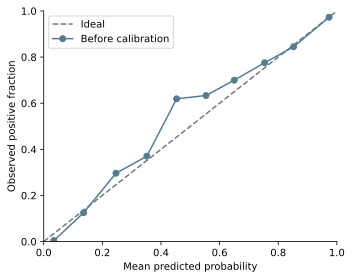
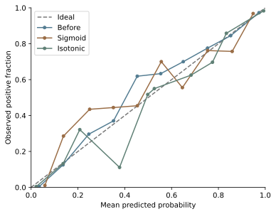
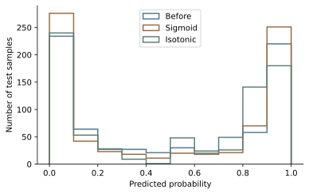

確率の校正（probability calibration）は、モデルが出す予測確率と、その確率を付けた集団での実際の正例割合が合うように調整する処理です。例えば「確率 0.9」と予測した件数をまとめた時、正例が約 90%なら、その集団では予測確率と観測結果が対応しています。

確率を使って期待損失や[判断の閾値](../confusion-matrix/)を決める時は、この対応が重要です。ただし、校正の処理を追加すれば必ず良くなるわけではありません。

<br>

本記事では同じ分類モデルを固定し、校正前後の確率と評価値を比べます。


- title: 分類の正解率
  body: 閾値で正例・負例を決めた時に、ラベルが何件当たったか。
- title: 確率の校正
  body: 似た予測確率を付けた集団で、正例の割合がその確率に対応するか。


---

### 信頼性プロット

信頼性プロット（reliability diagram）は、予測確率を区間に分け、横軸に区間内の予測確率の平均（Mean predicted probability）、縦軸に実際の正例割合（Observed positive fraction）を置く図です。両者が等しければ対角線上に並びます。点が対角線より下なら、その区間では予測確率が実測の正例割合より高くなっています。

[scikit-learn の校正機能](https://scikit-learn.org/stable/modules/calibration.html)を使い、合成データを学習用 1500 件、校正用 750 件、テスト用 750 件に分けます。学習用で GaussianNB を作り、校正前の確率を確認します。GaussianNB は、各クラス内で特徴量がそれぞれ[正規分布](/ml/math/probability-distributions/)に従い、互いに独立であると仮定する[ナイーブベイズ](/ml/math/bayes-theorem/)分類器です。ここでは予測確率の幅が 0.1 の区間を 10 個使います。空の区間はプロットされません。

以下は scikit-learn 1.8.0、[NumPy](https://numpy.org/) 2.4.1 で確認した結果です。[図と数値の生成コード](https://github.com/nao1215/debimate/blob/main/projects/ml/scripts/notes/probability-calibration_gen.py)は GitHub で公開しています。本文のコードは抜粋で、[Matplotlib](https://matplotlib.org/) の描画設定や保存処理を省略しています。

```python
import numpy as np
import matplotlib.pyplot as plt
from sklearn.calibration import CalibratedClassifierCV, calibration_curve
from sklearn.datasets import make_classification
from sklearn.frozen import FrozenEstimator
from sklearn.metrics import brier_score_loss, roc_auc_score
from sklearn.model_selection import train_test_split
from sklearn.naive_bayes import GaussianNB

X, y = make_classification(n_samples=3000, n_features=10,
                          n_informative=5, n_redundant=2, random_state=0)
X_tr, X_rest, y_tr, y_rest = train_test_split(
    X, y, test_size=0.5, stratify=y, random_state=0)
X_cal, X_te, y_cal, y_te = train_test_split(
    X_rest, y_rest, test_size=0.5, stratify=y_rest, random_state=0)
base = GaussianNB().fit(X_tr, y_tr)
raw = base.predict_proba(X_te)[:, 1]
observed, predicted = calibration_curve(y_te, raw, n_bins=10, strategy="uniform")
fig, ax = plt.subplots(figsize=(5, 4))
ax.plot([0, 1], [0, 1], "--", color="#777777", label="Ideal")
ax.plot(predicted, observed, "o-", color=BLUE, label="Before calibration")
ax.set(xlabel="Mean predicted probability", ylabel="Observed positive fraction",
       xlim=(0, 1), ylim=(0, 1))
ax.legend(loc="upper left")
plt.tight_layout()
save("calib_reliability_diagram.svg")
```



各点は有限個のサンプルから計算しているため、対角線からのずれには標本のばらつきも含まれます。区間の切り方で形も変わるので、1 本の線だけでモデル全体の性質を決めないようにします。後のヒストグラムで、どの区間に何件あるかも確認します。

---

### 校正用のデータと変換

元モデルのスコアや予測確率を受け取り、正例の確率へ変換するモデルを校正器と呼びます。ここでは元モデルの学習に使っていない 750 件を渡し、元モデルを学習し直さずに確率の変換だけを比較します。


- title: 学習用 1500 件
  body: 分類モデルを学習し、そのパラメータを固定。
- title: 校正用 750 件
  body: 固定したモデルの出力と正解から、確率の変換を学習。
- title: テスト用 750 件
  body: どちらの学習にも使わず、校正前後の出力を比較。


比較する変換は次の 2 つです。

- Sigmoid（Platt scaling）: 入力スコア `f` を `1 / (1 + exp(Af + B))` で変換し、係数 A・B を学習する。滑らかな曲線で表現できる範囲に限られる
- Isotonic regression: スコアが増えた時に出力確率が下がらない制約の下で、柔軟に変換を学習する。scikit-learn は学習した点の間を線形補間し、平らな区間もできる。少ない校正データでは[過学習](../overfitting/)しやすい

[`CalibratedClassifierCV`](https://scikit-learn.org/stable/modules/generated/sklearn.calibration.CalibratedClassifierCV.html)に通常の未学習モデルを渡すと、[交差検証](/ml/ml/cross-validation/)を使って元モデルと校正器を学習できます。一方で、ここでは `FrozenEstimator` で学習済みモデルを固定し、別に用意した校正データだけを渡します。この使い方では、学習用データと校正用データを利用者が分離する必要があります。`FrozenEstimator` は scikit-learn 1.6 以降で利用できます。

```python
models = {"Before": base}
for name, method in [("Sigmoid", "sigmoid"), ("Isotonic", "isotonic")]:
    models[name] = CalibratedClassifierCV(
        FrozenEstimator(base), method=method).fit(X_cal, y_cal)
probabilities = {name: model.predict_proba(X_te)[:, 1] for name, model in models.items()}
fig, ax = plt.subplots(figsize=(5.5, 4.3))
ax.plot([0, 1], [0, 1], "--", color="#777777", label="Ideal")
for (name, proba), color in zip(probabilities.items(), [BLUE, BROWN, GREEN]):
    brier = brier_score_loss(y_te, proba)
    auc = roc_auc_score(y_te, proba)
    print(f"{name:8s} Brier={brier:.4f} ROC AUC={auc:.4f}")
    observed, predicted = calibration_curve(y_te, proba, n_bins=10, strategy="uniform")
    ax.plot(predicted, observed, "o-", color=color, label=name, markersize=4)
ax.set(xlabel="Mean predicted probability", ylabel="Observed positive fraction",
       xlim=(0, 1), ylim=(0, 1))
ax.legend(loc="upper left")
plt.tight_layout()
save("calib_before_after.svg")
```



```text
Before   Brier=0.0783 ROC AUC=0.9612
Sigmoid  Brier=0.0804 ROC AUC=0.9612
Isotonic Brier=0.0788 ROC AUC=0.9597
```

Brier スコアは、正解 `y` を 0 か 1 として計算する `mean((予測確率 - y)²)` です。小さいほど確率予測の二乗誤差が少ないことを表します。今回は Sigmoid も Isotonic も、校正前より Brier スコアがわずかに悪くなりました。校正用データに合わせた変換が、別のテストデータでも改善するとは限らない例です。この 1 回の結果だけで、Sigmoid と Isotonic の一般的な優劣は判断できません。

Brier スコアは校正のずれだけでなく、正例と負例をどれだけ区別できるかなどにも影響されます。値が下がったことだけで、校正が改善したとは断定できません。[ROC AUC](../roc-pr-auc/) は予測の順位を見る指標なので、信頼性プロットや Brier スコアと併せて違いを確認します。今回の Sigmoid では順位が保たれ、Isotonic では同じ確率になる点が生じ、ROC AUC も変わりました。

---

### 出力確率の分布

校正前後で同じ 750 件にどんな確率が付いたかを確認します。横軸の区間は、信頼性プロットと同じ 10 区間です。

```python
fig, ax = plt.subplots(figsize=(5.5, 3.5))
for (name, proba), color in zip(probabilities.items(), [BLUE, BROWN, GREEN]):
    ax.hist(proba, bins=np.linspace(0, 1, 11), histtype="step", linewidth=1.5,
            color=color, label=name)
ax.set(xlabel="Predicted probability", ylabel="Number of test samples")
ax.legend(loc="upper center")
plt.tight_layout()
save("calib_probability_histogram.svg")
```



校正によって確率が必ず中央へ寄るわけではありません。この例でも Sigmoid 後は 0 付近の件数が増えています。予測確率が 0 や 1 に近い場合も、その確率を付けた集団の正例割合と対応しているかを確認します。

例えば、予測確率 0.9 の区間に 100 件ある場合と、3 件しかない場合では、同じ正例割合のずれでも判断の確かさが異なります。区間を細かくすれば詳細が見える一方で、各区間の件数が減って値が不安定になります。`strategy="quantile"` で件数が近くなる区切りを使う方法もありますが、確率の区間幅は揃わなくなります。

---

### 使いどころと限界

予測確率から[期待損失](/ml/math/expectation/)を計算したり、モデル間で確率を比較したりする時に、校正の確認が役立ちます。ただし、校正が良いだけで個々の入力を正確に識別できるとは限りません。例えば正例率が 50%の集団に常に 0.5 を返すモデルは、集団全体では確率が合っていても、誰が正例かを区別できません。

- 閾値を評価データ上で調整すること自体に、校正は必須ではない。閾値を「この確率以上」という意味で使う時には、確率と実測割合の対応が必要
- 校正器を元モデルの訓練データで学習すると、学習済みの点に対する過度に良い予測へ合わせてしまう。専用データか交差検証で分離する
- Isotonic に必要な件数はデータ分布やスコアの広がりで変わる。固定の件数だけで適否を決めず、未使用データで比較する
- [クラス不均衡](../class-imbalance/)を補う再サンプリングをしても、校正用と評価用は適用先のクラス比率を反映させる。校正だけで任意の分布差を解消できるわけではない
- [ロジスティック回帰](../logistic-regression/)でも、モデルの仮定や[正則化](../regularization/)、適用先の分布によって校正は崩れる。モデル名だけで追加の校正が必要かは決まらない
- [データドリフト](../../mlops/data-drift/)が起きたら、過去に校正した確率が今も合うかを再確認する。学習時の校正は将来の保証ではない
