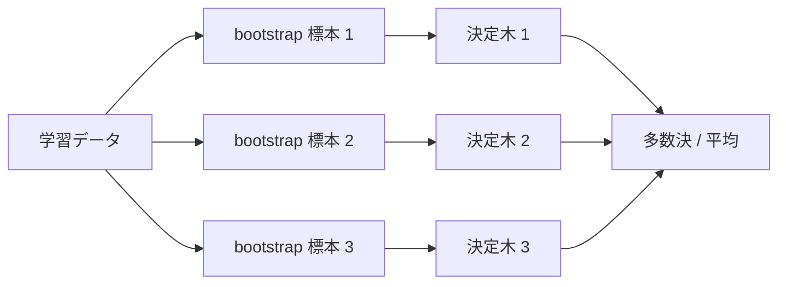

RandomForest は、少しずつ異なるデータで学習した多数の[決定木](../decision-tree/)を平均または多数決で束ねる手法です。単体の深い木は学習データの違いで予測が変わりやすいため、その揺れを平均して安定させます。

各木を異ならせる仕組みは二つあります。復元抽出した行で木を学習する bootstrap と、各分岐で見る列を一部に絞る `max_features` です。本記事では、単体木との安定性の違い、木数の決め方、重要度を読む際の限界を確認します。

<br>

### 予測を安定させる仕組み

1. 学習データの行を復元抽出し、木ごとに少し違う学習集合を作ります。
2. 各分岐では全列ではなく、一部の列だけを候補にします。
3. 分類なら各木の予測を多数決、回帰なら平均して最終予測にします。

bootstrap は列を入れ替える処理ではありません。同じ列を持つまま、行の重複と欠落を許して標本を作る処理です。列の候補もランダムに減らすことで、強い列だけを使う似た木が増えるのを抑えます。



---

### 単体の木と比べる

次の実験では、同じ分類データから 24 種類の bootstrap 標本を作り、単体の深い木と 200 本の木からなる RandomForest を比べます。横軸の箱は標本ごとのテスト精度の分布です。

```python
for seed in range(24):
    indices = np.random.default_rng(seed).choice(len(X_train), len(X_train), replace=True)
    tree = DecisionTreeClassifier(random_state=seed).fit(X_train[indices], y_train[indices])
    forest = RandomForestClassifier(
        n_estimators=200, max_features="sqrt", random_state=seed, n_jobs=1
    ).fit(X_train[indices], y_train[indices])
    tree_scores.append(accuracy_score(y_test, tree.predict(X_test)))
    forest_scores.append(accuracy_score(y_test, forest.predict(X_test)))
```


この乱数列では、単体木より RandomForest の箱が狭くなります。常に精度が上がる保証ではありませんが、木の誤りが完全に同じでなければ平均化で分散を下げられます。[バイアス-バリアンス分解](../bias-variance-tradeoff/) でいう bagging 側の効果です。

---

### 木数を決める

各木の bootstrap 標本に入らなかった行は out-of-bag（OOB）行と呼ばれます。OOB 精度は学習中の木数を増やす目安にできます。ただし最終的な性能を報告する時は、選択に使わなかったテスト集合を別に残します。

```python
model = RandomForestClassifier(
    n_estimators=n_estimators, max_features="sqrt", bootstrap=True,
    oob_score=True, random_state=12, n_jobs=1,
).fit(X_train, y_train)
oob_scores.append(model.oob_score_)
test_scores.append(model.score(X_test, y_test))
```


OOB 精度が安定しても、その値を何度も見て木数を選べば楽観的になります。OOB や [交差検証](../cross-validation/) は開発中の候補選びに使い、最後に一度だけ別のテスト集合で確認します。

---

### 前処理と重要度

木の分岐は「ある列が閾値以下か」という順序比較なので、列内の順序を保つ標準化は通常不要です。[kNN](../knn/) のような距離ベースの手法や、正則化付き線形モデルとは異なります。ただし PCA など別の前処理を組み合わせるなら、その前処理側の要件で[標準化](../standardization/)が必要になります。

`feature_importances_` は分岐で不純度をどれだけ下げたかから作る MDI です。値の種類が多い列は分岐候補も多く、高く見えやすいという偏りがあります。また相関する列は一方だけが分岐に使われ、もう一方が低く見える場合があります。列を崩した時のテスト性能低下を見る permutation importance も併読します。具体的な反例は[特徴量重要度](../feature-importance/)を参照してください。

### 機械学習での使いどころ

- 非線形な境界や列同士の相互作用がある表形式データのベースライン
- 単体木より安定した予測が必要で、推論時間とモデルサイズを許容できる場合
- 重要な列の候補を探し、別の検証で確かめる出発点

### 適さないケース / 落とし穴

- 数百本の木は推論時間とモデルサイズを増やすため、低遅延の用途には向きません。
- scikit-learn の `RandomForestClassifier` はバージョンによって欠損値の扱いが異なります。欠損をそのまま渡せると決め付けず、使用するバージョンの仕様を確認します。
- 多数の木を平均しても、因果関係や単純な IF-THEN 規則を説明できるわけではありません。
- 時系列ではランダムな bootstrap で未来の行を混ぜないよう、分割方法を別途設計します。

図の再現用コードは [GitHub](https://github.com/nao1215/debimate/blob/main/projects/ml/scripts/notes/random-forest_gen.py) にあります。
