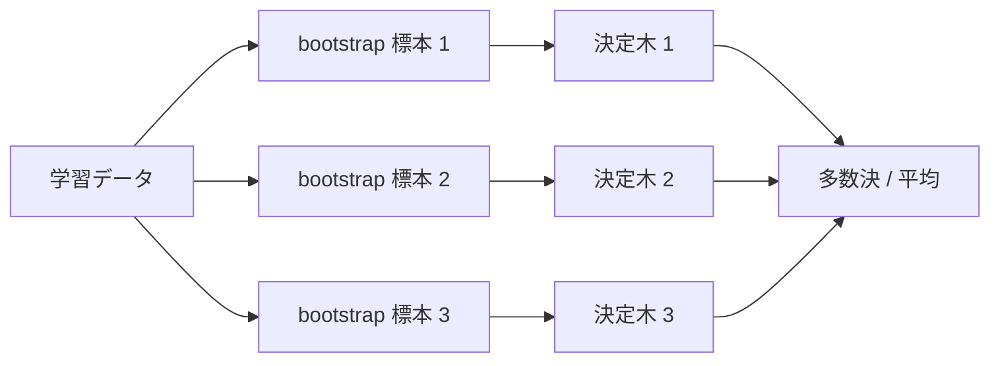
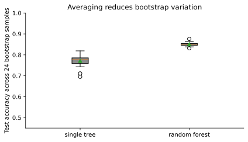
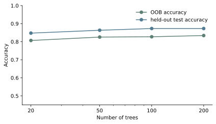

RandomForest は、[Breiman（2001）](https://doi.org/10.1023/A:1010933404324)が提案した、少しずつ異なるデータで学習した多数の[決定木](../decision-tree/)を平均または多数決で束ねる手法です。単体の深い木は学習データの違いで予測が変わりやすいため、その揺れを平均して安定させます。

各木を異ならせる仕組みは二つあります。復元抽出した行で木を学習する bootstrap と、各分岐で見る列を一部に絞る `max_features` です。scikit-learn では [`RandomForestClassifier`](https://scikit-learn.org/stable/modules/generated/sklearn.ensemble.RandomForestClassifier.html) で使え、分類での `max_features` の既定値は列数の平方根（`"sqrt"`）です。本記事では、単体木との安定性の違い、木数の決め方、重要度を読む際の限界を確認します。

<br>

### 予測を安定させる仕組み

1. 学習データの行を復元抽出し、木ごとに少し違う学習集合を作ります。
2. 各分岐では全列ではなく、一部の列だけを候補にします。
3. 分類なら各木の予測を多数決、回帰なら平均して最終予測にします。

bootstrap は列を入れ替える処理ではありません。同じ列を持つまま、行の重複と欠落を許して標本を作る処理です。列の候補もランダムに減らすことで、強い列だけを使う似た木が増えるのを抑えます。



---

### 単体の木と比べる

次の実験では、`make_classification` で作った 900 行・10 列の分類データを学習 585 行とテスト 315 行に分けます。学習データから 24 種類の bootstrap 標本を作り、標本ごとに単体の深い木と 200 本の木からなる RandomForest を学習して、同じテスト集合で精度を測ります。

本節と次節のコードは、[図の生成コード](https://github.com/nao1215/debimate/blob/main/projects/ml/scripts/notes/random-forest_gen.py)から学習の部分だけを抜き出したものです。import、データの作成（`X_train` などの分割）、結果を入れるリストの用意は、生成コードの冒頭にあります。

```python
for seed in range(24):
    indices = np.random.default_rng(seed).choice(len(X_train), len(X_train), replace=True)
    tree = DecisionTreeClassifier(random_state=seed).fit(X_train[indices], y_train[indices])
    forest = RandomForestClassifier(
        n_estimators=200, max_features="sqrt", random_state=seed, n_jobs=1
    ).fit(X_train[indices], y_train[indices])
    tree_scores.append(accuracy_score(y_test, tree.predict(X_test)))
    forest_scores.append(accuracy_score(y_test, forest.predict(X_test)))
```



図の箱は、24 個の標本で得たテスト精度の散らばりです。単体木は平均 0.771（[標準偏差](/ml/math/stddev/) 0.028）で、0.695〜0.819 と 0.1 以上揺れました。RandomForest は平均 0.851（標準偏差 0.010）で 0.832〜0.876 に収まり、24 個の標本すべてで単体木を上回りました。

これは上記の乱数列での結果で、常に精度が上がる保証ではありません。ただし、木の誤りが完全に同じでなければ平均化で分散を下げられます。[バイアス-バリアンス分解](../bias-variance-tradeoff/) でいう [bagging](../ensemble-learning/) 側の効果です。木を並べて平均するのではなく、前の木の誤りを次の木で順に直していく方法が[勾配ブースティング](../gradient-boosting/)です。

---

### 木数を決める

各木の bootstrap 標本に入らなかった行は out-of-bag（OOB）行と呼ばれます。585 行から 585 回復元抽出すると、ある行が一本の木の標本に入らない確率は約 37% です。その行を学習に使わなかった木だけで各行を予測すれば、テスト集合なしで精度を推定できます。これが OOB 精度で、木数を決める目安にできます。ただし最終的な性能を報告する時は、選択に使わなかったテスト集合を別に残します。

```python
model = RandomForestClassifier(
    n_estimators=n_estimators, max_features="sqrt", bootstrap=True,
    oob_score=True, random_state=12, n_jobs=1,
).fit(X_train, y_train)
oob_scores.append(model.oob_score_)
test_scores.append(model.score(X_test, y_test))
```



| 木数 | 20 | 50 | 100 | 200 |
|---|---|---|---|---|
| OOB 精度 | 0.807 | 0.826 | 0.827 | 0.834 |
| テスト精度 | 0.848 | 0.863 | 0.873 | 0.873 |

100 本と 200 本のテスト精度は同じ 0.873 で、この例では 100 本より増やしても精度は上がりませんでした。

OOB 精度は、どの木数でもテスト精度より 0.04 前後低くなりました。理由の一つは、OOB では各行の予測に約 37% の木しか使えないことです。200 本の森でも、1 行あたり平均約 74 本の多数決になります。ただし、各行の予測に 50 本すべてを使う 50 本の森のテスト精度 0.863 も、1 行あたり約 74 本を使う 200 本の森の OOB 精度 0.834 より高いので、使う木の数だけでは差を説明できません。学習 585 行だけで 5 分割の交差検証をすると、OOB とほぼ同じ 0.838 でした。

```python
cv_scores = cross_val_score(
    RandomForestClassifier(n_estimators=200, max_features="sqrt", random_state=12, n_jobs=1),
    X_train, y_train, cv=StratifiedKFold(5, shuffle=True, random_state=12),
)
print(f"{cv_scores.mean():.3f}")  # 0.838
```

差の大半は、315 行のテスト集合の選ばれ方による揺れと考えられます。分割の乱数を変えると、テスト精度が OOB 精度を下回る分割もありました。

OOB 精度が安定しても、その値を何度も見て木数を選べば楽観的になります。OOB や [交差検証](../cross-validation/) は開発中の候補選びに使い、最後に一度だけ別のテスト集合で確認します。

---

### 前処理と重要度

木の分岐は「ある列が閾値以下か」という順序比較なので、列内の順序を保つ標準化は通常不要です。[kNN](../knn/) のような距離ベースの手法や、[正則化](../regularization/)付き線形モデルとは異なります。ただし [PCA](../pca/) など別の前処理を組み合わせるなら、その前処理側の要件で[標準化](../standardization/)が必要になります。

`feature_importances_` は分岐で不純度をどれだけ下げたかから作る MDI です。値の種類が多い列は分岐候補も多く、高く見えやすいという偏りがあります。また相関する列は一方だけが分岐に使われ、もう一方が低く見える場合があります。列を崩した時のテスト性能低下を見る permutation importance も併読します。具体的な反例は[特徴量重要度](../feature-importance/)を参照してください。

---

### 機械学習での使いどころ

- 非線形な境界や列同士の相互作用がある表形式データのベースライン
- 単体木より安定した予測が必要で、推論時間とモデルサイズを許容できる場合
- 重要な列の候補を探し、別の検証で確認する出発点

---

### 適さないケース / 落とし穴

- 推論時間とモデルサイズは木の数と深さに比例して増えます。低遅延の用途では、本数と深さを絞って計測してから選びます。
- scikit-learn の `RandomForestClassifier` が[欠損値](../missing-values/)（NaN）をそのまま扱えるのは [1.4](https://scikit-learn.org/stable/whats_new/v1.4.html) からです。それより古いバージョンでは、欠損を先に埋めます。
- 多数の木を平均しても、因果関係や単純な IF-THEN 規則を説明できるわけではありません。
- [時系列](../time-series-forecasting/)では、学習とテストを時刻で分けます。OOB 精度はランダムに外れた行で測るので、未来の行で学んだ木が過去の行を当てる形になり、本番より高く出ることがあります。

図の再現用コードは [GitHub](https://github.com/nao1215/debimate/blob/main/projects/ml/scripts/notes/random-forest_gen.py) にあります。
