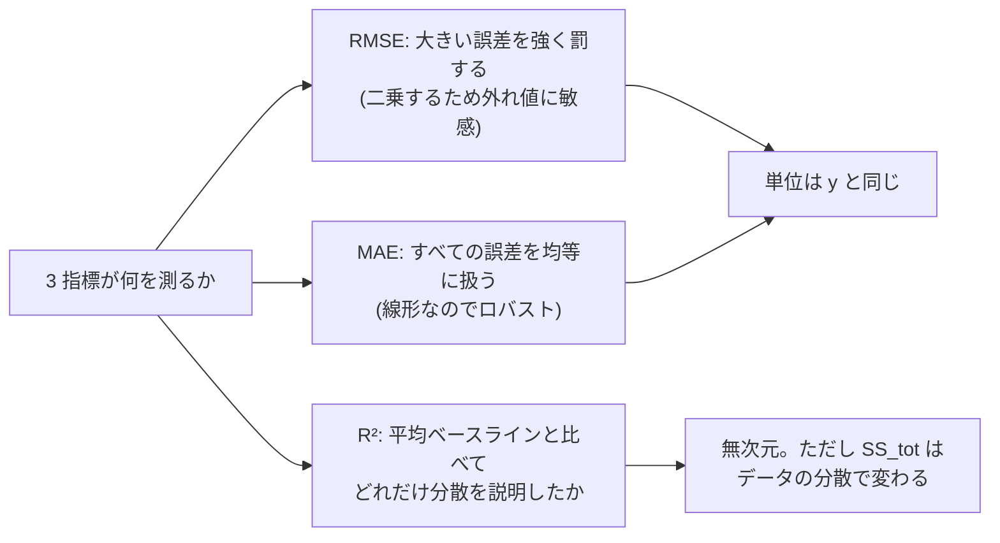
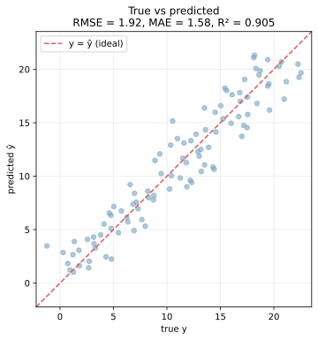
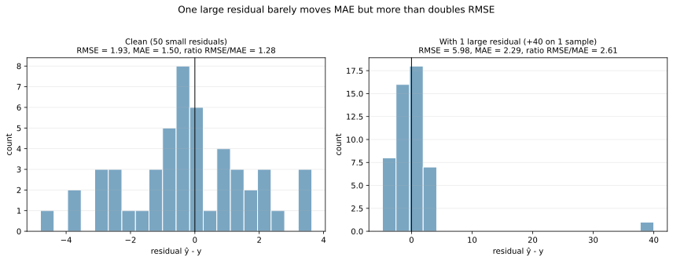
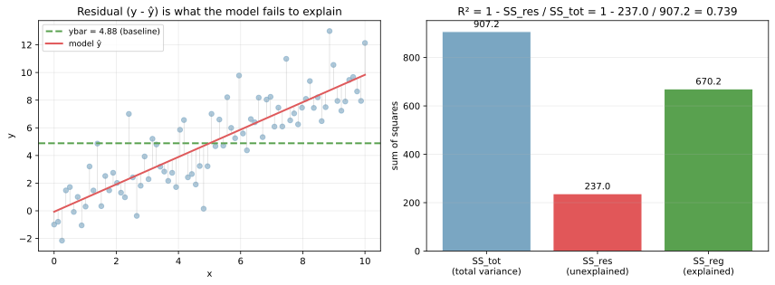
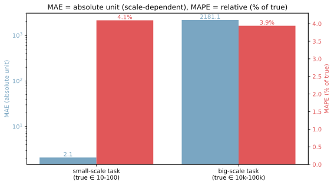

回帰モデルの予測 `ŷ` と正解 `y` のずれを定量化する指標として、RMSE（root mean squared error）、MAE（mean absolute error）、R²（決定係数, coefficient of determination）の 3 つが標準的に使われます。外れ値の扱いや単位、平均値を返すベースラインとの比較方法が異なるため、評価結果には複数の指標を併記します。

[損失関数](../loss-functions/) のノートで触れた通り、学習時の損失関数と評価指標は別に選べます。例えば、MSE で学習したモデルを R² で評価できます。ただし、同じ評価データと同じサンプル重みで測る限り、MSE を小さくするほど R² は大きくなり、両指標によるモデルの順位は一致します。

<br>

本記事では、人工データで 3 指標を計算し、外れ値 1 つやスケールの違いで値がどう動くかを確かめます。後半では、スケールの違うタスクを比べる MAPE と、その落とし穴も扱います。

---

### 3 つの指標の定義

| 指標 | 定義 | 単位 | 範囲 |
|---|---|---|---|
| RMSE | `sqrt((1/n) Σ (y_i - ŷ_i)^2)` | `y` と同じ | `[0, ∞)` |
| MAE | `(1/n) Σ abs(y_i - ŷ_i)` | `y` と同じ | `[0, ∞)` |
| R² | `1 - SS_res / SS_tot` | 無次元 | `(-∞, 1]` |

`SS_res = Σ (y_i - ŷ_i)^2` は残差の二乗和、`SS_tot = Σ (y_i - ȳ)^2` は平均値 `ȳ` からのずれの二乗和（ターゲットの全変動）です。`SS_tot` は「平均値だけを返すベースライン」の誤差に相当します。

R² = 1 で完全一致、R² = 0 で平均値だけを返すベースラインと同等、R² < 0 でベースラインより悪いことを意味します。テストデータで R² が負なら、過学習、訓練時との分布の違い、外挿、特徴量不足、モデルの不適合などを疑います。



---

### 散布図と 3 指標を一度に見る

直線にノイズを乗せたデータを線形回帰で当てはめ、3 指標を計算します。コードは [scikit-learn](https://scikit-learn.org/stable/modules/model_evaluation.html#regression-metrics) 1.9.1、[NumPy](https://numpy.org/) 2.5.4 で実行した計算部分の抜粋で、[Matplotlib](https://matplotlib.org/) の描画を含む[図の生成コード](https://github.com/nao1215/debimate/blob/main/projects/ml/scripts/notes/regression-metrics_gen.py)は GitHub にあります。

2 つ目以降のコードは、最初のコードの `np` と `rng` を続けて使います。乱数を消費する順番で値が変わるので、上から順に実行してください。

```python
import numpy as np
from sklearn.linear_model import LinearRegression
from sklearn.metrics import mean_squared_error, mean_absolute_error, r2_score

rng = np.random.default_rng(0)
x = np.linspace(0, 10, 100)
y = 2 * x + 1 + rng.normal(0, 2, 100)
pred = LinearRegression().fit(x.reshape(-1, 1), y).predict(x.reshape(-1, 1))

print(f"RMSE = {np.sqrt(mean_squared_error(y, pred)):.2f}")
print(f"MAE  = {mean_absolute_error(y, pred):.2f}")
print(f"R²   = {r2_score(y, pred):.3f}")
```

出力:

```text
RMSE = 1.92
MAE  = 1.58
R²   = 0.905
```



赤い破線が `y = ŷ`（完全予測）の対角線で、点がそれにどれだけ近いかが精度の目安です。RMSE と MAE は `y` と同じ単位で「平均してこれくらいズレている」を表し、R² はベースラインを基準とした相対的な良さを表します。

R² が高くても、RMSE が低いとは限りません。上記の例は R² = 0.905 ですが、`y` がおよそ -1〜23 に広がっているから R² が高く出ているのであって、平均して 1.6（MAE）〜1.9（RMSE）のずれは残っています。

---

### RMSE と MAE の違い: 外れ値感度

RMSE は二乗を取るため、大きい残差を重く罰します。外れ値が 1 つ入るだけで、RMSE と MAE は大きく離れます。

```python
y_true = rng.normal(50, 5, 50)
pred_clean = y_true + rng.normal(0, 2, 50)
pred_with_outlier = pred_clean.copy()
pred_with_outlier[0] = y_true[0] + 40  # 1 つだけ大きく外す

print(f"clean: RMSE = {np.sqrt(((y_true - pred_clean)**2).mean()):.2f}, "
      f"MAE = {np.abs(y_true - pred_clean).mean():.2f}")
print(f"outlier: RMSE = {np.sqrt(((y_true - pred_with_outlier)**2).mean()):.2f}, "
      f"MAE = {np.abs(y_true - pred_with_outlier).mean():.2f}")
```

出力:

```text
clean: RMSE = 1.93, MAE = 1.50
outlier: RMSE = 5.98, MAE = 2.29
```



クリーンなデータでは RMSE と MAE の比は 1.28 で、正規分布の理論値 `√(π/2) ≈ 1.25` に近い値です。50 点のうち 1 点を外しただけで RMSE は 3.10 倍に膨らむのに対し、MAE は 1.52 倍にしか動きません。比も 2.61 まで上がります。

RMSE と MAE の比が約 1.25 より大きい場合、一部に大きな残差があると疑う材料になります。しかし、この比だけで外れ値の存在を断定することはできません。裾の重い誤差分布、異分散、一部セグメントだけでの大きな予測失敗でも比は大きくなります。

実務での選び分け:

- 大きく外す予測を絶対に避けたい → RMSE を見る（例: 在庫切れを起こすと致命的な需要予測）
- 典型的な誤差幅を素直に伝えたい → MAE を見る（例: ユーザーへの予測誤差レポート）

---

### R² の意味: 分散を「何割説明したか」

`R² = 1 - SS_res / SS_tot` の `SS_tot` は「何もしない場合の誤差」、`SS_res` は「モデルが残した誤差」で、その比が小さいほど R² は 1 に近づきます。以下のコードでは、予測値が平均値から動いた分の二乗和 `SS_reg`（モデルが説明した変動）も計算します。

```python
x3 = np.linspace(0, 10, 80)
y3 = 1.0 * x3 + rng.normal(0, 1.5, 80)
m3 = LinearRegression().fit(x3.reshape(-1, 1), y3)
pred3 = m3.predict(x3.reshape(-1, 1))

ybar = y3.mean()
SS_tot = ((y3 - ybar) ** 2).sum()
SS_res = ((y3 - pred3) ** 2).sum()
SS_reg = ((pred3 - ybar) ** 2).sum()  # explained
print(f"R² = 1 - {SS_res:.1f} / {SS_tot:.1f} = {1 - SS_res / SS_tot:.3f}")
```

出力:

```text
R² = 1 - 237.0 / 907.2 = 0.739
```



左の図の緑の破線が平均値だけを返すベースライン、赤線がモデルの予測、灰色の縦線が残差です。右の棒グラフでは `SS_reg + SS_res = 670.2 + 237.0 = 907.2 = SS_tot` が成り立っています。この分解は切片ありの最小二乗法（OLS）で当てはめた時に成り立ち、その場合 R² は `SS_reg / SS_tot` とも書けます。

R² は無次元ですが、`SS_tot` が評価データの分散で決まるので、別のデータ集合で測った R² を並べても比較になりません（[scikit-learn のドキュメント](https://scikit-learn.org/stable/modules/model_evaluation.html#r2-score-the-coefficient-of-determination)にも同じ注意があります）。

また、訓練データで測る R² は特徴量を増やすほど上がります。特徴量数で補正した指標として、`adjusted R²`（自由度調整済み決定係数）も使われます。

---

### MAPE: 相対誤差 (%) で比較する

MAE は単位を持つため、`y` のスケールが極端に違うタスク間で比較できません。例えば、「気温予測の MAE = 1.0」と「売上予測の MAE = 1000」は字面では比べられません。MAPE（mean absolute percentage error）は誤差を `y` の何 % かに変換します。

`MAPE = (1/n) Σ |y_i - ŷ_i| / |y_i| × 100`

```python
small_true = rng.uniform(10, 100, 100)
small_pred = small_true * (1 + rng.normal(0, 0.05, 100))
big_true = rng.uniform(10000, 100000, 100)
big_pred = big_true * (1 + rng.normal(0, 0.05, 100))

for name, yt, yp in [("small", small_true, small_pred), ("big", big_true, big_pred)]:
    mae = np.abs(yt - yp).mean()
    mape = np.mean(np.abs((yt - yp) / yt)) * 100
    print(f"{name}: MAE = {mae:.2f}, MAPE = {mape:.2f}%")
```

出力:

```text
small: MAE = 2.09, MAPE = 4.09%
big: MAE = 2181.15, MAPE = 3.94%
```



両方とも、正解に標準偏差 5% の相対ノイズを乗せたデータです。MAE は規模に比例して 2.09 → 2181 と約 1000 倍になるのに対し、MAPE は 4.09% と 3.94% でほぼ揃います。どちらも、正規分布の絶対値の平均から求まる `5% × √(2/π) ≈ 3.99%` の近くです。

スケールの違うタスクを横断比較するなら MAPE が便利です。ただし、いくつかの落とし穴があります。

- `y` が 0 に近いサンプルでは `|y_i|` で割った値が非常に大きくなり、`y_i = 0` では定義できない
- 予測の上振れと下振れを非対称に評価する（`y = 100, ŷ = 50` のずれ率は 50%、`y = 50, ŷ = 100` は 100%）

scikit-learn の `mean_absolute_percentage_error` は、分母が 0 の時に小さな正の数で割ります。そのため、`mean_absolute_percentage_error([0, 1], [1, 1])` はエラーにならず約 `2.25e15` を返します。

ちなみに、戻り値は 100 を掛ける前の比率で、上記の small のデータでは `0.0409` です。

これらを避けたい場合は、SMAPE（symmetric MAPE）や WAPE（weighted absolute percentage error、誤差の合計を実測値の合計で割る指標）、RMSLE（root mean squared log error）を使います。

---

### 数学での使いどころ

- 統計モデルの当てはまりの良さ: [線形回帰](/ml/ml/linear-regression/)の R²、一般化線形モデルの疑似 R²
- 残差分析: RMSE と MAE の比で分布の特性を診断
- [時系列予測](/ml/ml/time-series-forecasting/): RMSE / MAE / MAPE / SMAPE / [MASE](https://otexts.com/fpp3/accuracy.html)（時系列専用）の使い分け

---

### 機械学習での使いどころ

- モデル選択: 同じテストデータで複数モデルの RMSE / MAE / R² を比較。説明変数の追加前後の R² の差も見る
- [ハイパーパラメータ](/ml/ml/hyperparameter/)探索: [交差検証](../cross-validation/) で `cv_results_` の `mean_test_score` を比較
- 学習曲線: 訓練と検証の RMSE を訓練データ量に対してプロット（[バイアス-バリアンス分解](../bias-variance-tradeoff/)）
- 異常検知: 「予測 ± `k × RMSE`」を正常範囲として、外れる予測を要注意としてフラグ

scikit-learn の対応関数:

- `mean_squared_error(y, ŷ)`、`root_mean_squared_error(y, ŷ)`（RMSE。`squared=False` は [scikit-learn 1.4](https://scikit-learn.org/stable/whats_new/v1.4.html) で非推奨、1.6 で削除）
- `mean_absolute_error(y, ŷ)`
- `r2_score(y, ŷ)`
- `mean_absolute_percentage_error(y, ŷ)`（v0.24+。戻り値は % ではなく比率）

---

### 適さないケース / 落とし穴

- R² の値だけで「良いモデル」と判断する: R² 0.9 でも RMSE が運用上許容できないことがある。必ず単位付きの誤差も併記する
- スケールが違うタスクで RMSE 比較: `y` の範囲が違うので無意味。MAPE や MASE で比較する
- 訓練データで R² を見る: 過学習を見落とす。必ず別データ（テスト or 交差検証）で評価する
- 外れ値が支配的な場合に RMSE だけ: 1 つの外れ値が指標を歪める。MAE と RMSE/MAE 比を併記する
- 値が一部の範囲に偏った目的変数で R²: 多数を占める範囲のサンプルに引きずられる。重み付き評価やセグメント別評価を検討する
- 単位の違う複数の時系列を RMSE で横並び比較: 系列ごとに単位も難しさも違う。素朴な予測（1 つ前の時点の値）の誤差で割る MASE を使う
- MAPE で `y_i = 0` のサンプル: 定義できないので除外するか、SMAPE / WAPE に切り替える
- 評価指標と学習目的の不一致: MSE で学習して MAE で評価すると、MSE で最良のモデルが MAE でも最良とは限らない。揃えるか、中央値を予測する分位回帰（分位 0.5）で MAE を直接最小化する
- 「R² = 0.95 だから良い」「R² = 0.5 だから悪い」の絶対判定: タスクの難易度・データの SNR（signal-to-noise ratio、信号対雑音比）で R² の良し悪しは変わる。同じタスクの過去モデルや baseline との比較で見る