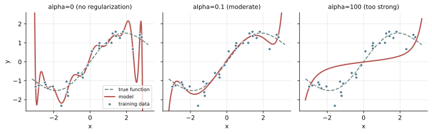
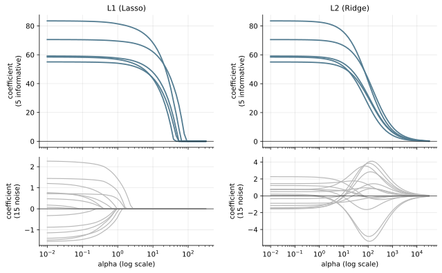

正則化（regularization）は、[過学習](../overfitting/)を抑えるためにモデルの「複雑さ」へペナルティを課す仕組みです。
学習時に最小化する[損失関数](/ml/ml/loss-functions/)に、パラメータの大きさを表す項を足すことで、極端に大きな重みを持つモデルが選ばれにくくなります。

ペナルティの形によって主に L2（リッジ）、L1（ラッソ）、L1 と L2 の組み合わせ（Elastic Net）に分かれます。

- L2: `loss = 通常の誤差 + alpha * sum(w_i ^ 2)`
- L1: `loss = 通常の誤差 + alpha * sum(|w_i|)`

`alpha` は正則化の強さを決める[ハイパーパラメータ](../hyperparameter/)。`alpha` が大きいほど、係数の大きさに対するペナルティが増えます。`alpha=0` は正則化なし（通常の最小二乗）と同じ。

---

### 正則化が効く様子

意図的に過学習しやすい設定（多項式の次数 15）に L2 正則化をかけ、`alpha` を変えた 3 例です。



- `alpha=0`: 訓練点をなぞる暴れた曲線 = [過学習](../overfitting/)
- `alpha=0.1`: 両端を除いて破線の真の関数にほぼ沿う、ちょうど良い状態
- `alpha=100`: 正則化が強すぎて曲線が平らに潰れ、データの山と谷を捉えきれない = 未学習

`alpha` を強めるほどバリアンスが減ってバイアスが増える関係は、[バイアス-バリアンス分解](../bias-variance-tradeoff/)で式として扱えます。`alpha` 自体も[交差検証](../cross-validation/)で選ぶのが基本です。「正則化を入れれば過学習しない」のではなく「適切な `alpha` を選んで初めて効く」点に注意します。

---

### L1 と L2 の違い

両方とも `alpha` を大きくすると係数が 0 に近づきます。ただし、近づけ方が違います。次の図は、次節のコードと同じデータ（20 個の特徴量のうち y に効くのは 5 個）で、`alpha` ごとの係数を追ったものです。上段が効く 5 個、下段が効かない 15 個です。



- L1（左, Lasso）: 効かない 15 個は `alpha` が 3 付近までに全て 0 ちょうどになり、効く 5 個だけが残る。「[特徴量を選別する](../feature-selection/)」効果がある
- L2（右, Ridge）: 係数は 0 ちょうどにはならない。縮み方も係数ごとに違い、下段では `alpha=100` 付近で効かない特徴量の係数が一時的に ±5 近くまで膨らむ

L2 が全ての係数を同じ比率で縮めるのは、特徴量同士が[無相関](/ml/math/correlation/)で分散も揃っている特殊な場合だけです。この例では、効く 5 個の係数が縮んで y を説明しきれなくなり、訓練データ上で偶然わずかに相関していた効かない特徴量の係数が代わりに大きくなっています。

横軸の範囲が左右で違うのは、[scikit-learn の Lasso](https://scikit-learn.org/stable/modules/generated/sklearn.linear_model.Lasso.html) だけが誤差を `1 / (2 * n_samples)` 倍してからペナルティを足すためです（[Ridge](https://scikit-learn.org/stable/modules/generated/sklearn.linear_model.Ridge.html) はそのまま）。

使い分けの目安:

- 特徴量がたくさんあって、本当に効いている数個に絞りたい（[次元の呪い](../curse-of-dimensionality/) 対策にも有効） → L1
- 全ての特徴量に少しずつ影響があってほしい、計算が安定する方が良い → L2
- どちらを取るか決め切れない → Elastic Net（L1 と L2 の混合）

---

### Python での実例

scikit-learn では正則化はモデルクラスとして用意されています。回帰なら `Ridge` / `Lasso`、[ロジスティック回帰](../logistic-regression/)なら `LogisticRegression` の `penalty` 引数で指定します。

```python
import numpy as np
from sklearn.datasets import make_regression
from sklearn.linear_model import Ridge, Lasso, LinearRegression
from sklearn.model_selection import train_test_split

# 20 個の特徴量のうち y に効くのは 5 個だけ。coef=True で正解の係数も受け取る
X, y, true_coef = make_regression(n_samples=200, n_features=20, n_informative=5,
                                  noise=15, random_state=0, coef=True)
X_tr, X_te, y_tr, y_te = train_test_split(X, y, test_size=0.3, random_state=0)
print("informative:", np.flatnonzero(true_coef))

for label, model in [
    ("LinearRegression", LinearRegression()),
    ("Ridge alpha=1", Ridge(alpha=1.0)),
    ("Lasso alpha=1", Lasso(alpha=1.0)),
    ("Lasso alpha=3", Lasso(alpha=3.0)),
]:
    model.fit(X_tr, y_tr)
    kept = np.flatnonzero(model.coef_)
    print(f"{label:16s} test R^2: {model.score(X_te, y_te):.3f}  nonzero coefs: {len(kept):2d}/20")
    if len(kept) < 20:
        print(f"{'':16s} kept: {kept}")
```

[scikit-learn](https://scikit-learn.org/) 1.9.1 での出力:

```text
informative: [ 0 13 16 17 18]
LinearRegression test R^2: 0.992  nonzero coefs: 20/20
Ridge alpha=1    test R^2: 0.992  nonzero coefs: 20/20
Lasso alpha=1    test R^2: 0.993  nonzero coefs: 10/20
                 kept: [ 0  1  3  6  7 12 13 16 17 18]
Lasso alpha=3    test R^2: 0.990  nonzero coefs:  5/20
                 kept: [ 0 13 16 17 18]
```

`alpha=1` の Lasso が残した 10 個には、効かない 5 個（1, 3, 6, 7, 12 番）が混ざっています。`alpha=3` まで強めると、正解を教えていないのに効く 5 個だけが残り、テストの R^2 はほぼ変わりません。どこまで絞れるかは `alpha` 次第です。なお、`make_regression` の特徴量は最初から平均 0・分散 1 なので、[標準化](../standardization/)を省いています。

[図と数値の生成コード](https://github.com/nao1215/debimate/blob/main/projects/ml/scripts/notes/regularization_gen.py)は GitHub で公開しています。

---

### 機械学習での使いどころ

正則化が組み込まれている代表的なモデル:

- [線形回帰](/ml/ml/linear-regression/): Ridge（L2）、Lasso（L1）、Elastic Net
- [ロジスティック回帰](../logistic-regression/): `penalty='l1'` / `'l2'` / `'elasticnet'`
- [SVM](../svm/)（support vector machine、サポートベクターマシン）: `C` パラメータ（C が小さいほど正則化が強い）
- ニューラルネット: weight decay（[SGD](/ml/math/gradient-descent-sgd/) では L2 と同じ。Adam では一致しないため [AdamW](https://arxiv.org/abs/1711.05101) が分けて扱う）、dropout、batch normalization
- [GradientBoosting](../gradient-boosting/) の実装である [XGBoost](https://xgboost.readthedocs.io/en/stable/parameter.html)・[LightGBM](https://lightgbm.readthedocs.io/en/stable/Parameters.html): `reg_alpha`（L1）、`reg_lambda`（L2）、`min_child_weight` など

[決定木](../decision-tree/)そのものに「正則化項」はありません。その代わり、`max_depth` を小さくする、`min_samples_leaf` を大きくするといった木の成長の制限が、事実上の正則化として働きます。[RandomForest](../random-forest/) や GradientBoosting でハイパーパラメータを絞ることは、概念上は正則化と同じことをしています。

---

### 正則化を効かせる前に確認すること

- 特徴量がスケーリングされているか: L1/L2 はパラメータの大きさにペナルティを課すので、特徴量のスケールが揃っていないと一部の特徴ばかり罰せられる。前段に[標準化](../standardization/)（StandardScaler）を入れるのが基本
- `alpha` を 1 つ決め打ちで使っていないか: 適切な値はデータ依存。[交差検証](../cross-validation/)で複数候補を試して選ぶ
- 過学習の原因がモデル側にあるか: [データのリーク](../data-leakage/)や評価方法の問題（テストデータの使い回し）が原因なら、正則化を強めても解決しない

---

### 適さないケース

- 訓練データが圧倒的に多く、モデルが単純で過学習していない場面: 正則化の効果は小さく、強くかけると性能を落とす
- 解釈性が必要で、特徴量の生の係数を見たい場面: 正則化で縮められた係数は「特徴量の真の影響度」とは別物
- `alpha` の候補を試す時間や計算資源が無い場面: 適切な `alpha` を選ばないと効かないので、決め打ちで導入するのは慎重に
