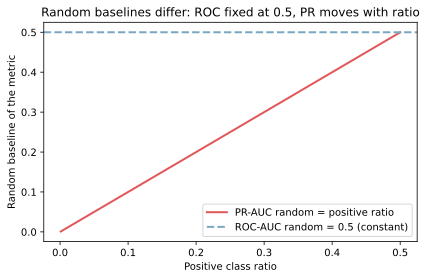
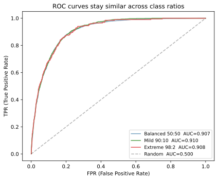
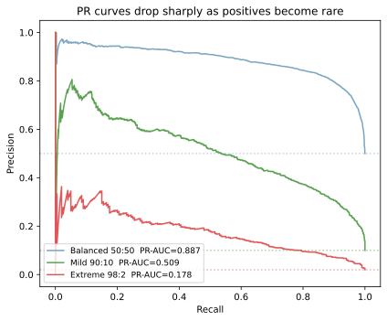
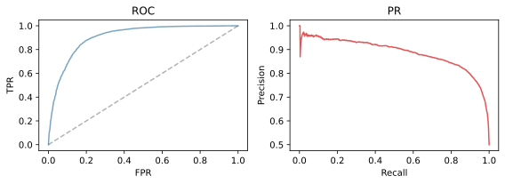

ROC-AUC（Receiver Operating Characteristic - Area Under the Curve）と PR-AUC（Precision-Recall - Area Under the Curve）は、二値分類モデルの性能を「閾値に依存せず」 1 つの数で比較するための指標です。両者は同じ予測スコアから計算できます。ただし、不均衡データ（陽性クラスが極端に少ないデータ）における振る舞いが大きく違うため、目的によって使い分けます。

ROC-AUC は、陽性と陰性の比率が変わっても値がほとんど変わりません。そのため、陽性が少ないデータで「陽性と判定した中に誤検知がどれだけ混ざるか」は ROC-AUC から読み取れず、PR-AUC を併用します。詳しい対処手段は [クラス不均衡](../class-imbalance/) のノートで扱います。

---

### 何を測っているか

ROC-AUC と PR-AUC は、いずれもモデルが出した「陽性である確率」 (`y_score`) を真のラベル (`y_true`, 0/1) と突き合わせて、閾値 `t` を 1.0 から 0.0 まで動かしながら点を打って描いた曲線を 1 つの数にまとめたものです。閾値 1 つにつき次の 4 つの値が決まります。

- `TPR(t) = TP / (TP + FN)` ＝ 真陽性率（Recall とも呼ぶ）。陽性のうち捕まえた割合
- `FPR(t) = FP / (FP + TN)` ＝ 偽陽性率。陰性のうち誤って陽性と判定した割合
- `Precision(t) = TP / (TP + FP)` ＝ 陽性と判定したうち本当に陽性の割合
- `Recall(t) = TPR(t)` ＝ TPR と同じ

ここでの TP / FP / TN / FN は[混同行列](../confusion-matrix/)の 4 マスに対応します。閾値を下げると TP と FP の両方が増え、上げると両方が減ります。

---

### ROC / PR 曲線の作り方

予測確率の閾値 `t` を 1.0 → 0.0 へ少しずつ下げながら、各 `t` で次の 1 点を打って線でつなぎます。

- ROC: 点 `( FPR(t), TPR(t) )` を打ち続けたもの
- PR:  点 `( Recall(t), Precision(t) )` を打ち続けたもの

両端は固定されます。

- `t = 1.0`（誰も陽性と判定しない）: ROC は原点 (0, 0)、PR は左上 (0, 1) 付近
- `t = 0.0`（全員陽性と判定）: ROC は右上 (1, 1)、PR は右下 (1, 陽性比率)

ROC は左上に寄るほど良く（TPR が高く FPR が低い）、PR は右上に寄るほど良いです（Recall と Precision の両方が高い）。ROC-AUC は ROC 曲線の下の面積で、陽性と陰性を 1 件ずつ無作為に選んだ時に陽性の方が高いスコアを持つ確率に等しくなります（[Fawcett 2006](https://doi.org/10.1016/j.patrec.2005.10.010)）。

PR-AUC と呼ばれる値には、計算方法が 2 通りあります。

- 平均適合率（AP: Average Precision）: 閾値ごとに Recall の増分とその閾値の Precision を掛けて足す。`AP = Σ (R_n − R_{n−1}) P_n`。scikit-learn の [`average_precision_score`](https://scikit-learn.org/stable/modules/generated/sklearn.metrics.average_precision_score.html) が計算するのは AP
- 台形則: `precision_recall_curve` の点を直線でつなぎ、`auc(recall, precision)` で面積を出す

scikit-learn のドキュメントは、直線で補間する台形則は楽観的な値になり得ると説明しています。2 つの値は一致せず、後述の実験の陽性 2% のデータでは AP が 0.178、台形則が 0.175 でした。4 件のサンプル（`y_true=[0, 0, 1, 1]`、`y_score=[0.1, 0.4, 0.35, 0.8]`）では 0.833 と 0.792 まで開きます。本記事の PR-AUC は AP を指します。値を比べる時は計算方法を揃えます。

---

### ROC-AUC と PR-AUC のランダム基準

ランダム予測の基準値は、ROC-AUC と PR-AUC で異なります。

- ROC-AUC のランダム基準: 常に `0.5`。クラス比率に依存しない
- PR-AUC（AP）のランダム基準: 陽性比率に等しい。陽性が 2% なら 0.02、50% なら 0.5

つまり、PR-AUC の値は陽性比率を添えないと読めません。陽性 2% のデータで PR-AUC=0.2 ならランダム (0.02) を上回り、スコアが陽性を上位へ寄せていることは分かります。陽性 50% のデータで同じ 0.2 なら、無作為に並べる (0.5) より悪い順位付けです。ただし、ランダムの何倍かは採用の基準になりません。採用できるかは、運用で必要な Recall での Precision や、今使っているモデルとの比較で決めます。

以下の図は両者のランダム基準を陽性比率の関数として描いたものです。ROC-AUC が常に 0.5 で水平なのに対し、PR-AUC は陽性比率に沿って斜めに動きます。



---

### 陽性比率だけを変える実験

不正検知（陽性 1〜2%）や稀少疾患診断（陽性 0.1% 未満）のように陽性が少ない場面でも、モデルの順位付けが同じなら ROC-AUC は同じ値になります。FPR の分母は陰性の総数 `(FP + TN)` なので、陰性が増えると FP も陰性の件数に比例して増え、FPR は変わらないからです。一方 Precision `TP / (TP + FP)` は TP と FP の件数を直接比べるので、陰性が増えて FP の件数が増えれば下がります。

これを確かめるため、50:50 のデータで学習した[ロジスティック回帰](../logistic-regression/)のスコアから、陽性比率 50%・10%・2% の 3 種類のデータを 10,000 件ずつ取り直します。モデルとスコアは同じで、変えたのは陽性比率だけです。図の凡例の 90:10 は陰性 90%・陽性 10% を表します。



ROC 曲線は 3 本ともほぼ重なり、ROC-AUC はすべて 0.91 前後です。モデルの判別性能が変わっていないので、これは当然です。

以下は [scikit-learn](https://scikit-learn.org/) 1.9.1、[NumPy](https://numpy.org/) 2.5.4 で実行したコードです。図は軸ラベルとタイトルを足した[生成コード](https://github.com/nao1215/debimate/blob/main/projects/ml/scripts/notes/roc-pr-auc_gen.py)で描いています。

```python
import numpy as np
import matplotlib.pyplot as plt
from sklearn.datasets import make_classification
from sklearn.linear_model import LogisticRegression
from sklearn.metrics import roc_curve, roc_auc_score


def base_dataset(seed=0):
    X, y = make_classification(
        n_samples=40_000, n_features=10, n_informative=5,
        weights=[0.5, 0.5], flip_y=0.02, class_sep=1.0, random_state=seed,
    )
    model = LogisticRegression(max_iter=1000).fit(X, y)
    return y, model.predict_proba(X)[:, 1]


def subsample(y_all, scores_all, pos_ratio, n_total=10_000, seed=0):
    rng = np.random.default_rng(seed)
    n_pos = int(n_total * pos_ratio)
    pos_idx = np.where(y_all == 1)[0]
    neg_idx = np.where(y_all == 0)[0]
    pick = np.concatenate([
        rng.choice(pos_idx, n_pos, replace=False),
        rng.choice(neg_idx, n_total - n_pos, replace=False),
    ])
    return y_all[pick], scores_all[pick]


y_all, scores_all = base_dataset()
plt.figure(figsize=(6, 5))
for ratio, name, color in [(0.5, "50:50", "#7aa6c2"),
                           (0.1, "90:10", "#59a14f"),
                           (0.02, "98:2", "#e15759")]:
    y, s = subsample(y_all, scores_all, ratio)
    fpr, tpr, _ = roc_curve(y, s)
    plt.plot(fpr, tpr, color=color,
             label=f"{name}  AUC={roc_auc_score(y, s):.3f}")
plt.plot([0, 1], [0, 1], "k--", alpha=0.3)
plt.legend(); plt.tight_layout()
plt.savefig("roc-pr-auc_roc_imbalance.svg", bbox_inches="tight")
```

同じデータに対する PR 曲線が次の図です。点線は各陽性比率のランダム基準です。



PR-AUC は 50:50 で 0.887、90:10 で 0.509、98:2 で 0.178 と大きく下がります。

```python
from sklearn.metrics import precision_recall_curve, average_precision_score

plt.figure(figsize=(6, 5))
for ratio, name, color in [(0.5, "50:50", "#7aa6c2"),
                           (0.1, "90:10", "#59a14f"),
                           (0.02, "98:2", "#e15759")]:
    y, s = subsample(y_all, scores_all, ratio)
    precision, recall, _ = precision_recall_curve(y, s)
    plt.plot(recall, precision, color=color,
             label=f"{name}  PR-AUC={average_precision_score(y, s):.3f}")
    plt.axhline(ratio, color=color, linestyle=":", alpha=0.5)
plt.legend(); plt.tight_layout()
plt.savefig("roc-pr-auc_pr_imbalance.svg", bbox_inches="tight")
```

PR-AUC が下がる理由は、陽性の 80% を拾う閾値で件数を数えると分かります。

```python
for ratio in [0.5, 0.1, 0.02]:
    y, s = subsample(y_all, scores_all, ratio)
    t = np.quantile(s[y == 1], 0.2)  # 陽性の 80% がこの値以上
    pred = s >= t
    tp = (pred & (y == 1)).sum()
    fp = (pred & (y == 0)).sum()
    print(f"{ratio:.0%}: t={t:.3f} TP={tp} FP={fp} "
          f"FPR={fp / (y == 0).sum():.3f} Precision={tp / (tp + fp):.3f}")
```

```text
50%: t=0.564 TP=4000 FP=739 FPR=0.148 Precision=0.844
10%: t=0.562 TP=800 FP=1347 FPR=0.150 Precision=0.373
2%: t=0.553 TP=160 FP=1501 FPR=0.153 Precision=0.096
```

FPR は 3 つとも 0.15 前後で、ROC 曲線上ではほぼ同じ点です。しかし陽性 2% のデータでは、陽性と判定した 1,661 件のうち本当の陽性は 160 件しかなく、Precision は 0.096 です。陽性と判定した 10 件のうち 9 件は誤検知で、判定結果を人が 1 件ずつ確認する運用なら作業の大半が空振りになります。ROC-AUC は不均衡だから高く出るのではなく、陽性比率で変わらないので、この Precision の低下が値に出ません。PR-AUC は同じ低下を 0.887 → 0.178 として示します。

---

### 使い分けの判断

主指標は、陽性比率の数字で機械的に決めるより、何を知りたいかで決めます。

- 陽性と判定した中にどれだけ誤検知が混ざるかが問題になる（不正検知で判定結果を人が確認する、など）: PR-AUC を見る。評価データと運用で陽性比率が同じかも確かめる
- 陽性比率が違うデータどうしで、モデルの順位付けの良さを比べたい（期間や地域で陽性比率が変わる、など）: ROC-AUC を見る
- どちらも 1 つの数への要約なので、最後は運用で使う閾値での Precision と Recall を確認する

陽性比率は `y.mean()` で確かめ、PR-AUC を報告する時は陽性比率を添えます。[Saito & Rehmsmeier (2015)](https://doi.org/10.1371/journal.pone.0118432) も、不均衡データの評価では PR 曲線の方が ROC 曲線より多くの情報を与えると報告しています。

---

### AUC と曲線の役割の違い

AUC（数値）と曲線（形）は目的が違うので混同しないようにします。

- AUC はモデルどうしを比較するための指標。「モデル A と B のどちらが全閾値で平均的に強いか」を 1 つの数で表す。閾値の選定には使わない
- 曲線そのものは、運用上の閾値を決めるために使う。「誤検知 (FPR) を 5% までに抑えたい」のような制約がある時、曲線上で制約を満たす点を探し、その点に対応する閾値を採用する。見逃しを減らしたいなら Precision の下限を決めて Recall を最大化し、誤検知のコストが高いなら Precision を高めに固定して Recall を見る

つまり、「モデル選定 → AUC」「閾値選定 → 曲線」と覚えると整理しやすいです。

---

## Python での実例

実装そのものは scikit-learn の関数で完結します。基本的な ROC 曲線と PR 曲線の描画は次の通りです。`y_true` と `y_score` には、陽性比率を変える実験の `subsample` で作った 50:50 のデータを使います。

```python
from sklearn.metrics import (
    roc_auc_score,
    average_precision_score,
    roc_curve,
    precision_recall_curve,
)

y_true, y_score = subsample(y_all, scores_all, 0.5)

roc = roc_auc_score(y_true, y_score)
pr = average_precision_score(y_true, y_score)
print(f"ROC-AUC: {roc:.3f}")
print(f"PR-AUC: {pr:.3f}")

fpr, tpr, _ = roc_curve(y_true, y_score)
precision, recall, _ = precision_recall_curve(y_true, y_score)

fig, axes = plt.subplots(1, 2, figsize=(8, 3))
axes[0].plot(fpr, tpr, color="#7aa6c2")
axes[0].plot([0, 1], [0, 1], "k--", alpha=0.3)
axes[0].set_title("ROC")
axes[0].set_xlabel("FPR")
axes[0].set_ylabel("TPR")
axes[1].plot(recall, precision, color="#e15759")
axes[1].set_title("PR")
axes[1].set_xlabel("Recall")
axes[1].set_ylabel("Precision")
plt.tight_layout()
plt.savefig("roc-pr-auc_curves.svg", bbox_inches="tight")
```

出力:

```text
ROC-AUC: 0.907
PR-AUC: 0.887
```



`y_score` はモデルが出す確率（あるいは確率に変換できるスコア）で、scikit-learn なら `model.predict_proba(X)[:, 1]` で得られます。`model.predict(X)` ではなく確率を渡すのが要点です。`predict` の結果は閾値 0.5 で打ち切った 0/1 ラベルなので、ROC 曲線は (0, 0)・閾値 0.5 の点・(1, 1) の 3 点を結んだ折れ線になります。上記のデータで 0/1 ラベルを渡すと ROC-AUC は 0.836 で、確率を渡した時の 0.907 より低く出ます。

---

### 数学での使いどころ

- 二値分類の識別性能の要約（閾値非依存）
- モデル比較で「全体的にどちらが強いか」を 1 つの数で示す
- 確率予測の校正度合いとは別の軸（識別の良さは AUC、確率値そのものの正しさは Brier Score など）

---

### 機械学習での使いどころ

二値分類では、用途に応じて ROC-AUC と PR-AUC のどちらを主指標にするかを選びます。

- 不正取引検知・稀少疾患診断のように陽性が少なく、陽性と判定した後に人が確認する用途: PR-AUC を主に見て、必要な Recall での Precision も確認する
- 複数モデルのオフライン比較: AUC のばらつきを[交差検証](../cross-validation/)で押さえる

---

### 適さないケース

- 多クラス分類: One-vs-Rest / One-vs-One のどちらで集計するかが必要。`macro` / `micro` / `weighted` の選択にも注意
- 確率値そのものの校正を評価したい場合: AUC は順位だけ見るので、確率値が真の頻度と合っているかは別途 Brier Score / Calibration Plot で確認する
- コストが閾値で大きく変わる場合: AUC は閾値非依存なので、コスト構造を反映した指標（Expected Cost / utility）が望ましい
- データが極端に少ない場合: 曲線がギザギザになり AUC が不安定。[交差検証](../cross-validation/)で平均と[標準偏差](../../math/stddev/)を出すと判断しやすい
