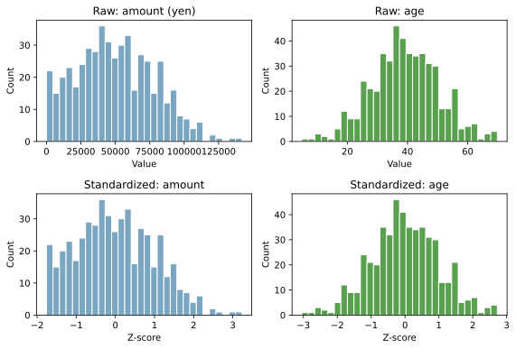
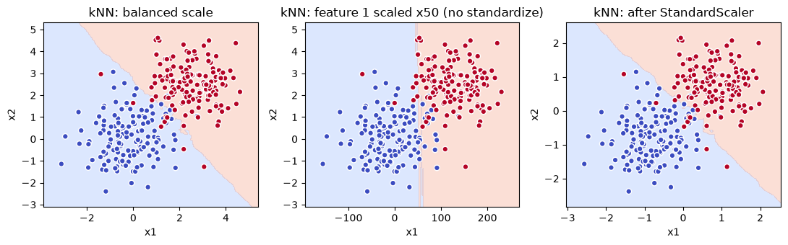
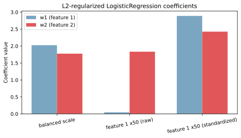
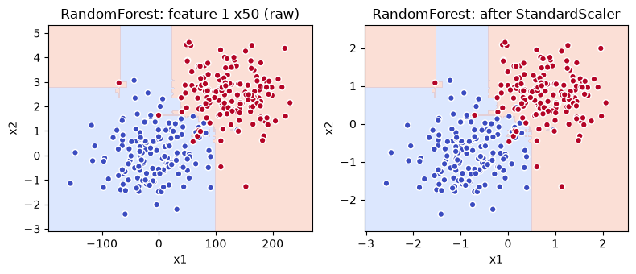

特徴量スケーリングは、複数の特徴量のスケール（値の取り得る範囲・分散）を揃える前処理です。代表は標準化（standardization, Z-score）と正規化（normalization, Min-Max）の 2 つで、[scikit-learn](https://scikit-learn.org/stable/) ではそれぞれ [`StandardScaler`](https://scikit-learn.org/stable/modules/generated/sklearn.preprocessing.StandardScaler.html) と [`MinMaxScaler`](https://scikit-learn.org/stable/modules/generated/sklearn.preprocessing.MinMaxScaler.html) が対応します。前処理では、[欠損値処理](../missing-values/) で `NaN` を埋めてからスケーリングします。

スケールを揃える理由は、特定のモデルでは特徴量のスケール差がそのまま学習結果を歪めるからです。例えば金額（数十万円）と年齢（〜100）を素のまま [kNN](../knn/) に入れると、金額の差が距離計算を支配して年齢が無視されることがあります。スケーリングが必要かどうかは、モデルが距離や正則化をどう計算するかと、特徴量の単位が揃っているかで判断します。

---

### 標準化と正規化の違い

両者は「スケールを揃える」点では同じです。ただし、揃え方の基準が異なります。

- 標準化（standardization, Z-score）: `z = (x - mu) / sigma`。各特徴量の平均を 0、標準偏差を 1 に揃える。外れ値は平均と標準偏差を動かすが、外れ値を残したまま分布の形は保たれる
- 正規化（normalization, Min-Max）: `x' = (x - x_min) / (x_max - x_min)`。各特徴量を 0〜1 の範囲に押し込める。最大・最小の影響を強く受けるので、外れ値があると有用な範囲が圧縮される
- ロバストスケーリング（robust scaling, [`RobustScaler`](https://scikit-learn.org/stable/modules/generated/sklearn.preprocessing.RobustScaler.html)）: 中央値と四分位範囲（[四分位点](../../math/quantile/)で計算）を使う。外れ値に強い

以下は同じデータに対して、生の値と標準化後の値をヒストグラムで並べた図です。金額（数万円、最大で約 14 万円）と年齢（〜70）はスケールが大きく違います。標準化後は、両方とも Z-score（平均 0・標準偏差 1）の同じ尺度に揃います。



スケーリングは、分布の形を変えずに軸の尺度を揃える操作です。分布の歪み（[歪度](../../math/skewness/)）はスケーリングしても残るので、必要なら別途 `log1p` などの変換と組み合わせます。

---

### 標準化が必要なモデルと不要なモデル

スケーリングの必要性は、モデルが内部で「特徴量の値そのもの」を使うのか「順序だけ」を使うのかで決まります。単位の違う特徴量を混ぜる場合に、モデルごとの影響をまとめると次の通りです。

| モデル種別 | 標準化の必要性 | 理由 |
|---|---|---|
| 距離ベース（[kNN](../knn/), [k-means](../k-means/), [SVM](../svm/) RBF カーネル） | 必要 | 距離計算でスケールの大きい特徴量が他を支配する |
| 正則化付き線形モデル（[LogisticRegression](../logistic-regression/) L1/L2, Ridge, Lasso） | 必要 | [正則化](../regularization/)項がスケールに依存し、スケールの小さい特徴量の係数ほど強く縮められる |
| [PCA](../pca/) | 必要 | 共分散行列の[固有値分解](../../math/eigen-decomposition/)で、分散の大きい特徴量が第 1 主成分を占める |
| ニューラルネットワーク（[勾配降下](/ml/math/gradient-descent-sgd/)で学習するもの） | 推奨 | スケールの違いが勾配の方向を歪め、収束が遅くなる |
| 木系（[決定木](../decision-tree/), [RandomForest](../random-forest/), [GradientBoosting](../gradient-boosting/)） | ほぼ不要 | 各分割は「特徴量 X が閾値 t 以下か」という順序ベースの判定で、値の絶対スケールに依存しない |
| ガウス型 [Naive Bayes](/ml/math/bayes-theorem/) | 不要 | 特徴量ごとに平均と分散を推定するので、定数倍しても予測はほぼ変わらない |

表の「必要」は、金額と年齢のように単位の違う特徴量を混ぜる場合の話です。画素値や同じ単位の座標のように、特徴量の単位が揃っていて分散の大きさ自体に意味がある場合は、標準化しないことがあります。例えば画像の PCA で標準化すると、わずかしか変化しない背景の画素まで分散 1 に拡大され、ノイズの方向が主成分に混ざります。標準化は「どの特徴量でも 1 標準偏差の差を同じ重さで扱う」という選択なので、それが目的に合うかで決めます。

---

### kNN で起きること（距離ベース）

距離ベースモデルは、特徴量のスケール差をそのまま距離に変換してしまいます。以下は同じデータに対する [kNN](../knn/) の決定境界で、左から「スケールがバランスしている場合」「特徴量 1 を 50 倍にした場合（標準化なし）」「50 倍にしたものを標準化した場合」の 3 枚を並べました。



中央の図では、距離計算がほぼ「特徴量 1 の差」だけで決まるので、決定境界が x1 軸に対してほぼ垂直に走ります。本来情報を持っているはずの特徴量 2 が事実上無視されている状態です。標準化後（右）は両方の特徴量が同じ尺度に並ぶので、決定境界が両軸の情報を使った形に戻ります。

[k-means](../k-means/) も同様の理由でスケール差に弱いです。クラスタ中心からの距離で振り分けるので、スケールの大きい特徴量の値だけでクラスタが区切られます。距離の近い点から順につなぐ[階層的クラスタリング](../hierarchical-clustering/)も同じです。

---

### LogisticRegression で起きること（正則化系）

[正則化](../regularization/)付きの線形モデルでは、係数 `w_i` の大きさが `||w||^2`（L2 の場合）でペナルティを受けます。同じ予測効果を出すのに必要な係数の大きさはスケールに反比例します。そのため、スケールの大きい特徴量は小さい係数で済んでペナルティをほとんど受けず、スケールの小さい特徴量は大きな係数が要るので強く縮められます。

下の図は、同じデータと同じ `C=1.0`（L2 正則化）で [LogisticRegression](../logistic-regression/) を学習させた時の係数を 3 ケースで比較したものです。



中央の「feature 1 x50 (raw)」（特徴量 1 を 50 倍、標準化なし）では、`w1` が 0.046 まで小さくなります。左の balanced では `w1=2.026` なので約 1/44 です。特徴量 1 の 1 単位が 50 分の 1 の意味しか持たなくなったので、係数も小さくて済みます。50 倍に戻すと 2.3 で、balanced の 2.026 より大きくなります。ペナルティを受けにくくなった分、特徴量 1 に偏った当てはめになっています。

標準化後（右）は `w1=2.891`、`w2=2.426` と、両方の係数が同じ尺度に収まります。標準化しないままだと「係数が大きい特徴量が重要」という読み方ができないので、係数を特徴量どうしで比べたい場合は標準化してから学習します。

---

### RandomForest で起きないこと（木系）

[RandomForest](../random-forest/) のような木系モデルは、各ノードで「特徴量 X が閾値 t 以下か」という順序判定だけを行います。値が `1000` でも `0.001` でも、その特徴量内での順序が変わらなければ閾値が連動して動くだけで、分割結果は同じになります。

実際に同じデータで `RandomForest` を当て、標準化の前後で決定境界を並べると次のようになります。



左右で同じ境界が描かれます（軸の目盛りだけが違う）。

---

## Python での実例

ここまでの 3 ケースの違いは、5-fold [交差検証](../cross-validation/)の正解率でも確認できます。注意点は「テストデータに `fit` してはいけない」「交差検証では fold ごとに fit し直す」の 2 点です。これを守るために、標準化は [`Pipeline`](https://scikit-learn.org/stable/modules/generated/sklearn.pipeline.Pipeline.html)（前処理とモデルを 1 つの推定器にまとめる仕組み）に入れます。

```python
import numpy as np
from sklearn.ensemble import RandomForestClassifier
from sklearn.model_selection import cross_val_score
from sklearn.neighbors import KNeighborsClassifier
from sklearn.pipeline import make_pipeline
from sklearn.preprocessing import StandardScaler

# 2 クラスの点を 150 個ずつ作り、特徴量 1 だけを 50 倍にした版も用意する
rng = np.random.default_rng(0)
X = np.vstack([rng.normal([0, 0], 1, size=(150, 2)),
               rng.normal([2.5, 2.5], 1, size=(150, 2))])
y = np.repeat([0, 1], 150)
X_x50 = X * [50, 1]

models = {
    "kNN": lambda: KNeighborsClassifier(n_neighbors=15),
    "RandomForest": lambda: RandomForestClassifier(n_estimators=50, random_state=0),
}
print("Accuracy by model and scaling:")
for name, make in models.items():
    for case, X_data, model in [
        ("balanced", X, make()),
        ("raw x50", X_x50, make()),
        # StandardScaler は各 fold の訓練データだけで fit される
        ("standardized", X_x50, make_pipeline(StandardScaler(), make())),
    ]:
        acc = cross_val_score(model, X_data, y, cv=5).mean()
        print(f"  {name + ' ' + case:<26s}  acc={acc:.3f}")
```

```text
Accuracy by model and scaling:
  kNN balanced                acc=0.953
  kNN raw x50                 acc=0.910
  kNN standardized            acc=0.957
  RandomForest balanced       acc=0.933
  RandomForest raw x50        acc=0.933
  RandomForest standardized   acc=0.933
```

kNN は raw x50 で正解率が 0.953 → 0.910 に落ち、標準化で 0.957 に戻ります。RandomForest はどのケースでも 0.933 で変わりません。

Pipeline に入れると、交差検証の各 fold で訓練データだけに `fit` し、テスト fold には学習済みの平均・標準偏差で `transform` だけを適用します。先に `StandardScaler().fit_transform(X)` を全データに当ててから分割すると、テスト fold の平均・分散が訓練側に混ざります（[リーケージ](../data-leakage/)）。この人工データでは全データで fit しても kNN は 0.957 と同じ値でしたが、サンプル数が少ないデータや外れ値の多いデータでは評価が楽観的になる可能性があります。scikit-learn の [Common pitfalls](https://scikit-learn.org/stable/common_pitfalls.html) も、同じ理由で前処理を Pipeline に入れることを勧めています。

---

### 数学での使いどころ

- 異なる単位・スケールの量を 1 つの尺度（Z-score）に揃える
- [相関係数](../../math/correlation/) は、両方の量を標準化した上で内積を取り、サンプル数で割った値（共分散をそれぞれの[標準偏差](../../math/stddev/)で割った値）と等しい
- [主成分分析](../pca/)（PCA）で単位の違う特徴量を扱う場合は、標準化してから実行する（相関行列で PCA するのと同じ）
- 距離ベースの統計量（マハラノビス距離など）も内部で似た正規化を行っている

---

### 機械学習での使いどころ

前述の表で「必要」「推奨」としたモデルに、単位の違う特徴量を入れる場面で使います。具体的な利用例は次の通りです。

- 顧客分析: 年齢・年収・購買回数を混ぜた kNN レコメンドで、年収だけが効いてしまう問題を回避
- 医療データ: 血圧・体温・心拍数をスケーリングしてからロジスティック回帰で疾患予測
- 不正検知: 金額と取引頻度を混ぜた距離ベースの[異常検知](../anomaly-detection/)

---

### 適さないケース

- 木系モデル（[RandomForest](../random-forest/), [GradientBoosting](../gradient-boosting/), 決定木）: 標準化しても精度はほぼ変わらない。前処理の手間が増えるだけ
- カテゴリ変数（[One-Hot Encoding](../categorical-encoding/) 済みの 0/1 列）: 既に 0〜1 に収まっているので、標準化しないことが多い
- 外れ値が多くて Z-score が極端に偏る場合: 通常の `StandardScaler` ではなく `RobustScaler`（中央値と[四分位点](../../math/quantile/)を使う）の方が安定する
- 特徴量の単位が揃っていて、分散の大きさ自体に意味がある場合（画素値など）: 標準化すると、変化の小さいノイズの特徴量まで同じ重さになる
