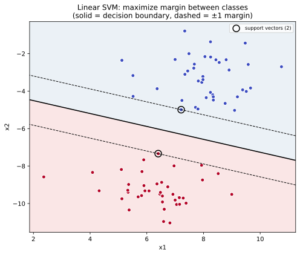
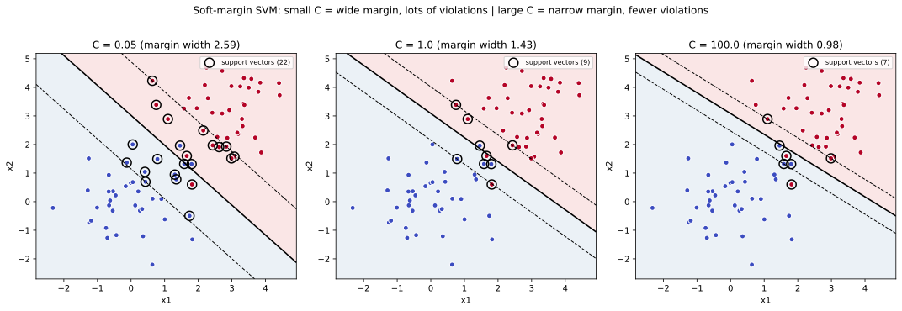
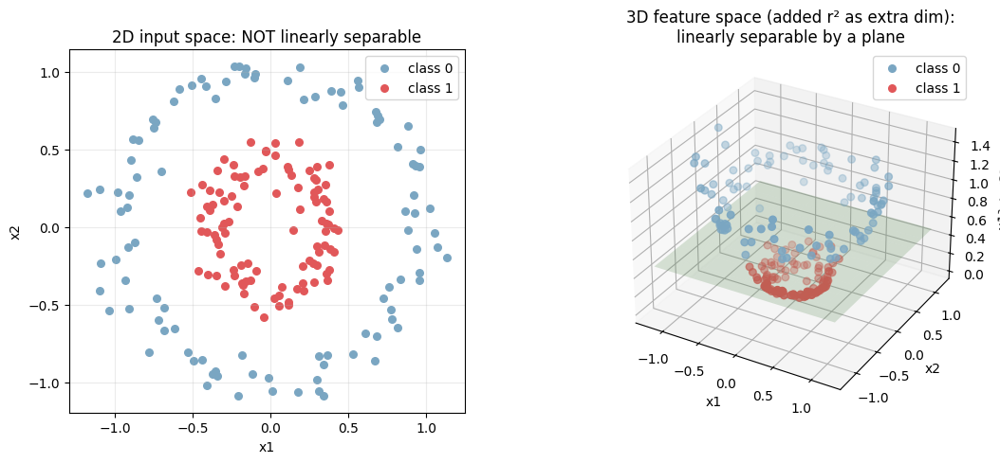
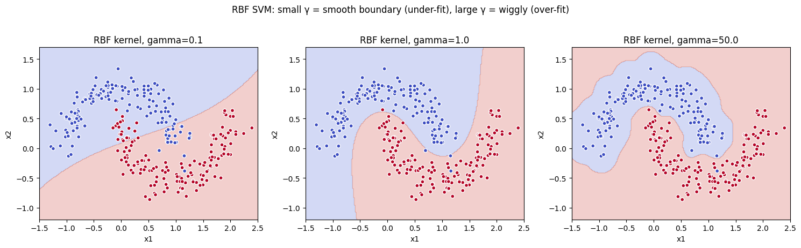

サポートベクターマシン（SVM, support vector machine）は、2 クラスのデータを「マージン（境界と最も近い点との距離）が最大になる超平面」で分離する分類器です。1990 年代から 2000 年代前半にかけて分類の標準アルゴリズムとして広く使われ、カーネルトリック（kernel trick）により非線形分離まで自然に拡張できる柔軟性を持ちます。

表データの分類では[勾配ブースティング](../gradient-boosting/)も使われます。SVM の特徴は、凸最適化として解けること、マージンを最大にする決定境界、テキスト分類のような高次元データにも効くこと、です。

---

### マージン最大化の発想

線形分離可能な 2 クラスデータでは、両者を分ける直線（超平面）が無限に引けます。SVM は「最も近い点との距離（マージン）が最大になる線」を選びます。直感的には「両クラスの間の安全圏が最も広い線」を引く操作です。

数式的には次の最適化問題になります（線形 SVM、ハードマージン）。

```text
min  (1/2) ||w||^2
s.t. y_i (w · x_i + b) ≥ 1   for all i
```

- `w`: 超平面の法線ベクトル
- `b`: 切片
- `y_i ∈ {-1, +1}`: クラスラベル
- 制約 `y_i (w · x_i + b) ≥ 1` は「全サンプルが正しい側にマージン 1 以上で分離される」

`||w||^2` を最小化するのは「マージン `1 / ||w||` を最大化する」のと等価で、これが SVM が「最大マージン分類器」と呼ばれる理由となります。最適解は「マージン上に乗っている少数の点（support vectors, サポートベクター）」だけで決まり、それ以外の点は捨てても結果が変わりません。

---

### 線形 SVM の決定境界とサポートベクター

可分なデータ（クラスタが離れている）に線形 SVM を当てると、マージンとサポートベクターが明示的に見えます。

```python
from sklearn.datasets import make_blobs
from sklearn.svm import SVC

X, y = make_blobs(n_samples=80, centers=2, cluster_std=1.1, random_state=6)
model = SVC(kernel="linear", C=1.0).fit(X, y)
print(f"support vectors: {len(model.support_vectors_)} of {len(X)}")
```

出力:

```text
support vectors: 2 of 80
```



実線が決定境界 `w · x + b = 0`、その両側の破線がマージン境界 `±1` で、丸で囲った点がサポートベクターです。80 サンプルのうち 2 点だけで境界が決まっています。

サポートベクターを 1 点抜いて学習し直すと境界の係数が変わり、それ以外の 40 点を抜いても係数は全く変わりませんでした。残りの 78 点は `±1` の外にいる限り、どう動かしても境界に影響しません。図の描画コードは[生成元](https://github.com/nao1215/debimate/blob/main/projects/ml/scripts/notes/svm_gen.py)にあります。

---

### ソフトマージン: C パラメータの意味

実データは完全に線形分離できないことの方が多いです。ソフトマージン SVM は「マージンを超える点」「逆側に入る点」をある程度許容します。許容度を制御するのが正則化パラメータ `C` です。

```text
min  (1/2) ||w||^2 + C Σ ξ_i
s.t. y_i (w · x_i + b) ≥ 1 - ξ_i,  ξ_i ≥ 0   for all i
```

`ξ_i` は各サンプルの「マージン違反量」で、`C` が大きいほど違反を強く罰します。`C` が小さいとマージンが広く単純な境界（under-fit 寄り）に、大きいとマージンが狭く訓練データに張り付く境界（over-fit 寄り）になります。

前節のデータは離れすぎていて `C` の差が出ないため、端が少し重なる 2 クラスを作って比べます。

```python
import numpy as np
from sklearn.svm import SVC

# 中心 (0, 0) と (3, 3) の 2 クラス。端が少し重なる
rng = np.random.default_rng(0)
X2 = np.vstack([rng.normal([0, 0], 1.0, (40, 2)), rng.normal([3, 3], 1.0, (40, 2))])
y2 = np.array([0] * 40 + [1] * 40)

for C in [0.05, 1.0, 100.0]:
    m = SVC(kernel="linear", C=C).fit(X2, y2)
    width = 2 / np.linalg.norm(m.coef_[0])  # 破線どうしの間隔
    errors = (m.predict(X2) != y2).sum()
    print(f"C={C:>6}: support vectors={len(m.support_vectors_):2d}, "
          f"margin width={width:.2f}, train errors={errors}")
```

出力:

```text
C=  0.05: support vectors=22, margin width=2.59, train errors=3
C=   1.0: support vectors= 9, margin width=1.43, train errors=3
C= 100.0: support vectors= 7, margin width=0.98, train errors=2
```



`C = 0.05` ではマージンの幅が 2.59 と広く、22 点がマージン内か境界上に入ってサポートベクターになっています。`C = 100` では幅が 0.98 まで縮み、サポートベクターは 7 点に減りました。

一方で訓練データの誤分類は 3 点から 2 点に減っただけで、重なった所の点はどの `C` でも分けきれません。`C` を上げると少数の点で境界が決まり、その点の位置に境界が振り回されやすくなります。どの `C` が良いかはデータ次第なので、[ハイパーパラメータ](/ml/ml/hyperparameter/)探索で [交差検証](../cross-validation/) にかけて決めます。

`C` は [ロジスティック回帰](../logistic-regression/) や [線形回帰](../linear-regression/) の [正則化](../regularization/) 強さ `α` とは逆向きの解釈（`C` 大 = 正則化弱、`C` 小 = 正則化強）になる点に注意が必要です。

---

### カーネルトリック: 非線形を線形に変換する

線形 SVM では「同心円状に並んだ 2 クラス」のような非線形なデータを分離できません。カーネルトリックは、データを暗黙的に高次元空間に射影することで線形分離可能にする手法です。

例として、2 次元のデータ `(x_1, x_2)` に「半径の二乗」`r^2 = x_1^2 + x_2^2` を 3 つ目の特徴量として加えると、内側クラスと外側クラスが「`z` 軸方向の高さ」で線形に分けられるようになります。

```python
from sklearn.datasets import make_circles

X_c, y_c = make_circles(n_samples=200, factor=0.4, noise=0.08, random_state=0)
z = X_c[:, 0] ** 2 + X_c[:, 1] ** 2  # 3 つ目の特徴量（半径の二乗）
print(f"inner circle: z max = {z[y_c == 1].max():.2f}")
print(f"outer circle: z min = {z[y_c == 0].min():.2f}")
```

出力:

```text
inner circle: z max = 0.34
outer circle: z min = 0.62
```



左の 2D 散布図では、円形のクラスタを直線で分けることができません。一方、右の 3D 散布図では、内側の円の `z` が最大 0.34、外側の円の `z` が最小 0.62 なので、その間の高さに置いた平面で完全に分けられます。緑の平面が `z = 0.5` の分離面です。

カーネルトリックでは、高次元空間での座標を計算せず、内積の計算だけで SVM を解きます。よく使われるカーネル関数は次の通りです。

| カーネル | 式 | 用途 |
|---|---|---|
| 線形 | `K(x, x') = x · x'` | 特徴量が既に良い、または高次元疎データ |
| 多項式 | `K(x, x') = (γ x · x' + r)^d` | 中程度の非線形性 |
| RBF（ガウス） | `K(x, x') = exp(-γ ‖x - x'‖^2)` | デフォルト候補、汎用的に強い |
| シグモイド | `K(x, x') = tanh(γ x · x' + r)` | ニューラルネット的 |

[scikit-learn](https://scikit-learn.org/stable/modules/svm.html) では `SVC(kernel="rbf", gamma=γ, C=C)` のように指定します。

---

### RBF カーネル: γ の効き方

RBF カーネルでは `γ`（ガンマ）パラメータが「1 サンプルの影響範囲」を決めます。`γ` が小さいと各サンプルの影響範囲が広く（境界が滑らか）、大きいと影響範囲が狭く（境界が局所的）なります。

```python
from sklearn.datasets import make_moons
from sklearn.svm import SVC

X_m, y_m = make_moons(n_samples=300, noise=0.15, random_state=0)
for gamma in [0.1, 1.0, 50.0]:
    m = SVC(kernel="rbf", gamma=gamma, C=1.0).fit(X_m, y_m)
    print(f"gamma={gamma:>4}: support vectors={len(m.support_):3d}, "
          f"train accuracy={m.score(X_m, y_m):.3f}")
```

出力:

```text
gamma= 0.1: support vectors=121, train accuracy=0.853
gamma= 1.0: support vectors= 51, train accuracy=0.987
gamma=50.0: support vectors=175, train accuracy=0.997
```



- γ=0.1: 境界がほぼ直線で月の形を捉えきれない（under-fit）。訓練データでも正解率 0.853
- γ=1.0: 月の輪郭をうまく捉えている。サポートベクターは 51 点で済む
- γ=50: 訓練点の周りだけを包み、点から離れた所はすべて片方のクラスになる。300 点中 175 点がサポートベクターで、データを覚え込んだ状態（過学習）

`C` と `γ` は両方とも複雑度を上げる方向に効くため、2 次元グリッドで [交差検証](../cross-validation/) するのが標準です。経験則として `gamma="scale"`（`1 / (n_features × var(X))`）から始め、`C ∈ {0.1, 1, 10, 100}`、`gamma ∈ {0.01, 0.1, 1, 10}` の範囲で探索する方法があります。

---

### 数学での使いどころ

- 凸二次計画法（QP）の応用: SVM の最適化は凸 QP なので、局所解がそのまま大域最適解になる。ただし一意に決まるのは `w` で、切片 `b` や双対変数は一意とは限らない（[Burges & Crisp, 1999](https://proceedings.neurips.cc/paper_files/paper/1999/hash/c4492cbe90fbdbf88a5aec486aa81ed5-Abstract.html)）
- カーネル法の代表例: RKHS（再生核ヒルベルト空間）の理論的基盤
- マージン理論: 統計的学習理論で汎化誤差の上限を導く（VC 次元、Rademacher 複雑度）
- 双対問題: 主問題と双対問題の対応（KKT 条件）
- ヒンジ損失: `max(0, 1 - y · ŷ)` に L2 正則化を足して最小化すると、ソフトマージン SVM と等価

---

### 機械学習での使いどころ

- 中規模データの分類: 数千 〜 数万サンプルで強い性能を出す
- 高次元疎データ: テキスト分類、文書分類（線形 SVM が定番）
- 画像分類のベースライン: 深層学習以前は SVM + HOG（Histogram of Oriented Gradients）/ SIFT（Scale-Invariant Feature Transform）といった画像特徴量の組み合わせが標準
- [異常検知](/ml/ml/anomaly-detection/): One-class SVM で「正常データ範囲」を学習し、外れる点を異常と判定
- SVR（Support Vector Regression）: SVM を回帰に使う手法で、ε 以内の誤差は無視する損失を使う

実装上は `sklearn.svm.SVC` / `SVR` がベースです。大規模データ（数十万サンプル以上）では訓練時間が `O(n^2)` 〜 `O(n^3)` に膨らむため、`LinearSVC`（線形限定、Liblinear ベース）か `SGDClassifier(loss="hinge")`、または[勾配ブースティング](../gradient-boosting/)のような別のアルゴリズムを使うのが現実的です。

---

### 適さないケース / 落とし穴

- 確率出力が必要: SVM の決定関数は確率ではない。`probability=True` で Platt scaling（決定関数の値をシグモイドで確率に写す手法）を当てられる。ただし、追加コストが大きい。確率が要るなら [ロジスティック回帰](../logistic-regression/) の方が素直（[確率の校正](../probability-calibration/) 参照）
- 特徴量のスケールが不揃い: RBF カーネルが歪む。[標準化](../standardization/) を必ず先に挟む
- 多クラス分類にそのまま使う: SVM は本来 2 クラス用。`SVC` は内部で `one-vs-one` を使い、K クラスなら `K(K-1)/2` 個の SVM を訓練する
- 解釈性が必要: カーネル SVM の決定関数は「サポートベクターとのカーネル値の重み付き和」で、特徴量レベルの寄与を直接読むのが難しい。[決定木](../decision-tree/) や [線形回帰](../linear-regression/) の方が説明しやすい
- 不均衡データ: マージン最大化が多数派クラスに引きずられる。`class_weight="balanced"` か別のリサンプリング手法（[クラス不均衡](../class-imbalance/)）が必要
