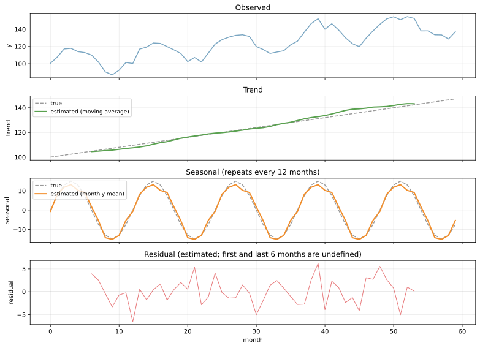
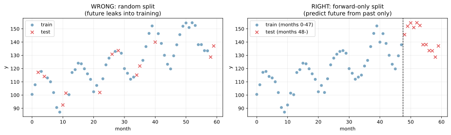
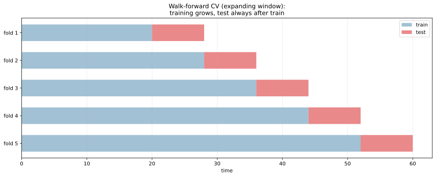
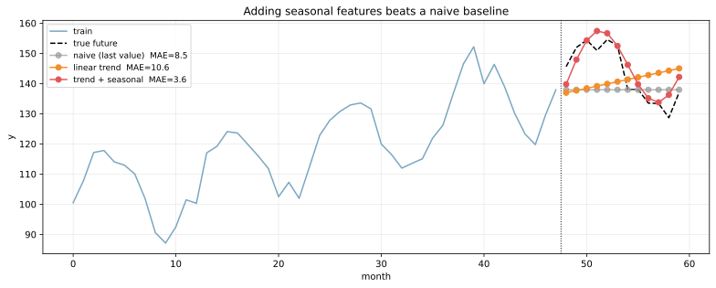

時系列予測（time series forecasting）は、過去の観測値から未来の値を予測するタスクです。需要予測、気温、サーバー負荷、医療モニタリングなど、ビジネスでも研究でも頻出します。

通常の教師あり学習（[線形回帰](../linear-regression/)、[勾配ブースティング](../gradient-boosting/)）と異なる点は、(1) サンプル間に時間的順序があり独立でない、(2) 評価は「未来データで」行う必要がある、(3) トレンド・季節性・自己相関という特有の構造を持つ、の 3 点です。(2) を無視して通常の CV（cross validation、[交差検証](../cross-validation/)）を当てると、訓練に未来の値が混ざり、評価が本番より良く出ます。

<br>

本記事では、次の疑問を順に説明します。

- 時系列はどんな成分に分けられるのか
- ランダムに分割した評価は、どれだけ楽観的になるのか
- 複数の時点で評価するには、どう分割するのか
- 時刻の情報を特徴量にどう入れれば、予測が当たるようになるのか

コードは [scikit-learn](https://scikit-learn.org/stable/) 1.9.1 と [NumPy](https://numpy.org/) 2.5.4 で実行しました。図の描画は[生成コード](https://github.com/nao1215/debimate/blob/main/projects/ml/scripts/notes/time-series-forecasting_gen.py)にあります。

---

### 時系列の 3 つの成分

多くの時系列は、次の 3 つの和として扱えます。

```text
y_t = trend(t) + seasonal(t) + residual(t)
```

- trend: 長期的な傾向（上昇・下降）
- seasonal: 決まった周期で繰り返す変動（日次・週次・年次など）
- residual: 上 2 つで説明できないランダムな変動

次のコードは、この 3 つを足して月次データ 5 年分を作り、観測値だけから成分を推定し直します。トレンドは前後 6 か月を含む移動平均、季節性はトレンドを引いた値の月ごとの平均で求めます。この手順は古典的分解と呼ばれ、[statsmodels の `seasonal_decompose`](https://www.statsmodels.org/stable/generated/statsmodels.tsa.seasonal.seasonal_decompose.html) も同じ計算をします。

```python
import numpy as np

t = np.arange(60)  # 月次データ 5 年分
trend = 100 + 0.8 * t
seasonal = 15 * np.sin(2 * np.pi * t / 12)
noise = np.random.default_rng(0).normal(0, 4, 60)
y = trend + seasonal + noise

# 1. トレンド: 前後 6 か月ずつを含む 13 点の移動平均（両端の点は重み 1/2）
w = np.r_[0.5, np.ones(11), 0.5] / 12
trend_hat = np.full(60, np.nan)
trend_hat[6:-6] = np.convolve(y, w, mode="valid")

# 2. 季節性: トレンドを引いた値を月（0〜11）ごとに平均し、合計が 0 になるようにずらす
detrended = y - trend_hat
seasonal_by_month = np.array([np.nanmean(detrended[m::12]) for m in range(12)])
seasonal_by_month -= seasonal_by_month.mean()
seasonal_hat = seasonal_by_month[t % 12]

# 3. 残差: 観測値から 2 つを引いた残り
resid_hat = y - trend_hat - seasonal_hat

print("seasonal (true):", np.round(seasonal[:12], 1))
print("seasonal (est) :", np.round(seasonal_by_month, 1))
print(f"resid std (est) = {np.nanstd(resid_hat):.2f}  (true noise std = {noise.std():.2f})")
```

出力:

```text
seasonal (true): [  0.    7.5  13.   15.   13.    7.5   0.   -7.5 -13.  -15.  -13.   -7.5]
seasonal (est) : [ -0.7   8.3  11.8  13.2  10.2   9.1   1.6  -5.5 -14.3 -15.2 -13.1  -5.3]
resid std (est) = 2.81  (true noise std = 3.59)
```



上から観測値、トレンド、季節性、残差です。推定した季節性と真の値の差は、どの月も 3 未満です。一方で、推定した残差の[標準偏差](/ml/math/stddev/)は 2.81 で、加えたノイズの 3.59 より小さくなりました。各月の平均は 4〜5 年分の値しか使わないので、ノイズの一部が季節性の推定値に入り込むからです。移動平均を取れない最初と最後の 6 か月は、トレンドと残差が求まりません。

成分に分けると、トレンドは直線で、季節性は月ごとの値で予測する、というように成分ごとに別の手法を選べます。トレンドと季節性を自動で推定して予測まで行うライブラリには、Meta が公開している [Prophet](https://facebook.github.io/prophet/) があります。

---

### 時間順の分割

時系列の予測性能を評価する時は、データを時間順に分割します。前のコードの `t` と `y` で、ランダムに分割した評価がどれだけ楽観的になるかを確認します。モデルは経過月だけを特徴量にした[ランダムフォレスト](../random-forest/)で、MAE（mean absolute error、平均絶対誤差。予測と正解の差の絶対値の平均）で比べます。

```python
from sklearn.ensemble import RandomForestRegressor
from sklearn.metrics import mean_absolute_error
from sklearn.model_selection import train_test_split

X = t.reshape(-1, 1)  # 特徴量は経過月だけ

# ランダム分割: test の 12 か月が 5 年間に散らばる
X_tr, X_te, y_tr, y_te = train_test_split(X, y, test_size=12, random_state=0)
rf = RandomForestRegressor(random_state=0).fit(X_tr, y_tr)
print("random test months:", np.sort(X_te[:, 0]))
print(f"random split : MAE = {mean_absolute_error(y_te, rf.predict(X_te)):.1f}")

# 時間順の分割: 最初の 48 か月で学習し、最後の 12 か月を予測
rf = RandomForestRegressor(random_state=0).fit(X[:48], y[:48])
pred = rf.predict(X[48:])
print(f"forward split: MAE = {mean_absolute_error(y[48:], pred):.1f}")
print("forward pred :", np.round(pred, 1))
```

出力:

```text
random test months: [ 2  4 10 11 22 26 28 34 35 40 58 59]
random split : MAE = 4.1
forward split: MAE = 10.0
forward pred : [134.5 134.5 134.5 134.5 134.5 134.5 134.5 134.5 134.5 134.5 134.5 134.5]
```



左のランダム分割では、test の月 40 の前後にある月 39 と月 41 が訓練に入っています。モデルは隣の月の値を写すだけで当たるので、[MAE](../regression-metrics/) は 4.1 に収まりました。本番では未来の値は手に入らないので、この評価は本番の性能を表しません（[データリーク](../data-leakage/)の典型）。

右は月 0〜47 を訓練、月 48〜59 をテストにした分割で、MAE は 10.0 まで悪化しました。[決定木](../decision-tree/)は訓練データの範囲の外へ値を伸ばせないので、12 か月すべてを 134.5 と予測しています。ランダム分割の評価では、この弱点が見えません。

---

### Walk-forward CV

単一の分割では、特定の時期の精度しか測れません。複数の時点で評価したい場合は、訓練期間を少しずつ伸ばしながら、その直後をテストにする walk-forward CV（expanding window CV）を使います。scikit-learn の [`TimeSeriesSplit`](https://scikit-learn.org/stable/modules/generated/sklearn.model_selection.TimeSeriesSplit.html) で、60 か月を 5 回に分けます。

```python
from sklearn.model_selection import TimeSeriesSplit

for name, cv in [("gap=0", TimeSeriesSplit(n_splits=5, test_size=8)),
                 ("gap=2", TimeSeriesSplit(n_splits=5, test_size=8, gap=2))]:
    print(name)
    for i, (tr, te) in enumerate(cv.split(t), 1):
        print(f"  fold {i}: train {tr[0]:2d}-{tr[-1]:2d}, test {te[0]}-{te[-1]}")
```

出力:

```text
gap=0
  fold 1: train  0-19, test 20-27
  fold 2: train  0-27, test 28-35
  fold 3: train  0-35, test 36-43
  fold 4: train  0-43, test 44-51
  fold 5: train  0-51, test 52-59
gap=2
  fold 1: train  0-17, test 20-27
  fold 2: train  0-25, test 28-35
  fold 3: train  0-33, test 36-43
  fold 4: train  0-41, test 44-51
  fold 5: train  0-49, test 52-59
```



各 fold で訓練期間が伸び、テストは常に訓練の後ろに来ます。`gap=2` では、訓練の末尾 2 か月を捨ててからテストが始まります。月末に締めたデータを 2 か月後の予測に使う、のようにデータの確定と予測の間に空きがある時、この空きを評価でも再現できます。

訓練期間の長さを固定して古い月を捨てる rolling window CV は、`max_train_size` で指定します。市場の構造が変わったなど、古いデータが今の予測に役立たない時は rolling、古いデータも信号を持つ時は expanding を選びます。

---

### 時刻の情報の入れ方

時系列予測のアプローチは、大きく 3 系統です。

| アプローチ | 代表手法 | 強み | 弱み |
|---|---|---|---|
| 統計モデル | ARIMA、SARIMA、ETS | 解釈可能、少データで動く | 非線形・複数特徴量に弱い |
| ML 回帰 | [線形回帰](../linear-regression/)、[勾配ブースティング](../gradient-boosting/) | 多特徴量、非線形を扱える | 自己相関の扱いが手作業 |
| 深層学習 | RNN、LSTM、Transformer | 長期依存、複雑なパターン | データ大量 + チューニング重い |

ML 回帰では、時刻の情報を特徴量にどう入れるかで結果が変わります。月 0〜47 で学習し、月 48〜59 を予測する 3 つの方法を比べます（`t` と `y` は前のコードと同じです）。

```python
from sklearn.linear_model import LinearRegression

t_train, t_test, y_train, y_test = t[:48], t[48:], y[:48], y[48:]

def season_features(t):
    return np.column_stack([t, np.sin(2 * np.pi * t / 12), np.cos(2 * np.pi * t / 12)])

preds = {
    # 最後に観測した値をそのまま使う
    "naive": np.full(12, y_train[-1]),
    # 経過月だけの線形回帰
    "linear trend": LinearRegression().fit(t_train.reshape(-1, 1), y_train)
                                      .predict(t_test.reshape(-1, 1)),
    # 経過月 + sin/cos の線形回帰
    "trend + seasonal": LinearRegression().fit(season_features(t_train), y_train)
                                          .predict(season_features(t_test)),
}
for name, pred in preds.items():
    print(f"{name:16s}: MAE = {mean_absolute_error(y_test, pred):.1f}")
```

出力:

```text
naive           : MAE = 8.5
linear trend    : MAE = 10.6
trend + seasonal: MAE = 3.6
```



- naive（灰色）: 最後の値をそのまま予測します。MAE 8.5
- linear trend（橙）: トレンドは拾いますが、季節性を取りこぼします。MAE 10.6 で、naive より悪くなりました
- trend + seasonal（赤）: データを作った式と同じ構造を持てるので、MAE 3.6 まで下がります

同じ線形回帰でも、月を `sin / cos` に変換して加えるだけで誤差が 3 分の 1 になりました。月を 0〜11 の整数のまま入れると 11 月と 0 月が離れた値になりますが、`sin / cos` なら円の上で隣り合います。

---

### 時系列の特徴量

ML 回帰で時系列を扱う時は、次の特徴量を作るのが定石です。`t` 時点の値を予測する行には、予測を出す時点で分かっている値だけを入れます。

| 特徴量 | 例 | 目的 |
|---|---|---|
| Lag features | `y_{t-1}, y_{t-7}, y_{t-30}` | 自己相関を取り込む |
| Rolling window | `mean(y_{t-7..t-1})`、`std(y_{t-7..t-1})` | 直近の動向 |
| 日付特徴量 | 曜日、月、四半期、祝日フラグ | カレンダー効果 |
| Cyclical encoding | `sin(2π·month/12)`、`cos(2π·month/12)` | 周期性を連続的に表現 |
| External regressors | 気温、イベント、競合価格 | 外生要因の取り込み |

Rolling window の範囲に `y_t` を含めると、予測したい値そのものが特徴量に入ります。[pandas](https://pandas.pydata.org/) なら `y.shift(1).rolling(7).mean()` のように、1 つずらしてから集計します。

作った特徴量は、[LightGBM](https://lightgbm.readthedocs.io/) や [XGBoost](https://xgboost.readthedocs.io/) などの[勾配ブースティング](../gradient-boosting/)に入れて学習します。

---

### 代表的なアルゴリズムとライブラリ

- ARIMA / SARIMA: 自己回帰 + 差分 + 移動平均。SARIMA は季節成分も持つ。古典統計の代表
- ETS（Exponential Smoothing）: 指数平滑法。Holt-Winters 法もこの仲間
- Prophet: トレンド + 季節 + 祝日効果の加法モデル
- [DeepAR](https://arxiv.org/abs/1704.04110) / [N-BEATS](https://arxiv.org/abs/1905.10437) / [Temporal Fusion Transformer](https://arxiv.org/abs/1912.09363): 深層学習ベース
- LightGBM / XGBoost + lag features: 過去の値を特徴量にした表形式データで学習

ARIMA と ETS は [statsmodels の `tsa`](https://www.statsmodels.org/stable/tsa.html) にあります。深層学習の手法は [PyTorch Forecasting](https://github.com/sktime/pytorch-forecasting)、[Darts](https://github.com/unit8co/darts)、[GluonTS](https://github.com/awslabs/gluonts) で試せます。

---

### 数学での使いどころ

- 自己相関関数（ACF）、偏自己相関関数（PACF）
- 定常性（stationarity）の検定: ADF 検定、KPSS 検定（[仮説検定](../../math/hypothesis-test/) 参照）
- フーリエ分解で周期成分を抽出
- 状態空間モデル: Kalman filter、HMM
- 確率過程: マルコフ性、ランダムウォーク、ブラウン運動
- 時系列の共和分（cointegration）

---

### 機械学習での使いどころ

- 需要予測: 小売、在庫管理、容量計画
- エネルギー: 電力需要、再生可能エネルギーの出力
- サーバー監視: トラフィック予測、自動スケーリング
- IoT / センサーデータ: 故障予測、[異常検知](../anomaly-detection/)の基準値
- ウェブログ解析: クリック数、コンバージョン率

---

### 適さないケース / 落とし穴

- 通常のランダム CV を時系列に当てる: 未来がリークして評価が膨らみます。`TimeSeriesSplit` を使います
- 予測時点で手に入らない値を特徴量に使う: 当日の確定値や、集計が数日遅れるデータを入れると、訓練では当たっても本番で再現できません。gap で遅れを評価にも入れます
- 訓練データの期間が短すぎる: 季節性を推定するには、最低 2〜3 周期分が必要です
- [標準化](../standardization/)を全データでやる: テストデータの統計が訓練に漏れます。fold ごとに訓練データだけで統計を計算します
- 定常性を確認しない: ARIMA の自己回帰・移動平均の部分は定常性を仮定します。差分の回数 `d` でトレンドを除いてから当てます
- 外挿の限界: 過去に観測されていない値域では精度が落ちます。決定木系は前述の実験のように訓練データの範囲で頭打ちになります
- 点予測だけを出す: 在庫や人員の判断には予測の幅が要ります。Prophet、DeepAR、quantile loss で区間や分布を出します
- 異常値の処理を忘れる: 単発の外れ値が lag features や移動平均を通じて後の予測に残ります
- 階層構造を無視する: 「全国合計」と「店舗ごと」の予測の合計が合わなくなります。Hierarchical Forecasting で整合させます
- 評価指標の選択: MAPE（mean absolute percentage error）は正解が 0 に近いと不安定です。SMAPE（symmetric MAPE）は名前に反して過大予測と過小予測を対称に扱わず、[Hyndman らの教科書](https://otexts.com/fpp3/accuracy.html)は使わないよう勧めています。MASE（mean absolute scaled error）は naive 予測の誤差で割った指標で、系列の単位に依らず比べられます