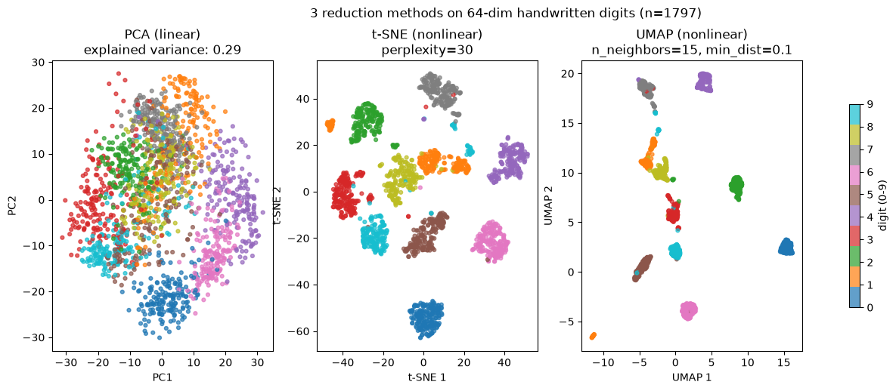
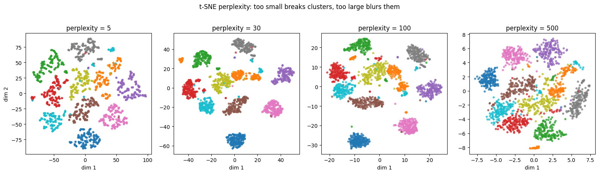
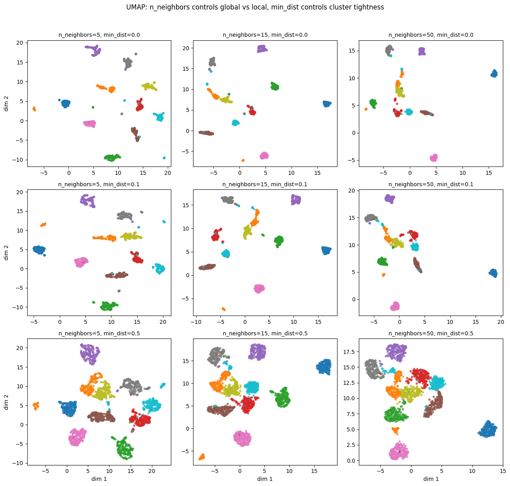
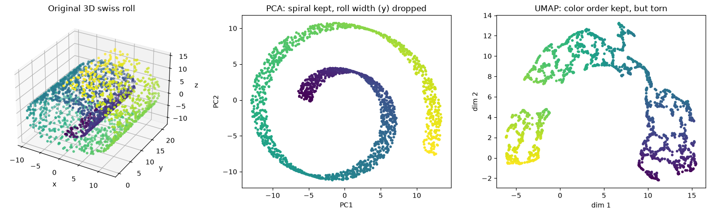

[t-SNE](https://www.jmlr.org/papers/v9/vandermaaten08a.html)（t-distributed Stochastic Neighbor Embedding）と [UMAP](https://arxiv.org/abs/1802.03426)（Uniform Manifold Approximation and Projection）は、高次元データを 2〜3 次元に圧縮する非線形次元削減アルゴリズムです。[PCA](../pca/) が線形の射影に限られるのに対し、t-SNE / UMAP は「元の空間で近い点は、低次元でも近くに置く」ことを優先して配置を決めます。

主な用途は可視化です。画像、文書埋め込み、遺伝子発現データ、ニューラルネットの中間層の出力などを 2D の散布図にして、似たデータの集まりを目で確かめます。UMAP は学習済みの写像で新しいデータも変換できるので、クラスタリングや分類の前処理にも使われます。

ただし、散布図にできた点の集まり（以下、島）の中で隣り合う点の近さは信用できても、島同士の距離や島の大きさは元データと対応するとは限りません。この 2 つを区別しないと、見た目から誤った結論を出します。

<br>

本記事では、手書き数字データを使って次の疑問を順に扱います。

- PCA と比べて、t-SNE / UMAP の散布図は何が違うのか
- perplexity、n_neighbors、min_dist で見た目がどう変わるのか
- 散布図のどの距離を信用してよいのか
- UMAP の出力を予測モデルの入力に使ってよいのか

---

### PCA との対比

同じ手書き数字データ（8×8 画素 = 64 次元、1797 枚）に 3 つの手法を当てます。本記事のコードは[生成コード](https://github.com/nao1215/debimate/blob/main/projects/ml/scripts/notes/tsne-umap_gen.py)から描画を除いた抜粋で、scikit-learn 1.9.1、umap-learn 0.5.12、NumPy 2.5.4 で実行しました。

```python
from sklearn.datasets import load_digits
from sklearn.decomposition import PCA
from sklearn.manifold import TSNE
import umap

digits = load_digits()
X, y = digits.data, digits.target  # 64 次元

X_pca = PCA(n_components=2, random_state=0).fit_transform(X)
X_tsne = TSNE(n_components=2, perplexity=30, random_state=0).fit_transform(X)
X_umap = umap.UMAP(n_components=2, n_neighbors=15, min_dist=0.1, random_state=0).fit_transform(X)
```



- PCA（左）: 2 次元で元の分散の 29% しか説明できず、数字の雲が重なります
- t-SNE（中央）: 数字ごとに分かれた島ができます
- UMAP（右）: 島がさらに小さく密にまとまり、島同士の隙間が広くなります

PCA より t-SNE / UMAP の方が、数字ごとの点の集まりを区別しやすくなっています。島の配置にどこまで意味があるかは、後の「散布図の距離の意味」で数値を使って確かめます。

---

### t-SNE: 近傍構造を保つ

t-SNE は「高次元での点同士の近さ」を「低次元での点同士の近さ」として保とうとするアルゴリズムです。

1. 高次元で各点 `x_i` に対し、条件付き確率 `p_{j|i}`（`x_i` の隣に `x_j` が来る確率）を計算し、対称化して `p_{ij}` にする
2. 低次元の埋め込み `y_i` に対しても同様の確率 `q_{ij}` を計算する。ここでは裾の重い t 分布を使う
3. 2 つの確率分布の [KL ダイバージェンス](../../math/information-theory/)を最小化するように、`y_i` を勾配降下で更新する

低次元側に t 分布を使うのは、高次元の近傍を 2 次元に詰め込むと点が中央に押し合う crowding 問題を和らげるためです。

最も効く[ハイパーパラメータ](/ml/ml/hyperparameter/)は perplexity で、各点が近傍として見る点の数の目安を決めます。次のコードは、上の `X` を使って perplexity だけを変えた抜粋です。

```python
for perp in [5, 30, 100, 500]:
    X_t = TSNE(n_components=2, perplexity=perp, random_state=0).fit_transform(X)
```



- perplexity = 5: 1 つの数字が複数の小さな島に割れます
- perplexity = 30: 数字ごとに 1 つの島にまとまります（scikit-learn の既定値）
- perplexity = 100: 島はまだ分かれていますが、間の隙間が狭くなります
- perplexity = 500: 島同士が接し、境界が不明瞭になります

[scikit-learn のドキュメント](https://scikit-learn.org/stable/modules/generated/sklearn.manifold.TSNE.html)は 5〜50 の範囲を勧め、perplexity はサンプル数より小さくする必要があります。1 つの値で判断せず、5・30・50 のように複数を試します。

---

### UMAP: 近傍グラフを低次元へ写す

UMAP も近傍を保つ手法で、元の空間で k 近傍のグラフを作り、そのグラフに近い形を低次元に描きます。t-SNE との実用上の違いは次の通りです。

- 学習済みの写像で新しいデータを変換できる（`reducer.transform(X_new)`）。scikit-learn の `TSNE` には `transform` がありません
- 出力を 4 次元以上にできる。scikit-learn の t-SNE は既定の Barnes-Hut 法だと 3 次元までです
- 大きなデータで速い。[umap-learn のベンチマーク](https://umap-learn.readthedocs.io/en/latest/benchmarking.html)では、70,000 枚の手書き数字 MNIST で UMAP が約 8.6 秒、scikit-learn の t-SNE が約 102 秒でした。1797 枚の digits では、手元で t-SNE 1.9 秒、UMAP 4.1 秒と逆転します

主要なハイパーパラメータは `n_neighbors`（近傍の数）と `min_dist`（低次元での点同士の最小間隔）です。次のコードも上の `X` を使った抜粋です。

```python
for n_neighbors in [5, 15, 50]:
    for min_dist in [0.0, 0.1, 0.5]:
        X_u = umap.UMAP(n_neighbors=n_neighbors, min_dist=min_dist, random_state=0).fit_transform(X)
```



- `n_neighbors` を小さく: 局所構造を重視し、本体から離れた小さな欠片が増えます
- `n_neighbors` を大きく: 広い範囲を見るので、似た数字の島が寄り集まります
- `min_dist` を小さく: 島が密に縮みます
- `min_dist` を大きく: 島の中の点が広がり、島同士が近づきます

既定値は `n_neighbors=15, min_dist=0.1` です。EDA（探索的データ分析）では複数の設定を並べ、どの設定でも残る島だけを信用します。

---

### 非線形性が効く例: Swiss Roll

Swiss Roll は、長方形のシートを 3 次元で渦巻き状に巻いたデータです。色はシートの巻き方向の位置を表し、もう 1 つの軸（y、ロールの幅）と合わせた 2 次元がデータの本当の座標です。

```python
import numpy as np
from sklearn.datasets import make_swiss_roll
from sklearn.manifold import trustworthiness

X_sr, color = make_swiss_roll(n_samples=2000, noise=0.0, random_state=0)
X_pca_sr = PCA(n_components=2).fit_transform(X_sr)
X_um_sr = umap.UMAP(n_components=2, n_neighbors=15, random_state=0).fit_transform(X_sr)

# シートの本当の座標（巻き方向の位置 color と幅 y）に対する近傍の保ち方
T = np.c_[color, X_sr[:, 1]]
for name, Z in [("PCA", X_pca_sr), ("UMAP", X_um_sr)]:
    print(f"{name:4s} trustworthiness={trustworthiness(T, Z, n_neighbors=10):.3f}")
```

```text
PCA  trustworthiness=0.840
UMAP trustworthiness=0.985
```



PCA は分散の大きい x・z 方向へ射影するので、渦巻きの断面が残ったまま幅（y）が消えます。UMAP は色の順序を保って渦巻きをほどきますが、シートは途中で裂け、黄緑の端が切り離されています。

シートの本当の座標（巻き方向の位置と y）に対する近傍の保ち方を [trustworthiness](https://scikit-learn.org/stable/modules/generated/sklearn.manifold.trustworthiness.html)（埋め込みでの近傍 10 点が元でも近傍かを 0〜1 で表す指標）で測ると、上の出力の通り PCA が 0.840、UMAP が 0.985 でした。近傍は保てても、全体の形まで正しく展開できるとは限りません。

---

### 散布図の距離の意味

UMAP の島は t-SNE よりはっきり分かれていましたが、島同士の距離は元データの距離を表しているのでしょうか。数字ごとの重心を 64 次元と 2 次元でそれぞれ求め、10 個の重心から作る 45 組の距離の順位がどれだけ一致するかを Spearman の順位相関で比べます。あわせて、各点の近傍 10 点がどれだけ保たれたかを trustworthiness で測ります。最初のコードの `X_pca`・`X_tsne`・`X_umap` と、Swiss Roll の節で import した `np`・`trustworthiness` を使います。

```python
from scipy.spatial.distance import pdist
from scipy.stats import spearmanr

def centroids(Z):
    return np.array([Z[y == k].mean(axis=0) for k in range(10)])

d_orig = pdist(centroids(X))  # 64 次元での数字の重心間距離（45 組）
for name, Z in [("PCA", X_pca), ("t-SNE", X_tsne), ("UMAP", X_umap)]:
    rho = spearmanr(d_orig, pdist(centroids(Z))).statistic
    tw = trustworthiness(X, Z, n_neighbors=10)
    print(f"{name:5s} 重心間距離の順位相関={rho:.2f} trustworthiness={tw:.3f}")
```

```text
PCA   重心間距離の順位相関=0.81 trustworthiness=0.830
t-SNE 重心間距離の順位相関=0.82 trustworthiness=0.993
UMAP  重心間距離の順位相関=0.54 trustworthiness=0.989
```

近傍の保ち方は t-SNE と UMAP がほぼ 0.99 で、同じ島の中で隣り合う点は元でも近いと読めます。一方で、島同士の距離の順位は UMAP が 0.54 と最も低くなりました。`random_state` を 0〜4 に変えても、UMAP は 0.54〜0.62、t-SNE は 0.82 でした。

「UMAP は t-SNE より島同士の配置（大局構造）を保つ」とよく言われますが、この例では逆です。[Kobak と Linderman](https://doi.org/10.1038/s41587-020-00809-z) は、UMAP が大局構造で優れるとした比較の差は、手法ではなく初期値の違いから来ると報告しています。scikit-learn の t-SNE は 1.2 から PCA 初期化が既定になっており、上の t-SNE もその既定値で動いています。

<br>

散布図の読み方は次の通りです。[How to Use t-SNE Effectively](https://distill.pub/2016/misread-tsne/) も同じ注意を挙げています。

- 同じ島の中で隣り合う点は、元データでも近いと読んでよい
- 島同士の距離は、元データの距離を表すとは限らない
- 島の大きさ（広がり）は、元データの散らばりを表さない
- 軸の値と向きに意味はない

距離そのものを比べたい時は、PCA や MDS（Multidimensional Scaling）を使います。

---

### 予測の前処理に使う場合

UMAP には `transform` があるので、学習データで写像を作り、テストデータを同じ写像で変換できます。[umap-learn の変換チュートリアル](https://umap-learn.readthedocs.io/en/latest/transform.html)も、同じ digits を 2 次元に変換してから [SVM](/ml/ml/svm/) と [kNN](/ml/ml/knn/) で分類しています。上の `X` を 7:3 に分け、kNN の正解率を比べます。

```python
from sklearn.model_selection import train_test_split
from sklearn.neighbors import KNeighborsClassifier

X_tr, X_te, y_tr, y_te = train_test_split(X, y, test_size=0.3, random_state=0, stratify=y)

def knn_acc(A, B):
    return KNeighborsClassifier(n_neighbors=5).fit(A, y_tr).score(B, y_te)

print(f"64 次元のまま : {knn_acc(X_tr, X_te):.3f}")
for k in [2, 10]:
    p = PCA(n_components=k, random_state=0).fit(X_tr)
    print(f"PCA  {k:2d} 次元 : {knn_acc(p.transform(X_tr), p.transform(X_te)):.3f}")
    r = umap.UMAP(n_components=k, random_state=0).fit(X_tr)
    print(f"UMAP {k:2d} 次元 : {knn_acc(r.embedding_, r.transform(X_te)):.3f}")
```

```text
64 次元のまま : 0.980
PCA   2 次元 : 0.606
UMAP  2 次元 : 0.974
PCA  10 次元 : 0.969
UMAP 10 次元 : 0.980
```

2 次元まで落とすと、PCA は 0.606 まで下がりますが、UMAP は 0.974 を保ちます。ただし、64 次元のままでも 0.980 なので、この例では UMAP を挟んでも正解率は上がっていません。

前処理に使う時は、写像を学習データだけで作ります。全データで `fit` してから分けると、テストデータの近傍関係が写像に混ざる[データリーク](/ml/ml/data-leakage/)になります。効果は[交差検証](/ml/ml/cross-validation/)で「次元削減なし」と比べて判断します。t-SNE は scikit-learn に `transform` が無いので、この使い方には向きません（[openTSNE](https://github.com/pavlin-policar/openTSNE) は新しい点の追加に対応しています）。

---

### 使いどころ

- 高次元データの探索的可視化。ニューラルネットの中間層、文書・画像の埋め込み、single-cell RNA-seq の細胞型など
- 密度ベースのクラスタリング（HDBSCAN など）の前処理。[umap-learn のドキュメント](https://umap-learn.readthedocs.io/en/latest/clustering.html)は、偽の裂け目でクラスタが細かく割れるので慎重に使うよう注意しています

実装は scikit-learn の `sklearn.manifold.TSNE` と [umap-learn](https://umap-learn.readthedocs.io/en/latest/)（`pip install umap-learn`）です。大規模データ向けには openTSNE や [PaCMAP](https://github.com/YingfanWang/PaCMAP) もあります。特徴量が数百を超える時は、scikit-learn のドキュメントが勧める通り、先に PCA で 50 次元程度へ落とすとノイズが減り計算も速くなります。

---

### 落とし穴

- 単位の違う特徴量をそのまま入れる: 距離が単位の大きい特徴量に引きずられるので、先に標準化します
- `random_state` を固定しない: 結果が再現できません
- 見た目で設定を選ぶ: 調整すれば何でもきれいに分かれて見えます。ラベルがあれば kNN の正解率、無ければ trustworthiness など、数値でも確かめます
- 島の数をクラスタ数とみなす: k-means や [DBSCAN](/ml/ml/dbscan/) を元の空間で当てて別途確かめます
- t-SNE を大きなデータにそのまま当てる: 厳密法は `O(n²)`、Barnes-Hut 法でも `O(n log n)` かかります
