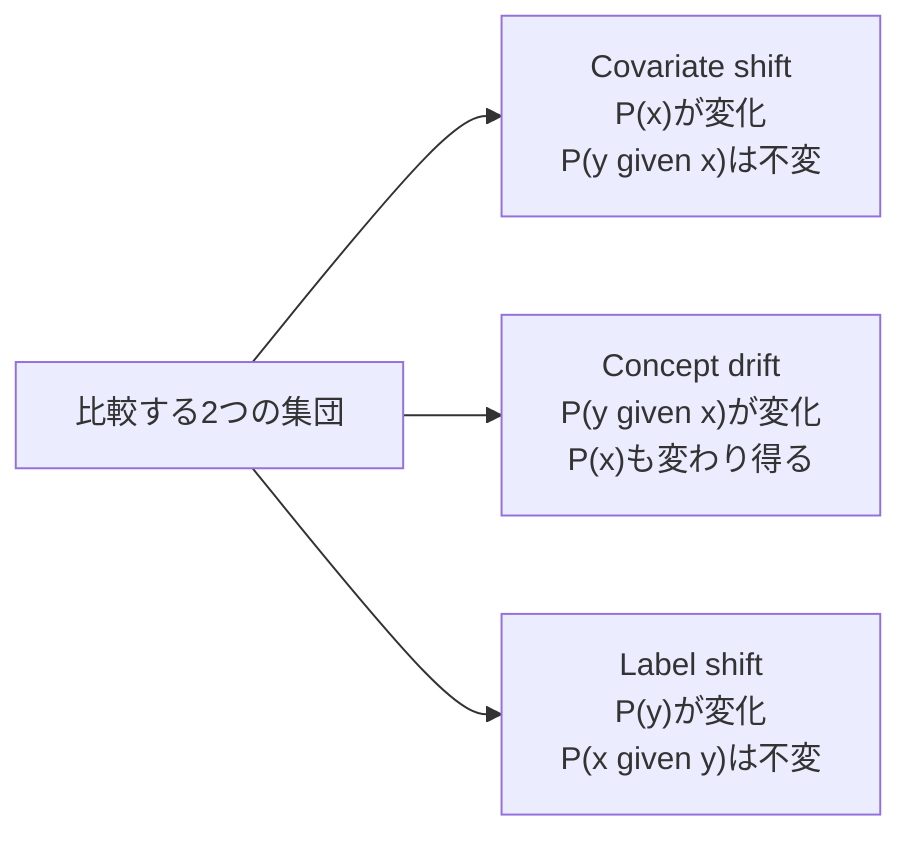
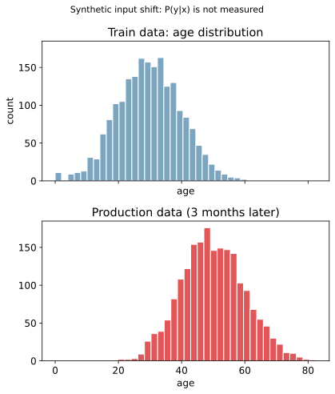
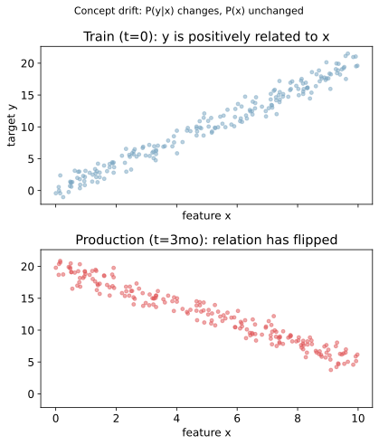
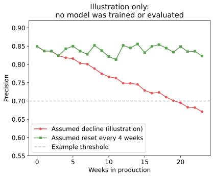

データドリフトは、比較する時点や環境の間でデータの分布が変わることです。例えば、学習時より年配の利用者が増える場合や、同じ入力に対する正解の傾向が変わる場合があります。コードやモデルを変えていなくても、予測性能に影響する可能性があります。

ただし、分布の変化と性能の低下は同じではありません。変化しても予測が当たる場合があります。また、運用後だけでなく、学習用と評価用のデータを集めた環境の違いでも生じます。

<br>

本記事では、何の分布が変わったかを整理し、監視で分かることと分からないことを区別します。

---

### 変わる分布と保つ仮定

入力をx、正解をyとすると、`P(x)` は入力分布、`P(y)` は正解の周辺分布です。`P(y|x)` は入力が分かった時の正解の分布、`P(x|y)` は正解のクラスが分かった時の入力分布を表します。[同時分布・周辺分布・条件付き分布](../../math/joint-marginal-conditional/)の関係を使います。



図では、各タイプで変化する分布と、不変と仮定する分布を並べています。Domain shiftは環境の違いによる分布変化を広く指し、上記の変化を含み得ます。また、data driftを入力分布の変化に限定して使う資料もあるため、監視する分布を具体的に指定する方が確実です。

---

### Covariate shift（共変量シフト）

入力分布 `P(x)` が変わる一方、入力と出力の関係 `P(y|x)` は変わらないパターンです。例として、訓練データのユーザー年齢分布は若年中心だったところ、サービスの認知が広がって本番では年配層が増えたケースを考えます。年齢などの入力が同じなら正解の傾向も変わらない、という条件の下ではCovariate shiftに当たります。

```python
import matplotlib.pyplot as plt
import numpy as np

rng = np.random.default_rng(0)
train_x = rng.normal(loc=30, scale=10, size=2000).clip(0, 100)
prod_x = rng.normal(loc=50, scale=10, size=2000).clip(0, 100)

fig, axes = plt.subplots(1, 2, figsize=(9, 3.5), sharex=True, sharey=True)
axes[0].hist(train_x, bins=30, color="#7aa6c2", edgecolor="white")
axes[0].set_title("Train data: age distribution")
axes[0].set_xlabel("age"); axes[0].set_ylabel("count")
axes[1].hist(prod_x, bins=30, color="#e15759", edgecolor="white")
axes[1].set_title("Production data (3 months later)")
axes[1].set_xlabel("age")
fig.suptitle("Synthetic input shift: P(y|x) is not measured")
plt.tight_layout()
plt.savefig("data-drift_covariate.svg", bbox_inches="tight")
```



この図は[NumPy](https://numpy.org/)で作った合成の入力分布です。正解yは生成していないため、図だけでは `P(y|x)` が不変であることや、予測性能への影響は確認できません。Covariate shiftと呼ぶには、その条件も必要です。

入力の平均・分散に加え、分布全体も比較します。例えば[SciPyの2標本KS検定](https://docs.scipy.org/doc/scipy/reference/generated/scipy.stats.ks_2samp.html)は、独立に得た2標本の分布を比較します。有意差があることと、予測に支障があることは別です。

---

### Concept drift（概念ドリフト）

入力と出力の関係 `P(y|x)` が変わるパターンです。入力分布 `P(x)` が同時に変わる場合もあります。以下の例では、関係の変化だけを見やすくするため、入力を同じ値に固定します。同じ入力値の集合を使い、xが大きいほどyも大きくなる関係から、xが大きいほどyが小さくなる関係へ変えます。

```python
x_common = rng.uniform(0, 10, 200)
y_t0 = 2.0 * x_common + rng.normal(0, 1, 200)
y_t1 = -1.5 * x_common + 20 + rng.normal(0, 1, 200)

fig, axes = plt.subplots(1, 2, figsize=(9, 3.5), sharex=True, sharey=True)
axes[0].scatter(x_common, y_t0, alpha=0.5, color="#7aa6c2", s=15)
axes[0].set_title("Train (t=0): y is positively related to x")
axes[0].set_xlabel("feature x"); axes[0].set_ylabel("target y")
axes[1].scatter(x_common, y_t1, alpha=0.5, color="#e15759", s=15)
axes[1].set_title("Production (t=3mo): relation has flipped")
axes[1].set_xlabel("feature x")
fig.suptitle("Concept drift: P(y|x) changes, P(x) unchanged")
plt.tight_layout()
plt.savefig("data-drift_concept.svg", bbox_inches="tight")
```



ユーザー行動の変化（流行・季節性・社会変化）、競合サービスの動き、業界規制の変更などが原因になりやすいです。例えば、レコメンドモデルで「以前は同ジャンル過去購入が強いシグナルだったところ、最近は価格帯が効くようになった」というケースは典型的な concept drift です。

入力の統計量だけ見ても検知できないのが厄介と言えます。予測への影響を確かめるには、[本番の予測と正解を突き合わせて評価](../model-performance-monitoring/)します。正解ラベルの入手が遅れる場合は、後から予測時点の記録と対応付けられるようにします。

---

### Label shift（ラベルシフト / Prior shift）

目的変数の周辺分布 `P(y)` が変わり、クラスごとの入力分布 `P(x|y)` は変わらない、という仮定です。[Liptonらの原論文](https://proceedings.mlr.press/v80/lipton18a.html)でもこの条件を使います。

例えば、2クラスで `P(x=1|y=1)=0.8`、`P(x=1|y=0)=0.2` とします。正例率が `P(y=1)=0.1` から `0.5` に変わると、入力の周辺確率は `0.8×0.1 + 0.2×0.9 = 0.26` から `0.8×0.5 + 0.2×0.5 = 0.5` へ変わります。クラス内の分布が同じでも、混ぜる比率が変わるためです。

また、[ベイズの定理](/ml/math/bayes-theorem/)から `P(y=1|x=1)` も約0.308から0.8へ変わります。Label shiftで保つのは `P(x|y)` であり、`P(x)` と `P(y|x)` が両方不変という意味ではありません。

代表性のある正解ラベルが得られるなら、正例率の変化を測れます。ただし、正例率が変わったことだけでは `P(x|y)` の不変までは分かりません。条件が妥当なら事前確率の比率を使う補正などを検討できますが、一般の分布変化を[確率校正](../../ml/probability-calibration/)だけで解消できるとは限りません。

---

### Domain shift（ドメインシフト）

`P(x)` `P(y|x)` `P(y)` のいずれか、または複数が同時に変化する広義の概念です。「訓練データを取った環境と本番の環境が違う」全般を指します。先述の仮定が成り立つ場合も、複数の分布が変化して単純な仮定では説明できない場合もあります。

切り分けは「先に統計検定で `P(x)` を確認」「次に予測精度と陽性比率を確認」「最後にラベルとの関係を確認」の順で進めるのが効率的です。

---

### 検知する方法

入力・モデルの予測・正解ラベルを、それぞれ別の観測として記録します。

- 入力：欠損率、カテゴリ比率、分布の差を比較する。平均が同じでも分布全体や列同士の関係が変わることはある
- 予測：予測クラスの比率やスコア分布を比較する。入力の変化を捉える手掛かりにはなるが、正解との関係は分からない
- 正解：ラベルが届いた予測を、予測時刻や対象群を揃えて評価する。ラベルが一部の利用者だけに付く場合は偏りも確認する

特に、モデルを固定し `P(x)` も不変なら、予測スコアの分布は変わりません。それでも `P(y|x)` が変われば誤りは増え得ます。予測確率の平均だけでConcept driftを検出できるわけではありません。

[検定のp値](../../math/hypothesis-test/)はサンプル数にも左右されます。多数の列を繰り返し検査する時は偶然の警報も増えるので、変化量、継続時間、影響する予測件数と併せて判断します。ドリフトの検知を、そのままモデル交換の許可にしないようにします。

---

### 対処: 再学習と学習データの更新

分布変化を検知したら、収集処理の不具合や対象群の変化を確認し、ラベルがあれば性能への影響を評価します。性能が低下している場合の対処には、次の選択肢があります。

1. 定期再学習
    - 週次・月次など固定スケジュールで最新データを使って再学習
    - パイプライン化が前提（学習ジョブ・評価・デプロイの自動化）
2. しきい値起動の再学習
    - 分布の変化量や性能低下が定めた条件を満たしたら、[再学習パイプライン](../retraining-pipeline/)を起動する
    - 再学習がコスト高のときに有効
3. 学習データの更新
    - sliding window（直近 N 日分だけ）で学習データを切り替える
    - 時間減衰重み（古いサンプルほど重みを下げる）で学習する
4. オンライン学習
    - 1 サンプルずつ逐次的にモデルを更新する手法（[SGDClassifier](https://scikit-learn.org/stable/modules/generated/sklearn.linear_model.SGDClassifier.html) の `partial_fit` など）
    - 連続的に変化するデータには有効。ただし、誤ったラベルや一時的な偏りを取り込み続けないよう、更新後の性能を監視する
5. アンサンブル切り替え
    - 複数モデル（古いモデル・新しいモデル）を運用し、状況に応じてゲートで重みを切り替える
    - A/B テストで段階的に新モデルに切り替える運用と相性が良い

<br>

以下は、低下する値と4週ごとに回復させる値を手で構成した模式図です。モデルを学習・評価した結果ではなく、再学習の効果や適切な周期を示すデータでもありません。

```python
weeks = np.arange(0, 24)
baseline = 0.85 - 0.008 * weeks + rng.normal(0, 0.005, len(weeks))

retrained = baseline.copy()
for w in [4, 8, 12, 16, 20]:
    delta = 0.85 - retrained[w]
    retrained[w:] = retrained[w:] + delta + rng.normal(0, 0.003,
                                                       size=len(retrained) - w)

fig, ax = plt.subplots(figsize=(7, 4))
ax.plot(weeks, baseline, color="#e15759", marker="o", markersize=4,
        label="Assumed decline (illustration)")
ax.plot(weeks, retrained, color="#59a14f", marker="s", markersize=4,
        label="Assumed reset every 4 weeks")
ax.axhline(0.70, color="gray", linestyle="--", alpha=0.6,
           label="Example threshold")
ax.set_xlabel("Weeks in production"); ax.set_ylabel("Precision")
ax.set_title("Illustration only: no model was trained or evaluated")
ax.set_ylim(0.55, 0.92); ax.legend()
plt.tight_layout()
plt.savefig("data-drift_decay.svg", bbox_inches="tight")
```



図の0.70も説明用の閾値です。再学習した候補は、学習に使っていない最近のデータで現行モデルと比較します。改善しなければ現行モデルを維持し、ラベルや特徴量の収集方法を見直す場合もあります。[Matplotlib](https://matplotlib.org/)を含む[図の生成コード](https://github.com/nao1215/debimate/blob/main/projects/ml/scripts/notes/data-drift_gen.py)はGitHubで確認できます。

---

### 機械学習での使いどころ

分布変化を想定すると、モデルの評価に加えて、次の運用方法を決める必要があります。

- 監視ダッシュボード設計: 入力統計・予測分布・正解精度の 3 段を並べる
- 再学習スケジュール設計: ドリフトの速さに応じて週次・月次・しきい値起動を選ぶ
- データセット更新ポリシー: sliding window の幅、減衰重みの設計
- A/B テスト運用: 新旧モデルの並走で安全に切り替える
- データ収集: 本番で ground truth が後から入手できる仕組み（クリック・購入・問い合わせなど）の設計
- 校正の再フィット: 確率出力を使う場面では label shift だけ起きていないか別途確認する

一般に、デプロイがゴールではなく「劣化に気づける状態」を作ることがモデルを本番で使い続ける前提条件と考えられます。コードもモデルも変えていないのに精度が下がる現象がある、と知っているだけで運用後の混乱を減らせます。

---

### よくある誤解

- 「コードが同じなら精度は維持される」とは限らない: 入力データとユーザー行動は時間で変わるため、利用中も入力と予測性能を確認する
- 「再学習すれば必ず良くなる」とは限らない: ドリフトの種類によっては再学習が逆効果（古いデータの重みを残した方が安定する）になる場合があるため、A/B で比較する
- 「Accuracy だけ見ていれば気づける」とは限らない: ラベルが遅延入手のサービスでは、本番予測の段階では精度が分からない。入力分布のドリフトを先行指標として併用する必要がある
- 「concept drift と covariate shift は同じ」ではない: 対処（再学習で済むか、確率校正で済むか、入力選別で済むか）が違うので、切り分けが意味を持つ
- 「変化は全て外部環境が原因」とは限らない: 特徴量の収集処理や前処理の変更・不具合でも、モデルに届く入力は変わる。外部の利用傾向とともに、データを作る処理も確認する
