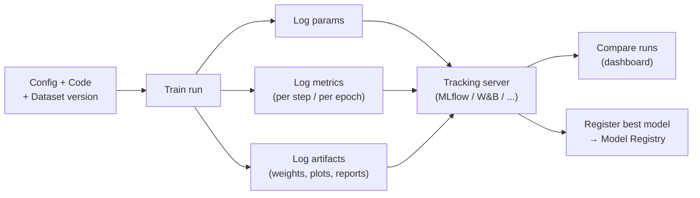
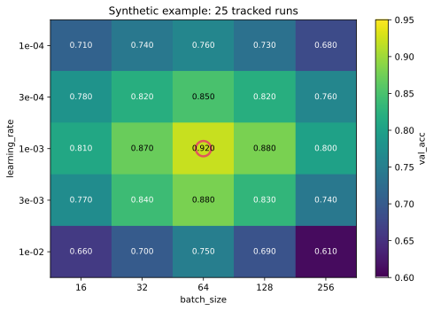
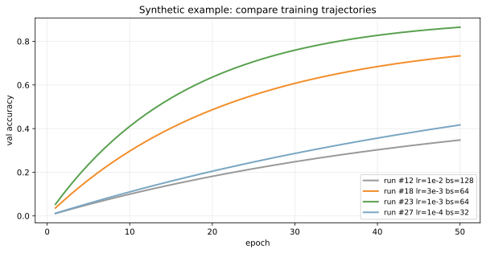
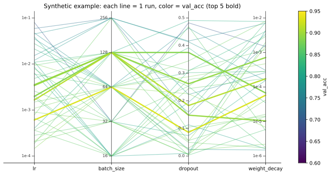

実験管理（experiment tracking）は、機械学習モデルの学習を「再現可能な記録」として残す仕組みです。1 回の学習を「実験（experiment）」と捉え、そこに入った設定（hyperparameter、データセット、コードバージョン）、出てきた結果（metric、可視化、学習曲線）、副産物（学習済み weight、前処理後データ、評価レポート）を 1 セットで保存します。

何百回も `train.py --lr 0.001` を回した記憶を頼りに「あのとき lr いくつだったっけ」を探す事態を避けるための運用基盤で、(1) 再現性、(2) モデル比較、(3) ステークホルダー説明、(4) 監査、の 4 つの目的を同時に達成します。代表的なツールに [MLflow](https://mlflow.org/)、[Weights & Biases](https://wandb.ai/)（W&B）、Neptune、Comet、TensorBoard、ClearML などがあります。

[ハイパーパラメータ](../../ml/hyperparameter/) 探索や [交差検証](../../ml/cross-validation/) と組み合わせると効果が大きく、ベイズ最適化や `Optuna` の study も実験管理ツールに保存できます。

---

### 実験管理の全体像



トラッキングサーバーは「全実験のメタデータ DB + アーティファクトストア」の組み合わせで、(1) リレーショナル DB に params/metrics、(2) S3 や MinIO に weights/plots をそれぞれ保存するのが典型です。各 run には一意の ID が振られ、Git の commit SHA、データのハッシュ、Docker イメージ、Python の `requirements.txt` まで紐付ける運用が標準となります。

---

### 何をログすればよいか

トラッキング対象は次の 5 つに分類できます。これが揃って初めて「他人がその run を再現できる」状態になります。

| 種別 | 例 | 目的 |
|---|---|---|
| Params | `lr=1e-3, batch_size=64, model="resnet50"` | 設定の記録 |
| Metrics | `train_loss`, `val_acc`, `epoch_time` | 結果の評価 |
| Artifacts | `model.pt`, `confusion_matrix.png`, `predictions.csv` | 成果物保存 |
| Environment | `requirements.txt`, `conda_env.yml`, Docker image digest | 環境再現 |
| Lineage | Git commit SHA、データセット version | コード/データ追跡 |

記憶に頼らず run 同士の違いを調べられるように、設定や結果をログに残します。

---

### コード例: MLflow

MLflow を例にした最小限のトラッキングコードです。MLflow 3.18.0 と scikit-learn 1.9.1 で実行すると、params と metrics はカレントディレクトリの `mlflow.db`（SQLite）に、モデル・混同行列・評価レポートは `mlruns/` に残ります。

```python
from pathlib import Path

import matplotlib.pyplot as plt
import mlflow
from sklearn.ensemble import RandomForestClassifier
from sklearn.datasets import load_iris
from sklearn.metrics import (
    ConfusionMatrixDisplay, accuracy_score, classification_report, f1_score
)
from sklearn.model_selection import train_test_split

X, y = load_iris(return_X_y=True)
X_train, X_test, y_train, y_test = train_test_split(
    X, y, test_size=0.25, random_state=0, stratify=y
)
artifact_dir = Path("artifacts")
artifact_dir.mkdir(exist_ok=True)

mlflow.set_experiment("iris-classification")
with mlflow.start_run(run_name="rf-baseline"):
    # 1. params を記録
    params = {"n_estimators": 200, "max_depth": 8, "random_state": 0}
    mlflow.log_params(params)

    # 2. 学習
    model = RandomForestClassifier(**params).fit(X_train, y_train)
    pred = model.predict(X_test)

    # 3. metrics を記録（3 クラスなので F1 はクラスごとの値を平均する）
    mlflow.log_metric("accuracy", accuracy_score(y_test, pred))
    mlflow.log_metric("f1_macro", f1_score(y_test, pred, average="macro"))

    # 4. artifacts を記録 (model 自体、可視化、レポート)
    mlflow.sklearn.log_model(
        model, name="model", skops_trusted_types=["sklearn.tree._tree.Tree"]
    )
    fig, ax = plt.subplots()
    ConfusionMatrixDisplay.from_predictions(y_test, pred, ax=ax)
    figure_path = artifact_dir / "confusion_matrix.png"
    fig.savefig(figure_path, bbox_inches="tight")
    plt.close(fig)
    mlflow.log_artifact(str(figure_path))
    report = classification_report(y_test, pred, output_dict=True)
    mlflow.log_dict(report, "report.json")

    # 5. lineage (環境の requirements.txt は log_model がモデルと一緒に残す)
    mlflow.set_tag("dataset", "sklearn.datasets.load_iris")
```

手元の実行では accuracy が 0.947、f1_macro が 0.946 でした。Iris は 3 クラスなので、[`f1_score`](https://scikit-learn.org/stable/modules/generated/sklearn.metrics.f1_score.html) を既定の `average="binary"` のまま呼ぶと ValueError で止まります。`average="macro"` はクラスごとの F1 を単純平均します。`skops_trusted_types` を外すと、MLflow 3 系の既定の保存形式である [skops](https://skops.readthedocs.io/) が RandomForest の内部型を拒み、保存の時点で例外になります。

`with mlflow.start_run()` の中で `log_*` を呼ぶと、ID が振られた 1 つの run にまとまります。チームではこれをトラッキングサーバーに送り、ダッシュボードで比較します。

---

### ハイパーパラメータ探索の可視化

実験管理の最も典型的な利用は、ハイパーパラメータ探索の結果比較です。グリッドサーチ・ランダムサーチ・ベイズ最適化のどれを使っても、各試行を個別の run として記録すれば、後で 1 つのダッシュボードで一覧できます。次の図は、比較の読み方を示すために生成した仮想の 25 run です。実測値ではありません。

```python
import numpy as np
import matplotlib.pyplot as plt

# 表示用の仮想結果。実際は tracking server から取得する
lrs = [1e-4, 3e-4, 1e-3, 3e-3, 1e-2]
batches = [16, 32, 64, 128, 256]
val_acc = np.array([
    [0.71, 0.74, 0.76, 0.73, 0.68],
    [0.78, 0.82, 0.85, 0.82, 0.76],
    [0.81, 0.87, 0.92, 0.88, 0.80],
    [0.77, 0.84, 0.88, 0.83, 0.74],
    [0.66, 0.70, 0.75, 0.69, 0.61],
])
fig, ax = plt.subplots()
im = ax.imshow(val_acc, cmap="viridis", vmin=0.60, vmax=0.95)
ax.set_xticks(range(len(batches)), batches)
ax.set_yticks(range(len(lrs)), [f"{lr:.0e}" for lr in lrs])
ax.set_xlabel("batch_size")
ax.set_ylabel("learning_rate")
best = np.unravel_index(np.argmax(val_acc), val_acc.shape)
ax.scatter(best[1], best[0], s=220, facecolors="none", edgecolors="#e15759")
fig.colorbar(im, ax=ax, label="val_acc")
fig.savefig("experiment_sweep_heatmap.svg", bbox_inches="tight")
```



この仮想例では、赤丸の `lr=1e-3, batch_size=64` が最良です。色の濃淡は val_acc を表します。実データでは、各 run に `lr`、`batch_size`、`val_acc` を記録し、データ分割と乱数 seed も同時に比較します。

---

### 複数 run の学習曲線比較

異なる設定の学習曲線を 1 枚に重ねると、学習の速さや検証指標の差を比較できます。以下の値も読み方を示す仮想 run であり、トラッキングサーバーから取得した実測値ではありません。

```python
# tracking server から取得した配列を想定する仮想曲線
epochs = np.arange(1, 51)
run_12_curve = 0.55 * (1 - np.exp(-0.020 * epochs))
run_18_curve = 0.82 * (1 - np.exp(-0.045 * epochs))
run_23_curve = 0.91 * (1 - np.exp(-0.060 * epochs))
run_27_curve = 0.79 * (1 - np.exp(-0.015 * epochs))
plt.plot(epochs, run_12_curve, label="run #12 lr=1e-2 bs=128")
plt.plot(epochs, run_18_curve, label="run #18 lr=3e-3 bs=64")
plt.plot(epochs, run_23_curve, label="run #23 lr=1e-3 bs=64")
plt.plot(epochs, run_27_curve, label="run #27 lr=1e-4 bs=32")
plt.legend()
plt.savefig("experiment_compare_runs.svg", bbox_inches="tight")
```



この仮想例では、run #23（緑）が最も高い val_acc に収束し、run #27（青）は 50 epoch 時点で伸び切っていません。実際の曲線では、過学習を判断するために train/validation の両方、データ分割、停止条件も記録します。

---

### 多次元ハイパーパラメータの俯瞰

4 個以上のハイパーパラメータを同時に変えると、heatmap や散布図では限界が来ます。Parallel coordinates plot は多次元探索を 1 枚にまとめる定番の可視化で、[W&B のダッシュボード](https://docs.wandb.ai/models/app/features/panels/parallel-coordinates)でも標準機能になっています。次の図も、読み方を示すために乱数で作った仮想の 40 run です（[生成元](https://github.com/nao1215/debimate/blob/main/projects/ml/scripts/notes/experiment-tracking_gen.py)）。



各線が 1 つの run で、色が val_acc を表し、上位 5 run を太線にしています。各軸の目盛りは元の値です。この仮想例の上位 5 run は、`lr` が 6e-4〜3.5e-3、`batch_size` が 64 か 128 に集まる一方、`dropout` は 0.09〜0.38、`weight_decay` は 1e-5〜7e-4 に散らばっています。ここから「`lr` と `batch_size` は効きが大きく、残り 2 つは小さそう」と仮説を立て、次の探索範囲を絞ります。

---

### 数学での使いどころ

- 統計的仮説検定との対応: A/B テスト的に「設定 A が設定 B より有意に良いか」を [仮説検定](../../math/hypothesis-test/) で評価
- ベイズ最適化: ガウス過程による獲得関数の更新で、過去の run から次の有望候補を選ぶ
- メタ学習: 過去実験の結果を「メタ訓練データ」として扱い、新タスクの初期 hyperparameter を予測
- 多目的最適化: Pareto 最適性の議論（精度 vs 学習時間など複数の指標）

---

### 機械学習での使いどころ

- ハイパーパラメータ探索: GridSearchCV / RandomizedSearchCV / Optuna の各試行を 1 run として記録
- モデル比較: 異なるアルゴリズム（[ロジスティック回帰](../../ml/logistic-regression/) vs [勾配ブースティング](../../ml/gradient-boosting/) vs ニューラル）を同じ評価指標で並べる
- アブレーション: 特徴量 1 つを外したときの精度変化を run として残す
- データセット version 管理: 同じコードで「v1 のデータ」「v2 のデータ」を別 run として記録
- チームコラボ: 誰がいつ何を試したかが共有できる（休暇明けでも追える）
- 監査・規制対応: 「このモデルがどう作られたか」の証跡として
- 論文の再現性確保: 全実験の seed・ハイパーパラメータをトラッキング ID で参照可能に
- 後段の [モデルレジストリ](../model-registry/) への接続: 「best run」を選んで本番モデルに昇格

ツール選び:

- 個人 / 小規模チーム: MLflow（OSS、self-host 可能）、TensorBoard（深層学習特化）
- 中規模チーム: Weights & Biases（無料枠あり、UI が秀逸）、Neptune、Comet
- 大規模・企業: Vertex AI Experiments、SageMaker Experiments、Azure ML、Databricks MLflow

---

### 適さないケース / 落とし穴

- 1 行 1 メトリックで全部 print してログファイルに頼る: run をまたいだ比較・検索ができなくなる。最低限 MLflow を入れる
- params だけログして artifacts を残さない: モデル本体が再現できなければ意味が薄い
- 環境（requirements / Docker image）を残さない: 「同じコードで違う結果」が起きたとき原因究明できない
- データセット version を tag しない: データが上書きされると過去 run の再現が不可能になる
- 巨大なファイルを毎回 artifact に保存: ストレージコストが爆発。weights は最良 run だけ残す等の運用ルールを決める
- 実験名がカオス（"test1", "final", "final_v2"）: 命名規約（`{date}_{algo}_{purpose}`）を最初に決める
- 個人開発で「自分しか使わないから」と省略: 3 か月後の自分にも他人と思って記録する
- トラッキングサーバーが壊れたときの復旧計画なし: DB とモデルファイルを定期的にバックアップする。例えば、バックアップ用スクリプトを cron で実行する
- メトリクスのスケールがバラバラ: `loss` と `accuracy` を同じ軸で比較すると判断を誤る。グループ化と単位を意識する
- 失敗 run を消す: 「効かなかった設定」も貴重な情報。失敗 run も残して後から検索できるようにする
