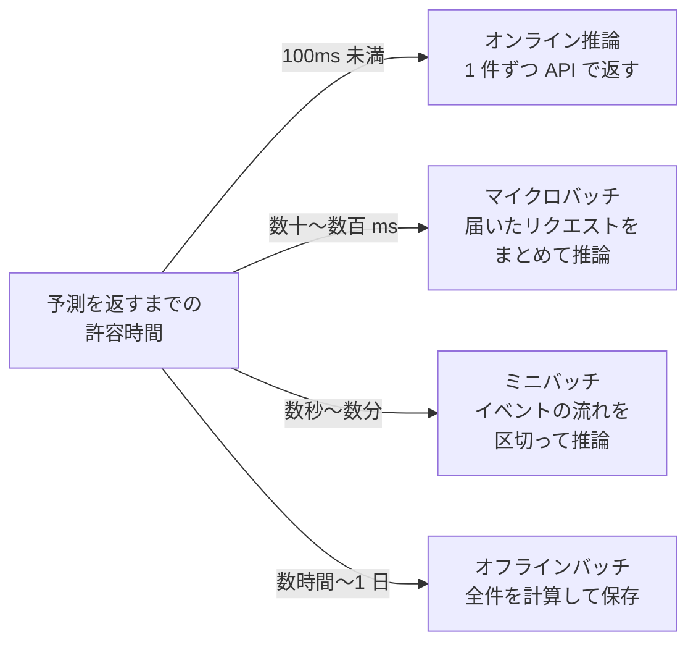

推論サービング（inference serving）は、学習済みモデルに本番の入力を渡して予測を返す仕組みです。例えば、解約しそうな顧客を当てるモデルなら、会員ページを開いたユーザーに解約確率をその場で返すこともできますし、全顧客の解約確率を夜間に計算して DB（データベース）へ保存しておくこともできます。前者をオンライン推論、後者をバッチ推論と呼びます。どちらを選ぶかで、サーバーの構成・コスト・監視する指標が変わります。

[モデルレジストリ](../model-registry/) でどのモデルを使うかを決め、[モデル性能劣化の監視](../model-performance-monitoring/) で本番の品質を確かめる流れの中で、実際に予測を返す役割を持つのがこの層です。



<br>

本記事では、次の疑問を順に扱います。

- 応答の速さは、なぜ平均ではなく P99 で測るのか
- 事前に全件を計算するバッチ推論は、いつ安くなるのか
- 同じモデルを API とバッチ処理で使うと、コードはどう違うのか
- レプリカやキャッシュを増やすと、遅いリクエストはどこまで減るのか

---

### 4 つの提供タイプ

図の 4 つは、予測を返すまでに許される時間で分けたものです。具体例は次の通りです。

| タイプ | 推論のまとめ方 | 例 |
|---|---|---|
| オンライン | 1 リクエストごとに推論して返す | 検索結果のランキング、決済時の不正検知 |
| マイクロバッチ | 数 ms〜数十 ms 待ち、その間に届いたリクエストを 1 回の推論にまとめる | GPU で動かす画像認識や言語モデルの API |
| ミニバッチ | イベントの流れを秒〜分単位で区切り、結果を保存先へ書く | クリックログからの特徴量生成 |
| オフラインバッチ | 夜間などに全件を計算し、結果を保存する | 全顧客の与信スコアの再計算、レコメンドの事前計算 |

マイクロバッチの例は [Triton Inference Server の dynamic batching](https://docs.nvidia.com/deeplearning/triton-inference-server/user-guide/docs/user_guide/batcher.html) で、応答は 1 件ずつ返します。ミニバッチの例は [Spark Structured Streaming](https://spark.apache.org/docs/latest/streaming/index.html) ですが、Spark はこれを micro-batch と呼びます。呼び名は製品で揺れるので、まとめ方と応答の返し方で区別してください。

---

### 応答時間は平均ではなく P99 で測る

オンライン推論の応答時間は、平均ではなく P95（95 パーセンタイル）や P99 で決めます。P99 は、全リクエストを速い順に並べた時に 99% 目の位置にある応答時間です。ユーザーが覚えているのは遅かった時なので、遅い側の裾を見る指標を使います。

次のコードは、10 万リクエストの応答時間を作り、平均と 3 つのパーセンタイルを比べます。大半は 30ms 前後で返り、5% だけが平均 80ms の待ちを追加で受ける、という仮定です。

```python
import numpy as np

n = 100_000
rng = np.random.default_rng(0)
latencies = rng.gamma(shape=2, scale=15, size=n) + \
             rng.exponential(scale=80, size=n) * (rng.random(n) < 0.05)
print(f"mean = {latencies.mean():.1f}ms")
for q in [50, 95, 99]:
    print(f"P{q} = {np.percentile(latencies, q):.1f}ms")
```

出力:

```text
mean = 34.0ms
P50 = 26.4ms
P95 = 83.0ms
P99 = 159.6ms
```

同じデータをヒストグラムにした図が次です。



平均は 34ms で、P50（中央値）の 26ms と大差ありません。一方で P99 は 160ms あり、P50 の約 6 倍です。100 回に 1 回は 160ms 以上待つユーザーがいるのに、平均だけを見ていると気付けません。

遅い応答の割合を SLO（service level objective、サービスの目標値）で管理する場合は、「P99 < 200ms」のようにパーセンタイルと上限の組で決めます。

---

### コストの比較

4 つのタイプで、同じモデルを動かした時のレイテンシ・スループット・100 万件あたりのコストを並べたのが次の図です。数値は傾向を示すための仮定で、実測ではありません。



オンライン推論は応答が速い代わりに、100 万件あたり 12 ドルと最も高くなっています。オフラインバッチは 0.3 ドルで、1 件あたりのコストは 1/40 です。ただし、バッチ推論は予測を使わないユーザーの分まで計算します。

例えば、100 万人のユーザーのレコメンドを 6 時間ごとに事前計算する場合と、ログインした時だけオンラインで推論する場合を比べます。単価は図と同じ仮定です。

```python
online_cost, batch_cost = 12, 0.3   # USD / 100 万件（図と同じ仮定）
users, runs_per_day = 1_000_000, 4  # 全ユーザーぶんを 6 時間ごとに事前計算

batch = users * runs_per_day * batch_cost / 1e6
for logins in [50_000, 100_000, 300_000]:
    online = logins * online_cost / 1e6
    print(f"logins/day={logins:7,}: online = ${online:.2f}, batch = ${batch:.2f}")
```

出力:

```text
logins/day= 50,000: online = $0.60, batch = $1.20
logins/day=100,000: online = $1.20, batch = $1.20
logins/day=300,000: online = $3.60, batch = $1.20
```

1 日のログインが 10 万人（全体の 10%）で両者が並び、それより少なければオンライン推論の方が安くなります。1 件あたり 1/40 という単価だけでは決まらず、予測を実際に使う件数と事前計算の回数で決まります。事前計算には、最大 6 時間前の予測を返すという制約も付きます。

---

### 同じモデルを API とバッチで使う

ここからは、同じ解約予測モデルをオンライン推論とバッチ推論の両方で使います。モデルは、契約月数・月額料金・問い合わせ回数の 3 つから解約確率を出す[ロジスティック回帰](../../ml/logistic-regression/)です。

[実験コード](./lab/run.py)は、架空の顧客 2,000 人でモデルを学習し、一時ディレクトリの [MLflow](https://mlflow.org/) レジストリへ登録して別名 `champion` を付け、下の `serve.py` と `batch_predict.py` を呼び出します。本文には推論の 2 ファイルだけを全体で載せ、登録と呼び出しの `run.py` はリンク先に置きます。

[依存ファイル](./lab/requirements.txt)と 3 つのファイルを同じディレクトリへ保存し、Python 3.12 と Java 17 で実行します。手元の JDK 17.0.2 では Spark の起動がコンテナ判定の不具合で落ちたので、`JAVA_TOOL_OPTIONS` で無効にしました。

```bash
python3 -m venv .venv
.venv/bin/pip install -r requirements.txt
JAVA_TOOL_OPTIONS=-XX:-UseContainerSupport .venv/bin/python run.py
```

モデルの登録時には、[`mlflow.sklearn.log_model`](https://mlflow.org/docs/latest/api_reference/python_api/mlflow.sklearn.html#mlflow.sklearn.log_model) に `pyfunc_predict_fn="predict_proba"` を渡しています。指定しないと、共通の読み込み口（pyfunc）の `predict` は 0 か 1 のラベルを返し、確率は取れません。

<br>

オンライン推論は [FastAPI](https://fastapi.tiangolo.com/) で書きます。起動時に 1 回だけモデルを読み込み、リクエストごとに `predict` を呼びます。

```python
from fastapi import FastAPI
from mlflow import MlflowClient
import mlflow.pyfunc
import pandas as pd
from pydantic import BaseModel

NAME = "churn-classifier"

# 起動時に 1 回だけ、別名 champion が指すバージョンを決めて読み込む
version = MlflowClient().get_model_version_by_alias(NAME, "champion").version
model = mlflow.pyfunc.load_model(f"models:/{NAME}/{version}")

app = FastAPI()


class Customer(BaseModel):
    tenure_months: float
    monthly_charges: float
    support_calls: float


@app.post("/predict")
def predict(customer: Customer):
    X = pd.DataFrame([customer.model_dump()])
    # 登録時に predict_proba を指定したので、[解約しない確率, 解約する確率] が返る
    churn_proba = model.predict(X)[0][1]
    return {"churn_probability": round(float(churn_proba), 3), "model_version": version}


@app.get("/healthz")
def healthz():
    return {"status": "ok"}
```

別名を解決してからバージョン番号で読み込むので、応答の `model_version` は実際に読み込んだモデルと一致します。後から別名を付け替えても、このプロセスは再起動するまで同じバージョンを返します（[モデルレジストリ](../model-registry/)のノートで実験しています）。

以前の `models:/churn-classifier/Production` のようなステージ指定は、MLflow 2.9.0 から[非推奨](https://mlflow.org/docs/latest/ml/model-registry/workflow/)です。

`/healthz` は [Kubernetes の liveness probe](https://kubernetes.io/docs/tasks/configure-pod-container/configure-liveness-readiness-startup-probes/) 用、`/predict` が本体です。`model.predict` の前後で時間を測って [Prometheus](https://prometheus.io/) などに送れば、前節のような分布を本番で確認できます。

<br>

バッチ推論は [PySpark](https://spark.apache.org/docs/latest/api/python/index.html) で書きます。[`mlflow.pyfunc.spark_udf`](https://mlflow.org/docs/latest/api_reference/python_api/mlflow.pyfunc.html#mlflow.pyfunc.spark_udf) は、列をまとめて渡す Pandas UDF を作ります。モデルのディレクトリは zip にして各 executor へ配られ、executor の Python プロセスごとに 1 回だけ読み込まれます。名前を付けずに渡した列は、登録時のシグネチャの順に特徴量として扱われます。

```python
import sys

import mlflow.pyfunc
from pyspark.sql import SparkSession

FEATURES = ["tenure_months", "monthly_charges", "support_calls"]


def main(input_path: str, output_path: str) -> None:
    spark = SparkSession.builder.getOrCreate()
    # モデルを各 executor に配り、Pandas UDF として列単位で推論する
    predict = mlflow.pyfunc.spark_udf(
        spark, "models:/churn-classifier@champion", result_type="array<double>"
    )
    df = spark.read.parquet(input_path)
    scored = df.withColumn("churn_probability", predict(*FEATURES)[1])
    scored.write.mode("overwrite").parquet(output_path)


if __name__ == "__main__":
    main(sys.argv[1], sys.argv[2])
```

本番では `s3://data/yesterday-features/` のような入力と出力のパスを渡し、下流のサービスが朝に結果を読み込みます。`run.py` では、ローカルの Parquet ファイルに 5 人分の特徴量を書いて渡しました。出力は次の通りです。

```text
GET /healthz -> {'status': 'ok'}
POST /predict {'tenure_months': 60, 'monthly_charges': 30.0, 'support_calls': 0} -> {'churn_probability': 0.034, 'model_version': 1}
POST /predict {'tenure_months': 3, 'monthly_charges': 110.0, 'support_calls': 5} -> {'churn_probability': 0.982, 'model_version': 1}
 tenure_months  monthly_charges  support_calls  churn_probability
             3             60.9              1              0.658
            34            114.9              1              0.546
            37             51.2              2              0.352
            54             62.3              2              0.226
            68            102.8              0              0.089
max |spark - sklearn| = 1.1102230246251565e-16
```

5 年契約で問い合わせの無い顧客は 3.4%、契約 3 か月で問い合わせ 5 回の顧客は 98.2% です。最後の行は、Spark の確率と scikit-learn のモデルで直接出した確率の差の最大値で、浮動小数点の誤差の範囲で一致しています。

試作の段階では、契約月数と問い合わせ回数を整数のまま学習させて登録したところ、API の推論が `Can not safely convert float64 to int64` で落ちました。登録時に記録した入力の型（シグネチャ）は整数なのに、API は小数で受け取っていたからです。MLflow は推論の前にこの型を検査します。学習時の型と本番の入力の型は揃えてください。

---

### レプリカ数と待ち時間

オンライン推論では、リクエストが増えたらレプリカ（同じモデルを載せたサーバー）を増やします。ただし、増やすほど速くなるわけではありません。

次のコードは、毎秒平均 500 件のリクエストが届き、1 台が毎秒平均 150 件を処理できる場合に、レプリカ数ごとの待ち時間を計算します。到着間隔と処理時間を指数分布にした、待ち行列理論の M/M/c モデル（c はレプリカ数）です。空いたレプリカが届いた順に処理します。

```python
import heapq
import numpy as np

def simulate(replicas, arrival_rate=500, service_rate=150, n=200_000, seed=0):
    rng = np.random.default_rng(seed)
    arrivals = np.cumsum(rng.exponential(1 / arrival_rate, n))
    services = rng.exponential(1 / service_rate, n)
    free_at = [0.0] * replicas
    latency = np.empty(n)
    for i in range(n):
        start = max(arrivals[i], heapq.heappop(free_at))
        end = start + services[i]
        heapq.heappush(free_at, end)
        latency[i] = end - arrivals[i]
    return latency[n // 10:] * 1000  # 立ち上がりの 1 割を捨てて ms に

for c in range(4, 11):
    lat = simulate(c)
    print(f"replicas={c:2d}: utilization={500 / (150 * c):.0%}, "
          f"P50={np.percentile(lat, 50):5.1f}ms, P99={np.percentile(lat, 99):6.1f}ms")
```

出力:

```text
replicas= 4: utilization=83%, P50= 10.3ms, P99=  50.8ms
replicas= 5: utilization=67%, P50=  6.0ms, P99=  33.3ms
replicas= 6: utilization=56%, P50=  5.0ms, P99=  31.6ms
replicas= 7: utilization=48%, P50=  4.7ms, P99=  31.2ms
replicas= 8: utilization=42%, P50=  4.7ms, P99=  31.1ms
replicas= 9: utilization=37%, P50=  4.6ms, P99=  31.1ms
replicas=10: utilization=33%, P50=  4.6ms, P99=  31.1ms
```

3 台では処理能力が毎秒 450 件と到着を下回り、待ち行列が伸び続けるので省きました。



4 台から 5 台で P99 は 51ms から 33ms へ下がりますが、6 台より先はほぼ平らです。平らになった先の約 31ms は、推論そのものにかかる時間の P99（`ln 100 / 150` 秒 ≈ 30.7ms）です。待ち時間が消えた後は、レプリカを足しても 1 件の推論は速くなりません。P99 をさらに下げるには、モデルを軽くするか、次節のキャッシュを使います。

実際の増減は、[Kubernetes の HPA（Horizontal Pod Autoscaler）](https://kubernetes.io/docs/tasks/run-application/horizontal-pod-autoscale/)で自動化します。HPA は CPU やメモリの使用率で動かすのが基本で、毎秒のリクエスト数のような値を使うにはカスタムメトリクスの設定が要ります。キューの長さで増減するなら [KEDA](https://keda.sh/)、0 台まで減らしたいなら [Cloud Run](https://cloud.google.com/run) や [AWS Lambda](https://aws.amazon.com/lambda/) のようなサーバーレスも候補です。

---

### キャッシュの効き方

同じ入力に同じ予測を返すモデルなら、一度計算した結果を保存しておき、次からはそれを返せます。レコメンドで同じユーザーが短時間に同じ画面を何度も開く場合などです。次のコードは、ヒット率 0%・30%・70% で P50 と P99 を比べます。ヒットした時は 1〜5ms、外れた時はモデルで推論して 5ms 以上かかる、という仮定です。

```python
import numpy as np

rng = np.random.default_rng(1)
n = 20_000
for hit_rate in [0.0, 0.3, 0.7]:
    hit = rng.random(n) < hit_rate
    latency = np.where(hit,
                       rng.uniform(1, 5, n),                   # キャッシュから返す
                       rng.gamma(shape=2, scale=20, size=n) + 5)  # モデルで推論する
    print(f"hit={hit_rate:.0%}: P50 = {np.percentile(latency, 50):5.1f}ms, "
          f"P99 = {np.percentile(latency, 99):5.1f}ms")
```

出力:

```text
hit=0%: P50 =  38.6ms, P99 = 139.2ms
hit=30%: P50 =  26.2ms, P99 = 128.1ms
hit=70%: P50 =   3.8ms, P99 = 110.6ms
```



図は CDF（累積分布関数）で、縦軸がその応答時間以内に返ったリクエストの割合です。ヒット率 70% では P50 が 39ms から 4ms まで下がる一方で、P99 は 139ms から 111ms にしか下がりません。遅い側の 1% は、ほぼ全てキャッシュに外れたリクエストだからです。キャッシュは P50 を大きく下げますが、P99 の SLO を守る手段としては弱く、外れた時の推論を速くする必要は残ります。

キャッシュには、次の注意点もあります。

- 入力にタイムスタンプのような毎回変わる値を含むと、ヒット率はほぼ 0 になる
- モデルを更新しても、古いモデルの予測がキャッシュに残る。キャッシュのキーにモデルのバージョンを含める
- キャッシュ自体がメモリを使う

---

### 数学での使いどころ

- 待ち行列理論（queueing theory）: M/M/c モデルで、レプリカ数と待ち時間の関係を見積もる
- パーセンタイル: 平均ではなく P50/P95/P99 で評価する（[四分位点](../../math/quantile/) の応用）
- 新旧モデルの比較: canary deployment で得た指標の差を[仮説検定](../../math/hypothesis-test/)で確かめる

---

### 機械学習での使いどころ

- リアルタイムレコメンド: 商品ページを開いた時に類似アイテムを表示する
- 不正検知: 決済リクエストに 100ms 未満で承認・拒否を返す
- 対話 AI: トークン単位で結果を返すストリーミング推論
- バッチスコアリング: 全顧客の与信スコアを日次で再計算する
- エッジ推論: スマートフォンのアプリ内で [ONNX](https://onnx.ai/)（Open Neural Network Exchange、フレームワークに依存しないモデル形式）や [Core ML](https://developer.apple.com/documentation/coreml) のモデルを動かす

サービング基盤の選択肢は次の通りです（2026 年 11 月時点の公式ドキュメントと公開リポジトリで確認）。

- マネージド: [SageMaker のリアルタイムエンドポイント](https://docs.aws.amazon.com/sagemaker/latest/dg/realtime-endpoints.html)、[Vertex AI](https://cloud.google.com/vertex-ai/docs/predictions/overview)、[Azure Machine Learning のエンドポイント](https://learn.microsoft.com/en-us/azure/machine-learning/concept-endpoints)、[Databricks Model Serving](https://docs.databricks.com/aws/en/machine-learning/model-serving/)
- OSS: [TensorFlow Serving](https://github.com/tensorflow/serving)、[Triton Inference Server](https://github.com/triton-inference-server/server)、[BentoML](https://github.com/bentoml/BentoML)、[KServe](https://github.com/kserve/kserve)。[TorchServe](https://github.com/pytorch/serve) は README で「no longer actively maintained」（積極的な保守は終了）と告知され、セキュリティ修正も予定されていません
- 自前の FastAPI + Kubernetes: 柔軟だが運用の負荷が大きい
- バッチ用途: [Spark](https://spark.apache.org/)、[Apache Beam](https://beam.apache.org/)、[Ray](https://www.ray.io/)、[Dask](https://docs.dask.org/en/stable/)

---

### 適さないケース / 落とし穴

- モデルをリクエストごとに読み込む: 大きいモデルでは毎回数秒かかる。プロセスの起動時に 1 回だけ読み込む
- バッチ推論で全データを 1 台のメモリに載せる: OOM（out of memory）で落ちる。Spark や Beam で分散処理する
- 訓練と推論で特徴量の変換コードを別々に書く: 片方だけ直すと、同じ入力でも学習時と違う特徴量がモデルに渡る（training-serving skew）。同じ変換コードを両方から呼ぶ
- 推論の入力と結果を記録しない: 後から「あの時どう予測したか」を調べられない。リクエストとレスポンスを抽出して保存する
- 検証せずに本番のモデルを切り替える: 障害時の影響範囲が読めない。shadow → canary → 全体と段階を踏む（[モデルレジストリ](../model-registry/)のノート参照）
- バッチ推論の出力スキーマを急に変える: 下流のサービスが壊れる。スキーマを検査し、後方互換を保つ
- GPU / CPU の選択を誤る: 軽量モデルを GPU で動かすとデータ転送などのオーバーヘッドが支配的になる。プロファイルしてから決める
