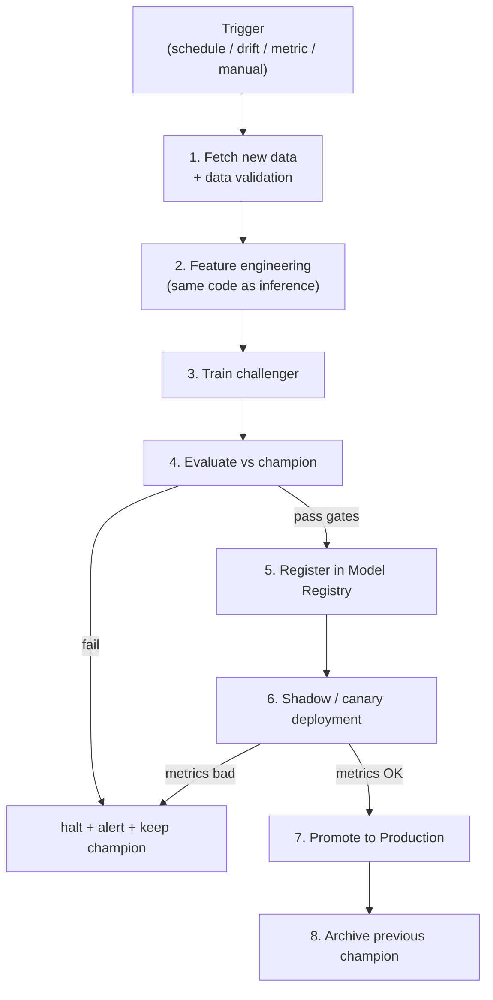

再学習パイプライン（retraining pipeline）は、本番のモデルを新しいデータで学習し直し、評価してからデプロイするまでを自動化する仕組みです。入力データの分布や入力と正解の関係は時間とともに変わるので（[データドリフト](../data-drift/)）、一度学習したモデルの精度は少しずつ落ちていきます。

[実験管理](../experiment-tracking/)で新モデルの学習結果を記録し、[モデルレジストリ](../model-registry/)でバージョンを管理します。[推論サービング](../inference-serving/)でデプロイした後は、[モデル性能劣化の監視](../model-performance-monitoring/)で次の再学習のタイミングを判断します。再学習パイプラインは、これらの工程をつなぎます。

<br>

本記事では、次の疑問を順に扱います。

- 何をきっかけに再学習を始めるか
- 再学習しないと、精度はどれくらい落ちるか。再学習に使うデータの範囲で結果は変わるか
- 再学習の間隔は、何を見積もれば決められるか
- 新しいモデルを本番へ出す前に、何を確認するか

---

### 再学習パイプラインの全体像

以下は、再学習パイプラインの工程の例です。本番で使っているモデルを champion、比較する新しいモデルを challenger と呼びます。



工程ごとに、テストする項目と、失敗した時に戻す状態を決めます。学習が終わったら即デプロイするのではなく、評価ゲートを順に通過してから本番へ反映します。どの段階で失敗しても、champion は動き続けます。

---

### トリガー

再学習を始めるきっかけ（トリガー）は、4 つのパターンに分けられます。SLO（Service Level Objective）は、精度などについて運用側が決めた目標値です。


- title: 定期実行（scheduled）
  body: 毎日 / 毎週 / 毎月
  items:
  - 強み：予測可能で計画しやすい
  - 弱み：ドリフトに反応できない
- title: ドリフト検知（drift-based）
  body: 入力分布の変化が閾値を超える
  items:
  - 強み：変化に追従できる
  - 弱み：誤検知で不要な再学習が起きる
- title: 性能低下（performance-based）
  body: 精度指標が SLO を割る
  items:
  - 強み：実害から逆算できる
  - 弱み：性能が落ちてからの対応になる
- title: 手動・イベント（manual）
  body: 大型リリース、規制変更
  items:
  - 強み：人が起動を判断できる
  - 弱み：人手の判断はスケールしない


実運用では、複数のトリガーを OR 条件で組み合わせます。例えば「毎月 1 回は必ず再学習し、ドリフトを検知したら即時、精度が SLO を割ったら緊急で再学習する」といった組み方です。

---

### 再学習しないと何が起きるか

ドリフトがあるシステムで、再学習しない場合と、30 日ごとに再学習する場合を比べます。再学習するデータは、過去の全期間を使う方法と、直近 30 日だけを使う方法の 2 つを試します。

データは 2 次元の点で、正解ラベルは「境界線のどちら側にあるか」で決まります。この境界線を 1 日に 0.2 度ずつ回し、入力と正解の関係が少しずつ変わる状況（concept drift）を作ります。ラベルの 5% はわざと誤りにしています。モデルは scikit-learn の [LogisticRegression](https://scikit-learn.org/stable/modules/generated/sklearn.linear_model.LogisticRegression.html) です。

```python
import numpy as np
from sklearn.linear_model import LogisticRegression

rng = np.random.default_rng(0)
DAYS, N_PER_DAY, NOISE = 365, 500, 0.05
DEG_PER_DAY = 0.2  # 正解の境界が 1 日に 0.2 度ずつ回る

def make_day(day):
    x = rng.normal(size=(N_PER_DAY, 2))
    theta = np.deg2rad(DEG_PER_DAY * day)
    w = np.array([np.cos(theta), np.sin(theta)])
    y = (x @ w > 0).astype(int)
    flip = rng.random(N_PER_DAY) < NOISE  # ラベルの 5% は誤り
    y[flip] = 1 - y[flip]
    return x, y

data = [make_day(d) for d in range(DAYS)]

def fit(days):
    x = np.vstack([data[d][0] for d in days])
    y = np.concatenate([data[d][1] for d in days])
    return LogisticRegression().fit(x, y)

def run(policy):
    model = fit(range(30))  # 最初の 30 日分で学習し、30 日目から本番で使う
    acc = []
    for day in range(30, DAYS):
        if policy != "none" and day % 30 == 0 and day > 30:
            past = range(day) if policy == "all" else range(day - 30, day)
            model = fit(past)
        x, y = data[day]
        acc.append(model.score(x, y))
    return np.array(acc)

results = {p: run(p) for p in ["none", "all", "window"]}
for policy, acc in results.items():
    print(f"{policy:6s} 平均 {acc.mean():.3f}  最後の 30 日 {acc[-30:].mean():.3f}"
          f"  0.85 未満の日数 {np.sum(acc < 0.85)}")
print("再学習なしの 1 日あたりの傾き:",
      round(np.polyfit(np.arange(30, DAYS), results["none"], 1)[0], 5))
```

以下が実行結果です。none は再学習なし、all は全期間、window は直近 30 日で再学習した結果です。

```text
none   平均 0.772  最後の 30 日 0.624  0.85 未満の日数 245
all    平均 0.845  最後の 30 日 0.770  0.85 未満の日数 174
window 平均 0.921  最後の 30 日 0.919  0.85 未満の日数 0
再学習なしの 1 日あたりの傾き: -0.00099
```



上記の図の灰色が再学習なし、橙が全期間、青が直近 30 日で再学習した場合の accuracy です。黒い破線を SLO の 0.85 としています。再学習なしの accuracy は 1 日に約 0.001 ずつ下がり、最後の 30 日の平均は 0.624 でした。

橙の線は、30 日ごとに再学習しているのに accuracy が下がり続けています。全期間のデータには古い境界で付けたラベルが大量に残っているので、学習した境界が実際の境界に追い付きません。再学習の頻度だけでなく、学習に使うデータの範囲も決める必要があります。

図は [retraining-pipeline_gen.py](https://github.com/nao1215/debimate/blob/main/projects/ml/scripts/notes/retraining-pipeline_gen.py) で描いています。

---

### 再学習の間隔

再学習の間隔を短くするほど再学習のコストが増え、長くするほど古いモデルの誤予測による損失が増えます。この 2 つの合計が最小になる間隔を探します。

前節の実験では、再学習なしの accuracy が 1 日に約 0.001 ずつ下がりました。この低下率を r とすると、間隔 T 日の 1 周期で accuracy は平均 r × T / 2 だけ下がります。以下のコードの金額と件数は、説明用に置いた値です。

```python
import numpy as np

C = 2_000   # 再学習 1 回のコスト（計算資源と確認の人件費、ドル）
N = 10_000  # 1 日の予測件数
L = 5       # 予測を 1 件誤った時の損失（ドル）
r = 0.001   # 再学習から 1 日経つごとに下がる accuracy（前節の実験）

def monthly_cost(T, C=C):
    retrain = 30 * C / T            # 30 日で 30 / T 回の再学習
    stale = 30 * N * L * r * T / 2  # 周期内の accuracy 低下は平均 r * T / 2
    return retrain, stale

T = np.arange(1, 91)
retrain, stale = monthly_cost(T)
total = retrain + stale
for t in [1, 7, 9, 30, 90]:
    print(f"T={t:2d}: 再学習 {retrain[t-1]:7,.0f} + 誤予測 {stale[t-1]:7,.0f} = {total[t-1]:7,.0f}")
print("最小:", T[np.argmin(total)], "日, 式:", round(np.sqrt(2 * C / (N * L * r)), 1), "日")
print("C を 4 倍:", T[np.argmin(sum(monthly_cost(T, C=4 * C)))], "日")
```

```text
T= 1: 再学習  60,000 + 誤予測     750 =  60,750
T= 7: 再学習   8,571 + 誤予測   5,250 =  13,821
T= 9: 再学習   6,667 + 誤予測   6,750 =  13,417
T=30: 再学習   2,000 + 誤予測  22,500 =  24,500
T=90: 再学習     667 + 誤予測  67,500 =  68,167
最小: 9 日, 式: 8.9 日
C を 4 倍: 18 日
```



上記の図の青が再学習のコスト、橙が誤予測の損失、黒が合計です。合計は 9 日で最小になり、合計を T で[微分して 0 と置いた](/ml/math/convex-functions/)式 T = √(2C / (N × L × r)) の 8.9 日と一致します。この式は、在庫管理の[経済的発注量（EOQ）](https://en.wikipedia.org/wiki/Economic_order_quantity)と同じ形です。

最適な間隔はコストの平方根でしか動かないので、再学習 1 回のコストが 4 倍になっても最適な間隔は 2 倍（18 日）です。また、最小付近の谷は平らで、週次（7 日）でも合計は 9 日の 3% 増しに収まります。次の 3 つを桁が合う程度に見積もれば、運用しやすい週次や月次に寄せて決められます。

- 再学習 1 回のコスト（C）：計算資源と、結果を確認する人の時間
- 予測を 1 件誤った時の損失（L）と、1 日の予測件数（N）
- 再学習から 1 日経つごとの精度低下（r）：過去のデータで、古いモデルを後の期間に当てて測る

---

### 評価ゲート

学習が終わった challenger は、以下のような評価ゲートを順に通過させてから本番へ上げます。


- title: スキーマ確認（schema check）
  body: 入出力のカラムと型を確認。不一致なら即停止し、データチームに通知。
- title: 動作確認（smoke test）
  body: 100 件のサンプル予測を実行。失敗したら学習コードを調べる。
- title: 検証データでの評価（holdout eval）
  body: 学習に使っていないデータで、精度が champion 以上かを確認。未達なら学習データ・特徴量を見直す。
- title: Shadow test
  body: 本番の入力を複製して challenger にも流し、2 日間は予測を記録するだけにする。推論時の不整合を検出。
- title: Canary 5%
  body: 本番のリクエストの 5% だけを challenger で処理。監視指標に異常があれば停止。
- title: Canary 50%
  body: 段階的に拡大。同様に監視し、異常があれば停止。
- title: 100% rollout
  body: 全展開。champion を fallback として残し、ロールバックできるようにする。


前半の 3 つは本番の外で、後半の 4 つは本番のリクエストを使って確認します。

---

### Airflow での実装例

再学習の各工程は、[Apache Airflow](https://airflow.apache.org/)、[Prefect](https://www.prefect.io/)、[Dagster](https://dagster.io/) などのワークフローエンジンで順に実行するのが典型です。以下は Airflow 3.4 で、毎週月曜 2:00 に 6 つのタスクを順に実行する DAG（Directed Acyclic Graph、タスクの依存関係）の例です。各タスクの中身は省略し、タスク名を表示するだけにしています。

```python
from datetime import datetime

from airflow.providers.standard.operators.python import PythonOperator
from airflow.sdk import DAG

def step(name):
    print(f"run {name}")  # 実際はデータ取得・学習・評価などを呼ぶ

with DAG(
    "weekly_retrain",
    start_date=datetime(2026, 1, 1),
    schedule="0 2 * * 1",  # 毎週月曜 2:00（UTC）
    catchup=False,
) as dag:
    tasks = [
        PythonOperator(task_id=name, python_callable=step, op_args=[name])
        for name in ["fetch_data", "validate_data", "train",
                     "evaluate", "register", "canary_deploy"]
    ]
    for upstream, downstream in zip(tasks, tasks[1:]):
        upstream >> downstream
```

`airflow dags test weekly_retrain` で実行すると、`run fetch_data` から `run canary_deploy` まで順に表示され、success で終わりました。Airflow 2 系の記事でよく見る `schedule_interval` は Airflow 3 では受け付けられず、`TypeError` になります。

各タスクは[冪等](/notes/distributed-systems/idempotency/)（idempotent、何回実行しても結果が同じ）にし、失敗したタスクを再実行してもデータが二重に登録されないようにします。

---

### Feature store との連携

再学習では、学習時と推論時で特徴量の作り方を一致させる必要があります。同じ生データから特徴量を作っているはずなのに、わずかな実装差で学習時と推論時の特徴量がずれることがあります（training-serving skew。[データリーク](../../ml/data-leakage/)の派生問題）。

Feature store（[Feast](https://feast.dev/)、[Vertex AI Feature Store](https://cloud.google.com/vertex-ai/docs/featurestore/latest/overview) など）は、1 箇所で定義した特徴量を学習用のオフラインストア（BigQuery など）と推論用のオンラインストア（Redis など）の両方へ届けてくれます。計算式のずれは起きにくくなりますが、オンラインストアの更新遅れや、学習データに未来の値を混ぜる誤りまでは防げません。

---

### 数学での使いどころ

- 再学習の間隔の最適化：本記事の √(2C / (N × L × r)) は、経済的発注量と同じコストの釣り合いの式
- 統計的変化検出：[CUSUM](https://en.wikipedia.org/wiki/CUSUM) などの変化点検出で、再学習が必要かを判定
- ベイズ更新：過去の再学習結果を事前分布として、次回の改善幅を予測（[ベイズの定理](../../math/bayes-theorem/)）

---

### 機械学習での使いどころ

- レコメンドモデルの定期更新（毎日 / 毎週、ユーザーの嗜好の変化に追従）
- 不正検知の頻繁な再学習（攻撃パターンが日々変わるので毎日〜毎時）
- 需要予測（季節性・トレンドを取り込むため週次 / 月次）
- イベント発生時の緊急再学習（感染症の流行、規制改定などで前提が変わった時）

ワークフローエンジンには、前述の 3 つに加えて [Argo Workflows](https://argoproj.github.io/workflows/) があります。小規模なら cron とシェルスクリプトでも足ります。

マネージドサービスでは、[Vertex AI Pipelines](https://cloud.google.com/vertex-ai/docs/pipelines/introduction)、[SageMaker Pipelines](https://aws.amazon.com/sagemaker/pipelines/)、Databricks の [Lakeflow Jobs](https://docs.databricks.com/aws/en/jobs/)（旧 Workflows）、[Azure Machine Learning のパイプライン](https://learn.microsoft.com/en-us/azure/machine-learning/concept-ml-pipelines)が使えます。

---

### 適さないケース / 落とし穴

- 再学習しても精度が上がらない：ドリフトの原因が特徴量に表れない（規制変更、UI 変更）ケース。モデル更新では解決せず、特徴量設計から見直す
- 全期間のデータで学習し続ける：実験の all のように、ドリフト後のデータの比重が薄くなる。直近 N か月だけを使う sliding window を検討する
- 正解データの遅れを見落とす：不正検知のように正解が数週間後に確定するデータでは、直近のデータはラベルが揃っていない。データの鮮度（freshness）を別の指標として監視する
- 上流のスキーマ変更で落ちる：上流のテーブルにカラムが追加されただけでパイプラインが落ちる。必要なカラムを名前で選んで読み、スキーマ確認で差分を検出する
- champion を急いで削除する：問題が見つかった時にロールバックできない。fallback として N 世代は残す
- 再学習さえすれば良くなると考える：再学習は精度を維持する手段で、モデルの改善は別の取り組み（[特徴量選択](../../ml/feature-selection/)、新しいアルゴリズム、[ハイパーパラメータ](../../ml/hyperparameter/)探索）になる
